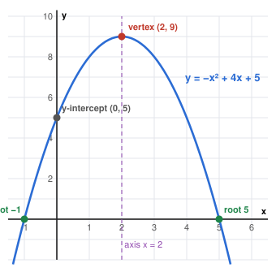

## 8. Graphs of quadratics

This skill covers the shape of y = ax² + bx + c (a parabola): which way it opens, its vertex, axis of symmetry and intercepts, and how to use the vertex to find a maximum or minimum. That is how you find maximum profit or minimum average cost without calculus.

### The shape of a parabola

The graph of any quadratic y = ax² + bx + c is a U-shaped curve called a **parabola**.

- **a > 0**: opens upward (a valley), so it has a **minimum**.
- **a < 0**: opens downward (a hill), so it has a **maximum**.
- The bigger the size of a, the narrower the curve.



Key features to find:

| Feature | How to find it | In the picture |
|---|---|---|
| y-intercept | set x = 0: it is c | (0, 5) |
| roots (x-intercepts) | solve ax² + bx + c = 0 | x = −1 and x = 5 |
| axis of symmetry | x = −b/(2a) | x = 2 |
| vertex | x = −b/(2a), then put it in | (2, 9) |

### Finding the vertex

**Formula method:** the vertex is at x = −b/(2a). Substitute to get y.

```
y = -x² + 4x + 5:   a = -1, b = 4
x = -4/(2 × -1) = 2
y = -(2)² + 4(2) + 5 = -4 + 8 + 5 = 9
vertex (2, 9), a maximum because a < 0
```

**Completing the square:** write y = a(x − h)² + k. Then the vertex is (h, k).

```
y = x² - 6x + 11
  = (x - 3)² - 9 + 11
  = (x - 3)² + 2          vertex (3, 2), a minimum
```

This **vertex form** also shows the minimum value at once: (x − 3)² is never negative, so y is never below 2.

The roots are symmetric about the axis: halfway between −1 and 5 is 2. If you know the roots, the vertex is at their midpoint.

### Sketching a parabola

1. Look at a: up or down?
2. Plot the y-intercept (0, c).
3. Find the vertex.
4. Find the roots if there are any (the discriminant says how many).
5. Draw a smooth, symmetric U through the points.

Example: y = x² − 4x + 3. Opens up; y-intercept 3; vertex x = 2, y = 4 − 8 + 3 = −1; roots (x − 1)(x − 3) = 0 so x = 1 and 3. A valley with its bottom at (2, −1), crossing the x-axis at 1 and 3.

### Economics: maximum revenue and profit

Demand P = 60 − 2Q gives revenue R = P × Q = 60Q − 2Q². That is a downward parabola, so it has a maximum:

```
Q = -b/(2a) = -60/(2 × -2) = 15
R = 60(15) - 2(15)² = 900 - 450 = 450
maximum revenue 450 at Q = 15 (price 60 - 30 = 30)
```

Profit π(q) = −q² + 20q − 64 from the last skill: vertex at q = −20/(−2) = 10, π = −100 + 200 − 64 = 36. **Maximum profit 36 (thousand) at 10,000 units**, exactly halfway between the break-even points 4 and 16.

In calculus you will find the same answer by setting the derivative to zero. For quadratics the vertex formula gets there directly.

### Practice

1. Does y = 3x² − x + 2 have a maximum or a minimum?
2. Find the vertex of y = x² + 8x + 10.
3. Find the vertex of y = −2x² + 12x − 7. Is it a maximum or minimum?
4. Write y = x² − 10x + 30 in vertex form and give its minimum value.
5. Find the roots, y-intercept and vertex of y = x² − 2x − 8.
6. A parabola has roots 1 and 9. What is the x value of its vertex?
7. Demand is P = 100 − 4Q. Find the quantity and price that maximise revenue.
8. Profit is π(q) = −3q² + 36q − 60. Find the profit-maximising output and the maximum profit.
9. Average cost is AC(q) = q² − 12q + 50. At what output is average cost lowest, and what is it?

**Answers.** 1: Minimum (a = 3 > 0). 2: x = −4, y = 16 − 32 + 10 = −6: (−4, −6). 3: x = 3, y = −18 + 36 − 7 = 11: (3, 11), a maximum. 4: (x − 5)² + 5; minimum 5. 5: (x − 4)(x + 2): roots 4 and −2; y-intercept −8; vertex (1, −9). 6: x = 5. 7: R = 100Q − 4Q², Q = 12.5, P = 50, R = 625. 8: q = 6, π = −108 + 216 − 60 = 48. 9: q = 6, AC = 36 − 72 + 50 = 14.
