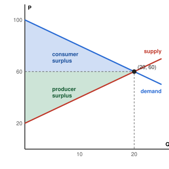

## 11. Integrals in economics

This skill uses definite integrals for the classic economics applications: consumer and producer surplus, totals from marginal functions, and the present value of a stream of income.

### Consumer surplus

The demand curve shows the most each buyer is willing to pay. Buyers who would have paid more than the market price gain the difference. Adding that gain over all buyers gives **consumer surplus** (CS): the area between the demand curve and the price line.



```
CS = ∫ from 0 to Q* of D(Q) dQ
     - P* Q*
```

where D(Q) is the inverse demand function and (Q*, P*) the market point.

With demand P = 100 − 2Q and price 60 (so Q* = 20):

```
∫ from 0 to 20 of (100 - 2Q) dQ
= [100Q - Q²] from 0 to 20
= 2000 - 400 = 1600
CS = 1600 - 60 × 20 = 400
```

For a straight demand line, the area is a triangle, so you can check: ½ × 20 × (100 − 60) = 400 ✓. The integral is needed when demand is curved.

### Producer surplus

Sellers would have accepted any price down to the supply curve. **Producer surplus** (PS) is the area between the price line and the supply curve S(Q):

```
PS = P* Q* - ∫ from 0 to Q* of S(Q) dQ
```

With supply P = 20 + 2Q:

```
∫ from 0 to 20 of (20 + 2Q) dQ
= [20Q + Q²] from 0 to 20 = 800
PS = 1200 - 800 = 400
```

**Total surplus** = CS + PS = 800. A tax or price ceiling shrinks it; the lost part is the **deadweight loss**, computed as another area.

### Curved demand

With demand P = 50/√Q (so P = 50Q^(−1/2)) at Q* = 25, the price is 50/5 = 10.

```
∫ from 0 to 25 of 50Q^(-1/2) dQ
= [100 Q^(1/2)] from 0 to 25
= 500
CS = 500 - 10 × 25 = 250
```

No triangle formula would give this.

### Present value of a stream

Money received later is worth less today. With continuous discounting at rate r, a payment received at time t is worth e^(−rt) times as much today. A stream paying f(t) per year from t = 0 to T has **present value**:

```
PV = ∫ from 0 to T of f(t) e^(-rt) dt
```

For a constant stream of A per year:

```
PV = ∫ from 0 to T of A e^(-rt) dt
   = (A/r)(1 - e^(-rT))
```

Example: 10,000 a year for 5 years at r = 5%:

```
PV = (10000/0.05)(1 - e^(-0.25))
   = 200000 × 0.2212
   ≈ 44,240
```

As T grows without limit, e^(−rT) → 0 and PV → A/r: a perpetuity of 10,000 at 5% is worth 200,000.

### Practice

1. Demand P = 80 − 4Q, market price 40. Find Q* and the consumer surplus (by integral, then check with the triangle).
2. Supply P = 10 + Q, market price 30. Find Q* and the producer surplus.
3. Demand P = 120 − 3Q and supply P = 20 + 2Q. Find the equilibrium, CS and PS.
4. Demand P = 40/√Q. Find the consumer surplus when Q = 16.
5. MC = 2q + 10. Find the extra cost of raising output from 10 to 30 units.
6. Find the present value of 5,000 a year for 10 years at r = 4% (continuous).
7. What is a perpetuity of 3,000 a year worth at r = 6%?

**Answers.** 1: Q* = 10; [80Q − 2Q²] = 600, CS = 600 − 400 = 200; triangle ½ × 10 × 40 = 200 ✓. 2: Q* = 20; PS = 600 − [10Q + Q²/2] = 600 − 400 = 200. 3: 120 − 3Q = 20 + 2Q, Q = 20, P = 60; CS = ½ × 20 × 60 = 600; PS = ½ × 20 × 40 = 400. 4: P = 10; [80√Q] from 0 to 16 = 320; CS = 320 − 160 = 160. 5: [q² + 10q] from 10 to 30 = 1200 − 200 = 1000. 6: (5000/0.04)(1 − e^(−0.4)) = 125000 × 0.3297 ≈ 41,210. 7: 3000/0.06 = 50,000.
