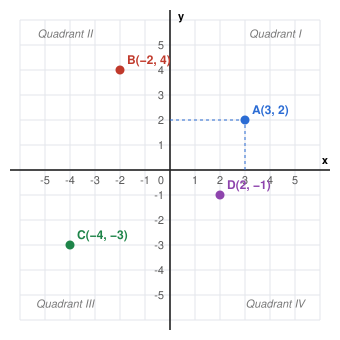

## 11. The coordinate plane

This skill covers how points are placed on a grid with two numbers, how to read them, and how to find the distance and midpoint between two points. Every graph in economics (supply and demand, cost curves, growth over time) lives on this grid.

### Axes and coordinates

Two number lines cross at right angles at the **origin**, (0, 0). The horizontal one is the **x-axis**, the vertical one the **y-axis**. A point is written as an **ordered pair (x, y)**:

- x first: how far **across** (right is positive, left negative);
- y second: how far **up** (up is positive, down negative).

Memory aid: "along the corridor, then up the stairs".



To plot A(3, 2): start at the origin, go 3 right, then 2 up. To plot C(−4, −3): 4 left, then 3 down.

(3, 2) and (2, 3) are different points. Order matters.

### Quadrants and the axes

The axes split the plane into four **quadrants**, numbered anticlockwise from the top right:

| Quadrant | Signs | Example |
|---|---|---|
| I (top right) | x positive, y positive | (3, 2) |
| II (top left) | x negative, y positive | (−2, 4) |
| III (bottom left) | x negative, y negative | (−4, −3) |
| IV (bottom right) | x positive, y negative | (2, −1) |

Points **on** an axis belong to no quadrant. Every point on the x-axis has y = 0, like (5, 0). Every point on the y-axis has x = 0, like (0, −2).

Most economics graphs only use quadrant I, because price and quantity cannot be negative. By convention, economists put **quantity on the x-axis and price on the y-axis**, even though price is usually the cause. Expect that.

### Distance and midpoint

The **midpoint** of two points is the average of the x values and the average of the y values:

```
midpoint of (2, 3) and (8, 7) = ((2 + 8)/2, (3 + 7)/2) = (5, 5)
```

The **distance** between two points comes from Pythagoras (a² + b² = c² in a right-angled triangle). Go across, go up, and the straight line is the long side:

```
distance = √((x₂ - x₁)² + (y₂ - y₁)²)

from (1, 2) to (4, 6):
across = 4 - 1 = 3,  up = 6 - 2 = 4
distance = √(9 + 16) = √25 = 5
```

Horizontal or vertical distances are simpler: from (−3, 2) to (5, 2) is 5 − (−3) = 8.

### Plotting a relationship from a table

A rule like y = 2x + 1 gives a y for every x. Make a table, then plot the points:

| x | −1 | 0 | 1 | 2 | 3 |
|---|---|---|---|---|---|
| y = 2x + 1 | −1 | 1 | 3 | 5 | 7 |

The points (−1, −1), (0, 1), (1, 3), (2, 5), (3, 7) lie on a straight line. That line is the **graph** of the rule: every point on it satisfies the equation, and every point that satisfies the equation is on it. The next skill is all about such lines.

### Practice

1. Which quadrant is (−5, 2) in? And (4, −4)?
2. A point is 3 left of the origin and 6 down. Write its coordinates.
3. Where does every point with x = 0 lie?
4. Find the midpoint of (−2, 5) and (6, 1).
5. Find the distance from (2, 1) to (8, 9).
6. Find the distance from (−1, −4) to (−1, 3).
7. Complete the table for y = 3 − x at x = −2, 0, 2, 4.
8. Does the point (2, 7) lie on y = 2x + 3?
9. In an economics graph, a point is at (Q, P) = (40, 12). What are the quantity and price?

**Answers.** 1: II; IV. 2: (−3, −6). 3: On the y-axis. 4: (2, 3). 5: √(36 + 64) = √100 = 10. 6: 7. 7: 5, 3, 1, −1. 8: 2(2) + 3 = 7, yes. 9: Quantity 40, price 12.
