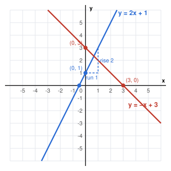

## 12. Straight-line graphs

This skill covers the equation of a straight line, y = mx + c: what the slope and intercept mean, how to draw a line, how to find its equation, and where two lines meet. Linear supply, demand, cost and consumption functions are all of this form.

### y = mx + c: slope and intercept

Every straight line (except a vertical one) can be written as **y = mx + c**.

- **m is the slope** (gradient): how much y changes when x goes up by 1. Positive m slopes up to the right, negative m slopes down, m = 0 is flat.
- **c is the y-intercept**: where the line crosses the y-axis (the value of y when x = 0).



For y = 2x + 1: each step of 1 to the right goes 2 up, and it crosses the y-axis at (0, 1). For y = −x + 3: each step right goes 1 down, crossing at (0, 3).

Americans write y = mx + b; economists often write y = a + bx. Same thing, different letters. In C = 50 + 0.8Y (consumption), 50 is the intercept and 0.8 the slope: the **marginal propensity to consume**.

### Slope from two points

Slope = rise ÷ run = change in y ÷ change in x.

```
m = (y₂ - y₁) / (x₂ - x₁)

through (1, 3) and (4, 9):   m = (9 - 3)/(4 - 1) = 6/3 = 2
through (-2, 5) and (2, -3): m = (-3 - 5)/(2 - (-2)) = -8/4 = -2
```

Keep the same point first on top and bottom. Special cases: a horizontal line y = 4 has slope 0; a vertical line x = 3 has an undefined slope (division by zero) and cannot be written as y = mx + c.

Parallel lines have the **same slope**.

### Drawing a line and finding its equation

**To draw y = mx + c:** plot the intercept (0, c), then use the slope to step to a second point, and join them. Or find where it crosses both axes: for 2x + 3y = 12, x = 0 gives y = 4 and y = 0 gives x = 6, so join (0, 4) and (6, 0).

**To find the equation** through two points:

```
through (2, 5) and (4, 11):
m = (11 - 5)/(4 - 2) = 3
y = 3x + c;  put in (2, 5):  5 = 6 + c,  c = -1
y = 3x - 1
```

**To read a line in another form**, rearrange it to y = ...: 2x + 3y = 12 becomes 3y = −2x + 12, so y = −(2/3)x + 4. Slope −2/3, intercept 4.

### Where two lines meet

Two lines cross where their x and y are both equal. Set the two right-hand sides equal and solve.

Demand: P = 100 − 2Q. Supply: P = 20 + 2Q. The market **equilibrium** is where they meet:

```
100 - 2Q = 20 + 2Q
80 = 4Q
Q = 20
P = 100 - 2(20) = 60       check: 20 + 2(20) = 60 ✓
equilibrium: Q = 20, P = 60
```

Solving two equations together like this is called a **system of equations**. The Algebra & Matrices track goes much further with it.

### Practice

1. Give the slope and intercept of y = −4x + 7.
2. Give the slope and intercept of 3x + y = 10.
3. Find the slope through (0, 2) and (3, 14).
4. Find the slope through (−1, 4) and (3, −4).
5. Find the equation of the line with slope 5 through (1, 2).
6. Find the equation of the line through (2, 3) and (6, 11).
7. Where does 4x + 2y = 8 cross the x-axis and the y-axis?
8. Are y = 3x + 1 and 6x − 2y = 5 parallel?
9. Find where y = 2x + 1 and y = −x + 7 meet.
10. Demand is P = 50 − Q, supply is P = 10 + Q. Find the equilibrium.

**Answers.** 1: −4; 7. 2: y = −3x + 10: −3; 10. 3: 4. 4: −2. 5: y = 5x − 3. 6: m = 2, y = 2x − 1. 7: (2, 0) and (0, 4). 8: Yes: the second is y = 3x − 2.5, slope 3. 9: 3x = 6, x = 2, y = 5: (2, 5). 10: Q = 20, P = 30.
