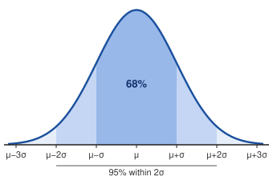

## 7. The normal distribution

This skill covers the normal distribution: its bell shape, the 68-95-99.7 rule, standardising with z-scores and reading probabilities from the standard normal table. It is the most used distribution in statistics and econometrics.

### Continuous distributions

Income, height and returns can take any value in a range, so we cannot list the probability of each value. Instead a **density curve** describes them: the probability of a range is the **area under the curve** over that range, and the total area is 1.

### The normal curve

The **normal distribution** X ~ N(μ, σ²) is symmetric and bell-shaped, centred at its mean μ, with spread set by its standard deviation σ.



The **68-95-99.7 rule**:

| Range | Share of values |
|---|---|
| μ ± 1σ | about 68% |
| μ ± 2σ | about 95% |
| μ ± 3σ | about 99.7% |

IQ scores are roughly N(100, 15²): about 95% of people score between 70 and 130.

### Standardising

Every normal distribution becomes the **standard normal** Z ~ N(0, 1) by turning values into z-scores:

```
z = (x - μ)/σ
```

Then one table serves every normal distribution. The table gives Φ(z) = P(Z ≤ z), the area to the left of z:

| z | P(Z ≤ z) |
|---|---|
| 0 | 0.500 |
| 0.5 | 0.691 |
| 1 | 0.841 |
| 1.28 | 0.900 |
| 1.5 | 0.933 |
| 1.645 | 0.950 |
| 1.96 | 0.975 |
| 2 | 0.977 |
| 2.576 | 0.995 |

By symmetry, P(Z ≤ −z) = 1 − P(Z ≤ z).

### Finding probabilities

Monthly sales are N(500, 40²). Find P(sales > 560).

```
z = (560 - 500)/40 = 1.5
P(Z > 1.5) = 1 - 0.933 = 0.067
```

Find P(460 < sales < 580):

```
z₁ = (460 - 500)/40 = -1
z₂ = (580 - 500)/40 = 2
P = 0.977 - (1 - 0.841)
  = 0.977 - 0.159 = 0.818
```

Always sketch the curve and shade the area you want: it prevents most sign errors.

### Working backwards

Which value cuts off the top 10%? From the table, P(Z ≤ 1.28) = 0.90, so z = 1.28:

```
x = μ + zσ = 500 + 1.28 × 40
  ≈ 551
```

The z-values 1.645, 1.96 and 2.576 are worth remembering: they leave 5%, 2.5% and 0.5% in one tail. They are used for 90%, 95% and 99% confidence intervals.

### Is it really normal?

Many economic variables are not normal. Income is right-skewed (its logarithm is closer to normal, which is one reason economists use log income). Financial returns have "fat tails": crashes happen far more often than a normal model predicts. Use the normal where it fits, and check.

### Practice

Use the table above.

1. X ~ N(50, 10²). Find P(X < 60).
2. X ~ N(50, 10²). Find P(X > 30).
3. Heights are N(170, 8²) cm. What share of people are between 162 and 178 cm?
4. Exam marks are N(65, 12²). Find P(mark > 89).
5. Returns are N(8%, 5²). Find P(return < 0).
6. In question 4, which mark cuts off the top 5%?
7. Weekly demand is N(1,000, 150²). How much stock is needed so that demand exceeds stock only 2.5% of the time?

**Answers.** 1: z = 1, 0.841. 2: z = −2, 0.977. 3: z from −1 to 1: about 0.68 (0.841 − 0.159 = 0.682). 4: z = 2, 1 − 0.977 = 0.023. 5: z = −1.6; P(Z ≤ 1.6) ≈ 0.945, so about 0.055 (between the table's 0.067 at 1.5 and 0.050 at 1.645). 6: 65 + 1.645 × 12 ≈ 84.7. 7: 1000 + 1.96 × 150 = 1,294.
