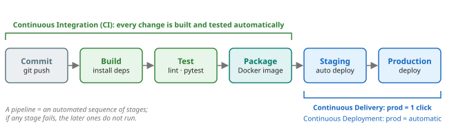
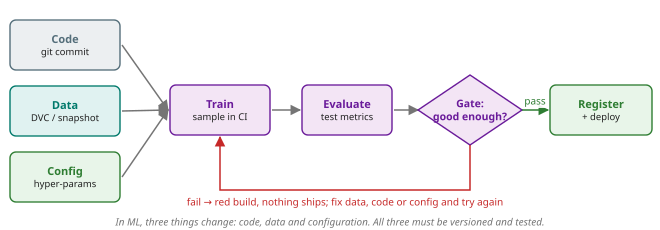
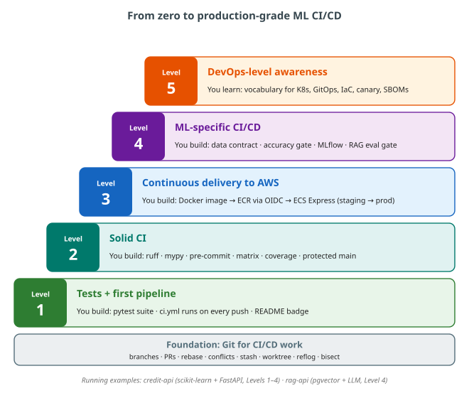

## 1. What CI/CD is

*Chapter 1: Introduction.* Before we write a single YAML file, we need a clear picture of what CI/CD is, which problem it solves, and why machine learning makes it more interesting than in ordinary software.

**After this level you can:**

- Explain CI, continuous delivery and continuous deployment in your own words, and say how they differ.
- Describe what a pipeline is and why it fails fast.
- Name the three things that change in an ML system (code, data, configuration) and why evaluation becomes a quality gate.
- Know which tool in this book does what, and in which level you will meet it.

### A tale of two teams

Imagine two small ML teams in Berlin. Both have four engineers, both
serve a credit-risk model behind an HTTP API, and both deploy on a
Friday.

**Team A has no CI/CD.** Lena finishes a feature on Thursday: a new input
field `age`. Her tests pass on her laptop, so she copies the model file
to the server, restarts the service and goes home. On Friday morning
Jonas merges his own change, which was written against last week's
code. He never ran Lena's tests, and Lena never ran his. The service
starts, but every request with `age` crashes with a `KeyError`.
Nobody notices until a customer calls. Rolling back means finding the
"old" model file somewhere on a laptop. The team loses a day, and
next time everyone is afraid to deploy, so they deploy less often, so
each deployment contains more changes, so each one is riskier. This
vicious circle is the normal state of teams without automation.

**Team B has CI/CD.** Lena opens a pull request. Within four minutes a
robot (the CI server) installs the project from scratch on a clean
machine, runs the linters, the unit tests and a small training run, and
checks that the model's accuracy has not dropped. A red cross appears
next to Jonas's PR, because it conflicts with Lena's change. He
updates his branch and the cross turns green. After a review, the merge
to `main` automatically builds a Docker image, deploys it to a staging
environment, runs a smoke test, and waits for one click to go to
production. When something does go wrong, a "rollback" button
redeploys the previous image in two minutes.

Team B is not smarter than team A. It has simply moved the boring,
error-prone steps from human memory into code that runs the same way
every time. That code is what this book teaches you to write.

### The vocabulary

**Concept: Continuous Integration (CI)**

Every change is merged into the shared main branch often (at least
daily) and every merge is **automatically built and tested**. The goal is
to find integration problems minutes after they are created, while the
author still remembers the code. German: *kontinuierliche
Integration*.

**Concept: Continuous Delivery (CD)**

Every change that passes CI is automatically turned into a **release
candidate** (for us: a Docker image) and deployed to a test environment.
Going to production is a **business decision**, taken with one click.
German: *kontinuierliche Bereitstellung* (Bereitstellung = deployment).

**Concept: Continuous Deployment**

Like continuous delivery, but without the click: every green change
goes to production automatically. This needs very good tests and
monitoring. Many teams, and most ML teams, stop at continuous delivery
with a manual approval for production.

A **pipeline** is the automated sequence of stages that a change travels
through (Figure 1). Each stage only runs if the previous one succeeded;
that is called **failing fast**. A failing linter stops the pipeline after
20 seconds instead of after a 15-minute training run. A pipeline is
described as code (YAML files in the repository), so it is versioned,
reviewed and reproducible, exactly like the application itself.

#### Worked example: one change, minute by minute

Abstract definitions only go so far, so here is a single change
travelling through the pipeline you will have built by the end of
Level 4. Lena adds a rule: applicants under 18 are rejected with HTTP
422. She opens a pull request at 10:00.

| Time | What runs | If it fails here, it means… |
|---|---|---|
| 10:00 | PR opened → GitHub starts the `CI` workflow on a fresh Ubuntu VM. | – |
| 10:00:40 | `lint`: ruff, format check, mypy (≈ 20 s after install). | Style or type error. Cheapest possible failure: nothing else ran, nothing was paid for. |
| 10:01:30 | `test (3.12)` and `test (3.13)` in parallel, with coverage. | Logic bug, or it only works on one Python version. |
| 10:02:30 | `model-gate`: validate data, train, compare metrics with the baseline. | The code is "correct" but the model got worse, or the data contract broke. |
| 10:03 | All green. A colleague reviews; Lena fixes one comment; CI runs again (the old run is **cancelled**). | – |
| 10:40 | Squash-merge into `main` → `Deploy` workflow starts. | – |
| 10:44 | Image built, tagged `:3f2a1c0…`, pushed to ECR. | Docker build broken (missing file, wrong base image). |
| 10:47 | Staging updated; smoke test calls `/health` and one `/predict`. | Config only production-like environments have: a missing env var, wrong port, too little memory. |
| 10:48 | Pipeline **pauses**: "Review deployments". | – |
| 11:15 | Lead approves → production deploy + smoke test. | Rare by now; if so, roll back to the previous SHA in two minutes. |

Notice the **shape**: the earliest checks are the cheapest and catch the
most common mistakes; each later stage catches a class of problem the
earlier ones cannot see. A pipeline is a funnel of increasingly
expensive, increasingly realistic tests. When you design one, ask of
every stage: **what kind of mistake does this catch that nothing before
it can?** If the answer is "nothing", delete the stage.

**What if… the tests pass on Lena's laptop but fail in CI?**

**What happens:**  The PR shows a red cross although "it works for me".

**Why:**  CI starts from a clean machine with only what is committed. The
usual culprits: a file that is in `.gitignore` (data, a model, a
`.env`), a package installed by hand but missing from `uv.lock`, an
absolute path like `/Users/lena/data.csv`, a different time zone,
or test order (one test relies on state another test left behind).

**What you do:**  Treat this as a **success** of CI: it found an assumption that
would also have broken production. Reproduce it with a fresh clone
(`git clone <url> /tmp/x`, then `uv sync --locked && uv run pytest`
inside it). Level 1 shows how to read the log.

**What if… two PRs are both green, but `main` is red after merging both?**

**What happens:**  Lena's PR renames a function; Jonas's PR adds a new call to
the **old** name. Each PR was tested against the `main` it started
from. Git merges both without a conflict, because they touched
different files. The combination is broken.

**Why:**  CI tested each change **alone**, not the **combination**. This is a
**semantic conflict**; Chapter 2 reproduces one.

**What you do:**  Require branches to be up to date before merging (Level 2), or
use a **merge queue**, which tests the exact combination before it
lands. And always run CI on `main` after every merge, so the
breakage is found within minutes, not by a customer.

A few more words that you will hear daily:

| Term | Meaning |
|---|---|
| Workflow | GitHub's name for a pipeline definition: one YAML file in `.github/workflows/`. |
| Job / step | A workflow contains jobs (each runs on its own fresh virtual machine); a job contains steps (single commands). |
| Runner | The machine that executes a job. GitHub provides hosted Linux, Windows and macOS runners. |
| Artefact | A file produced by a pipeline and kept afterwards: a coverage report, a trained model, a Docker image. |
| Environment | A place where the application runs: `dev`, `staging` (production-like, for testing), `production` (real users). |
| Quality gate | A check that must pass for the pipeline to continue: tests, coverage threshold, model accuracy. |
| Rollback | Returning production to the previous working version. |

### Why ML is different

In classic software, the behaviour of a system is determined by its
**code**. If the code does not change, the behaviour does not change. In
machine learning, behaviour is determined by **code, data and
configuration together** (Figure 2). Retraining with the same code on
new data gives you a different model. The same data with a different
random seed gives a slightly different model. This has consequences for
CI/CD:

1. **Version more than code.** You must be able to say which data snapshot and which hyper-parameters produced the model in production. Tools: Git for code, DVC or data snapshots for data, MLflow for runs and models.
2. **Evaluation is a test.** A model can be "correct code" and still be bad. So the pipeline trains (on a sample, to stay fast), measures metrics and **fails the build** if they drop. We call this an accuracy gate (Level 4).
3. **Tests are statistical, not exact.** You do not assert an exact prediction such as `0.7312`; you assert properties: probabilities between 0 and 1, determinism with a fixed seed, metric above a floor.
4. **Data can break things without any commit.** A new upstream column format breaks training. Data validation tests (a "data contract") catch this, and scheduled pipelines run them even when nobody pushes.
5. **LLM systems need evaluation with cost control.** A RAG service is evaluated against a golden set of questions. Calls to an LLM cost money, so CI must decide when to run the expensive checks.

**What if… nobody changes the code, but the model gets worse?**

**What happens:**  Three months after deployment, the credit model approves
more bad loans. No commit was made; every pipeline run was green.

**Why:**  The world changed, not the code: inflation shifted
`credit_amount`, a new loan `purpose` appeared, a partner bank sends
different applicants. This is **data drift** (the inputs change) or
**concept drift** (the relation between inputs and outcome changes).
A push-triggered pipeline cannot see it, because nothing was pushed.

**What you do:**  Add **time-triggered** pipelines: nightly data validation against
the newest data, a weekly retraining that must beat the current
champion (Level 4), and monitoring of the live prediction
distribution. In ML, "nothing changed in Git" never means "nothing
changed".

**What if… the new model is better on average but worse for one group?**

**What happens:**  ROC-AUC goes up from 0.786 to 0.792, the gate passes, but
for applicants under 25 the model got clearly worse.

**Why:**  One average metric hides subgroups. In `credit-api` the gap is
real: on the test set, AUC is 0.80 for applicants aged 25 and over
but only 0.74 for the 48 applicants under 25 (Level 4 measures
this).

**What you do:**  Make the gate check **slices** that matter for your business and
for fairness, not only the overall number. For a credit model in the
EU this is not optional: the AI Act classes credit scoring as
high-risk.

**Interview tip**

"In ML, a green unit-test suite is necessary but not sufficient. I
treat model evaluation as a quality gate in CI: the build fails if the
new model is worse than the one in production, and data validation
runs before training so we fail on bad data, not on a bad model."

### The map of this book

Figure 3 shows where you are going. Each level builds on the previous
one and ends with a checkpoint. You use one running example, a
credit-risk API called **credit-api**, from Level 1 to the first half of
Level 4; then a second example, **rag-api**, for LLM evaluation. Two
chapters sit beside the levels: **Operate it** (Chapter 7: logs, SLOs,
incidents, cost and compliance after deployment) and **The senior
toolkit** (Chapter 9: system design, interview answers and turning the
projects into a portfolio).

#### The tools at a glance

| Tool | What it does for us | Level |
|---|---|---|
| Git, GitHub | Version control  (*Versionsverwaltung*); pull requests, reviews, branch protection. | Git, 1–2 |
| GitHub Actions | Runs our workflows (CI and CD) on GitHub's runners. | 1–4 |
| uv | Fast Python package and project manager; creates the virtual environment and the lock file `uv.lock`. | 1 |
| pytest | The standard Python test framework. | 1 |
| ruff, mypy | Linter + formatter (ruff), static type checker (mypy). | 2 |
| pre-commit | Runs the same checks locally before each commit. | 2 |
| Docker | Packages the app and its dependencies into an image that runs the same everywhere. | 3 |
| Amazon ECR | AWS's private registry for Docker images. | 3 |
| Amazon ECS + Fargate | Runs containers without managing servers; we use **ECS Express Mode**, which also creates the load balancer. | 3 |
| AWS Lambda | Runs code per request; an optional target for our container. | 3 |
| MLflow | Tracks experiments; model registry with aliases such as `@champion`. | 4 |
| pandera, DVC | Data validation (pandera); data versioning (DVC, briefly). | 4 |
| pgvector, fastembed | Vector search in Postgres; local embedding model for the RAG example. | 4 |

**Watch out: AWS costs money**

Levels 1, 2 and 4 are free if your
repository is public (GitHub Actions minutes are free for public
repositories). Level 3 creates AWS resources that cost roughly 1 to 2
US dollars per day while they run. Chapter 5 sets up budget alarms
first and ends with a cleanup script. Run it at the end of each
session.
