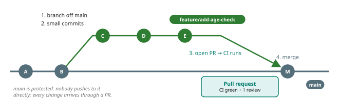
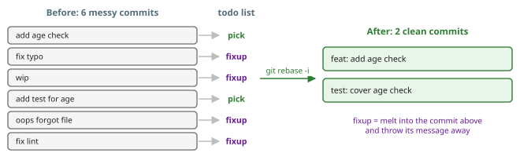

## 2. Merge & rebase

*Chapter 2: Git for CI/CD Work.* CI/CD lives on top of Git. Every pipeline starts with a push, every review is a pull request, every rollback is a commit you can point to. You know `commit`, `push`, `pull` and branches; this chapter adds the tools that make you comfortable in a busy team repository.

**After this level you can:**

- Work with feature branches, pull requests and a protected `main`.
- Choose between merge and rebase, and clean up a PR with interactive rebase.
- Resolve merge conflicts calmly, during a merge and during a rebase.
- Park work with `git stash`; review a PR in parallel with `git worktree`.
- Recover from mistakes with `reflog`, `reset`, `revert`, `cherry-pick`, and find a bad commit with `bisect`.

### The team workflow

In a professional repository, nobody pushes directly to `main`. The
branch is **protected**: changes arrive only through **pull requests**
(PRs; GitLab calls them merge requests), which must pass CI and get a
review before they can be merged. The basic loop (Figure 4):

1. Update `main` and create a short-lived branch:
`git switch -c feature/add-age-check`.
2. Make small, focused commits.
3. Push the branch and open a PR. CI runs on the PR.
4. Address review comments, keep the branch up to date with `main`.
5. Merge. Delete the branch. `main` is deployable at all times.



**Concept: Trunk-based development vs. GitFlow**

**Trunk-based development**: everyone integrates into one branch
(`main`, the "trunk") at least daily through small PRs; unfinished
features hide behind feature flags. This is what CI was invented for
and what most modern teams do. **GitFlow** uses long-lived `develop`,
`release/*` and `hotfix/*` branches. It fits products with scheduled
releases (e.g. installed software) but causes big, painful merges.
For services and ML APIs, prefer trunk-based with short branches.

### Merge vs. rebase

Your branch `feature` started from commit B. Meanwhile, teammates
merged C and F into `main`. Before your PR can be merged, your branch
must include their work. There are two ways to do that (Figure 5).


**`git merge main`** (while on `feature`) creates a new **merge commit** M
with two parents. Nothing existing is changed. History is truthful but
can get noisy: many "Merge branch main into feature" commits.

**`git rebase main`** takes your commits D and E, sets them aside, moves
your branch to the tip of `main`, and **replays** them one by one as new
commits D′ and E′. The result is a straight line, as if you had started
your work today. But D′ and E′ have new commit IDs: history was
**rewritten**.

#### Worked example: the same branch, merged and rebased

Diagrams are one thing; here is what Git itself prints. In a test
repository, `feature` has two commits and `main` gained two commits from
a teammate in the meantime. `git log --oneline --graph --all` draws the
history, newest first:

*expected output:*

```text
* 9529ffb F: teammate feature
* 4d36953 C: teammate fix
| * 817122a E: test age check
| * 174de9c D: add age check
|/
* d4a7642 B: add loader
* 42c8734 A: initial
```

After `git merge main` on a copy of the branch, the graph has a
**diamond**. D and E keep their IDs; a new merge commit `0e59e5a` joins
the two lines:

*expected output:*

```text
*   0e59e5a Merge branch 'main' into feature-merge
|\
| * 9529ffb F: teammate feature
| * 4d36953 C: teammate fix
* | 817122a E: test age check
* | 174de9c D: add age check
|/
* d4a7642 B: add loader
* 42c8734 A: initial
```

After `git rebase main` on the original branch, the history is a
straight line, and the IDs of D and E **changed** (`174de9c` →
`da2d582`, `817122a` → `89685ab`), because each commit's ID is a hash
of its content **and its parent**. New parent, new ID:

*expected output:*

```text
* 89685ab E: test age check
* da2d582 D: add age check
* 9529ffb F: teammate feature
* 4d36953 C: teammate fix
* d4a7642 B: add loader
* 42c8734 A: initial
```

That last sentence is the key to everything that can go wrong with
rebase: anybody who still has the **old** `174de9c` now has a commit that
no longer exists on your branch.

**Try it: Make it a habit**

Add an alias and look at the graph before and after every merge or
rebase: `git config --global alias.lg "log --oneline --graph --all
-20"`, then `git lg`. Most Git confusion disappears once you look at
the graph instead of guessing.

**Watch out: The golden rule of rebasing**

Never rebase commits that other people have already based work on.
Rebasing **your own** feature branch is fine, even after you pushed it
(you then need `git push --force-with-lease`). Rebasing `main` or a
branch a colleague also commits to will make their history diverge
from yours.

| Situation | Use | Why |
|---|---|---|
| Update **your** feature branch with new `main` | `git rebase main` (or merge, if the team prefers) | Clean, linear history; conflicts are solved commit by commit. |
| Branch is shared with a colleague | `git merge main` | Does not rewrite commits others have. |
| Integrating a finished PR into `main` | The PR button: "Squash and merge" or "Rebase and merge" | The team decides once, in the repository settings. |
| Pulling `main` when you have local commits | `git pull --rebase` | Avoids pointless merge commits. |

`git pull` is `git fetch` followed by `git merge`. With `--rebase` it
is `fetch` + `rebase` instead. Make it the default once:

*terminal:*

```bash
git config --global pull.rebase true
git config --global rebase.autoStash true   # stash/unstash dirty files
git config --global merge.conflictStyle zdiff3   # show the base, too
```

The usual way to update your branch before you ask for review:

*terminal:*

```bash
git switch feature/add-age-check
git fetch origin
git rebase origin/main          # replay my commits on the newest main
uv run pytest                   # still green?
git push --force-with-lease     # update the PR (safe force push)
```

**Concept: Why `--force-with-lease`, never `--force`**

After a rebase, your local branch and the remote branch have
different histories, so a normal push is rejected. `--force` would
overwrite the remote unconditionally, including commits a colleague
pushed in the meantime. `--force-with-lease` only overwrites if the
remote is still where you last saw it; otherwise it refuses.

This is what a normal push looks like after a rebase, and what the
lease does when a colleague pushed to the same branch meanwhile (real
output, remote URL shortened):

*expected output:*

```text
$ git push
 ! [rejected]        feature/x -> feature/x (fetch first)
hint: Updates were rejected because the remote contains work that you do
hint: not have locally. ...

$ git push --force-with-lease
 ! [rejected]        feature/x -> feature/x (stale info)
```

"Stale info" means: the remote branch is no longer where your last
fetch saw it, so somebody else pushed. Stop and look before you do
anything else.

**What if… I run `git fetch` and then `--force-with-lease` again?**

**What happens:**  The push succeeds, and your colleague's commit is **gone**
from the remote branch:

```text
$ git fetch
$ git push --force-with-lease
 + e00e90c...4081a71 feature/x -> feature/x (forced update)
```

It gets worse. When the colleague runs `git pull --rebase`, Git sees
that their commit used to be on `origin/feature/x` and assumes it was
intentionally removed upstream, so it silently drops it from **their**
branch too. We ran exactly this; the colleague's log afterwards no
longer contains "feat: colleague adds part 2".

**Why:**  The lease compares against your **remote-tracking branch**
(`origin/feature/x`). `git fetch` updates that to the colleague's
commit, so the lease now "expects" it and lets you overwrite it. You
never looked at what you fetched.

**What you do:**  Prevent it with `git push --force-with-lease --force-if-includes`
(Git 2.30+). It also checks that the remote tip is part of **your**
local history, and it rejected our push with
`(remote ref updated since checkout)`. Make it the default:
`git config --global push.useForceIfIncludes true`. Before any force
push, run `git log --oneline HEAD..origin/feature/x`: if it prints
anything, those commits exist only remotely; integrate them first
(`git rebase origin/feature/x`). To rescue a lost commit: the
colleague finds it in `git reflog` (it was `HEAD@{2}` in our run) and
runs `git cherry-pick <sha>`.

**What if… a colleague rebased a branch I also work on?**

**What happens:**  Your `git pull` stops with `fatal: Need to specify how to
reconcile divergent branches`, or a plain merge produces every commit
twice (old ID and new ID side by side).

**Why:**  Your local branch has the old commits, the remote has the
rewritten ones. Git sees two different histories.

**What you do:**  If you have no local work of your own: `git fetch` then
`git reset --hard origin/<branch>` (look at `git status` first: this
discards uncommitted changes). If you have local commits: `git pull
--rebase`, which skips commits that are already upstream in rewritten
form and replays only yours. Then agree with the team: shared
branches are **merged**, never rebased.

### Interactive rebase: clean up before review

Your PR has six commits: "add age check", "fix typo", "wip", "add test
for age", "oops forgot file", "fix lint". Reviewers want two meaningful
commits. Interactive rebase lets you edit the list of commits like a
text file:

*terminal:*

```bash
git rebase -i origin/main      # all commits not yet on main
# or: git rebase -i HEAD~6       # the last six commits
```

Git opens your editor with a **todo list**, oldest commit first:

*git-rebase-todo:*

```text
pick 3f2a1c0 add age check
pick 9b81d44 fix typo
pick 0c7e5aa wip
pick 51d2f9b add test for age
pick a77e0b3 oops forgot file
pick e41c2d8 fix lint

# Commands:
# p, pick = use commit           r, reword = use commit, edit message
# e, edit = stop to amend it     s, squash = meld into previous, keep msg
# f, fixup = meld into previous, discard this message
# d, drop = remove commit        (reorder lines to reorder commits)
```

Change the words and the order, save and close:

*git-rebase-todo (edited):*

```text
reword 3f2a1c0 add age check
fixup 9b81d44 fix typo
fixup 0c7e5aa wip
fixup e41c2d8 fix lint
pick 51d2f9b add test for age
fixup a77e0b3 oops forgot file
```

Git replays the commits; `reword` opens the editor once more so you
can write `feat: add age check`. The result is shown in Figure 6.



**Try it: Let Git prepare the todo list**

If you know while working that a commit fixes an earlier one, commit
it with `git commit --fixup 3f2a1c0`. Later, `git rebase -i
--autosquash origin/main` puts every fixup line in the right place
automatically.

#### Worked example: split one commit into two

Reviewers ask you to separate "refactor the loader" from "add age
validation", but both are in one commit `51d2f9b`. The `edit` command
stops the rebase **at** that commit so you can rebuild it:

*terminal:*

```bash
git rebase -i origin/main     # change 'pick 51d2f9b' to 'edit 51d2f9b'
# Git stops: 'Stopped at 51d2f9b... add age check and refactor loader'
git reset HEAD~1              # undo the commit, keep its changes unstaged
git add src/credit_api/data.py
git commit -m "refactor: simplify loader"
git add src/credit_api/validation.py tests/test_data.py
git commit -m "feat: reject applicants under 18"
git rebase --continue         # replay the remaining commits
```

`git add -p` (patch mode) goes one step further: it shows each changed
**hunk** and asks `Stage this hunk [y,n,q,a,d,s,e,?]?`, so you can split
changes **inside one file** into separate commits. It is the single most
useful command for making reviewable commits.

**What if… the interactive rebase went wrong and I already finished it?**

**What happens:**  You dropped the wrong line in the todo list, or squashed
into the wrong commit. The rebase finished; the branch looks wrong.

**What you do:**  Before the rebase started, Git saved the old tip in `ORIG_HEAD`.
Right after the rebase, `git reset --hard ORIG_HEAD` restores the
branch exactly. If you ran other commands since (which overwrite
`ORIG_HEAD`), use `git reflog` and look for the line **before**
`rebase (start)`, then `git reset --hard HEAD@{n}`. While a rebase is
still in progress, `git rebase --abort` is simpler.

**What if… my PR is based on a colleague's PR that was squash-merged?**

**What happens:**  You built `feat/b` on top of `feat/a` ("stacked PRs").
`feat/a` was squash-merged into `main` as one new commit S. Now
`git rebase main` on `feat/b` tries to replay `feat/a`'s original
commits again and conflicts with S everywhere.

**Why:**  A squash creates a **new** commit with new content; Git cannot
tell that `feat/a`'s commits are already in `main`.

**What you do:**  Transplant only **your** commits: `git rebase --onto main feat/a
feat/b` means "take the commits of `feat/b` that are not in `feat/a`
and replay them onto `main`". (If `feat/a` was already deleted, use
the SHA of its last commit instead of the name; `git log` on your
branch still shows it.)

### Commit messages that machines can read

**Conventional Commits** is a simple format for commit messages:
`type(scope): description`, e.g. `feat(api): add /version endpoint` or
`fix: handle unknown purpose category`.

| Type | Use for | Version bump |
|---|---|---|
| `feat` | A new feature for users of the API or model. | minor: 1.4.0 → 1.5.0 |
| `fix` | A bug fix. | patch: 1.4.0 → 1.4.1 |
| `feat!` or `BREAKING CHANGE:` footer | A change that breaks clients. | major: 1.4.0 → 2.0.0 |
| `docs`, `test`, `refactor`, `ci`, `chore`, `perf` | Everything else. | none |

Because the type is machine-readable, CI can generate changelogs and
release versions automatically (tools: *release-please*,
*semantic-release*; *commitlint* checks the format in CI). With squash
merges, the **PR title** becomes the commit message, so teams often lint
PR titles instead.

**Exercise: Rebase with conflicts**

In the conflict lab, add two more commits on `feature/stricter` that
each change `features:` to a different value, and one commit on `main`
that changes `features:` too. Rebase the feature branch onto `main`.
How many times do you have to resolve? Then use `git reflog` to get
back to the state before the rebase.

**Exercise: Clean history**

Create five small commits on a branch, including two "fix typo"
commits. Use `git commit --fixup` for one of them and
`git rebase -i --autosquash` to end up with two Conventional-Commit
messages.

**Exercise: The force-push trap**

Create a bare repository (`git init --bare remote.git`) and two
clones, `you` and `colleague`. Reproduce the what-if from Section
2.2: both push to `feature/x`, you rebase, fetch, and force-push with
the lease. Confirm the colleague's commit disappears, recover it from
the colleague's reflog, then repeat with `--force-if-includes` and
observe the rejection.

**Exercise: Lock file conflict**

In a fresh `uv init` project, add a different dependency on two
branches and merge them. Resolve it the right way, and prove it with
`uv sync --locked`.

**Exercise: Semantic conflict**

Reproduce the "no conflict, still broken" what-if with two branches
and a test. Which GitHub setting would have prevented the broken
`main`, and at what cost?

**Checkpoint: you should now be able to…**

- explain merge vs. rebase with a drawing, and state the golden rule;
- update a feature branch with `git rebase origin/main` and push with
`--force-with-lease`;
- squash, reword, reorder and drop commits with `git rebase -i`;
- read conflict markers, resolve them in VS Code or the terminal, and use `--abort` / `--continue`;
- read the base section of a `zdiff3` conflict and resolve by intention; handle modify/delete, lock-file and binary conflicts;
- explain why `--force-if-includes` exists, why a reverted merge must be reverted again before re-merging, and what a semantic conflict is;
- choose between `stash` and `worktree`;
- undo with `reset`, `revert` and `reflog`, and find a bad commit with `git bisect run`.
