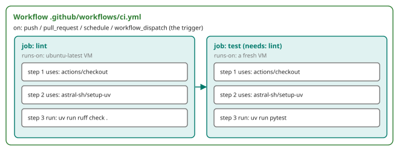

## 6. First CI pipeline

### Your first GitHub Actions workflow

GitHub Actions runs **workflows**: YAML files in `.github/workflows/`.
When an event happens (a push, a pull request, a schedule), GitHub
starts a fresh virtual machine, a **runner**, and executes the jobs you
defined. Figure 9 shows the structure; here is the smallest useful
workflow:

*.github/workflows/ci.yml (Level 1 version):*

```yaml
name: CI

on:
  push:
    branches: [main]
  pull_request:

jobs:
  test:
    runs-on: ubuntu-latest
    steps:
      - uses: actions/checkout@v7
      - uses: astral-sh/setup-uv@v10.3.3
      - run: uv sync --locked
      - run: uv run pytest
```

| Line | Meaning |
|---|---|
| `name` (1) | Shown in the Actions tab and in PR checks. |
| `on` (3–6) | The **triggers**: pushes to `main`, and every pull request (any branch). Other triggers: `schedule` (cron), `workflow_dispatch` (a manual button), `release`, `workflow_call` (reusable). |
| `jobs` (8) | A map of jobs. Jobs run **in parallel** unless one says `needs: other-job`. |
| `runs-on` (10) | The runner image. `ubuntu-latest` is the standard choice: fast to start and free for public repositories. |
| `steps` (11) | Executed in order, in the same machine and directory. If a step fails (non-zero exit code), the job stops. |
| `uses` (12–13) | Runs a ready-made **action**: `owner/repo@version`. `checkout` clones your repository into the runner; `setup-uv` installs uv and, if needed, Python. |
| `run` (14–15) | Runs a shell command. Its exit code decides success: pytest returns 1 when a test fails, so the job turns red. |



**Concept: `uses` vs. `run`, and pinning versions**

`run` executes your own command. `uses` executes someone else's code
(an action), so pin it to a version. `@v7` is a **moving** major tag
that receives fixes; `@v10.3.3` is an exact release. Some projects,
like `setup-uv`, no longer publish major tags, so you must name an
exact version. The most secure option is to pin the full commit SHA
(Level 5). The versions in this book were current in November 2026;
check each action's README for newer ones.

**Interview tip: `actions/setup-python`**

Most projects you will meet use `actions/setup-python@v7` with
`python-version: "3.12"` and then `pip install -r requirements.txt`.
It works the same way; `setup-uv` simply does both jobs (Python and
packages) and is faster.

### Five more things you need in almost every workflow

*common step options:*

```yaml
    steps:
      - uses: actions/checkout@v7
      - name: Show where we are            # 1. a readable name in the UI
        run: |                             # 2. several commands
          python --version
          echo "Triggered by $GITHUB_EVENT_NAME on $GITHUB_REF_NAME"
      - name: Train
        working-directory: ./training      # 3. run in a subfolder
        env:                               # 4. env vars for this step
          SAMPLE_FRAC: "0.1"
        run: uv run python train.py
      - name: Upload logs only if something failed
        if: failure()                      # 5. conditional step
        uses: actions/upload-artifact@v7
        with:
          name: training-logs
          path: training/logs/
```

`run: |` is YAML for a multi-line string; each line is one shell
command. GitHub sets many variables automatically (`GITHUB_SHA`,
`GITHUB_REF_NAME`, `GITHUB_EVENT_NAME`, `RUNNER_OS`, …); the same
values are available as expressions (`${{ github.sha }}`). A step
with `if: failure()` runs only when an earlier step failed: ideal for
collecting logs and reports that explain the failure. `always()` runs
regardless; `success()` is the default.

**What if… my workflow does not start at all?**

**What happens:**  You pushed, but the Actions tab shows nothing.

**Why:**  Go through this checklist; it covers nearly every case:
- The file is not in `.github/workflows/` exactly (a typo such as
`.github/workflow/` is silently ignored) or does not end in
`.yml`/`.yaml`.
- The YAML is invalid. The Actions tab then shows a failed run with an error like `Invalid workflow file: … (Line: 12, Col: 9)`, but only if GitHub could find the file. Indentation with tabs is a common cause.
- The trigger does not match: `branches: [main]` but you pushed to
`feature/x`; or `paths-ignore` matched every changed file.
- The workflow file exists only on your branch: `schedule` and
`workflow_dispatch` use the file on the **default branch**, and the manual button only appears after the file is on `main`.
- Actions are disabled in **Settings → Actions → General**, or the commit message contains `[skip ci]`.

**What you do:**  Validate locally before pushing: `actionlint` (a linter for
workflow files, also available as a pre-commit hook) catches
syntax errors, unknown keys and many expression mistakes.

**What if… my workflow runs twice for every push?**

**What happens:**  Each commit on a PR shows two identical runs.

**Why:**  `on: [push, pull_request]` without filters triggers once for the
push to the branch and once for the pull request.

**What you do:**  Use the pattern from this chapter: `push` only for `main`,
`pull_request` for everything else.

**What if… a command fails, but the step is green?**

**What happens:**  You write `run: uv run pytest | tee pytest.log` to keep a
log file. Tests fail, but the step and the job are green.

**Why:**  A shell pipeline's exit code is that of the **last** command
(`tee`, which succeeded). When you do not set `shell:`, GitHub runs
steps with `bash -e {0}`: it stops on errors, but without
`pipefail`. With an explicit `shell: bash` it uses
`bash --noprofile --norc -eo pipefail {0}`, and the step fails as
it should.

**What you do:**  Set it once for the whole workflow:

```yaml
defaults:
  run:
    shell: bash
```

The same trap exists in any script with pipes: start your shell
scripts with `set -euo pipefail`.

### Push it and watch it run

*terminal:*

```bash
git add .github/workflows/ci.yml
git commit -m "ci: run tests on every push"
git push
```

Open your repository on GitHub, click the **Actions** tab and then the
run. You see the job `test` and, inside, each step with its log. Steps
are collapsible; the first one, **Set up job**, shows the runner image
version, which is useful when something worked yesterday and fails
today.

### A red run, and how to read it

**Try it: Break it on purpose**

In `src/credit_api/gate.py`, change `if new[name] < floor:` to
`if new[name] > floor:`. Commit on a branch, push, and open a pull
request. Within a minute the PR shows a red cross: **CI / test
(pull_request) Failing**.

Click **Details** next to the failing check and expand the red step.
Always read a CI log **from the bottom up**: the summary is at the end.

*expected output:*

```text
FAILED tests/test_gate.py::test_gate_passes_for_good_model
FAILED tests/test_gate.py::test_main_returns_exit_code
==================== 2 failed, 29 passed in 1.9s ====================
Error: Process completed with exit code 1.
```

Then scroll up to the first failure:

*expected output:*

```text
tests/test_gate.py:11: in test_gate_passes_for_good_model
    assert gate.check(new, BASE, FLOORS, max_drop=0.03) == []
E   AssertionError: assert ['roc_auc=0.7...ow floor 0.4'] == []
E     Left contains 2 more items, first extra item:
E     'roc_auc=0.7900 below floor 0.7'
```

The message says a good model (AUC 0.79) was reported as "below floor
0.7", so the comparison is inverted. Reproduce locally with
`uv run pytest tests/test_gate.py`, fix it, push again: the same PR
re-runs automatically and turns green.

**Watch out: Typical first-run failures**

`uv sync --locked` fails with "The lockfile needs to be updated":
you changed `pyproject.toml` but did not commit the new `uv.lock`.
Run `uv lock` and commit. Tests that pass locally but fail in CI
usually depend on something only your laptop has: a file that is
not committed (check `.gitignore`), an environment variable, a
timezone or an absolute path.

### A field guide to red runs

The last lines of a failed log usually identify the category at once.
These are the ones you will meet most:

| Last lines of the log | Cause and fix |
|---|---|
| `ModuleNotFoundError: No module named 'credit_api'` | The package is not installed in the environment pytest runs in. With the `src/` layout, run tests through `uv run` after `uv sync`; with plain pip, `pip install -e .`. |
| `FileNotFoundError: … data/german_credit.csv` | The file is in `.gitignore` or was never committed. `git ls-files data/` shows what Git actually has. |
| `ERROR: … no tests ran` / exit code 5 | pytest found no tests: wrong folder, or files not named `test_*.py`. Exit code 5 fails the job, which is good. |
| `Error: Process completed with exit code 137.` | The runner killed the process: out of memory. Train on a smaller sample in CI, or use a larger runner. |
| `The job running on runner … has exceeded the maximum execution time of 10 minutes.` | Your `timeout-minutes` hit. Often a test waiting forever for a network service, or a prompt waiting for input (`apt-get install` without `-y`). |
| Passes on re-run without changes | A **flaky** test: randomness without a seed, timing (`sleep`), test order, or an external service. Fix it at once; a team that gets used to "just re-run" stops trusting red builds. |

**Try it: Read logs faster from the terminal**

With the GitHub CLI: `gh run list` shows recent runs, `gh run view
--log-failed` prints **only the failed steps' logs**, and `gh run
rerun --failed` re-runs only the failed jobs. For more detail,
re-run in the UI with **Enable debug logging**, which prints every
internal step of the runner and of the actions.

### The CI badge

A badge in the README shows the status of the last run on `main`. In
the Actions tab, open the workflow, click **…** → **Create status badge**,
or write it yourself:

*README.md:*

```markdown
# credit-api


```

The badge is small, but recruiters and interviewers notice it: it
shows at a glance that your portfolio project is tested automatically
and currently green.

**Exercise: A test for the schema**

Add a parametrized test to `tests/test_api.py` that sends three
invalid requests (negative `credit_amount`, `duration` of 200, a
missing `purpose`) and asserts status 422 for each.

**Exercise: Trigger on a schedule**

Make the Level 1 workflow also run every night at 04:00 UTC and add a
manual "Run workflow" button. (Hint: `schedule` and
`workflow_dispatch`.)

**Exercise: Find the order dependence**

Add a test at the end of `tests/test_api.py` that sets
`df["age"] = 0` on the session fixture **without** copying it. Run the whole suite and then
only `tests/test_data.py`. Which tests fail, and why only in one
case? Fix the test.

**Exercise: The pipe trap**

Add a step `run: uv run pytest | tee pytest.log` and break a test.
Confirm that the job stays green. Then add `defaults: run: shell:
bash` and confirm that it turns red.

**Checkpoint: you should now be able to…**

- create a project with `uv`, commit `uv.lock`, run `uv run pytest`;
- write tests with fixtures, `parametrize` and `pytest.raises`;
- compare floats with `pytest.approx`, write fixtures with teardown, and explain why a test can fail only in the full suite;
- write behavioural tests for a model (baseline, skew, leakage, stability);
- debug a workflow that does not start, runs twice, or stays green although a command failed;
- explain `on`, `jobs`, `runs-on`, `steps`, `uses` and `run`;
- find the cause of a red run by reading the log bottom-up;
- show the CI status with a README badge.
