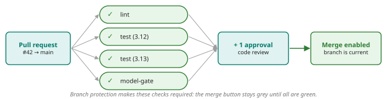

## 8. Protected PRs & secrets

### Branch protection and the PR workflow

Now make CI **mandatory**. In your repository: **Settings → Rules →
Rulesets → New branch ruleset**. Target the default branch and enable:

- **Restrict deletions** and **Block force pushes**.
- **Require a pull request before merging**, with 1 required approval (for a solo portfolio project you can set 0 approvals but still require the PR).
- **Require status checks to pass**: add `ci-ok`. (You could list
`lint`, `test (3.12)`, `test (3.13)` and `model-gate` one by one; the first what-if below shows why one aggregator is better.) A check name only appears in the list after it has run at least once.
- **Require branches to be up to date before merging**: the PR must contain the latest `main`, so CI tested the real combination.

(The older **Settings → Branches → Branch protection rules** page does
the same; rulesets are the newer, more flexible version.)



The full PR workflow, end to end:

*terminal:*

```bash
git switch main && git pull
git switch -c feat/validate-age
# ... edit code and tests ...
uv run pytest && git commit -am "feat: reject applicants under 18"
git push -u origin feat/validate-age
gh pr create --fill               # or open the PR in the browser
gh pr checks --watch              # watch CI from the terminal
# after approval and green checks:
gh pr merge --squash --delete-branch
```

**What if… a required check shows "Expected — Waiting for status to be reported" forever?**

**What happens:**  The PR cannot be merged. All runs are green, but one
required check stays yellow, and nothing is running.

**Why:**  Required checks are matched **by name**. The matrix creates names
such as `test (3.12)`. If you change the matrix to 3.13 and 3.14,
the job `test (3.12)` never runs again, but the ruleset still waits
for it. The same happens when a path filter skips the whole workflow
or an `if:` skips a required job (a skipped job counts as passed,
but a workflow that never **started** reports nothing).

**What you do:**  Do not make every matrix job required. Add one small
**aggregator** job that depends on everything and require only that:

```yaml
  ci-ok:
    if: always()                 # run even if a dependency failed
    needs: [lint, test, model-gate]
    runs-on: ubuntu-latest
    steps:
      - name: Fail if any dependency failed or was cancelled
        if: >-
          contains(needs.*.result, 'failure') ||
          contains(needs.*.result, 'cancelled')
        run: exit 1
```

Now you can change the matrix freely; the ruleset only knows
`ci-ok`. The `if: always()` is essential: without it, `ci-ok` would
be **skipped** when a dependency fails, and skipped counts as success.

**What if… the team is busy and "require up to date" becomes a race?**

**What happens:**  Five PRs are approved. You update yours with `main`, wait
six minutes for CI, and just before you click merge somebody else
merges. Your PR is out of date again. Repeat.

**Why:**  "Up to date" guarantees that CI tested the exact combination,
but it serialises the team on **your** attention.

**What you do:**  A **merge queue** (**Rulesets → Require merge queue**). You click
"Merge when ready"; GitHub builds a temporary branch with `main` +
the PRs ahead of yours + yours, runs CI on it, and merges if it is
green. Workflows must listen to the queue's event, or the queue
waits forever:

```yaml
on:
  pull_request:
  merge_group:        # run CI on the merge queue's temporary branch
```

### Secrets and variables

Sooner or later CI needs credentials: an API key for an LLM, a token for
a tracking server. **Never put them in the code or the workflow file.**
GitHub stores them encrypted: **Settings → Secrets and variables →
Actions**.

| Kind | Use for | In a workflow |
|---|---|---|
| Secret | Passwords, API keys, tokens. Write-only in the UI and masked as `***` in logs. | `${{ secrets.ANTHROPIC_API_KEY }}` |
| Variable | Non-secret configuration: region, role ARN, URLs. Visible in the UI. | `${{ vars.AWS_ROLE_ARN }}` |
| Environment secret/variable | Values that differ per environment (staging vs. production) and can be protected by approvals (Level 3). | same syntax, inside a job with `environment:` |
| `GITHUB_TOKEN` | Automatic, short-lived token for the GitHub API in this repository; scope it with `permissions:`. | `${{ secrets.GITHUB_TOKEN }}` |

Pass secrets to the step that needs them, as environment variables:

*using a secret:*

```yaml
      - name: Faithfulness eval
        env:
          ANTHROPIC_API_KEY: ${{ secrets.ANTHROPIC_API_KEY }}
        run: uv run python eval/run_eval.py --faithfulness
```

**Watch out: What never to commit, and what to do if you did**

Never commit `.env` files, cloud access keys, private keys, notebook
outputs containing credentials, or data with personal information
(GDPR!  (*DSGVO*)). Add them to `.gitignore` before the first commit.
If a secret was pushed, **deleting the file is not enough**: it stays in
Git history and bots scan public GitHub within minutes. Revoke and
rotate the key immediately, then clean history if needed. GitHub's
**secret scanning** and **push protection** (free for public repos) block
many known key formats on push; turn them on in **Settings → Code
security**.

Secrets are not passed to workflows triggered by pull requests from
**forks**, because anybody could open such a PR and print them. Keep this
in mind for open-source projects: expensive or credentialed jobs run
on `push` to `main` or behind a label set by a maintainer, a pattern
you will use for the LLM evaluation in Level 4.

**What if… a secret appears in the log in plain text after all?**

**What happens:**  Masking replaces the **exact** secret string with `***`. Your
step prints it base64-encoded, URL-encoded, or split across two
lines, and the transformed value is visible to anyone who can read
the logs.

**What you do:**  Never print secrets, not even "to debug". If a step **derives** a
sensitive value (a token fetched at runtime), register it for
masking before it is used: `echo "::add-mask::$TOKEN"`. If one
leaked: rotate it, then delete the run's logs (run page → **…** →
**Delete all logs**).

**What if… I switch to `pull_request_target` so fork PRs get secrets?**

**What happens:**  It works, and it is one of the most exploited GitHub
Actions mistakes ("pwn request").

**Why:**  `pull_request_target` runs in the context of the **base**
repository, with secrets and a write token. If the workflow then
checks out and runs the PR's code (`ref: ${{
github.event.pull_request.head.sha }}` followed by `pip install` or
`pytest`), the stranger's code runs with your secrets. A `conftest.py`
in the PR is enough to send them to the attacker.

**What you do:**  Use `pull_request` for anything that runs PR code. Use
`pull_request_target` only for tasks that never execute the PR's
code (labelling, commenting). For paid evaluations of fork PRs, let
a maintainer run them after reading the code.

**What if… my Dependabot PRs fail because secrets are empty?**

**What happens:**  PRs opened by Dependabot run CI, but every step that uses a
secret fails as if the secret did not exist.

**Why:**  For safety, workflows triggered by Dependabot do not receive
Actions secrets. They get **Dependabot secrets**, a separate store
(**Settings → Secrets and variables → Dependabot**).

**What you do:**  Make unit tests independent of secrets (fakes, as in Level 4),
and add a Dependabot secret only where a dependency PR truly needs
one.

#### Keeping dependencies fresh: Dependabot

A lock file freezes versions, which is good for reproducibility and
bad for security: vulnerabilities in old versions stay. **Dependabot**
opens PRs that update dependencies; CI then tells you whether the
update is safe to merge. It understands `uv.lock` and your workflow
files:

*.github/dependabot.yml:*

```yaml
version: 2
updates:
  - package-ecosystem: "uv"
    directory: "/"
    schedule: {interval: "weekly"}
    groups:                       # one PR for all minor/patch updates
      minor-and-patch:
        update-types: ["minor", "patch"]
  - package-ecosystem: "github-actions"   # bumps actions/checkout@v7 ...
    directory: "/"
    schedule: {interval: "monthly"}
```

This is where your test suite pays off a second time: a good suite
lets you merge a "bump scikit-learn" PR in one minute. Without one,
nobody dares, and the project ages until an upgrade becomes a
project of its own.

### Speed and cost

GitHub Actions is free for public repositories. For private ones,
GitHub Free includes 2,000 Linux minutes per month (check the current
plan details), and wasted minutes add up quickly in a team. The levers:

- **Concurrency groups.** `concurrency: group: ci-${{ github.ref }}` with
`cancel-in-progress: true` cancels the still-running pipeline of a PR when you push a new commit: nobody needs the result for an outdated commit. Our file only cancels on PRs; runs on `main` always finish.
- **Path filters.** `paths:` / `paths-ignore:` skip workflows when irrelevant files change (docs, README). Careful: a **required** check that is skipped by a path filter can block merging. Either keep required workflows unfiltered or filter at the job level.
- **Job dependencies.** Cheap jobs first (`lint` takes 15 seconds), expensive ones only if those pass (`needs:`).
- **Caching** and **timeouts**, as above.
- **Right-size the matrix.** Test all versions on PRs to `main`, but not necessarily all operating systems; nightly runs can cover the rest.

### Testing strategy at scale

Everything so far fits one repository and one person. In a team of
thirty with a dozen models, the questions change from "how do I write
a test?" to "which tests run where, how long may they take, and who
owns them?". A senior engineer can draw this on a whiteboard:

| Layer | Examples in this book | Budget | Runs on |
|---|---|---|---|
| Static checks | ruff, mypy, actionlint, secret scan | < 1 min | every push |
| Unit tests | `test_gate.py`, behavioural tests with a tiny model | < 3 min | every push |
| Data and model | data contract, train on a sample, metric gate | < 10 min | every PR |
| Integration | pgvector test, API against a real database | < 10 min | PR (paths) and `main` |
| Full evaluation | full-data training, LLM faithfulness, slices | < 60 min | `main`, nightly |
| Post-deploy | smoke test, distribution check, load test | < 10 min | after each deploy |

The budgets are the point: a layer that exceeds its budget moves down a
row (runs less often) or gets faster. Four practices keep this working
in a team:

- **Contract tests between services.** When another team calls
`/predict`, write down what they rely on (fields, types, status codes) as a test that runs in **your** CI. Tools such as Pact automate this between repositories; a JSON schema checked in both repos is the lightweight version. It turns "expand, then contract" (Chapter 5) from a promise into a check.
- **A load test with a gate.** A short k6 or Locust run against staging that fails if p95 latency exceeds the SLO (Chapter 7). Ten minutes of load after deploy catches the memory leak and the missing index that unit tests never will.
- **A flaky-test policy.** A test that fails without a code change gets a
`flaky` label, an owner and a deadline; it is **quarantined** (skipped in the required check, still run and reported elsewhere) until fixed. Without a policy, "re-run until green" becomes the culture and the required check means nothing.
- **Ownership.** `CODEOWNERS` makes the right people review changes to thresholds, evaluation sets, infrastructure and workflows. In
`credit-api`, `.github/CODEOWNERS` assigns `metrics/`, `gate.py`,
`infra/` and the workflows; combined with the ruleset option **Require review from Code Owners**, nobody lowers a quality gate without the owner's approval.

**Interview tip**

"I'd draw the test pyramid with a time budget per layer, and
enforce the budgets: if the unit tests take longer than three
minutes, that is a bug. Contract tests protect our consumers, a
short load test protects the SLO, and flaky tests get quarantined
with an owner, never re-run until green."

**Exercise: Add an OS dimension**

Extend the matrix to run the tests on `ubuntu-latest` and
`macos-latest` for Python 3.12 only, using `include:`. How many jobs
run now? Why might macOS minutes be more expensive on private
repositories?

**Exercise: Protect yourself**

Create the ruleset described above on your `credit-api` repository.
Then open a PR that breaks `ruff format --check` and confirm that
GitHub refuses to merge it.

**Exercise: Prove the aggregator**

With `ci-ok` as the only required check, (a) change the matrix to
`["3.13", "3.14"]` and confirm the PR can still be merged, and
(b) remove `if: always()` from `ci-ok`, break a test, and look at
what `ci-ok` reports. Why is (b) dangerous?

**Exercise: Read the linters**

Copy `features.py` from this chapter into `credit-api/src/credit_api/`,
run ruff and mypy, and fix every finding by hand (no `--fix`). Which
fix changes the behaviour of the code?

**Checkpoint: you should now be able to…**

- run ruff, mypy and pytest locally and via pre-commit;
- explain the bugs behind B006 and mypy's `[return]` error, and introduce linters into a legacy codebase step by step;
- require one aggregator check instead of matrix job names, and explain merge queues and `merge_group`;
- recognise the `pull_request_target` trap and unmasked transformed secrets;
- explain caching, matrix builds and the coverage threshold;
- make checks required with a branch ruleset and merge a PR end to end;
- store and use secrets and variables, and react to a leaked key;
- reduce CI time and cost with concurrency, path filters, `needs` and timeouts.
