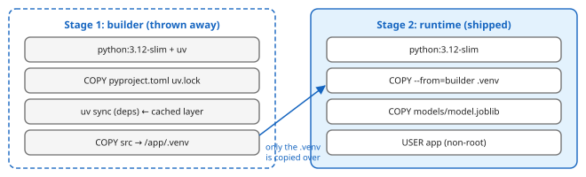

## 9. AWS setup & Docker

*Chapter 5 · Level 3: Continuous Delivery to AWS.* Now the pipeline stops being only a judge and becomes a delivery truck. Every merge to `main` builds a Docker image, pushes it to AWS without any stored password, deploys it to staging, tests it, and waits for your approval to go to production.

**After this level you can:**

- Set up an AWS account safely: root MFA, an admin user via IAM Identity Center, budget alarms, region `eu-central-1`.
- Write a production-quality Dockerfile for a Python service.
- Authenticate GitHub Actions to AWS with OIDC and explain the trust policy line by line.
- Deploy to ECS Express Mode (Fargate) with staging → production, manual approval, smoke tests and rollback.
- Delete everything again so you are not billed.

**What you build:** `deploy.yml`: merge → image in ECR tagged with the git SHA → staging → smoke test → approval → production → smoke test; plus a one-click rollback workflow.

### AWS account setup: security and cost first

**Watch out: Do this section before anything else**

A new AWS account is a credit card connected to the internet.
Leaked keys are found by bots within minutes and used for crypto
mining. The four steps below take 30 minutes and prevent almost all
horror stories.

**1. Create the account** at `aws.amazon.com` (you need a credit card and
a phone). AWS changed its free tier in 2025: new accounts receive
credits and choose between a free and a paid account plan. Read the
current terms during sign-up; credits do not replace budget alarms.

**2. Protect the root user.** The e-mail address you signed up with is
the **root user**: it can do everything, including closing the account.
In the console: account menu → **Security credentials** → **Assign MFA
device**. Use a passkey/security key or an authenticator app. Then stop
using root for daily work, and never create access keys for it.

**3. Create your everyday admin user with IAM Identity Center.** Open
**IAM Identity Center** (choose region `eu-central-1`, Frankfurt), click
**Enable**. Then: **Users → Add user** (your name and e-mail) → **Permission
sets → Create** → predefined **AdministratorAccess** → **AWS accounts** →
select your account → **Assign users** → your user + the permission set.
You get an e-mail with an **AWS access portal** URL. Log in there from now
on, with MFA. On your laptop, install the AWS CLI v2 and connect it:

*terminal:*

```bash
aws configure sso          # asks for the portal URL and region
#   SSO start URL:  https://d-xxxxxxxxxx.awsapps.com/start
#   SSO region:     eu-central-1
#   profile name:   admin
export AWS_PROFILE=admin   # put this in your ~/.zshrc
aws sso login              # opens the browser; valid for some hours
aws sts get-caller-identity
```

The CLI now uses **short-lived** credentials that expire after a few
hours. There is no long-lived access key on your laptop that could
leak.

**4. Budget alarms.** **Billing and Cost Management → Budgets → Create
budget → Use a template → Monthly cost budget**. Create one budget of
**10 USD** and a second of **25 USD**, each sending e-mails at 80 % of the
actual cost and at 100 % of the **forecasted** cost. Also enable **Cost
Anomaly Detection** (same console, free), which mails you when spending
jumps unexpectedly.

**What if… the 10-dollar budget e-mail arrives?**

**What happens:**  "AWS Budgets: Monthly 10 USD has exceeded your alert
threshold". Budgets are an **alarm**, not a **brake**: AWS does not stop
anything, and the cost data behind them is updated only a few times
per day, so the real spend is already higher than the e-mail says.

**What you do:**  Find the cause in this order. (1) **Billing → Bills**, expand by
service and region: which service, where? (2) **Cost Explorer**,
grouped by **Usage type**: for example `EUC1-LoadBalancerUsage` is an
ALB in Frankfurt running by the hour, `PublicIPv4:InUseAddress` are
public IPs. (3) Delete the resource; for this book, `bash
infra/cleanup.sh`. (4) Check **other regions**: a service created by
mistake in `us-east-1` is invisible while the console shows
Frankfurt.

**What if… I lose the phone with my root MFA?**

**What you do:**  Register **two** MFA devices for root from the start (AWS allows
several), for example a hardware key plus an authenticator app, and
keep one in a drawer. Without any device, AWS has a recovery process
that verifies the root e-mail address and the account's phone
number: it works, but takes time. Keep both up to date.

**Concept: Why `eu-central-1` (Frankfurt)**

A **region** is a set of AWS data centres in one place. Choose the one
closest to your users and your legal requirements. For a German
company, Frankfurt means low latency and data that stays in the EU,
which simplifies GDPR discussions. Many AWS resources are regional:
if you cannot find something in the console, check the region
selector at the top right first.

### Docker for the app

A **container image** is a packaged file system with your code, the
Python interpreter and every library, plus the command to start it.
A **container** is a running instance of an image. Because the image
contains everything, it runs the same on your laptop, in CI and on AWS.
An image is built from a `Dockerfile` in **layers**; each instruction
creates one, and unchanged layers are reused from cache.

*Dockerfile:*

```dockerfile
# syntax=docker/dockerfile:1

# ---------- stage 1: build the virtual environment ----------
FROM python:3.12-slim AS builder
COPY --from=ghcr.io/astral-sh/uv:0.13 /uv /bin/uv
ENV UV_COMPILE_BYTECODE=1 UV_LINK_MODE=copy UV_PYTHON_DOWNLOADS=never
WORKDIR /app
# Dependencies first: this layer is cached until uv.lock changes
COPY pyproject.toml uv.lock ./
RUN uv sync --locked --no-dev --no-install-project
# Then our own code (changes often, so it comes last)
COPY src ./src
RUN uv sync --locked --no-dev --no-editable

# ---------- stage 2: small runtime image ----------
FROM python:3.12-slim
RUN useradd --create-home --uid 10001 app
WORKDIR /app
COPY --from=builder /app/.venv /app/.venv
COPY models/ /app/models/
ENV PATH="/app/.venv/bin:$PATH" \
    PYTHONUNBUFFERED=1 \
    MODEL_PATH=/app/models/model.joblib
USER app
EXPOSE 8080
HEALTHCHECK --interval=30s --timeout=3s CMD python -c \
  "import urllib.request as u; u.urlopen('http://localhost:8080/health')"
CMD ["uvicorn", "credit_api.app:app", "--host", "0.0.0.0", "--port", "8080"]
```



What makes this Dockerfile production-quality:

- **Slim base image** (lines 4, 16): `python:3.12-slim` is Debian with Python and little else. Smaller images download faster, start faster and contain fewer packages with security vulnerabilities.
- **Multi-stage build** (Figure 11): stage 1 has uv and build tools; stage 2 receives only `/app/.venv`. Build tools never reach production.
- **Layer order for caching** (lines 9–13): dependency files are copied and installed **before** the source code. Changing `app.py` reuses the expensive dependency layer; only `uv.lock` changes invalidate it.
- **`--locked`**: the image contains exactly the versions in `uv.lock`, the same ones CI tested.
- **Non-root user** (lines 17, 24): if an attacker breaks into the process, they are not root inside the container.
- **Model baked in** (line 20): the image is a complete, versioned unit. "Image `:3f2a1c0`" means exactly one code version **and** one model.
- **`HEALTHCHECK` and `EXPOSE`** (lines 25–27): document the port and let Docker know if the app is healthy.

The `.dockerignore` file keeps the **build context** small and secret-free:

*.dockerignore:*

```
# Keep the build context small and free of secrets
.git
.github
.venv
**/__pycache__
.pytest_cache
.mypy_cache
.ruff_cache
.coverage
coverage.xml
mlruns
mlflow.db
tests
data
*.md
.env
```

**Try it: Build and run locally**

Install Docker Desktop (or Colima/OrbStack on macOS), then:

*terminal:*

```bash
uv run python -m credit_api.train          # creates models/model.joblib
docker build -t credit-api:dev .
docker run --rm -p 8080:8080 -e APP_VERSION=dev credit-api:dev
# in a second terminal:
curl localhost:8080/health
curl -X POST localhost:8080/predict -H 'Content-Type: application/json' \
  -d '{"checking_status":"<0","duration":24,"credit_history":
  "existing paid","purpose":"new car","credit_amount":4000,
  "savings_status":"<100","employment":"1<=X<4","age":35}'
```

*expected output:*

```text
{"status":"ok","version":"dev","model_version":"local-a7ad9a21934f",
 "data_sha256":"a7ad9a21934f"}
{"risk":"bad","probability_bad":0.6427,
 "model_version":"local-a7ad9a21934f"}
```

(Your probability and hashes will differ if you trained on other data.
The container also prints one JSON log line per request; Chapter 7
explains them.)

**Watch out: Apple Silicon and image architecture**

On an M-series Mac, `docker build` produces an `arm64` image.
Fargate runs `x86_64` by default, where such an image fails to start
with `exec format error`. In our pipeline the image is built on
GitHub's `ubuntu-latest` (x86_64), so this does not happen. If you
push from your laptop, build with `--platform linux/amd64`.

### When the container does not work: a debugging toolkit

| Command | Answers the question |
|---|---|
| `docker logs <container>` (`-f` to follow) | What did the app print before it died? |
| `docker run --rm -it --entrypoint sh credit-api:dev` | What is **actually** in the image? (`ls /app/models`, `whoami`, `env`) |
| `docker exec -it <container> sh` | Look inside a **running** container. |
| `docker inspect <container> --format '{{.State.ExitCode}} {{.State.OOMKilled}}'` | Why did it stop? Exit code, killed for memory? |
| `docker history credit-api:dev` | Which layer makes the image big? |
| `docker run --memory 512m …` | Does it survive with the memory Fargate will give it? |

**What if… the container runs locally but the deployment never becomes healthy?**

**What happens:**  The deploy step waits, then fails; ECS shows tasks starting
and stopping in a loop, with `Task failed ELB health checks`.

**Why:**  Work through the usual suspects:
- The app listens on `127.0.0.1` (uvicorn's default!) instead of
`0.0.0.0`. Inside a container, `127.0.0.1` is reachable only from inside the container itself, so the load balancer can never connect (and neither can `docker run -p` on your laptop: `curl` gets `Connection reset by peer`). The bug hides when you only ever run `uvicorn` directly on your laptop, where `127.0.0.1` is fine. Our `CMD` passes `--host 0.0.0.0` for exactly this reason.
- Port mismatch: the app listens on 8000, the service expects 8080.
- `/health` returns 503 because the model did not load (wrong
`MODEL_PATH`), which is exactly what our health check is designed to report.
- Exit code 137 / `OutOfMemoryError: Container killed due to memory usage`: 512 MB is too little for the model plus pandas. Measure locally with `docker run --memory 512m` and raise `memory`.
- `exec format error`: an `arm64` image on `x86_64` (box above).

**What you do:**  Read the **task's** logs, not only the workflow's: CloudWatch Logs
(**ECS → service → Logs**) or `aws logs tail <log-group> --follow`.
The workflow only knows "unhealthy"; the container's own output says
why.

**What if… the Docker build fails with `"/models/model.joblib": not found`?**

**What happens:**  `COPY models/model.joblib …` fails with `failed to compute
cache key: … "/models/model.joblib": not found`.

**Why:**  `models/` is in `.gitignore`, so a fresh checkout has no model.
Our `deploy.yml` trains the model **before** `docker build` (line 33);
if someone removes or reorders that step, the file is missing.
(The same error appears if `.dockerignore` excludes the path.)

**What you do:**  Keep the train step before the build, and treat the error as
useful: it proves the image can never ship without a model. In a
registry-based setup, this step downloads `@champion` instead of
training (Level 4).

**What if… I need a secret during `docker build` (a private package index)?**

**What happens:**  The tempting `ARG PIP_TOKEN` + `--build-arg PIP_TOKEN=…` works
but stores the token in the image metadata and layers: anyone who can
pull the image can read it with `docker history`.

**What you do:**  Use a **build secret**, which is mounted only for one `RUN` and
never stored: `RUN --mount=type=secret,id=pip_token
PIP_TOKEN=$(cat /run/secrets/pip_token) uv sync …`, built with
`docker build --secret id=pip_token,env=PIP_TOKEN .`. Multi-stage
builds help too: secrets used only in the builder stage never reach
the runtime image.
