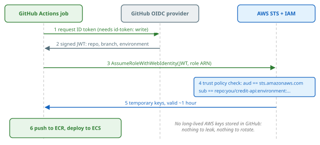
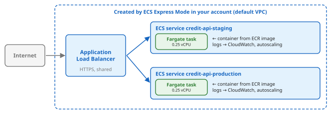

## 10. Keyless OIDC to AWS

### Keyless authentication: GitHub OIDC → AWS

The pipeline must push images and deploy services, so it needs AWS
permissions. The old way was to create an IAM user, generate an
access key, and store it as a GitHub secret. That key never expires,
and if it leaks, someone else can use your account until you notice.

The modern way is **OpenID Connect (OIDC)**. GitHub can issue each job a
short-lived, signed **ID token** (a JWT) that says "I am a workflow run
of repository X, on branch Y, in environment Z". You tell AWS to trust
tokens from GitHub **under specific conditions**. The job exchanges the
token for temporary AWS credentials that expire after about an hour
(Figure 12).



### The trust policy, line by line

Every IAM role has two policies. The **trust policy** answers "who may
assume this role?". We use one template for all our GitHub roles;
`setup.sh` fills in `ACCOUNT_ID`, `GH_OWNER` and `SUBJECT`:

*infra/github-trust-policy.json:*

```json
{
  "Version": "2012-10-17",
  "Statement": [
    {
      "Sid": "GitHubActionsOIDC",
      "Effect": "Allow",
      "Principal": {
        "Federated": "arn:aws:iam::ACCOUNT_ID:oidc-provider/token.actions.githubusercontent.com"
      },
      "Action": "sts:AssumeRoleWithWebIdentity",
      "Condition": {
        "StringEquals": {
          "token.actions.githubusercontent.com:aud": "sts.amazonaws.com",
          "token.actions.githubusercontent.com:sub": "repo:GH_OWNER/credit-api:SUBJECT"
        }
      }
    }
  ]
}
```

| Line | Meaning |
|---|---|
| 7–9 | **Principal**: the identity provider you registered in IAM for `token.actions.githubusercontent.com`. Only tokens signed by GitHub are considered. |
| 10 | **Action**: `sts:AssumeRoleWithWebIdentity` is the STS call that exchanges an OIDC token for credentials. |
| 13 | **Audience** (`aud`): the token must be meant for AWS STS. `configure-aws-credentials` requests exactly this audience. |
| 14 | **Subject** (`sub`): who exactly is calling. A push to `main` gives `repo:you/credit-api:ref:refs/heads/main`; a job that declares `environment: production` gives `repo:you/credit-api:environment:production`. Each role accepts exactly **one** subject; any other repository, fork, branch or environment is rejected. |

**Watch out: The classic OIDC security hole**

Never use a wildcard such as `repo:*` or leave out the `sub`
condition. Then **every** GitHub repository in the world could assume
your role. Keep `sub` as narrow as possible; `StringLike` with
`repo:you/credit-api:*` is the loosest acceptable form.

### The `sub` claim decides everything

Most OIDC problems are a mismatch between the `sub` that GitHub puts
into the token and the list in the trust policy. The format depends on
**how** the job was started, and one rule surprises everybody: **if the
job declares an `environment`, the environment wins** over the branch.

| The job… | gets `sub` = |
|---|---|
| runs on a push to `main`, no environment | `repo:you/credit-api:ref:refs/heads/main` |
| runs on a push to `feature/x` | `repo:you/credit-api:ref:refs/heads/feature/x` |
| runs for a pull request | `repo:you/credit-api:pull_request` |
| runs for a tag push | `repo:you/credit-api:ref:refs/tags/v1.4.0` |
| declares `environment: production`, any trigger | `repo:you/credit-api:environment:production` |

### Three roles, three blast radii

A first version of this pipeline (in the previous edition of this
book) used **one** role that trusted three subjects: `main`, the
`staging` environment and the `production` environment, with
permission to update **any** ECS service. A senior reviewer found the
hole in five minutes:

**What if… a feature branch declares `environment: staging`?**

**What happens:**  Someone pushes a branch with a new workflow whose job says
`environment: staging`. GitHub issues a token with `sub =
…:environment:staging`, which the single role trusted. The job gets
AWS credentials and, because the role could update **every** ECS
service, it can deploy unreviewed code to **production**.

**Why:**  Two weaknesses combined: an environment without rules (anyone
on any branch may use `staging`) and a role broader than any single
job needs.

**What you do:**  Close both, as the repository now does. (1) In **Settings →
Environments**, give **every** environment, staging included, a
deployment-branch rule: only `main`. GitHub then refuses to start a
job for that environment from any other branch, so no token is
ever issued. (2) Split the role: one per stage, each trusting one
subject and allowed to touch only its own resources.

| Role | Trusts only `sub` = | May do |
|---|---|---|
| `github-credit-api-build` | `…:ref:refs/heads/main` | Push images to the `credit-api` repository. Nothing in ECS. |
| `github-credit-api-staging` | `…:environment:staging` | Update the service `credit-api-staging`; read images; pass the two ECS roles. |
| `github-credit-api-production` | `…:environment:production` | Same, for `credit-api-production`; tag images `prod-…`. |

Now the trust policies read like sentences: only code on `main` can
build; only a job that passed the staging rules can touch staging;
only a job a reviewer approved can touch production. A pull request
gets `sub = …:pull_request` and matches no role at all. This is
**defence in depth**: if one control is misconfigured, another still
holds. The permissions live in `infra/permissions-build.json` and
`infra/permissions-deploy.json`; the deploy file is a template in
which `setup.sh` replaces `ENV`:

*infra/permissions-deploy.json (excerpt):*

```json
    {
      "Sid": "EcsUpdateOnlyThisEnvironment",
      "Effect": "Allow",
      "Action": [
        "ecs:UpdateExpressGatewayService",
        "ecs:DescribeExpressGatewayService",
        "ecs:DescribeServices",
        "ecs:ListServiceDeployments",
        "ecs:DescribeServiceDeployments",
        "ecs:UntagResource"
      ],
      "Resource": "arn:aws:ecs:eu-central-1:ACCOUNT_ID:service/*/credit-api-ENV"
    },
```

**Watch out: Verify the service ARN pattern**

The statement above restricts updates to resources matching
`service/*/credit-api-staging` (or `-production`), the format ECS
uses for service ARNs. This edition could not run it against AWS. If
the first deployment fails with `AccessDenied` on
`UpdateExpressGatewayService`, the error names the resource it
tried; compare it with the output of `aws ecs list-services
--cluster default` and adjust the pattern. In a company, the
stronger version of this idea is **one AWS account per environment**
(Chapter 9).

**What if… the AWS login step fails with "Not authorized to perform sts:AssumeRoleWithWebIdentity"?**

**What happens:**  `configure-aws-credentials` fails with `Could not assume role
with OIDC: Not authorized to perform sts:AssumeRoleWithWebIdentity`.

**Why:**  AWS rejected the token. AWS does not tell you which condition
failed (that would help attackers), so check in this order:
1. **Which `sub` did this job get?** Use the table above. Typical: you added `environment: staging` to a job, and its `sub` changed from `ref:refs/heads/main` to `environment:staging`, which is not in the policy. Or the workflow runs on a PR.
1. **Typos.** The owner in `repo:You/credit-api` must match GitHub's spelling; the repository name too. `StringEquals` compares exactly.
1. **Audience.** `aud` must be `sts.amazonaws.com`.
1. **Provider.** The OIDC provider exists in **this** account, and the role's `Principal` contains **this** account ID.
1. **Role ARN.** `vars.AWS_ROLE_ARN` is an **environment** variable: in a job without that environment it is empty or points elsewhere.

**What you do:**  Fix the workflow, or the subject in `setup.sh` and run it
again: it updates existing trust policies
(`aws iam update-assume-role-policy`). AWS
CloudTrail records each failed `AssumeRoleWithWebIdentity` call,
which can confirm **that** it was tried and by which role.

**What if… the error is "Credentials could not be loaded" instead?**

**What happens:**  `Credentials could not be loaded, please check your action
inputs: Could not load credentials from any providers`.

**Why:**  The job never got an OIDC token at all, so AWS was not even
asked: `permissions: id-token: write` is missing. A common way to
lose it: you add a `permissions:` block to a **job** (for example
`contents: write` to create a release). Job-level permissions
**replace** the workflow-level ones; they are not merged.

**What you do:**  List everything the job needs in its own block:
`permissions: {id-token: write, contents: read}`. In a reusable
workflow, the **caller** must grant it as well.

**What if… the login works, but `docker push` says "not authorized"?**

**What happens:**  `denied: User: arn:aws:sts::…:assumed-role/github-actions-…
is not authorized to perform: ecr:InitiateLayerUpload`.

**Why:**  Authentication succeeded (you **are** the role); **authorisation**
failed: the permissions policy does not allow this action on this
resource. Different ECR repository name, different region in the
ARN, or a missing action.

**What you do:**  The message names the exact action and role. Add the action for
the exact resource ARN to the permissions policy; resist the
temptation of `ecr:*` on `*`. Least privilege means you will see
this error a few times while building a pipeline, and each time the
message tells you precisely what is missing.

### One-time setup

`infra/setup.sh` creates the ECR repository, the OIDC provider, the
three GitHub roles and the two roles ECS Express Mode needs. Every
step first checks whether its resource exists, so you can run it again
after changing a policy (an **idempotent** script, the property that
infrastructure-as-code tools give you for free, Chapter 8). Read it
before running it, then:

*terminal:*

```bash
aws sso login
GH_OWNER=<your-github-user> bash infra/setup.sh
```

Afterwards add the variables below in GitHub. None of them is secret:
an ARN is an address, not a password. Most are **repository variables**
(**Settings → Secrets and variables → Actions → Variables**);
`AWS_ROLE_ARN` is an **environment variable**, set once in each
environment (**Settings → Environments → staging → Add variable**), so
the same workflow line resolves to a different role per environment.

| Variable | Value |
|---|---|
| `AWS_BUILD_ROLE_ARN` | `arn:aws:iam::<account>:role/github-credit-api-build` |
| `AWS_ROLE_ARN` (staging) | `…:role/github-credit-api-staging` |
| `AWS_ROLE_ARN` (production) | `…:role/github-credit-api-production` |
| `ECS_EXECUTION_ROLE_ARN` | `arn:aws:iam::<account>:role/ecsTaskExecutionRole` |
| `ECS_INFRA_ROLE_ARN` | `…:role/ecsInfrastructureRoleForExpressServices` |
| `ECR_REGISTRY` | `<account>.dkr.ecr.eu-central-1.amazonaws.com` |

### Choosing a deployment target

| Option | Good at | Why not here |
|---|---|---|
| **ECS Express Mode** (Fargate) | One API call creates service, load balancer, HTTPS URL, autoscaling and canary deployments. You still see and own every resource. | **Our choice.** |
| ECS on Fargate, hand-built | Full control over VPC, load balancer, task definitions. | Twenty resources to wire up before the first request; that belongs in an IaC lesson (Level 5). |
| AWS Lambda | Pay per request, scales to zero. | Cold starts with a 500 MB ML image; 15-minute limit. Shown as an optional variant. |
| Amazon EKS (Kubernetes) | Large platforms with many services. | Costs about 70 USD/month for the control plane alone; Level 5. |
| AWS App Runner | Was the simplest "container → URL" service. | Closed to new customers since April 2026 (box below). |

**Concept: AWS App Runner: what you should know**

App Runner (2021) took a container image or a source repository and
gave you an HTTPS URL with automatic scaling, without load balancers
or clusters. You paid per vCPU and GB while instances were active.
On **30 April 2026** AWS closed App Runner to **new** customers (per AWS's
availability notice when this edition was written; verify). Existing
customers can still use it and create services, and AWS keeps
patching it, but no new features are planned. AWS recommends **ECS
Express Mode** as the replacement, and publishes a migration guide
that shifts traffic with weighted DNS (a blue-green technique, Level
5). In interviews: you may meet App Runner in existing stacks; for
new work you would choose ECS Express Mode or ECS on Fargate.

### What ECS Express Mode creates



**Amazon ECS** (Elastic Container Service) runs containers. A **task** is a
running container (or a group of them). A **service** keeps N copies of a
task running and replaces failed ones. **Fargate** runs tasks without you
managing servers. An **Application Load Balancer** (ALB) receives HTTPS
traffic and forwards it to healthy tasks; it uses our `/health`
endpoint to decide which tasks are healthy. Express Mode creates all of
this in your account's **default VPC** (network) and gives each service
a URL like `https://<name>.ecs.eu-central-1.on.aws`.

**Watch out: What it costs**

Approximate Frankfurt prices (November 2026; check the AWS Pricing
Calculator): one ALB ≈ 0.03 USD/hour; each Fargate task with 0.25 vCPU
and 0.5 GB ≈ 0.015 USD/hour; public IPv4 addresses 0.005 USD/hour
each. Staging plus production together: **roughly 2 USD per day**,
about 60 USD per month if forgotten. Your budget alarms will warn
you, but the habit to build is: **clean up after each session**
(Section 5.6).
