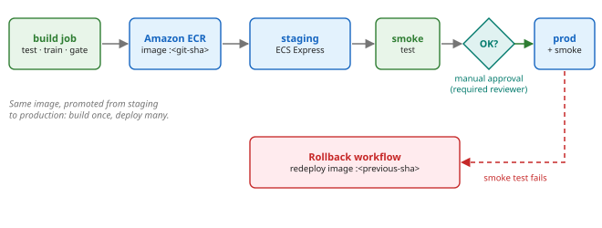

## 11. Deploy & roll back

### The deployment workflow

The deployment is split into two files. `deploy.yml` builds once and
then calls a **reusable workflow** twice, once per environment:

*.github/workflows/deploy.yml:*

```yaml
name: Deploy

on:
  push:
    branches: [main]
  workflow_dispatch:

concurrency:
  group: deploy            # never run two deployments at the same time
  cancel-in-progress: false

permissions:
  id-token: write          # needed to request the OIDC token
  contents: read

env:
  AWS_REGION: eu-central-1
  ECR_REPOSITORY: credit-api

jobs:
  build:
    runs-on: ubuntu-latest
    timeout-minutes: 20
    outputs:
      image: ${{ steps.push.outputs.image }}
    steps:
      - uses: actions/checkout@v7
      - uses: astral-sh/setup-uv@v10.3.3
        with:
          enable-cache: true
      - run: uv sync --locked
      - run: uv run pytest -q
      # With a shared MLflow server, ship the registry's @champion;
      # without one (the tutorial default), train and gate here.
      - if: vars.MLFLOW_TRACKING_URI == ''
        run: uv run python -m credit_api.train
      - if: vars.MLFLOW_TRACKING_URI == ''
        run: uv run python -m credit_api.gate metrics/metrics.json
      - if: vars.MLFLOW_TRACKING_URI != ''
        env:
          MLFLOW_TRACKING_URI: ${{ vars.MLFLOW_TRACKING_URI }}
          MLFLOW_TRACKING_TOKEN: ${{ secrets.MLFLOW_TRACKING_TOKEN }}
        run: uv run --group tracking python -m credit_api.export_champion

      - name: Log in to AWS with OIDC (no stored keys)
        uses: aws-actions/configure-aws-credentials@v6
        with:
          role-to-assume: ${{ vars.AWS_BUILD_ROLE_ARN }}
          aws-region: ${{ env.AWS_REGION }}

      - name: Log in to Amazon ECR
        id: ecr
        uses: aws-actions/amazon-ecr-login@v2

      - name: Build and push image tagged with the git SHA
        id: push
        env:
          IMAGE: ${{ steps.ecr.outputs.registry }}/${{ env.ECR_REPOSITORY }}
        run: |
          docker build -t "$IMAGE:$GITHUB_SHA" .
          docker push "$IMAGE:$GITHUB_SHA"
          # deploy by digest: the exact bytes we built and tested
          DIGEST=$(docker inspect --format '{{index .RepoDigests 0}}' \
            "$IMAGE:$GITHUB_SHA")
          echo "image=$DIGEST" >> "$GITHUB_OUTPUT"

  deploy-staging:
    needs: build
    if: vars.DEPLOY_FREEZE != 'true'   # set the variable to pause deploys
    uses: ./.github/workflows/_deploy-env.yml
    with:
      environment: staging
      image: ${{ needs.build.outputs.image }}
      version: ${{ github.sha }}

  deploy-production:
    needs: deploy-staging
    uses: ./.github/workflows/_deploy-env.yml
    with:
      environment: production
      image: ${{ needs.build.outputs.image }}
      version: ${{ github.sha }}
```

- Lines 8–10: `concurrency: deploy` with `cancel-in-progress: false` queues deployments instead of running two at once or killing one halfway.
- Line 13: `id-token: write` allows the jobs to request the OIDC token. Without it, `configure-aws-credentials` fails with "Credentials could not be loaded".
- Lines 31–43: the build job re-runs the tests and then gets a model: without a shared MLflow server (the tutorial default) it trains and runs the quality gate; with one, it exports the registry's
`@champion` instead (Chapter 6 explains why that matters). An image is only built from code and a model that passed.
- Line 48: the build job uses the **build** role, which can push images and nothing else.
- Lines 55–65: the image is tagged with `$GITHUB_SHA`, the full commit ID, for humans. The job **outputs** the image **digest** (`…/credit-api@sha256:4f1c…`), a hash of the image's content, so later jobs deploy exactly the bytes that were built and tested: **build once, deploy many**. A tag is a name that could, in a mutable repository, point to different images over time; a digest cannot.
- Line 69: if the repository variable `DEPLOY_FREEZE` is `true`, both deployments are skipped (a **deploy freeze**, e.g. during an incident or over the holidays). Rollbacks are not affected.

*.github/workflows/_deploy-env.yml:*

```yaml
# Reusable workflow: deploy one image to one environment, then smoke-test.
name: deploy-env

on:
  workflow_call:
    inputs:
      environment:
        type: string
        required: true
      image:
        type: string
        required: true
      version:
        type: string
        required: true

permissions:
  id-token: write
  contents: read

jobs:
  deploy:
    runs-on: ubuntu-latest
    timeout-minutes: 30
    # One deployment per environment at a time, shared by deploy.yml
    # and rollback.yml, so a rollback never races a deployment
    concurrency:
      group: deploy-${{ inputs.environment }}
      cancel-in-progress: false
    environment:
      name: ${{ inputs.environment }}
      url: ${{ steps.deploy.outputs.endpoint }}
    steps:
      - uses: actions/checkout@v7

      - uses: aws-actions/configure-aws-credentials@v6
        with:
          # an *environment* variable: a different role per environment
          role-to-assume: ${{ vars.AWS_ROLE_ARN }}
          aws-region: eu-central-1

      - name: Deploy to ECS Express Mode (Fargate + load balancer)
        id: deploy
        uses: aws-actions/amazon-ecs-deploy-express-service@v1
        with:
          service-name: credit-api-${{ inputs.environment }}
          image: ${{ inputs.image }}
          execution-role-arn: ${{ vars.ECS_EXECUTION_ROLE_ARN }}
          infrastructure-role-arn: ${{ vars.ECS_INFRA_ROLE_ARN }}
          container-port: 8080
          health-check-path: /health
          cpu: "256"
          memory: "512"
          min-task-count: 1
          max-task-count: 2
          environment-variables: |
            [{"name": "APP_VERSION", "value": "${{ inputs.version }}"}]

      - name: Smoke test
        run: >
          python3 scripts/smoke_test.py
          "${{ steps.deploy.outputs.endpoint }}" "${{ inputs.version }}"

      - name: Distribution check (are the predictions plausible?)
        run: >
          python3 scripts/distribution_check.py
          "${{ steps.deploy.outputs.endpoint }}" 200

      - name: Protect the image from expiry once it ran in production
        if: inputs.environment == 'production'
        env:
          TAG: ${{ inputs.version }}
        run: |
          aws ecr describe-images --repository-name credit-api \
            --image-ids imageTag="prod-$TAG" > /dev/null 2>&1 && exit 0
          MANIFEST_TYPE=$(aws ecr batch-get-image \
            --repository-name credit-api --image-ids imageTag="$TAG" \
            --query 'images[0].imageManifestMediaType' --output text)
          aws ecr batch-get-image --repository-name credit-api \
            --image-ids imageTag="$TAG" \
            --query 'images[0].imageManifest' --output text > manifest.json
          aws ecr put-image --repository-name credit-api \
            --image-tag "prod-$TAG" --image-manifest file://manifest.json \
            --image-manifest-media-type "$MANIFEST_TYPE" > /dev/null
```

- Lines 27–29: one deployment per environment at a time. `rollback.yml` uses the same reusable workflow and therefore the same group, so a rollback waits for a running deployment instead of racing it.
- Lines 30–32: `environment:` links the job to a GitHub **environment** (next section). Its `url` appears as a link on the run page.
- Line 39: `vars.AWS_ROLE_ARN` is an environment variable, so staging and production assume different roles.
- Lines 42–57: the Express action creates the service on the first run and updates it afterwards, then **waits** until the new tasks are healthy. `APP_VERSION` is passed into the container so `/health` reports which commit is running.
- Lines 59–67: the smoke test ("is it alive and the right version?") and the distribution check ("are its decisions plausible?", Chapter 7) run against the real URL.
- Lines 69–84: after a successful production deployment, the image gets a second tag `prod-<sha>`, which the ECR lifecycle policy protects (box below).

### Environments, approval and versioning

In GitHub, **Settings → Environments → New environment**:

- `staging`: **Deployment branches and tags** = `main` only. No reviewers: it deploys automatically. The branch rule is not optional; the what-if in Section 5.3 shows what happens without it.
- `production`: **Required reviewers** = you (or your team); **Deployment branches and tags** = `main` only. Optionally a **wait timer** and **Prevent self-review**.

When the pipeline reaches `deploy-production`, it pauses and GitHub
shows **Review deployments**. Nothing happens until a reviewer approves:
this is continuous **delivery**. Remove the reviewer rule and you have
continuous **deployment**.



**Image tags.** Our ECR repository is **immutable**: a tag can never be
overwritten. The git SHA identifies every build uniquely and links the
running container to the exact code. For human-friendly releases, add
a **semantic version** tag when you create a GitHub release, e.g. trigger
on `push: tags: ["v*"]` and push the same image also as `:v1.4.0`.
Avoid `:latest` in production: it tells you nothing about what is
running, and with immutable tags you cannot even push it twice.

### Smoke tests and rollback

A **smoke test** is a short check right after deployment: "does the new
version answer, and is it the version we just deployed?" It is not a
full test suite; it catches broken configuration, missing files, wrong
ports. Ours checks `/health` (with retries while tasks start), the
reported version, and one real prediction:

*scripts/smoke_test.py:*

```python
def main(base: str, expected_version: str) -> int:
    if not base.startswith("http"):
        base = "https://" + base
    for attempt in range(1, 11):  # new tasks may need a minute
        try:
            health = call(f"{base}/health")
            break
        except OSError as exc:
            print(f"attempt {attempt}: {exc}; retrying in 15 s")
            time.sleep(15)
    else:
        print("service never became healthy")
        return 1
    if health.get("version") != expected_version:
        print(f"wrong version: {health} (expected {expected_version})")
        return 1
    pred = call(f"{base}/predict", APPLICANT)
    if not 0 <= pred["probability_bad"] <= 1:
        print(f"nonsense prediction: {pred}")
        return 1
    print(f"smoke test passed: {health} {pred}")
    return 0
```

If the smoke test fails, the job fails, and production is never
reached (or, for production, you know within seconds). Express Mode
also uses **canary deployments** with alarm-based automatic rollback (as
documented when this edition was written; verify the current options) on
HTTP errors. For a **manual** rollback, `rollback.yml` redeploys an older
image by SHA through the same reusable workflow. In the Actions tab:
**Rollback → Run workflow** → environment + SHA. Because the image
already exists in ECR, a rollback takes about as long as a deployment,
with no build. (Do not confuse it with `git revert`, which fixes the
code. A rollback is the fast emergency step; the revert follows.)

### What can go wrong during a deployment

**What if… I merge three PRs within two minutes?**

**What happens:**  Merge A starts `Deploy`. B and C start `Deploy` too, but the
concurrency group `deploy` allows only one **running** and one
**pending** run. When C arrives, GitHub **cancels the pending B**. The
Actions tab shows B as cancelled.

**Why:**  With `cancel-in-progress: false`, the running deployment is
protected, but there is room for only one waiting run per group.

**What you do:**  Nothing: this is what you want. C's image contains A, B and C
(it was built from the newest `main`), so deploying B in between
would be wasted time. Be aware of it when someone asks "why was my
deployment cancelled?". If every commit must be deployed
individually (rare), use one concurrency group per commit and let
ECS serialise them, or deploy through a queue.

**What if… the new version starts but crashes on real traffic?**

**What happens:**  Staging and the smoke test were green. Ten minutes after
production went live, error rates rise.

**Why:**  A smoke test checks that the service is **alive**, not that it
handles every real request. Production has inputs, volumes and
clients that staging does not.

**What you do:**  Two safety nets, in this order. First, Express Mode's **canary**:
a small share of traffic goes to the new tasks first, and if the
CloudWatch alarm on HTTP 5xx fires, ECS rolls back by itself. Second,
your rollback workflow, by SHA. Then reproduce the failing request
in a test and fix forward. Over time, every production incident
should leave behind a test that would have caught it.

**What if… nobody approves the production deployment?**

**What happens:**  The run waits in "Waiting for review". After 30 days the
pending deployment fails on its own.

**What you do:**  That is harmless: staging has the new version, production the
old one, both healthy. Configure **Environments → production → Wait
timer** or reminders as your team prefers. What you should **not** do
is approve old runs out of order: always approve the newest one,
and reject (or let expire) the rest.

**What if… ECR deletes the image that production is running?**

**What happens:**  A quiet week in production, a busy week in staging: twelve
merges. Then production scales out to a second task, or AWS replaces
an unhealthy one, and it fails with `CannotPullContainerError`. The
image production runs no longer exists. The same error appears when
you try to roll back to a SHA from two months ago.

**Why:**  The first edition's lifecycle policy kept "the 10 newest images,
any tag". It counted **builds**, not **what is running**: after ten
staging builds, the production image was expired. A rule written to
save storage became an outage.

**What you do:**  Make "has run in production" visible to the policy. The
production deploy job adds a second tag `prod-<sha>` (lines 69–84 of
`_deploy-env.yml`), and the lifecycle policy treats those images
separately:

*infra/ecr-lifecycle.json:*

```json
{
  "rules": [
    {
      "rulePriority": 1,
      "description": "Images that ran in production: keep the newest 20",
      "selection": {
        "tagStatus": "tagged",
        "tagPrefixList": ["prod-"],
        "countType": "imageCountMoreThan",
        "countNumber": 20
      },
      "action": { "type": "expire" }
    },
    {
      "rulePriority": 2,
      "description": "All other images: keep the newest 30",
      "selection": {
        "tagStatus": "any",
        "countType": "imageCountMoreThan",
        "countNumber": 30
      },
      "action": { "type": "expire" }
    }
  ]
}
```

An image matched by a higher-priority rule is not expired by a
lower-priority one, so the 20 newest production images survive any
number of staging builds, and your rollback window is "the last 20
production releases". Before starting a rollback, check the image:
`aws ecr describe-images --repository-name credit-api --image-ids
imageTag=<sha>`.

**What if… the old image is fine, but rolling back would break clients?**

**What happens:**  Version 2 added a response field `explanation` (the top
three reasons for the decision), and the bank's web app now shows
it. Version 2 has a memory leak, so you roll back to version 1. The
web app now receives responses without `explanation` and its page
crashes.

**Why:**  A rollback restores the **code**, not the world around it:
clients, database schemas, message formats.

**What you do:**  Change interfaces in steps that are each safe to roll back
(**expand, then contract**): release the new field, let it run
stably for a while, and only then let clients **depend** on it;
clients should treat new fields as optional at first. Remove old
fields last. (In the other direction our API is forgiving already:
Pydantic **ignores** unknown request fields by default, so clients
may send a new field before the server knows it. A schema with
`extra="forbid"` would turn that into a 422.) For databases, the
same rule: add columns in one release, use them in the next, drop
old ones in a third. And for ML specifically: because our image
contains the model, rolling back the image rolls back the model
too. If the model is loaded from a registry at runtime instead,
you must roll back **both** (image **and** alias) to restore the old
behaviour.

**What if… I need to roll back **now**, and the approval rule slows me down?**

**What happens:**  `rollback.yml` reuses the production environment, so it
waits for a reviewer, at 2 a.m., during an incident.

**What you do:**  Decide this calmly, before the incident. Options: allow
administrators to bypass the review (environment setting), add a
second reviewer so one is always reachable, or create a separate
`production-rollback` environment that only accepts images that
have already been deployed to production. The worst option is the
common one: someone with console access changes the service by
hand, and Git no longer tells the truth about what is running.
Two more things to check during the incident: set `DEPLOY_FREEZE`
so that the next merge does not redeploy the broken version on top
of your rollback, and reject any production deployment that is
still **waiting for approval**, so nobody approves it by reflex later.
Rollback and deployment share the concurrency group
`deploy-production`, so they can never run at the same time.

**Concept: Optional: the same image on AWS Lambda**

Lambda can run container images. With the **AWS Lambda Web Adapter**,
a normal HTTP app like ours runs on Lambda without code changes:
`Dockerfile.lambda` adds the adapter as a Lambda **extension**, which
translates Lambda invocations into HTTP requests to uvicorn. Push it
to ECR as `credit-api:lambda-<sha>`, then create the function with
`aws lambda create-function --package-type Image --code
ImageUri=<image> --role <lambda-role-arn> --memory-size 1024
--timeout 30` and expose it with `aws lambda
create-function-url-config --auth-type NONE` (the console adds the
required invoke permission; with the CLI add it with `aws lambda
add-permission`). Expect a cold start of several seconds for an image
with scikit-learn; this variant was not executed for this book.

### Cleanup: stop paying

**Watch out: Run this at the end of every AWS session**

Everything in this chapter is reproducible: the next push recreates
the services. There is no reason to leave them running overnight.

To pause cheaply but keep the setup, delete only the two Express
services (step 1 below). To remove everything, run the script:

*infra/cleanup.sh:*

```bash
#!/usr/bin/env bash
# Delete everything the tutorial created, so nothing keeps billing.
#   bash infra/cleanup.sh
set -uo pipefail          # no -e: keep going if something is gone already
export AWS_REGION=eu-central-1
P=arn:aws:iam::aws:policy/service-role   # AWS-managed policies

echo "1) ECS Express services (also removes ALB, target groups, SGs)"
for arn in $(aws ecs list-services --cluster default \
               --query 'serviceArns[]' --output text); do
  echo "   deleting $arn"
  aws ecs delete-express-gateway-service --service-arn "$arn" \
    --monitor-resources
done

echo "2) ECR repository and all images"
aws ecr delete-repository --repository-name credit-api --force
```

The rest of the script (in the repository) deletes the log groups,
the IAM roles and the OIDC provider, and finally lists anything that
is still there. Check by hand, too: in the console, open **Billing →
Bills** the next day and confirm there are no running charges, and look
at **Resource Explorer** (all regions) for leftovers. Keep the budgets:
they are free.

**What if… the cleanup script prints errors?**

**What happens:**  Lines like `An error occurred (NoSuchEntity) … The role with
name ecsTaskExecutionRole cannot be found` or
`RepositoryNotFoundException`.

**Why:**  The script uses `set -uo pipefail` **without** `-e` on purpose: it
keeps going if something is already gone, so it can be run twice.
"Not found" means "already deleted": good. A real problem looks
different: `DeleteConflict` (a role is still attached to something),
`DependencyViolation` (a security group is still used), or
`AccessDenied` (your SSO session expired: run `aws sso login`).

**What you do:**  Read the last section of the output: it lists services, load
balancers and tagged resources that still exist. Run the script
again after a few minutes (deleting an Express service takes time
to remove the load balancer behind it), and delete stragglers in
the console.

**What if… I forgot to clean up for a month?**

**What happens:**  The bill shows around 60 USD for the load balancer, tasks
and public IPs.

**What you do:**  Clean up immediately, then open a case in the **AWS Support
Center** (account and billing support is free): explain it was an
unintended charge on a learning account, and what you have changed
(cleanup script, budgets). AWS sometimes grants a one-time credit
for such cases, but there is no guarantee. The budget alarms you set
up in Section 5.1 exist so this conversation never becomes
necessary.

**Exercise: Prove the approval gate**

Change the response of `/health` to include `"python": "3.12"`,
merge, and follow the run. Approve production only after you have
called the staging URL yourself. Then use the rollback workflow to
return production to the previous SHA, and confirm with `curl`.

**Exercise: Prove the environment rule**

On a feature branch, add a workflow with one job that declares
`environment: staging` and runs `aws sts get-caller-identity` after
`configure-aws-credentials`. Push it. What does GitHub do, and at
which point? Then temporarily allow all branches for `staging` and
push again: what does AWS answer now, and why is that still not a
production risk with three roles? Restore the rule.

**Exercise: Break OIDC on purpose**

Add `environment: staging` to the `build` job in `deploy.yml` without
changing anything else. Does the AWS login still work? Then add
`permissions: {contents: read}` to the `build` job. What error do you
get now, and why? Restore both.

**Exercise: Simulate the listen-address bug**

Change the `CMD` in the Dockerfile to drop `--host 0.0.0.0`, build,
run with `-p 8080:8080`, and `curl` the health endpoint. What do you
see? Then use `docker exec` to call the endpoint from **inside** the
container (`python -c "import urllib.request as u;
print(u.urlopen('http://localhost:8080/health').read())"`).

**Checkpoint: you should now be able to…**

- set up an AWS account with root MFA, Identity Center, budgets and the right region;
- write a multi-stage, non-root Dockerfile and explain layer caching;
- explain OIDC and every line of the trust policy, and why the pipeline uses one role per stage plus branch rules on **every** environment;
- deploy by digest, protect production images from lifecycle expiry, and freeze deployments during an incident;
- predict a job's `sub` claim and debug the three typical AWS login and permission errors;
- debug a container that is healthy locally but not on Fargate;
- explain what rollback can and cannot restore (lifecycle policy, client contracts, model in image vs. registry);
- deploy with environments, manual approval, SHA tags and smoke tests, and roll back;
- explain why App Runner is no longer an option and what ECS Express Mode creates;
- delete everything you created.
