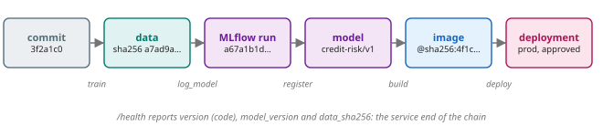

## 13. MLflow & registry

### Experiment tracking and the model registry with MLflow

A gate answers "is this model good enough?". A **registry** answers
"which model is in production, where did it come from, and what was
there before?". **MLflow** records each training **run** (parameters,
metrics, artefacts such as the model file) and keeps **registered
models** with numbered versions.

*src/credit_api/train.py:*

```python
def log_to_mlflow(
    model: Pipeline, metrics: dict[str, float], params: dict[str, Any]
) -> None:
    import mlflow  # imported lazily: only needed with --track

    mlflow.set_experiment("credit-risk")
    with mlflow.start_run():
        mlflow.log_params(params)
        mlflow.set_tag("data_sha256", file_sha256(DATA_PATH))
        mlflow.log_metrics(metrics)
        mlflow.sklearn.log_model(
            model,
            name="model",
            registered_model_name="credit-risk",
            # MLflow 3 saves sklearn models with skops (safer than
            # pickle) and asks us to vouch for non-standard types
            skops_trusted_types=[TREE_PREDICTOR],
        )
```

Every `--track` run creates a new version of the registered model
`credit-risk`. Versions are labelled with **aliases**: `@champion` for
the model in production and `@challenger` for the newest candidate.
Code loads `models:/credit-risk@champion`, so promotion and rollback
are just moving an alias.

**Concept: Aliases replace the old "stages"**

Older tutorials move models between the **stages** `Staging` and
`Production`. MLflow deprecated stages in version 2.9 in favour of
aliases and tags, because one fixed set of stages did not fit real
workflows. If you meet stages in an existing project, the concept
maps directly: `Production` ≈ `@champion`.

`promote.py` implements champion/challenger: the newest version
becomes `@challenger`; if it passes the same gate against the current
champion's metrics, it becomes `@champion`:

*src/credit_api/promote.py:*

```python
def main() -> int:
    client = MlflowClient()
    versions = client.search_model_versions(f"name='{NAME}'")
    newest = max(versions, key=lambda v: int(v.version))
    client.set_registered_model_alias(NAME, "challenger", newest.version)
    new = client.get_run(str(newest.run_id)).data.metrics

    try:
        champ = client.get_model_version_by_alias(NAME, "champion")
        baseline = client.get_run(str(champ.run_id)).data.metrics
    except MlflowException:
        print("no champion yet: the first model becomes champion")
        baseline = {}

    cfg = json.loads(THRESHOLDS.read_text())
    failures = check(new, baseline, cfg["floors"], cfg["max_drop"])
    if failures:
        print("challenger rejected:", *failures, sep="\n  - ")
        return 1
    client.set_registered_model_alias(NAME, "champion", newest.version)
    print(f"version {newest.version} is now @champion")
    return 0

if __name__ == "__main__":
    sys.exit(main())
```

The **weekly retraining** workflow ties it together. A `schedule`
trigger runs it every Monday; `workflow_dispatch` adds a manual button:

*.github/workflows/retrain.yml:*

```yaml
name: Weekly retrain

on:
  schedule:
    - cron: "0 3 * * 1"     # Mondays 03:00 UTC
  workflow_dispatch:         # plus a "Run workflow" button

# Only one run may write to the model registry at a time
concurrency:
  group: model-registry
  cancel-in-progress: false

permissions:
  contents: read

jobs:
  retrain:
    runs-on: ubuntu-latest
    timeout-minutes: 30
    env:
      # Real teams point this at a shared MLflow server; the fallback
      # keeps the tutorial runnable without one.
      MLFLOW_TRACKING_URI: >-
        ${{ vars.MLFLOW_TRACKING_URI || 'sqlite:///mlflow.db' }}
      MLFLOW_TRACKING_TOKEN: ${{ secrets.MLFLOW_TRACKING_TOKEN }}
    steps:
      - uses: actions/checkout@v7
      - uses: astral-sh/setup-uv@v10.3.3
        with:
          enable-cache: true
      - run: uv sync --locked --group tracking
      - name: Train and register a new model version
        run: uv run python -m credit_api.train --track
      - name: Promote to @champion if it beats the current one
        run: uv run python -m credit_api.promote
      - uses: actions/upload-artifact@v7
        if: always()
        with:
          name: mlflow-db
          path: mlflow.db
          if-no-files-found: ignore
```

**Try it: See it locally**

`export MLFLOW_TRACKING_URI=sqlite:///mlflow.db`, then run
`uv run --group tracking python -m credit_api.train --track` twice
(once with `--max-iter 3` for a deliberately bad model), then
`uv run --group tracking python -m credit_api.promote` after each.
The bad model is rejected. Browse the runs with
`uv run --group tracking mlflow ui --backend-store-uri
sqlite:///mlflow.db` at `http://localhost:5000`.

**Watch out: Where MLflow lives in a team**

A SQLite file on a CI runner disappears after the job; our workflow
uploads it as an artefact only so the tutorial works without a
server. In a team, `MLFLOW_TRACKING_URI` points to a shared tracking
server (self-hosted on ECS with a database and S3, or a managed
offering such as Amazon SageMaker's MLflow), and the deploy pipeline
exports `models:/credit-risk@champion` (`export_champion.py`) instead
of training a fresh model.

### Closing the loop: which model is actually running?

Be precise about what the tutorial setup does, because an interviewer
will be. Without a shared tracking server, `retrain.yml` registers and
promotes models in a SQLite file that disappears after the job. Its
`@champion` **never reaches production**; `deploy.yml` trains its own
model from the merged code. Both are legitimate designs, and you must
be able to say which one you run:

|  | Train-in-deploy (tutorial default) | Registry-driven (`MLFLOW_TRACKING_URI` set) |
|---|---|---|
| Model in the image | Trained from the commit being deployed | `@champion`, exported by `export_champion.py` |
| Quality gate | `gate.py` against `baseline.json` | `promote.py`, before the alias moves |
| A new model ships when… | code or data changes are merged | retraining promotes a challenger **and** a deploy runs |
| Reproducible from Git alone? | Yes | No: needs the registry |
| Good for | Small models, few retrains | Expensive training, frequent retrains, several consumers of one model |

`deploy.yml` (lines 33–43) supports both: if the repository variable
`MLFLOW_TRACKING_URI` is set, the build exports the champion instead
of training. In registry mode, `baseline.json` should not be edited by
hand any more: the champion's own metrics are the baseline, otherwise
there are two sources of truth that will disagree.

**Lineage** is the chain that lets you answer "what exactly is running?"
in one minute during an incident:



Every link is recorded somewhere: Git, the `data_sha256` tag on the
MLflow run, the registry version, the image digest in the deploy job,
the GitHub deployment history. `train.py` and `export_champion.py`
write the part the **service** needs into `models/model_meta.json`, and
`/health` reports it. This is real output with the exported champion:

*expected output:*

```text
{'status': 'ok', 'version': '3f2a1c0', 'model_version': 'credit-risk/v1',
 'data_sha256': 'a7ad9a21934f'}
```

`version` is the code (git SHA), `model_version` the model, and
`data_sha256` the training data. Before this edition, the API reported
the git SHA as `model_version`, which stops being true the moment
models come from a registry.

### When to retrain: a decision table

"We retrain weekly" is a junior answer; a senior answer names the
**trigger** and who decides:

| Trigger | Use when | Watch out |
|---|---|---|
| Schedule (our weekly job) | Data arrives steadily; cheap training | Retrains even when nothing changed; promotes noise unless the gate is paired (box above). |
| New labelled data | Labels arrive in batches (e.g. loan outcomes after 12 months) | Label delay: the newest data has no labels yet. |
| Drift alarm (Chapter 7) | Inputs shift, labels are slow | Drift is a reason to **look**; retraining on drifted data can bake in a data bug. |
| Performance alarm | Labels arrive quickly (fraud chargebacks) | The best trigger when you have it; most credit models do not. |
| Code or feature change | Always, through the normal PR | Already covered by CI. |

Whichever trigger fires, **promotion** stays a gated decision, and for a
credit model in the EU a human approval of the production deploy is a
sensible default (Chapter 7 explains the regulatory side).

**What if… the challenger was evaluated on newer data than the champion?**

**What happens:**  `promote.py` compares the challenger's metrics from **its**
training run with the champion's metrics from **its** run. If the data
grew between the two runs (new applicants arrived, so the split
contains different rows), the two numbers come from different test
sets. The challenger may "lose" against a champion that would score
lower on today's data, or "win" for the same reason.

**Why:**  Lesson 3 above: on 250 rows, the test set alone is worth
±0.06.

**What you do:**  For promotion decisions, evaluate **both** models on the **same**,
current test set, inside the promotion job: load
`models:/credit-risk@champion`, score it on today's test split,
score the challenger on the same rows, then apply the gate. This is
called a **paired** comparison, and it is much more sensitive than
comparing two numbers from different runs. Our `promote.py` keeps
the simple version for readability; an exercise at the end of
this chapter asks you to improve it.

**What if… the new champion turns out bad in production?**

**What you do:**  Because code loads `@champion`, rollback is moving the alias
back, one API call:

```python
from mlflow import MlflowClient

MlflowClient().set_registered_model_alias(
    "credit-risk", "champion", "7"    # the previous good version
)
```

Note **where** the model is loaded. In our image-based setup, the
model is baked in at build time, so moving the alias changes nothing
until the next build and deploy: rollback = redeploy the previous
image (Level 3). In a setup that loads `@champion` at startup,
moving the alias and restarting the tasks is the rollback. Know
which one your system is, before the incident.

**What if… two retraining runs promote at the same time?**

**What happens:**  The schedule fires while someone clicks **Run workflow**.
Both runs register a version, both set `@challenger`, and the
"newest version" one of them promotes is not the one it trained.

**What you do:**  One concurrency group for everything that writes to the
registry. Our `retrain.yml` has it (lines 8–11):
`concurrency: {group: model-registry, cancel-in-progress: false}`. And promote the version **this run**
registered (MLflow returns it from `log_model`), not "the newest
version in the registry".
