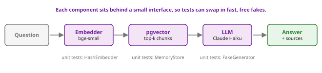
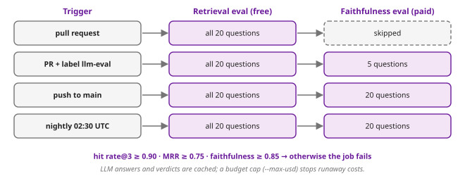

## 14. Evaluating RAG

### Part B · LLM systems: the RAG service

`rag-api` answers employee questions from a (fictional) company
handbook: vacation, sick leave, expenses, on-call. It embeds the
question, retrieves the three most similar text chunks from
Postgres with **pgvector**, and asks an LLM to answer **only from those
chunks**. The design choice that makes CI possible is that every
component sits behind a small interface with a free, deterministic
fake for unit tests (Figure 17).



*src/rag_api/embeddings.py (excerpt):*

```python
class Embedder(Protocol):
    dim: int

    def embed(self, texts: list[str]) -> Vectors: ...

class HashEmbedder:
    """Bag-of-words hashed into a fixed-size vector (a test double)."""

    def __init__(self, dim: int = 256) -> None:
        self.dim = dim

    def embed(self, texts: list[str]) -> Vectors:
        out = np.zeros((len(texts), self.dim), dtype=np.float32)
        for row, text in enumerate(texts):
            for word in re.findall(r"[a-zäöüß0-9]+", text.lower()):
                h = int(hashlib.md5(word.encode()).hexdigest(), 16)
                out[row, h % self.dim] += 1.0
        norms = np.linalg.norm(out, axis=1, keepdims=True)
        return (out / np.maximum(norms, 1e-9)).astype(np.float32)
```

`Embedder` is a `Protocol`: any class with a `dim` and an `embed()`
method fits. In unit tests, `HashEmbedder` turns words into hashed
counts: meaningless as semantics, but deterministic, instant and free.
In the evaluation, `FastEmbedder` runs the real model
`BAAI/bge-small-en-v1.5` locally on the CPU (ONNX, about 70 MB, no API
key). The same pattern gives `MemoryStore` vs. `PgVectorStore` and
`FakeGenerator` vs. `ClaudeGenerator`. Result: 15 unit tests run in
under a second without network access, and one integration test runs
against a real Postgres with pgvector.

#### The golden set

A **golden set** is a small, hand-curated list of questions with the
expected source and a reference answer. It is the test data of an LLM
system. Twenty good questions beat two hundred generated ones;
include easy cases, paraphrases, questions that need the right
paragraph, and some that mention German terms.

*eval/golden.jsonl (two of 20 lines, wrapped for print):*

```text
{"id": "q04", "question": "When do I need a doctor's certificate when
  I am sick?", "expected_doc": "sick-leave", "reference": "From the
  fourth calendar day of illness."}
{"id": "q17", "question": "What documents do I need for the
  Anmeldung?", "expected_doc": "onboarding", "reference": "Passport
  and the Wohnungsgeberbestätigung."}
```

**What if… the team tunes the system until the golden set is perfect?**

**What happens:**  After a month of prompt tweaks, hit rate is 1.00 and
faithfulness 1.00, but users report the same problems as before.

**Why:**  The golden set became **training data**: every change was judged
by it, so the system was fitted to these 20 questions. Same problem
as tuning a model on its test set.

**What you do:**  Keep a second, **held-out** set that only the nightly job uses and
nobody looks at while tuning. Grow the golden set from **production**:
every bad answer a user reports becomes a new golden question (after
removing personal data), so the set follows real usage. And version
the golden set in Git: a metric change caused by a golden-set change
must be visible in the same PR.

#### The evaluation gate

| Metric | Meaning | Threshold |
|---|---|---|
| Hit rate@3 | Share of questions where the expected document is among the 3 retrieved chunks. Measures **retrieval**. | ≥ 0.90 |
| MRR | Mean reciprocal rank: 1 if the right document is first, 1/2 if second, 1/3 if third, else 0, averaged. | ≥ 0.75 |
| Faithfulness | Share of answers whose every claim is supported by the retrieved context, judged by an LLM. Measures **hallucination**. | ≥ 0.85 |

*eval/run_eval.py (core loop):*

```python
    hits, rr, faithful = 0, 0.0, 0
    for item in golden:
        results = rag.retrieve(item["question"], args.k)
        docs = [chunk.doc for chunk, _ in results]
        hits += item["expected_doc"] in docs
        rr += reciprocal_rank(docs, item["expected_doc"])
        status = "HIT " if item["expected_doc"] in docs else "MISS"
        print(f"{status} {item['id']} {item['question'][:50]:<50} {docs}")
        if judge:
            answer = rag.answer(item["question"], args.k)
            context = [chunk.text for chunk, _ in results]
            faithful += judge.judge(context, answer.text).faithful

    n = len(golden)
    scores = {f"hit_rate_at_{args.k}": hits / n, "mrr": rr / n}
    if judge:
        scores["faithfulness"] = faithful / n
        print(f"judge cost this run: ${judge.spent_usd:.4f}")
    (HERE / "scores.json").write_text(json.dumps(scores, indent=2))

    limits = json.loads((HERE / "thresholds.json").read_text())
    failed = False
    for name, value in scores.items():
        ok = value >= limits[name]
        failed |= not ok
        print(
            f"{name:<14} {value:.3f}  (min {limits[name]})  "
            f"{'ok' if ok else 'FAIL'}"
        )
    return 1 if failed else 0
```

Retrieval metrics need no LLM at all, so they are free and fast. The
real run with the local embedding model:

*terminal:*

```bash
uv run python eval/run_eval.py
```

*expected output:*

```text
HIT  q01 How many vacation days do full-time employees  ['vacation', …]
HIT  q07 Which days do I have to be in the Berlin office?  ['onboarding',
     'remote-work', 'expenses']
…
hit_rate_at_3  1.000  (min 0.9)  ok
mrr            0.975  (min 0.75)  ok
```

Look at q07: the right document is only in second place. That is
exactly the kind of case a changed chunking strategy can push out of
the top 3; the gate would catch it.

**Faithfulness** uses an **LLM as a judge**. The judge sees the retrieved
context and the answer, and returns a structured verdict. The SDK's
`messages.parse()` validates the response against a Pydantic model,
so the code never parses free text:

*src/rag_api/judge.py (excerpt):*

```python
    def judge(self, context: list[str], answer: str) -> Verdict:
        prompt = JUDGE_PROMPT.format(
            context="\n\n".join(context), answer=answer
        )
        key = hashlib.sha256((self.model + prompt).encode()).hexdigest()
        cached = self.cache_dir / f"{key}.json"
        if cached.exists():  # same input as last time: free
            return Verdict.model_validate_json(cached.read_text())
        if self.spent_usd >= self.max_usd:
            raise RuntimeError(f"eval budget of ${self.max_usd} used up")

        response = self.client.messages.parse(
            model=self.model,
            max_tokens=300,
            messages=[{"role": "user", "content": prompt}],
            output_format=Verdict,
        )
        price_in, price_out = PRICES.get(self.model, (5.0, 25.0))
        usage = response.usage
        self.spent_usd += (
            usage.input_tokens * price_in + usage.output_tokens * price_out
        ) / 1e6
        verdict = response.parsed_output
        if verdict is None:  # e.g. a refusal: count it as a failure
            verdict = Verdict(faithful=False, reason="no verdict")
        cached.write_text(json.dumps(verdict.model_dump()))
        return verdict
```

**Watch out: LLM judges have limits**

A judge is a model too: it can be wrong, and it may favour answers
that sound like its own. Spot-check its verdicts by hand, keep the
judge prompt under version control (a prompt change changes the
metric), and prefer a different or stronger model as judge when the
stakes are high. Our companion code makes the cheap choice: by
default the generator and the judge are the **same** small model
(`claude-haiku-5-5`), which keeps CI cheap but means the judge grades
its own family's answers. Set `JUDGE_MODEL` to a larger model for the
nightly run (and add its price to `PRICES` in `judge.py`, or the
budget check cannot count it); say this trade-off out loud in an
interview. The judge path was tested with a mocked client; running
it needs an `ANTHROPIC_API_KEY`.

#### Thresholds on small evaluation sets

With 20 golden questions, each question is worth **5 percentage points**.
That turns the thresholds into simple counting rules:

| Metric · threshold | Questions | Means in practice |
|---|---|---|
| hit rate ≥ 0.90 | 20 | at most 2 retrieval misses |
| faithfulness ≥ 0.85 | 20 | at most 3 unfaithful answers |
| faithfulness ≥ 0.85 | 5 (PR subset) | **no** mistake allowed: 4 of 5 = 0.80 fails |

**What if… the faithfulness gate is red on a PR, green on the re-run?**

**What happens:**  On the 5-question PR subset, one answer was judged
unfaithful. Re-run: green.

**Why:**  Two sources of noise meet: the generator and the judge are both
LLMs, and their output can vary between calls for the same input.
On 5 questions, a single changed verdict moves the metric by 0.20,
across the threshold.

**What you do:**  Do not make a 5-question LLM metric a **hard** gate. Options: use
the subset as a **warning** (post the score as a PR comment) and gate
hard only on the full set on `main`; or set a lower threshold for
the subset; or run each question several times and use the majority
verdict. Treat the retrieval metrics, which are deterministic, as
the hard gate on PRs. And look at the failing **question**, not only
the number: the judge's `reason` field says what it objected to.

**What if… we switch to a better embedding model?**

**What happens:**  You change `BAAI/bge-small-en-v1.5` (384 dimensions) to a
model with 768 dimensions. Unit tests pass (they use the fake
embedder). The service starts and every query fails with
pgvector's `expected 384 dimensions, not 768`. With a model of the
**same** size the failure is worse: no error, just bad results,
because question vectors and stored chunk vectors now come from
different models and are not comparable.

**Why:**  Vectors from different embedding models live in different
spaces. Changing the model means **re-embedding the whole corpus**.

**What you do:**  Treat the embedding model as part of the **index version**: store
the model name with the index (a table per model, or a column), have
the service refuse to start when they differ, and build the new
index **before** switching (blue-green for data: build `chunks_v2`,
evaluate it with the golden set in CI, then switch reads). The
integration test against real pgvector catches the dimension case;
the evaluation gate catches the silent case.

### Controlling LLM costs in CI

Every faithfulness run calls the LLM twice per question (answer +
verdict). With Claude Haiku 5.5 at 0.10 USD per million input tokens
and 0.50 USD per million output tokens (November 2026 list prices;
check before relying on them), a full run of 20 questions with about
700 input tokens per call costs well under one cent. That is cheap,
but a team with 50 PRs a day, a bigger golden set and a larger model
pays real money, and an accidental loop can burn a budget. The
pipeline therefore uses five levers (Figure 18):

1. **Free checks first.** Retrieval metrics run on every PR; the paid job
`needs:` the free one.
2. **Run expensive checks deliberately.** Faithfulness runs on `main`, nightly, and on PRs only when a maintainer adds the label
`llm-eval`, and then only on 5 questions.
3. **Cache.** Answers and verdicts are cached on disk, keyed by a hash of model + prompt, and the cache is restored with `actions/cache`. An unchanged question with unchanged context costs nothing.
4. **Judge budget cap.** `--max-usd 0.50` makes the judge raise an error once its estimated spend reaches the cap. Two honest limits: it counts only the **judge's** calls, not the generator's, and it checks **before** each call, so the last call can overshoot slightly. A production version tracks both clients in one budget object.
5. **Small, cheap models** for judge and generator in CI, and token limits (`max_tokens`) on every call.



*.github/workflows/rag-eval.yml (faithfulness job):*

```yaml
  faithfulness:                 # costs money: run it deliberately
    needs: retrieval
    if: >-
      github.event_name != 'pull_request' ||
      contains(github.event.pull_request.labels.*.name, 'llm-eval')
    runs-on: ubuntu-latest
    timeout-minutes: 20
    services:
      postgres:
        image: pgvector/pgvector:pg17
        env:
          POSTGRES_PASSWORD: postgres
        ports: ["5432:5432"]
        options: >-
          --health-cmd "pg_isready -U postgres"
          --health-interval 5s --health-retries 10
    env:
      LLM: claude
      LLM_CACHE_DIR: eval/.cache/llm
      ANTHROPIC_API_KEY: ${{ secrets.ANTHROPIC_API_KEY }}
      # 5 questions on labelled PRs, the full set on main and nightly
      LIMIT: ${{ github.event_name == 'pull_request' && '5' || '20' }}
    steps:
      - uses: actions/checkout@v7
      - uses: astral-sh/setup-uv@v10.3.3
        with:
          enable-cache: true
      - run: uv sync --locked
      - uses: actions/cache@v6
        with:
          path: .cache/fastembed
          key: fastembed-bge-small-en-v1.5
      - name: Reuse earlier LLM answers and verdicts
        uses: actions/cache@v6
        with:
          path: eval/.cache
          key: llm-${{ hashFiles('eval/**', 'docs/**', 'src/**') }}
          restore-keys: llm-
      - name: Faithfulness gate (LLM-as-judge, max 0.50 USD)
        run: >
          uv run python eval/run_eval.py --faithfulness
          --limit "$LIMIT" --max-usd 0.50
      - uses: actions/upload-artifact@v7
        if: always()
        with:
          name: rag-scores
          path: eval/scores.json
```

**What if… I raise `max_tokens` and the eval results do not change?**

**What happens:**  Some answers were cut off, so you raise `max_tokens` in
`rag_api/llm.py` from 400 to 800 and run the evaluation in CI. You
get exactly the same, still truncated answers, at zero cost.

**Why:**  Read the cache key in `rag_api/llm.py`: `sha256(model + prompt)`.
The prompt includes the question and the retrieved context, so
changed documents or a changed prompt template invalidate the cache
automatically. But `max_tokens` (and any other request parameter,
such as a system prompt passed separately) is not part of the key,
so the old answers are served from the cache. This gap is in our own
code, and it is typical: a cache key must contain **everything that
influences the result**.

**What you do:**  Build the key from every request parameter, for example
`json.dumps({"model": …, "prompt": …, "max_tokens": …}, sort_keys=True)`.
When in doubt, delete the CI cache (**Actions → Caches**).

**What if… the LLM provider has an outage during CI?**

**What happens:**  The faithfulness job fails with `529 overloaded` or a
timeout. Nobody on `main` can merge, although nothing in the code is
wrong.

**What you do:**  Separate "the model is bad" from "the API was unavailable".
The SDK already retries transient errors (`max_retries`); on top of
that, catch API errors in the eval script and exit with a distinct
status, and let the workflow mark that run as **skipped** with a
warning instead of failed. Do not make a paid, external check a
**required** PR check; the free retrieval gate is. The nightly run
will catch up.

The `services:` block (lines 59–67) starts a real Postgres with the
pgvector extension next to the job, the standard way to give CI a
database. The `if:` (lines 54–56) implements lever 2, the expression
on line 73 picks the subset size, and lines 84–89 restore the cache.

### Operating ML pipelines over time

**Scheduled workflows.** `on: schedule: - cron: "30 2 * * *"` runs a
workflow every night at 02:30 UTC (cron fields: minute, hour, day of
month, month, day of week). Use schedules for things that can break
without a commit: nightly full evaluation, data validation against the
latest upstream data, weekly retraining. Schedules run on the default
branch only, may start a few minutes late, and GitHub disables them
in public repositories after 60 days without activity.

**Data versioning with DVC.** Our CSV is small enough for Git. Real
training data is not. **DVC** (Data Version Control) stores large files
in S3 or similar and commits only a small pointer file (`data.csv.dvc`
with a hash) to Git. `dvc pull` in CI fetches exactly the data version
of that commit, so code, data and model stay linked. Alternatives:
dated, immutable snapshots in S3, or table formats with time travel
(Delta Lake, Apache Iceberg).

**Model cards and changelogs.** A **model card** is a short document
shipped with each model: intended use, training data, metrics per
segment, known limitations, fairness considerations. (We dropped the
`personal_status` column of the German Credit data because it encodes
sex; a model card is where you say so.) Generate the metrics part in
CI from `metrics.json` and attach it to the release, next to a
changelog generated from Conventional Commits.
