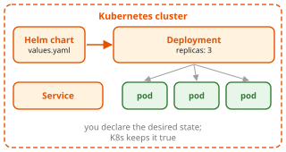
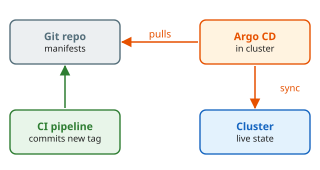
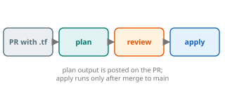
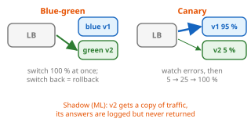

## 16. DevOps overview

*Chapter 8 · Level 5: DevOps-Level Overview.* You will not build these in this book, but you will hear about them in every platform team and in many interviews. For each topic: the problem it solves, when an ML engineer meets it, and one sentence you can say about it with confidence.

**After this level you can:**

- Recognise Kubernetes, Helm, GitOps, IaC pipelines and deployment strategies, and place them next to what you built.
- Explain supply-chain security, DORA metrics and platform engineering in plain words.

### Running and shipping at scale





#### Kubernetes and Helm

**Problem:** Running many containers on many machines: placement, restarts, scaling, networking, rolling updates. **Kubernetes** (K8s) does this from **declarative** YAML ("I want 3 replicas of this image"); a **Helm chart** is a parameterised package of that YAML, installed with different `values.yaml` per environment.

**You meet it when:** your company runs a shared cluster (Amazon EKS, GKE, AKS), or you serve models with KServe, Ray Serve or a GPU node pool.

**Say it:** *"ECS Express is the managed version of what a Kubernetes Deployment plus Service plus Ingress give you; with Helm I'd template the same service for staging and production."*

**What if… the pods keep restarting with `CrashLoopBackOff`?**

The Kubernetes version of "unhealthy on Fargate": the container
exits, Kubernetes restarts it with increasing delays. `kubectl
describe pod <name>` shows the events (OOMKilled? image pull
failed?), `kubectl logs <name> --previous` the output of the crashed
run. The causes are the ones from Level 3: listen address, port,
memory, missing model file.

#### GitOps (Argo CD, Flux)

**Problem:** CI pipelines that push to clusters need cluster credentials, and the real state drifts from what Git says. In **GitOps**, Git is the single source of truth: an agent **inside** the cluster pulls the desired state from a repository and continuously reconciles it. CI only commits a new image tag; it never touches the cluster.

**You meet it when:** a platform team owns the clusters and you "deploy" by merging a PR into a config repository.

**Say it:** *"With GitOps, a deployment is a Git commit and a rollback is a revert: auditable, reviewable, and the cluster heals drift by itself."*

**What if… someone fixes production by hand with `kubectl edit`?**

Argo CD marks the application **OutOfSync**, and with auto-sync it
reverts the change within minutes, so the "fix" disappears in the
middle of an incident. That is the point: the fix must go through
Git. Emergency changes are a PR to the config repository with fast
review, not a terminal session.

#### Infrastructure as Code pipelines (Terraform, AWS CDK)

**Problem:** We created AWS resources with a shell script; in a team that is not reviewable or repeatable. **IaC** describes infrastructure in code (Terraform HCL, or Python/TypeScript with CDK). The pipeline runs `terraform plan` on each PR and posts the diff as a comment; `apply` runs only after merge, often with approval. State is stored remotely (S3 with locking) so two runs never collide.

**You meet it when:** you need a new S3 bucket, queue or GPU instance: you open a PR in the infra repository instead of clicking in the console.

**Say it:** *"I treat infrastructure like application code: plan on the PR, review the diff, apply on merge, no console changes in production."*

**What if… the `plan` on the PR said "1 to change", but `apply` wants to destroy a database?**

Something changed between plan and apply: another PR merged first,
or someone changed the resource in the console (**drift**). Good IaC
pipelines save the plan file from the PR and apply **exactly that
plan**, or re-plan and require approval again if it differs. Protect
stateful resources with `prevent_destroy` (Terraform) or deletion
protection, so that no plan can delete them by accident.



### Releasing safely



#### Blue-green, canary, feature flags

**Problem:** A deployment that goes to 100 % of users at once makes every bug a full outage. **Blue-green** runs the new version (green) next to the old (blue) and switches traffic at once, so rollback is switching back. **Canary** sends a small share of traffic (5 %) to the new version, watches error rates and metrics, then increases. **Feature flags** ship code switched off and enable it per user group at runtime. For ML, **shadow deployment** sends a copy of real traffic to the new model and only logs its answers, so you compare models on production data with zero risk.

**You meet it when:** you replace a model that drives business decisions, or ECS Express runs its built-in canary for you.

**Say it:** *"For a new model I'd start with shadow traffic to compare predictions offline, then a canary with automatic rollback on error and latency alarms."*

**What if… the canary has no errors, but its predictions are different?**

HTTP-level canary checks (5xx rate, latency) are blind to ML quality:
a model that approves everyone answers fast and without errors. For
model changes, also compare **prediction distributions** between the
canary and the stable version (share of "bad", mean probability)
and roll back on a large difference. Ground truth (did the loan
default?) arrives months later, which is why shadow deployments and
distribution checks matter so much in ML.

#### Choosing a release strategy

Knowing the names is junior; choosing is senior. The choice depends
on what you can afford and what you can **measure** quickly:

| Strategy | Extra cost | Rollback | Catches | Needs |
|---|---|---|---|---|
| Rolling (ECS default) | none | minutes (redeploy) | crashes, failed health checks | health checks |
| Blue-green | 2× capacity during switch | seconds (switch back) | config and startup errors before traffic | stateless service or compatible schema |
| Canary | small | seconds–minutes, can be automatic | errors and latency under real traffic | enough traffic for metrics to mean something; alarms |
| Shadow | 2× compute for shadowed traffic | nothing to roll back | prediction differences on real inputs, zero user risk | request duplication; offline comparison |
| Feature flag | code complexity | instant (flip) | business impact per user group | flag service, cleanup discipline |

For ML, the decisive column is often missing from such tables: **how
long until you know the model is wrong?** With fast labels (fraud
chargebacks within days), a canary on business metrics works. With
slow labels (loan defaults after months), a canary can only prove the
service is healthy; model quality needs shadow comparison before the
release and distribution checks after it, which is exactly what
`credit-api` does with its post-deploy distribution check (Chapter 7).

#### Monorepos and reusable workflows

**Problem:** Ten services with ten nearly identical workflow files drift apart. **Reusable workflows** (`workflow_call`, as our `_deploy-env.yml`) and **composite actions** put the shared logic in one place; in a **monorepo** (all services in one repository), path filters and tools such as Bazel, Nx or Pants build and test only what changed.

**You meet it when:** your team's ML services and libraries live in one big repository.

**Say it:** *"In my project one reusable deploy workflow serves both environments; across services I'd publish it as a tagged, shared workflow, so a security fix to the pipeline is one PR."*

**What if… a change to the shared reusable workflow breaks ten services?**

Version reusable workflows like actions: callers reference a tag
(`uses: org/pipelines/.github/workflows/deploy.yml@v3`), not `@main`.
The platform team releases `v4`, and services upgrade one by one,
ideally through Dependabot PRs that run each service's CI.

#### Self-hosted runners

**Problem:** GitHub's hosted runners have no GPU, no access to your private network, and limited CPU/RAM. **Self-hosted runners** are your own machines (often autoscaled on Kubernetes with Actions Runner Controller) that pick up jobs. Larger hosted runners, including GPU runners, are a paid alternative.

**You meet it when:** training or GPU tests must run in CI, or the pipeline needs data inside a private VPC.

**Say it:** *"Self-hosted runners must be ephemeral and never used for public repositories, because a PR from a fork could run code on them."*

**What if… a self-hosted runner is reused between jobs?**

A job can leave files, credentials or a modified Python installation
behind, and the next job (perhaps from another repository) inherits
them. Use **ephemeral** runners (`--ephemeral`, one job per runner)
that are destroyed after each job, as Actions Runner Controller does
by default.

### Security, measurement, organisation

#### Software supply-chain security

**Problem:** Your image contains hundreds of packages you did not write; any of them, or a compromised GitHub Action, can be an attack path. Defences: **dependency scanning** (Dependabot, `pip-audit`) and **image scanning** (Trivy, ECR scan on push, which we enabled); **SBOMs** (software bill of materials: a machine-readable list of everything in the image, e.g. with Syft); **image signing** with Sigstore **cosign** and verification before deploy; **pinning actions to commit SHAs**; and **SLSA** provenance, a signed record of how and from which commit an artefact was built.

**You meet it when:** a security review asks "how do you know what is in your container?" or a CVE appears in a library you use.

**Say it:** *"I'd give every image an SBOM and a vulnerability scan in CI, fail on critical CVEs with time-limited exceptions, sign by digest, and pin third-party actions by SHA."*

**What if… the image scan fails on a critical CVE with no fix available?**

Blocking every deployment until upstream ships a fix can be worse
than the risk. Teams keep an **exception file** (Trivy's `.trivyignore`
with an expiry date and a reason), reviewed like code, and check
whether the vulnerable code is reachable at all. What matters is
that the decision is explicit, recorded and time-limited.

#### Supply-chain checks in practice

The four commands below are the core of a supply-chain stage after
`docker build` in `deploy.yml`. They were not run for this book;
install each tool with its vendor's official GitHub Action and check
the current version and flags in its documentation.

*supply-chain stage (sketch):*

```bash
# 1. fail the build on critical, fixable vulnerabilities
trivy image --exit-code 1 --severity CRITICAL --ignore-unfixed "$IMAGE"
# 2. software bill of materials, kept as a build artefact
syft "$IMAGE" -o spdx-json > sbom.spdx.json
# 3. sign the image by digest, keyless (uses the job's OIDC token)
cosign sign --yes "$DIGEST"
# 4. before deploying: verify who signed it
cosign verify "$DIGEST" \
  --certificate-identity-regexp 'github.com/<you>/credit-api' \
  --certificate-oidc-issuer https://token.actions.githubusercontent.com
```

Signing **by digest** is why the deploy job now passes a digest instead
of a tag (Chapter 5): a signature on a tag would say nothing about
which bytes it covers. For organisation-wide reusable workflows, AWS
trust policies can also check the OIDC claim `job_workflow_ref`, which
names the **workflow file** that runs, so only the platform team's
reviewed deploy workflow can assume the production role.

#### DORA metrics

**Problem:** How do you know whether delivery is getting better? The DORA research programme found four (now five) measures that predict performance: **deployment frequency**, **lead time for changes** (commit to production), **change failure rate**, **failed deployment recovery time** (called "time to restore service" in older reports), and more recently **rework rate** (unplanned deployments to fix problems). Elite teams deploy on demand, with lead times under a day and fast recovery.

**You meet it when:** management asks for "engineering metrics", or you justify investment in CI/CD.

**Say it:** *"I'd measure lead time and change failure rate together: if small PRs and automated gates make us faster but the failure rate rises, we have only moved the work to incident handling."*

**What if… management wants to compare teams by DORA metrics?**

The research designed them to help a team improve itself, not to
rank teams. Used as targets, they get gamed: deployment frequency
rises with empty deployments. Answer with trends of **one** team over
time, and always show speed (frequency, lead time) together with
stability (failure rate, recovery time).

#### Platform engineering

**Problem:** When every team builds its own pipelines, clusters and monitoring, everyone solves the same problems badly. A **platform team** builds an internal developer platform: golden-path templates ("new ML service" creates repo, CI, deploy, dashboards), self-service infrastructure and a portal such as Backstage. Product and ML teams consume it like a product.

**You meet it when:** your company has a "platform" or "MLOps platform" team, and you are either its customer or you join it.

**Say it:** *"I'd treat the pipeline I built as a golden-path template: the next model service should get CI, gates and deployment by answering a few questions."*

### Capstone: from shell script to Terraform

`infra/setup.sh` works, and it is the first thing a senior reviewer
will question: it is imperative ("create this, then that"), has no
plan step and no review of infrastructure changes. Rebuilding it in
Terraform is the most valuable next project after this book; plan
about one weekend. The shape of the solution (a sketch, not run for
this book; check the current AWS provider documentation):

*infra/main.tf (excerpt, sketch):*

```text
terraform {
  backend "s3" {                      # remote state, shared and locked
    bucket       = "<you>-tfstate"
    key          = "credit-api/terraform.tfstate"
    region       = "eu-central-1"
    use_lockfile = true               # S3-native locking (newer versions)
  }
}

resource "aws_ecr_repository" "api" {
  name                 = "credit-api"
  image_tag_mutability = "IMMUTABLE"
  image_scanning_configuration { scan_on_push = true }
}

resource "aws_iam_role" "deploy" {
  for_each = toset(["staging", "production"])
  name     = "github-credit-api-${each.key}"
  assume_role_policy = templatefile("trust.json.tftpl", {
    subject = "repo:<you>/credit-api:environment:${each.key}"
  })
}
```

And the pipeline around it:

1. **On every PR** touching `infra/`: `terraform fmt -check`, `terraform validate`, `terraform plan -out=tfplan`, and post the plan as a PR comment. Reviewers read the plan, not only the code: "1 to add, 0 to destroy" is the sentence that matters.
1. **On merge**: `terraform apply` in a job with `environment: infrastructure` (required reviewers), using a dedicated OIDC role.
1. **Nightly**: `terraform plan -detailed-exitcode`; exit code 2 means the real infrastructure differs from the code (**drift**), and opens an issue.
1. Protect stateful resources (`lifecycle { prevent_destroy = true }`) and keep **one state per environment**, so a mistake in staging cannot plan changes to production.

The bootstrap problem has a standard answer: the state bucket and the
first OIDC role are created once by hand (or by a tiny separate
configuration), everything else by the pipeline.

**Interview tip: Where to go next**

After Terraform, the two strongest additions to `credit-api` are the
supply-chain stage above (scan, SBOM, sign, verify) and deploying the
same image to a local Kubernetes cluster (kind) with a Helm chart.
Each makes a strong second portfolio story; Chapter 9 shows how to
present them.
