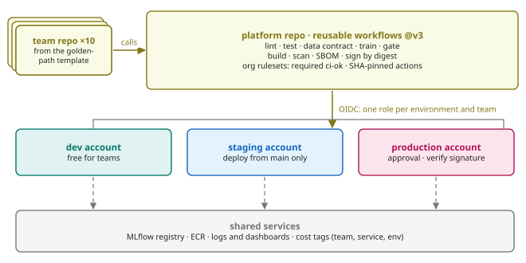

## 18. System design

*Chapter 9 · Career: The Senior Toolkit.* You can now build and operate the pipeline. This chapter is about the other half of a senior role: designing delivery for more than one team, answering interview questions with trade-offs instead of features, and turning two repositories into evidence that a hiring manager believes.

**After this level you can:**

- Recognise what makes an answer sound senior, and rewrite junior answers.
- Work through a system-design question: a delivery platform for ten ML teams.
- Answer fifteen senior CI/CD questions, and tell honest "tell me about a time" stories from your own project.
- Turn `credit-api` and `rag-api` into a portfolio: README, ADRs, measurements, demo, CV bullets.

**What you build:** An interview kit you have rehearsed aloud, a portfolio README with measured numbers, three or more ADRs, and four CV bullets you can defend in any follow-up question.

### What "senior" sounds like

Interviewers for senior roles rarely ask "what is a pipeline?". They
ask open questions and listen for **signals**. The same knowledge can
sound junior or senior:

| Signal | Junior answer | Senior answer |
|---|---|---|
| Trade-offs | "We used canary deployments." | "Canary needs enough traffic for the metrics to mean something; at 50 requests a minute I used a smoke test plus a distribution check instead." |
| Numbers | "The gate prevents bad models." | "The split alone moves AUC by ±0.025, so I set the tolerance to 0.03 and fixed the split." |
| Failure | "It worked well." | "My first role design let any branch reach production through staging; a review found it, and I split the role." |
| Scope | "I built the pipeline." | "I'd turn it into a template so the next team gets it in a day; here is what they may change." |
| Uncertainty | Guesses a fact. | "I haven't run that at scale; I'd check X and measure Y first." |
| Users | Talks about tools. | Talks about who is affected: the applicant, the reviewer at 2 a.m., the auditor. |

A useful habit: answer in the order **context → options → decision →
cost → what I'd watch**. "It depends" is a senior phrase only if you
then say **on what**.

### System design: a delivery platform for ten ML teams

**Concept: The question**

"You join as a senior ML engineer. Ten teams each build models and
deploy them their own way: copied workflows, long-lived AWS keys,
manual deploys on Fridays. Design how they should build, test and
deliver models. You have 45 minutes."

#### Step 1: clarify (5 minutes)

Ask before you draw. Each answer changes the design:

- **Online or batch?** APIs with latency targets, or nightly scoring jobs, or both. (Both, usually.)
- **How regulated?** A bank (four-eyes principle, audit trail, DORA) or a startup?
- **Where do they run today?** One AWS account or many; Kubernetes or ECS; how mature is the platform team?
- **What hurts most?** Incidents, slow delivery, cost, audit findings? The answer sets your first milestone.
- **How many people for the platform?** Two engineers design differently from twenty.

Assume for this answer: a German bank, online and batch models, AWS,
ECS today, two platform engineers, and an audit finding about manual
production changes.

#### Step 2: the design (25 minutes)

Walk through it in layers, and give each decision its reason:

1. **Golden-path template.** A template repository ("new model service") creates repo, CI, deploy, runbook skeleton, dashboards and a model card in one step (a cookiecutter template, or Backstage software templates if the company runs Backstage). Teams start on the paved road instead of copying last year's workflow.
1. **Reusable workflows, versioned.** The steps live once, in a platform repository, released by tag (`@v3`). Teams call them with a few inputs. Dependabot opens upgrade PRs; each team's CI proves the upgrade. A security fix becomes one release, not ten PRs.
1. **Accounts and identity.** Separate AWS accounts for dev, staging and production (AWS Organizations). No long-lived keys: OIDC roles per environment and team; production roles trust only the `production` environment and, via `job_workflow_ref`, only the platform's deploy workflow. This removes the audit finding at the root.
1. **Guardrails, not gatekeepers.** Organisation rulesets require the platform's check (`ci-ok`) and reviews on every repo; actions are pinned by SHA; images are scanned, get an SBOM, are signed by digest and **verified** before production deploys. Teams cannot skip these; everything else is theirs to change.
1. **ML specifics.** A shared MLflow registry and artefact store; promotion through gated aliases; a model card and lineage record are required artefacts of every production deploy. Data contracts and metric gates are **in** the template, thresholds owned by each team.
1. **Release and operations.** Continuous delivery with approval for models making credit decisions; canary or blue-green for services with enough traffic; standard JSON logs, an SLO per service, runbook and postmortem templates.
1. **Cost.** Mandatory cost tags (`team`, `service`, `env`) enforced in IaC; a monthly cost report per team; budgets per account.

#### Step 3: rollout and measurement (10 minutes)

A platform nobody adopts has failed. Say how you would roll out:

- **Phase 1 (month 1–2):** OIDC and the reusable CI workflow with two pilot teams, picked because they have the most pain. Remove their long-lived keys.
- **Phase 2 (month 3–4):** deploy workflow, environments, signing; the production account accepts only platform-built images.
- **Phase 3:** template for new services; migrate the rest team by team, with office hours, not a deadline email.
- **Measure:** DORA measures per team (lead time, deployment frequency, change failure rate, recovery time), share of repos on the current workflow version, number of long-lived keys (target: zero), audit findings closed.

#### Step 4: name the risks (5 minutes)

- **Too rigid:** teams fork the workflow and drift. Mitigation: inputs for the common variations, an "escape hatch" process, and a platform roadmap teams can influence.
- **Platform team becomes a bottleneck:** self-service over tickets; documented contribution path for teams.
- **Big-bang migration:** never. Pilot, measure, then expand.

**Interview tip**

"I'd treat the platform as a product with internal customers:
start with the two teams that hurt most, remove long-lived keys first
because that's also the audit finding, and measure adoption and lead
time, not the number of features we ship."

#### Two shorter design prompts

**Concept: Prompt A: "Design CI/CD for an LLM feature where prompts change weekly."**

**Key insight:** a prompt is code **and** configuration; it changes model
behaviour without a model change. **Answer outline:** prompts versioned
in Git (not in a database UI) and reviewed like code; a golden set
with deterministic checks (retrieval hit rate, format, refusal on
out-of-scope) as the hard PR gate; LLM-judged quality on a sample as
an advisory PR comment and a hard gate nightly; cost caps and a cache
keyed on **every** request parameter; prompt version in every log line;
rollout behind a feature flag to a share of users, with user feedback
and judge scores compared per prompt version; held-out set to avoid
tuning to the golden set. Mention the model provider as a dependency:
pin the model version, and treat a model upgrade like a dependency
upgrade with the full evaluation.

**Concept: Prompt B: "Nightly batch scoring of 50 million rows."**

**Key insight:** no latency SLO, but a **deadline** and a **correctness**
SLO (results complete and plausible by 06:00). **Answer outline:** the
scoring job is a versioned container image from the same pipeline,
run by a scheduler (Airflow, Step Functions, or a managed batch
service) with partitioned input; CI runs the job on a small fixed
sample and compares the output distribution with the previous
version; before publishing, checks on row counts, null shares and
the score distribution against yesterday, with publication blocked if
they fail (the batch equivalent of our distribution check); outputs
written to a dated location and switched atomically, so rollback is
pointing consumers back to yesterday's run; cost by using spot
capacity for a retryable job.

### Explaining your pipeline in an interview

A feature list ("ruff, mypy, pytest, Docker, ECR, ECS, MLflow…")
sounds like a tutorial. Interviewers for senior roles listen for
**decisions**: what problem, which options, why this one, what it cost,
what broke. Structure the two minutes that way:

**Interview tip: A two-minute script: problem, three decisions, what broke**

"I built a credit-risk API as a portfolio project, and treated the
delivery pipeline as the actual product. **The problem:** a model can
be correct code and still be worse than the one in production, so
ordinary CI is not enough.

**Decision one:** the pipeline validates data and trains on every PR,
and a gate fails the build if ROC-AUC falls below a floor or drops
more than 0.03 against the baseline. I chose that tolerance from
measurement, not by feel: I retrained twenty times and found that
the train/test split alone moves AUC by about ±0.025, so I fixed the
split as part of the contract.

**Decision two:** continuous delivery, not deployment. Every merge
goes to staging automatically, with a smoke test and a check that
the share of rejected applicants is plausible; production needs an
approval. For a credit model, a wrong release is expensive and
outcomes arrive months later, so the human gate is worth the delay.

**Decision three:** no stored cloud credentials. GitHub Actions gets
short-lived AWS credentials through OIDC, with one role per stage.
My first version had a single broad role, and a review showed that
any branch could have reached production through the staging
environment, so I split it and restricted every environment to
`main`.

**What I would do next at scale:** a shared model registry so that
promotion, not retraining, decides what ships; Terraform instead of
my shell script; and separate AWS accounts per environment."

Why this works: every paragraph contains a **trade-off** and a
**number**, it admits a mistake and shows how it was found, and it ends
with what you would change, which invites the follow-up questions you
have prepared. Never say "we" for a solo project, and do not claim
production traffic you did not have; "in my project I measured…" is
stronger than an invented team result. Chapter 9 has the full interview
kit: fifteen senior questions with model answers, and how to turn the
what-ifs in this book into honest "tell me about a time" stories.

Likely follow-up questions, and short answers:

| Question | Answer in one breath |
|---|---|
| Why not deploy automatically to production? | It depends on reversibility and how fast you learn about mistakes. Credit decisions are costly to reverse and labels arrive months later, so I keep a human approval; with fast labels, canaries and good monitoring I would move to continuous deployment. |
| How do you avoid flaky metric gates? | Measure the variance first, fix seeds and the split, set the tolerance from the measurement, and change the baseline only through a reviewed PR. |
| How does the champion reach production? | In my default setup it does not: deploy trains from the merged commit. With a shared registry, the build exports `@champion` instead; `/health` reports code SHA, model version and data hash either way. |
| How would this scale to big data? | Train on samples in PRs, full training as a separate pipeline (SageMaker, Kubeflow or Airflow), data versioned with DVC; CI only orchestrates and gates. |
| What if the new model is bad in production? | Smoke test and canary catch crashes; the distribution check catches implausible decisions; for quality, monitoring compares prediction distributions; rollback is redeploying the previous image by SHA, which also restores the old model. |

**Exercise: Break the data**

Change one `age` value in `data/german_credit.csv` to `150` and push
a branch. Which job fails first, with which message? Revert.

**Exercise: Make retrieval worse**

In `rag-api`, change `chunk_markdown` to put the whole document into
one chunk, run `eval/run_eval.py`, and explain the change in MRR.
Then run with `--k 1` (add a `hit_rate_at_1` threshold to
`eval/thresholds.json` first) and compare.

**Exercise: Paired promotion**

Rewrite `promote.py` so that it loads both `@champion` and the new
version, scores both on the **same** current test split, and promotes
only if the challenger passes the gate against the champion's score
on those rows. Test it locally with the SQLite tracking URI.

**Exercise: A slice gate**

Extend `train.py` to also report `roc_auc_age_lt_25`, add a floor of
0.65 for it in `thresholds.json`, and make sure `gate.check()` handles
it without code changes. What happens if a sample contains fewer than
two classes in the slice?

**Exercise: Fix the cache key**

Change the cache key in `rag_api/llm.py` so that it includes every
request parameter, make `max_tokens` a constructor argument, and add
a unit test that proves two different `max_tokens` values produce
two different cache files.

**Checkpoint: you should now be able to…**

- write a data contract and explain why it runs before training;
- explain why a contract does not detect drift, and run a KS test;
- derive a gate tolerance from measured variance, and explain why the evaluation split is part of the contract;
- add slice gates, and handle an intentional metric trade-off through a reviewed baseline change;
- explain paired comparisons and how alias rollback relates to image rollback;
- read RAG thresholds as question counts, and handle embedding-model changes, cache keys and provider outages;
- implement and justify floors and maximum-drop limits in a gate;
- track runs and promote models with MLflow aliases;
- build a golden set and compute hit rate, MRR and faithfulness;
- keep LLM evaluation costs predictable with five levers;
- present the whole pipeline in two minutes and answer follow-ups.
