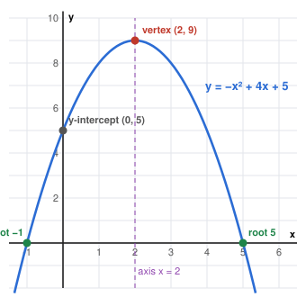

## How to use this track

This track takes you from solving one linear equation to the algebra an MSc in economics expects on day one: functions, polynomials, quadratics, exponentials and logarithms, systems of equations, vectors and matrices. It assumes the **Math Foundations** track: negatives, fractions, powers, expanding brackets, solving and rearranging equations, and straight-line graphs.

### Why this matters for economics

| Topic | Where economics uses it |
|---|---|
| Functions | Demand, supply, cost, utility and production functions |
| Polynomials and quadratics | Cost and profit curves, finding maximum profit |
| Exponentials and logs | Growth, interest, discounting, log-linear regressions, elasticities |
| Systems of equations | Market equilibrium, several markets at once, macro models |
| Vectors and matrices | Econometrics (regression is matrix algebra), input-output models, optimisation |

### Two routes through the tree

The tree splits into two paths after Functions:

- **Left path (polynomials):** polynomials, factoring, quadratic equations, parabolas, then exponentials and logs.
- **Right path (linear algebra):** systems of equations, vectors, matrices, determinants and inverses, then solving systems with matrices.

You can follow one path to the end or alternate. The boss review needs both.

### How to study

- Work every example on paper before reading the solution.
- Do the practice questions with the answers covered.
- Matrices are written in this track with square brackets over several lines, like this:

```
A = [ 2  1 ]
    [ 4  3 ]
```

That is a matrix with 2 rows and 2 columns: the first row is 2, 1 and the second row is 4, 3.

- A calculator is fine for exponentials and logs; for everything else, try without.


## 1. Functions

This skill covers what a function is, how to read f(x) notation, domains and ranges, combining functions and inverse functions. Economics describes almost everything as a function: demand as a function of price, cost as a function of output.

### What a function is

A **function** is a rule that takes an input and gives exactly **one** output. We write f(x) ("f of x"): f is the name of the rule, x the input.

```
f(x) = 3x + 2
f(4)  = 3(4) + 2 = 14
f(-1) = 3(-1) + 2 = -1
f(a + 1) = 3(a + 1) + 2 = 3a + 5
```

f(x) does **not** mean f times x. It means "the output of f when the input is x".

Economics examples: a demand function Q(P) = 200 − 4P gives the quantity demanded at each price; a cost function C(q) = 500 + 20q gives the cost of producing q units. The letters change; the idea is the same.

The input is the **independent variable**, the output the **dependent variable**. On a graph, input goes on the x-axis and output on the y-axis (except in supply and demand diagrams, where economists put price on the y-axis by tradition).

### Domain and range

- The **domain** is the set of inputs allowed.
- The **range** is the set of outputs that actually come out.

Inputs are ruled out when they would mean dividing by zero or taking the square root of a negative number, or when they make no sense in context:

| Function | Domain | Why |
|---|---|---|
| f(x) = 1/(x − 2) | all x except 2 | dividing by zero |
| g(x) = √(x + 3) | x ≥ −3 | no square root of a negative |
| C(q) = 500 + 20q | q ≥ 0 | cannot produce negative output |

The range of f(x) = x² is y ≥ 0, since a square is never negative.

### Combining functions

You can add, subtract and multiply functions: if R(q) = 50q (revenue) and C(q) = 500 + 20q (cost), profit is

```
π(q) = R(q) - C(q)
     = 50q - 500 - 20q
     = 30q - 500
```

(Economists use the Greek letter π, "pi", for profit. Here it has nothing to do with 3.14.)

A **composite function** feeds one function into another. f(g(x)) means: do g first, then f.

```
f(x) = 2x + 1,  g(x) = x²
f(g(x)) = 2(x²) + 1 = 2x² + 1
g(f(x)) = (2x + 1)² = 4x² + 4x + 1
```

Order matters: f(g(x)) and g(f(x)) are usually different.

### Inverse functions

The **inverse** f⁻¹ undoes f: if f(3) = 11, then f⁻¹(11) = 3. To find it, write y = f(x), swap the roles, and make x the subject:

```
f(x) = 3x + 2
y = 3x + 2
x = (y - 2)/3
f⁻¹(y) = (y - 2)/3
(often written f⁻¹(x) = (x - 2)/3)
```

Economics example: the demand function Q = 200 − 4P gives quantity from price. Its inverse, the **inverse demand function** P = 50 − Q/4, gives price from quantity. Economists switch between the two all the time.

Note: f⁻¹(x) means the inverse, not 1/f(x).

### Practice

1. f(x) = 5 − 2x. Find f(3), f(−2) and f(0).
2. g(x) = x² − 3x. Find g(4) and g(−1).
3. h(t) = 4t + 1. Find h(t + 2) and simplify.
4. Give the domain of f(x) = 1/(x + 5) and of g(x) = √(x − 4).
5. R(q) = 40q and C(q) = 200 + 15q. Write the profit function and find the break-even output.
6. f(x) = x + 3 and g(x) = 2x. Find f(g(x)) and g(f(x)).
7. Find the inverse of f(x) = 4x − 7.
8. Demand is Q = 90 − 3P. Find the inverse demand function.

**Answers.** 1: −1, 9, 5. 2: 4 and 4. 3: 4t + 9. 4: all x except −5; x ≥ 4. 5: π(q) = 25q − 200; break-even at q = 8. 6: 2x + 3; 2x + 6. 7: f⁻¹(x) = (x + 7)/4. 8: P = 30 − Q/3.


## 2. Polynomials

This skill covers what a polynomial is, its degree, and how to add, subtract and multiply polynomials, including the special products that appear everywhere. Cost and profit functions in economics are often polynomials.

### What a polynomial is

A **polynomial** is a sum of terms, each a number times a whole-number power of x:

```
4x³ - 2x² + x - 7
```

- The **degree** is the highest power: here 3.
- The **leading coefficient** is the number in front of the highest power: 4.
- The term without x is the **constant term**: −7.

| Degree | Name | Example |
|---|---|---|
| 0 | constant | 5 |
| 1 | linear | 3x + 2 |
| 2 | quadratic | x² − 5x + 6 |
| 3 | cubic | 2x³ + x − 1 |

Not polynomials: 1/x (a negative power), √x (a fraction power), 2ˣ (x in the exponent).

Write polynomials in **descending order** of power. A typical cost function is cubic: C(q) = q³ − 6q² + 15q + 100.

### Adding and subtracting

Collect like terms (same power of x). For subtraction, put the second polynomial in brackets and change every sign inside:

```
(3x² + 2x - 5) + (x² - 7x + 4)
  = 4x² - 5x - 1

(3x² + 2x - 5) - (x² - 7x + 4)
= 3x² + 2x - 5 - x² + 7x - 4
= 2x² + 9x - 9
```

### Multiplying

Every term in the first times every term in the second, then collect like terms. Remember x² × x = x³ (add the powers).

```
(x + 4)(x - 2)
  = x² - 2x + 4x - 8
  = x² + 2x - 8
(2x - 3)(x + 5)
  = 2x² + 10x - 3x - 15
  = 2x² + 7x - 15
(x + 2)(x² - x + 3)
  = x³ - x² + 3x + 2x² - 2x + 6
  = x³ + x² + x + 6
```

With two binomials, FOIL helps you not miss a term: **F**irst, **O**uter, **I**nner, **L**ast.

The degree of a product is the sum of the degrees: (degree 1) × (degree 2) gives degree 3.

### Special products

Learn these three by heart: they are used in factoring, completing the square and statistics.

| Name | Pattern | Example |
|---|---|---|
| Square of a sum | (a + b)² = a² + 2ab + b² | (x + 3)² = x² + 6x + 9 |
| Square of a difference | (a − b)² = a² − 2ab + b² | (x − 5)² = x² − 10x + 25 |
| Difference of two squares | (a + b)(a − b) = a² − b² | (x + 4)(x − 4) = x² − 16 |

The most common mistake in algebra: (x + 3)² = x² + 9. **Wrong.** It is (x + 3)(x + 3), which has the middle term 6x. Check with x = 1: (1 + 3)² = 16, but 1 + 9 = 10.

### Evaluating and dividing by a monomial

To evaluate, substitute: if p(x) = 2x³ − x + 4, then p(2) = 16 − 2 + 4 = 18.

Dividing by a single term divides every term: (6x³ − 9x² + 3x)/(3x) = 2x² − 3x + 1. Long division by (x − a) exists too, but in economics you rarely need it; factoring (next skill) covers most uses.

### Practice

1. Give the degree and leading coefficient of 7 − 3x + 5x⁴.
2. (4x² − 3x + 1) + (2x² + 5x − 6)
3. (5x² + x − 2) − (3x² − 4x + 1)
4. (x + 6)(x − 1)
5. (3x − 2)(2x + 5)
6. (x − 1)(x² + 2x − 3)
7. (x + 7)²
8. (2x − 3)²
9. (x + 9)(x − 9)
10. p(x) = x³ − 2x² + 5. Find p(3).
11. Revenue R(q) = 100q − 2q² and cost C(q) = 40q + 150. Write the profit function.

**Answers.** 1: Degree 4, coefficient 5. 2: 6x² + 2x − 5. 3: 2x² + 5x − 3. 4: x² + 5x − 6. 5: 6x² + 11x − 10. 6: x³ + 2x² − 3x − x² − 2x + 3 = x³ + x² − 5x + 3. 7: x² + 14x + 49. 8: 4x² − 12x + 9. 9: x² − 81. 10: 27 − 18 + 5 = 14. 11: π(q) = −2q² + 60q − 150.


## 3. Systems of linear equations

This skill covers solving two (or three) equations with two (or three) unknowns at the same time, by substitution and by elimination, and what it means when there is no solution or infinitely many. Market equilibrium is exactly this.

### What a system is

A **system** is a set of equations that must all be true at once:

```
2x + y = 10
 x - y = 2
```

The **solution** is the pair (x, y) that satisfies both. Here it is (4, 2): check 2(4) + 2 = 10 and 4 − 2 = 2.

On a graph, each linear equation is a straight line, and the solution is the point where the lines cross. Two unknowns need two independent equations; three unknowns need three.

### Method 1: substitution

Make one letter the subject of one equation, then substitute it into the other.

```
y = 3x - 5
4x + 2y = 20

substitute: 4x + 2(3x - 5) = 20
            4x + 6x - 10 = 20
            10x = 30,  x = 3
back:       y = 3(3) - 5 = 4
solution:   (3, 4)
```

Substitution is easiest when one equation already has a letter on its own (as supply and demand functions usually do).

### Method 2: elimination

Add or subtract the equations to make one letter vanish. Multiply first if needed so that one letter has matching coefficients.

```
3x + 2y = 16    (1)
5x - 2y = 16    (2)

(1) + (2):  8x = 32,  x = 4
into (1):   12 + 2y = 16,  y = 2
```

```
2x + 3y = 12    (1)
3x + 4y = 17    (2)

(1) × 3:   6x + 9y = 36
(2) × 2:   6x + 8y = 34
subtract:  y = 2
into (1):  2x + 6 = 12,  x = 3
```

### No solution or infinitely many

Two lines usually cross once. But:

| Case | Graph | Algebra sign |
|---|---|---|
| One solution | lines cross | you get x = ..., y = ... |
| No solution | parallel lines (same slope, different intercept) | you get something false, like 0 = 5 |
| Infinitely many | the same line twice | you get something always true, like 0 = 0 |

Example: x + 2y = 4 and 2x + 4y = 9. Double the first: 2x + 4y = 8. Subtract: 0 = 1. False, so **no solution**: the lines are parallel.

### Economics: equilibrium in two markets

Demand Qd = 100 − 2P and supply Qs = 3P − 25. Equilibrium: Qd = Qs.

```
100 - 2P = 3P - 25
125 = 5P,  P = 25,  Q = 50
```

With two related goods, each demand depends on both prices, and you get two equations in P₁ and P₂:

```
market 1:
  10 - 2P₁ + P₂ = -2 + 3P₁
  ->  5P₁ - P₂ = 12
market 2:
  15 + P₁ - P₂ = -1 + P₂
  ->  P₁ - 2P₂ = -16

from the second: P₁ = 2P₂ - 16
into the first:
  5(2P₂ - 16) - P₂ = 12
  9P₂ = 92
  P₂ ≈ 10.22,  P₁ ≈ 4.44
```

Bigger systems like this are where matrices (later skills) take over.

### Three equations, three unknowns

Use elimination twice to get down to two equations in two unknowns, then solve as before:

```
x + y + z = 6      (1)
2x - y + z = 3     (2)
x + 2y - z = 2     (3)

(1) + (3):  2x + 3y = 8      (4)
(2) + (3):  3x + y = 5       (5)
(5) × 3 - (4):  7x = 7,  x = 1
(5): y = 2;   (1): z = 3
```

### Practice

1. Solve y = 2x + 1 and 3x + y = 16.
2. Solve x + y = 9 and x − y = 3.
3. Solve 4x + 3y = 25 and 2x − y = 5.
4. Solve 3x + 5y = 21 and 2x + 3y = 13.
5. How many solutions has y = 4x − 1 and 8x − 2y = 2?
6. Demand P = 80 − 3Q and supply P = 20 + 2Q. Find the equilibrium.
7. Two coffees and a cake cost 9.50. One coffee and two cakes cost 10. Find each price.
8. Solve x + y + z = 10, x − y = 1, y + z = 7.

**Answers.** 1: 3x + 2x + 1 = 16, x = 3, y = 7. 2: x = 6, y = 3. 3: second × 3: 6x − 3y = 15; add: 10x = 40, x = 4, y = 3. 4: x = 2, y = 3. 5: The second is y = 4x − 1, the same line: infinitely many. 6: 80 − 3Q = 20 + 2Q, Q = 12, P = 44. 7: 2c + k = 9.5, c + 2k = 10: coffee 3, cake 3.50. 8: from (1) and (3), x = 3; then y = 2, z = 5.


## 4. Factoring

This skill covers factorising: writing a polynomial as a product of simpler pieces. It is the fastest way to solve quadratic equations, simplify fractions and find where a curve crosses zero.

### Why factor?

If a product is zero, one of its factors must be zero. So if you can write

```
x² - 5x + 6 = (x - 2)(x - 3)
```

then x² − 5x + 6 = 0 means x − 2 = 0 or x − 3 = 0, so x = 2 or x = 3. Without factoring, that equation is much harder.

Always start by taking out any **common factor**:

```
4x² - 12x    = 4x(x - 3)
3x³ + 6x² + 9x = 3x(x² + 2x + 3)
```

### Quadratics x² + bx + c

Find two numbers that **multiply to c** and **add to b**:

```
x² + 7x + 12
  × to 12, + to 7: 3 and 4
  = (x + 3)(x + 4)
x² - 8x + 15
  × to 15, + to -8: -3 and -5
  = (x - 3)(x - 5)
x² + 2x - 15
  × to -15, + to 2: 5 and -3
  = (x + 5)(x - 3)
x² - x - 20
  × to -20, + to -1: -5 and 4
  = (x - 5)(x + 4)
```

Sign guide: if c is positive, both numbers have the sign of b. If c is negative, the numbers have opposite signs, and the bigger one takes the sign of b.

Check by expanding: (x + 5)(x − 3) = x² − 3x + 5x − 15 = x² + 2x − 15 ✓

### Quadratics ax² + bx + c (a not 1)

Use the "ac method": find two numbers that multiply to **a × c** and add to **b**, split the middle term with them, then factor in pairs.

```
2x² + 7x + 3:  a × c = 6
numbers 6 and 1 (× to 6, + to 7)
= 2x² + 6x + x + 3
= 2x(x + 3) + 1(x + 3)
= (2x + 1)(x + 3)

6x² - x - 2:  a × c = -12
numbers -4 and 3
= 6x² - 4x + 3x - 2
= 2x(3x - 2) + 1(3x - 2)
= (2x + 1)(3x - 2)
```

Not every quadratic factors with whole numbers. If you cannot find the pair, use the quadratic formula (next skill).

### Special patterns

The special products from the polynomials skill, run backwards:

| Pattern | Example |
|---|---|
| a² − b² = (a + b)(a − b) | x² − 49 = (x + 7)(x − 7) |
| a² + 2ab + b² = (a + b)² | x² + 10x + 25 = (x + 5)² |
| a² − 2ab + b² = (a − b)² | 4x² − 12x + 9 = (2x − 3)² |

x² + 49 (a **sum** of squares) does not factor at all with real numbers.

Watch for hidden patterns: 3x² − 75 = 3(x² − 25) = 3(x + 5)(x − 5). Take out the common factor first, then look again.

### Simplifying algebraic fractions

Factor top and bottom, then cancel **whole factors** only:

```
(x² - 9)/(x² + 5x + 6)
  = (x + 3)(x - 3)/((x + 2)(x + 3))
  = (x - 3)/(x + 2)
```

You cannot cancel the x² terms directly: x²/x² cancels only when x² is a factor of the whole top and the whole bottom.

### Practice

Factorise:

1. 5x² + 20x
2. x² + 9x + 20
3. x² − 10x + 21
4. x² + 3x − 28
5. x² − 4x − 32
6. 3x² + 10x + 8
7. 4x² − 4x − 3
8. x² − 144
9. 2x² − 18
10. x² − 14x + 49
11. Simplify (x² − 4)/(x² − x − 2).
12. Solve x² − 3x − 10 = 0 by factoring.

**Answers.** 1: 5x(x + 4). 2: (x + 4)(x + 5). 3: (x − 3)(x − 7). 4: (x + 7)(x − 4). 5: (x − 8)(x + 4). 6: (3x + 4)(x + 2). 7: (2x + 1)(2x − 3). 8: (x + 12)(x − 12). 9: 2(x + 3)(x − 3). 10: (x − 7)². 11: (x + 2)(x − 2)/((x − 2)(x + 1)) = (x + 2)/(x + 1). 12: (x − 5)(x + 2) = 0, x = 5 or x = −2.


## 5. Vectors

This skill introduces vectors: lists of numbers that you add, scale and multiply in a dot product. They are the building blocks of matrices, and economists use them to hold bundles of goods, prices and data.

### What a vector is

A **vector** is an ordered list of numbers. It can be written as a row or as a column:

```
row vector:     v = (3, 1, 4)

column vector:  v = [ 3 ]
                    [ 1 ]
                    [ 4 ]
```

The numbers are its **components** (or entries). A vector with n components lives in "n-dimensional space", written ℝⁿ.

Two pictures of a vector, both useful:

- **An arrow** from the origin to the point (3, 1): it has a length and a direction.
- **A list of quantities**: a consumption bundle q = (2, 5, 1) means 2 apples, 5 bread rolls, 1 coffee. A price vector p = (0.5, 0.3, 2.5) gives the price of each.

Order matters: (2, 5) and (5, 2) are different vectors.

### Adding and scaling

Add vectors of the same length **component by component**. Multiply by a number (a **scalar**) by multiplying every component.

```
(3, 1, 4) + (1, 2, -2) = (4, 3, 2)
(3, 1, 4) - (1, 2, -2) = (2, -1, 6)
2 × (3, 1, 4)          = (6, 2, 8)
```

As arrows: adding puts one arrow at the tip of the other ("tip to tail"); multiplying by 2 doubles the length; multiplying by −1 reverses the direction.

A **linear combination** mixes vectors with scalars: 2u + 3v. If two shops sell bundles u and v and you buy 2 of the first and 3 of the second, your total is 2u + 3v.

You cannot add vectors of different lengths: (1, 2) + (1, 2, 3) is undefined.

### The dot product

The **dot product** multiplies matching components and adds the results. The answer is a single number, not a vector.

```
u · v = u₁v₁ + u₂v₂ + ... + uₙvₙ

(2, 5, 1) · (0.5, 0.3, 2.5)
  = 1 + 1.5 + 2.5 = 5
```

That example is the cost of the bundle: quantities · prices = **total spending**. A budget constraint is p · q ≤ m (spending at most income m).

Dot product facts:

- u · v = v · u.
- If u · v = 0, the vectors are **perpendicular** (at right angles), also called **orthogonal**. Example: (1, 2) · (2, −1) = 2 − 2 = 0. Orthogonality is central to regression in econometrics.
- v · v is the sum of squares of v's components.

### Length (norm)

The **length** or **norm** of a vector, written ‖v‖, is from Pythagoras:

```
‖v‖ = √(v · v)
    = √(v₁² + v₂² + ... + vₙ²)

‖(3, 4)‖    = √(9 + 16) = 5
‖(1, 2, 2)‖ = √(1 + 4 + 4) = 3
```

A **unit vector** has length 1. Dividing a vector by its length gives a unit vector in the same direction: (3, 4)/5 = (0.6, 0.8).

### Practice

1. u = (2, −1, 3), v = (4, 0, −2). Find u + v and u − v.
2. Find 3u − 2v for the same u and v.
3. Find u · v.
4. Are (3, −2) and (4, 6) perpendicular?
5. Find the length of (6, 8) and of (2, −3, 6).
6. Find the unit vector in the direction of (5, 12).
7. A bundle is q = (4, 2, 10) and prices are p = (1.5, 3, 0.2). What does the bundle cost?
8. With income m = 20 and prices p = (2, 4), which of these bundles are affordable: (4, 3), (6, 3), (1, 4)?
9. Find k so that (k, 3) is perpendicular to (2, −4).

**Answers.** 1: (6, −1, 1) and (−2, −1, 5). 2: (6, −3, 9) − (8, 0, −4) = (−2, −3, 13). 3: 8 + 0 − 6 = 2. 4: 12 − 12 = 0, yes. 5: 10; √(4 + 9 + 36) = 7. 6: (5/13, 12/13). 7: 6 + 6 + 2 = 14. 8: (4, 3) costs 20: affordable, exactly on the budget line. (6, 3) costs 24: not affordable. (1, 4) costs 18: affordable, with 2 left over. 9: 2k − 12 = 0, k = 6.


## 6. Quadratic equations

This skill covers three ways to solve ax² + bx + c = 0: factoring, completing the square and the quadratic formula, plus how the discriminant tells you how many solutions there are. Quadratics give you break-even points and optimal outputs in economics.

### Quadratic equations and roots

A **quadratic equation** can be written as ax² + bx + c = 0 with a not zero. Its solutions are called **roots**. There can be two, one or none (in real numbers).

First step, always: **get everything on one side, equal to zero**. x² = 5x − 6 becomes x² − 5x + 6 = 0.

Simple cases need no method:

```
x² = 49
  x = 7 or x = -7   (remember ±)
(x - 3)² = 16
  x - 3 = ±4,  x = 7 or x = -1
x² - 6x = 0
  x(x - 6) = 0,  x = 0 or x = 6
```

Never divide both sides by x in x² = 6x: you lose the root x = 0.

### Method 1: factoring

If the quadratic factors, set each factor to zero:

```
x² + x - 12 = 0
(x + 4)(x - 3) = 0
x = -4  or  x = 3

2x² - 7x + 3 = 0
(2x - 1)(x - 3) = 0
x = 1/2  or  x = 3
```

Fastest when it works. When you cannot spot the factors in a minute, move on to the formula.

### Method 2: completing the square

Rewrite x² + bx as a perfect square minus a correction: **x² + bx = (x + b/2)² − (b/2)²**.

```
x² + 6x - 7 = 0
(x + 3)² - 9 - 7 = 0
(x + 3)² = 16
x + 3 = ±4
x = 1  or  x = -7
```

If a is not 1, divide everything by a first. Completing the square matters because it shows the **vertex** of the parabola (next skill), and it is how the quadratic formula is derived.

### Method 3: the quadratic formula

For ax² + bx + c = 0, the roots are:

```
x = (-b ± √(b² - 4ac)) / (2a)
```

It always works. Write down a, b and c with their signs first.

```
3x² - 5x - 2 = 0
  a = 3, b = -5, c = -2
b² - 4ac = 25 - 4(3)(-2)
         = 25 + 24 = 49
x = (5 ± 7)/6
x = 2  or  x = -1/3

x² + 4x + 1 = 0
  a = 1, b = 4, c = 1
b² - 4ac = 16 - 4 = 12
x = (-4 ± √12)/2 = -2 ± √3
  (about -0.27 and -3.73)
```

Traps: −b when b is negative is positive; b² is always positive (square the bracket: (−5)² = 25); divide the **whole** top by 2a.

### The discriminant

The part under the root, **D = b² − 4ac**, is the **discriminant**. It tells you how many roots there are before you solve:

| D | Roots | Graph (next skill) |
|---|---|---|
| D > 0 | two different roots | crosses the x-axis twice |
| D = 0 | one repeated root | touches the x-axis once |
| D < 0 | no real roots | never reaches the x-axis |

Example: x² + 2x + 5 = 0 has D = 4 − 20 = −16 < 0: no real solution.

### Economics example: break-even with a quadratic

A firm's profit is π(q) = −q² + 20q − 64 (in thousands). Break-even is π = 0:

```
-q² + 20q - 64 = 0
q² - 20q + 64 = 0          (× -1)
(q - 4)(q - 16) = 0
q = 4  or  q = 16
```

The firm makes a profit between 4,000 and 16,000 units, and a loss outside that range.

### Practice

1. x² − 64 = 0
2. x² + 5x = 0
3. x² − 7x + 10 = 0
4. x² + 2x − 24 = 0
5. 3x² + 5x − 2 = 0 (by factoring)
6. Solve x² − 8x + 3 = 0 by completing the square.
7. Solve 2x² + 3x − 5 = 0 with the formula.
8. Solve x² − 2x − 4 = 0 with the formula (exact answers).
9. How many real roots has 4x² − 12x + 9 = 0? And x² + x + 1 = 0?
10. Profit is π(q) = −2q² + 24q − 40. Find the break-even outputs.

**Answers.** 1: x = ±8. 2: x = 0 or −5. 3: (x − 2)(x − 5): x = 2 or 5. 4: (x + 6)(x − 4): x = −6 or 4. 5: (3x − 1)(x + 2): x = 1/3 or −2. 6: (x − 4)² = 13, x = 4 ± √13. 7: D = 9 + 40 = 49, x = (−3 ± 7)/4: x = 1 or −5/2. 8: D = 4 + 16 = 20, x = (2 ± √20)/2 = 1 ± √5. 9: D = 144 − 144 = 0: one root (x = 3/2); D = 1 − 4 < 0: none. 10: divide by −2: q² − 12q + 20 = 0, (q − 2)(q − 10): q = 2 or 10.


## 7. Matrices and matrix operations

This skill covers what a matrix is, its size, adding and scaling matrices, matrix multiplication, the identity matrix and the transpose. Matrices are how economists and econometricians handle many equations and many data points at once.

### What a matrix is

A **matrix** is a rectangular table of numbers in rows and columns:

```
A = [ 2  1  5 ]
    [ 0  3 -1 ]
```

- Its **size** is (rows) × (columns): A is 2 × 3. Always rows first.
- The entry in row i, column j is written aᵢⱼ. Here a₁₃ = 5 and a₂₂ = 3.
- A **square** matrix has as many rows as columns.
- A vector is a matrix with one column (n × 1) or one row (1 × n).

Economics example: a firm makes 2 products in 3 factories. A 2 × 3 matrix holds the output of each product in each factory. In econometrics, a data matrix X has one row per observation and one column per variable.

### Adding, subtracting and scaling

Only matrices of the **same size** can be added. Add matching entries:

```
[ 1  4 ]   [ 2 -1 ]   [ 3  3 ]
[ 0  2 ] + [ 5  3 ] = [ 5  5 ]

3 × [ 1  4 ]  =  [ 3  12 ]
    [ 0  2 ]     [ 0   6 ]
```

These work just like numbers: A + B = B + A, and 2(A + B) = 2A + 2B.

### Matrix multiplication

This is the one to practise. To get the entry in row i, column j of AB, take the **dot product of row i of A with column j of B**.

```
A = [ 1  2 ]     B = [ 5  6 ]
    [ 3  4 ]         [ 7  8 ]

AB: row 1 · col 1 = 1×5 + 2×7 = 19
    row 1 · col 2 = 1×6 + 2×8 = 22
    row 2 · col 1 = 3×5 + 4×7 = 43
    row 2 · col 2 = 3×6 + 4×8 = 50

AB = [ 19  22 ]
     [ 43  50 ]
```

**Size rule:** (m × n) times (n × p) gives (m × p). The inside numbers must match; the outside numbers give the size of the answer. A 2 × 3 times a 3 × 1 is fine (answer 2 × 1); a 2 × 3 times a 2 × 3 is undefined.

Multiplying a matrix by a vector:

```
[ 2  1 ] [ 3 ]   [ 2×3 + 1×4 ]
[ 1 -1 ] [ 4 ] = [ 1×3 - 1×4 ]

              = [ 10 ]
                [ -1 ]
```

### Order matters

For numbers, 3 × 5 = 5 × 3. For matrices, **AB is usually not BA**. With A and B above:

```
BA = [ 5×1 + 6×3   5×2 + 6×4 ]
     [ 7×1 + 8×3   7×2 + 8×4 ]

   = [ 23  34 ]
     [ 31  46 ]
```

That is different from AB. Often one of AB and BA is not even defined. Other rules still hold: A(BC) = (AB)C and A(B + C) = AB + AC.

### The identity and the transpose

The **identity matrix** I has 1s on the main diagonal and 0s elsewhere. It acts like the number 1: AI = IA = A.

```
I = [ 1  0 ]
    [ 0  1 ]
```

The **transpose** Aᵀ swaps rows and columns: row 1 becomes column 1.

```
A = [ 2  1  5 ]       Aᵀ = [ 2  0 ]
    [ 0  3 -1 ]            [ 1  3 ]
                           [ 5 -1 ]
```

A 2 × 3 matrix has a 3 × 2 transpose. A rule worth knowing: (AB)ᵀ = BᵀAᵀ (the order flips). You will meet XᵀX in the regression formula of every econometrics course.

### Practice

A = [2 0; 1 3] (rows 2, 0 and 1, 3), B = [1 4; −2 1], C = [1 2 3; 0 1 −1] (a 2 × 3).

1. What size is C? What is c₂₃?
2. Find A + B and 2A − B.
3. Find AB.
4. Find BA. Is it equal to AB?
5. Find AC. Can you find CA?
6. Find Cᵀ and its size.
7. Multiply A by the vector (1, 2) written as a column.
8. A shop sells 3 goods. Matrix Q (2 × 3) holds the units sold on Monday (row 1: 10, 5, 2) and Tuesday (row 2: 8, 6, 4). Prices are the column vector p = (2, 3, 10). Find Qp and say what it means.

**Answers.** 1: 2 × 3; c₂₃ = −1. 2: A + B = [3 4; −1 4]; 2A − B = [3 −4; 4 5]. 3: AB = [2 8; −5 7]. 4: BA = [6 12; −3 3]; no. 5: AC = [2 4 6; 1 5 0]; CA is (2 × 3)(2 × 2), undefined. 6: Cᵀ = [1 0; 2 1; 3 −1], size 3 × 2. 7: (2, 7). 8: Qp = (20 + 15 + 20, 16 + 18 + 40) = (55, 74): the revenue on Monday and on Tuesday.


## 8. Graphs of quadratics

This skill covers the shape of y = ax² + bx + c (a parabola): which way it opens, its vertex, axis of symmetry and intercepts, and how to use the vertex to find a maximum or minimum. That is how you find maximum profit or minimum average cost without calculus.

### The shape of a parabola

The graph of any quadratic y = ax² + bx + c is a U-shaped curve called a **parabola**.

- **a > 0**: opens upward (a valley), so it has a **minimum**.
- **a < 0**: opens downward (a hill), so it has a **maximum**.
- The bigger the size of a, the narrower the curve.



Key features to find:

| Feature | How to find it | In the picture |
|---|---|---|
| y-intercept | set x = 0: it is c | (0, 5) |
| roots (x-intercepts) | solve ax² + bx + c = 0 | x = −1 and x = 5 |
| axis of symmetry | x = −b/(2a) | x = 2 |
| vertex | x = −b/(2a), then put it in | (2, 9) |

### Finding the vertex

**Formula method:** the vertex is at x = −b/(2a). Substitute to get y.

```
y = -x² + 4x + 5:   a = -1, b = 4
x = -4/(2 × -1) = 2
y = -(2)² + 4(2) + 5 = -4 + 8 + 5 = 9
vertex (2, 9), a maximum because a < 0
```

**Completing the square:** write y = a(x − h)² + k. Then the vertex is (h, k).

```
y = x² - 6x + 11
  = (x - 3)² - 9 + 11
  = (x - 3)² + 2
vertex (3, 2), a minimum
```

This **vertex form** also shows the minimum value at once: (x − 3)² is never negative, so y is never below 2.

The roots are symmetric about the axis: halfway between −1 and 5 is 2. If you know the roots, the vertex is at their midpoint.

### Sketching a parabola

1. Look at a: up or down?
2. Plot the y-intercept (0, c).
3. Find the vertex.
4. Find the roots if there are any (the discriminant says how many).
5. Draw a smooth, symmetric U through the points.

Example: y = x² − 4x + 3. Opens up; y-intercept 3; vertex x = 2, y = 4 − 8 + 3 = −1; roots (x − 1)(x − 3) = 0 so x = 1 and 3. A valley with its bottom at (2, −1), crossing the x-axis at 1 and 3.

### Economics: maximum revenue and profit

Demand P = 60 − 2Q gives revenue R = P × Q = 60Q − 2Q². That is a downward parabola, so it has a maximum:

```
Q = -b/(2a) = -60/(2 × -2) = 15
R = 60(15) - 2(15)² = 900 - 450 = 450
maximum revenue 450 at Q = 15
(price 60 - 30 = 30)
```

Profit π(q) = −q² + 20q − 64 from the last skill: vertex at q = −20/(−2) = 10, π = −100 + 200 − 64 = 36. **Maximum profit 36 (thousand) at 10,000 units**, exactly halfway between the break-even points 4 and 16.

In calculus you will find the same answer by setting the derivative to zero. For quadratics the vertex formula gets there directly.

### Practice

1. Does y = 3x² − x + 2 have a maximum or a minimum?
2. Find the vertex of y = x² + 8x + 10.
3. Find the vertex of y = −2x² + 12x − 7. Is it a maximum or minimum?
4. Write y = x² − 10x + 30 in vertex form and give its minimum value.
5. Find the roots, y-intercept and vertex of y = x² − 2x − 8.
6. A parabola has roots 1 and 9. What is the x value of its vertex?
7. Demand is P = 100 − 4Q. Find the quantity and price that maximise revenue.
8. Profit is π(q) = −3q² + 36q − 60. Find the profit-maximising output and the maximum profit.
9. Average cost is AC(q) = q² − 12q + 50. At what output is average cost lowest, and what is it?

**Answers.** 1: Minimum (a = 3 > 0). 2: x = −4, y = 16 − 32 + 10 = −6: (−4, −6). 3: x = 3, y = −18 + 36 − 7 = 11: (3, 11), a maximum. 4: (x − 5)² + 5; minimum 5. 5: (x − 4)(x + 2): roots 4 and −2; y-intercept −8; vertex (1, −9). 6: x = 5. 7: R = 100Q − 4Q², Q = 12.5, P = 50, R = 625. 8: q = 6, π = −108 + 216 − 60 = 48. 9: q = 6, AC = 36 − 72 + 50 = 14.


## 9. Determinants and inverses

This skill covers the determinant of a 2 × 2 and a 3 × 3 matrix, what it tells you, and how to find the inverse matrix. The inverse is matrix "division": it is what lets you solve a whole system of equations in one step.

### The determinant of a 2 × 2 matrix

The **determinant** is a single number computed from a square matrix, written det(A) or with straight bars around the entries.

```
A = [ a  b ]        det(A) = ad - bc
    [ c  d ]

A = [ 4  3 ]
    [ 1  2 ]
det(A) = 4×2 - 3×1 = 8 - 3 = 5
```

"Down-right diagonal minus up-right diagonal."

What it tells you:

- **det(A) ≠ 0**: A has an inverse, and the system it describes has exactly one solution.
- **det(A) = 0**: A is **singular**. No inverse; the system has no solution or infinitely many (parallel or identical lines, as in the systems skill).

Example: [2 4; 1 2] has determinant 4 − 4 = 0. Its rows are multiples of each other (row 1 = 2 × row 2), so they carry the same information.

### The determinant of a 3 × 3 matrix

Expand along the first row. Each entry multiplies the 2 × 2 determinant left when you cross out its row and column, with signs **+ − +**:

```
A = [ a  b  c ]
    [ d  e  f ]
    [ g  h  i ]

det(A) = a(ei - fh)
       - b(di - fg)
       + c(dh - eg)
```

```
A = [ 2  1  3 ]
    [ 0  4  1 ]
    [ 1  2  0 ]

det(A) = 2(4×0 - 1×2)
       - 1(0×0 - 1×1)
       + 3(0×2 - 4×1)
       = 2(-2) - 1(-1) + 3(-4)
       = -4 + 1 - 12 = -15
```

Shortcuts: if a row or column is all zeros, det = 0. If one row is a multiple of another, det = 0. For a triangular matrix (zeros below the diagonal), det = the product of the diagonal.

Two useful facts: det(AB) = det(A) × det(B), and det(Aᵀ) = det(A).

### The inverse matrix

The **inverse** A⁻¹ is the matrix with A × A⁻¹ = A⁻¹ × A = I. Like 1/5 for the number 5. Only square matrices with det ≠ 0 have one.

For a 2 × 2 matrix there is a formula: **swap a and d, change the signs of b and c, divide by the determinant**.

```
A = [ a  b ]
    [ c  d ]

A⁻¹ = 1/(ad - bc) × [  d  -b ]
                    [ -c   a ]

A = [ 4  3 ]        det = 5
    [ 1  2 ]
A⁻¹ = 1/5 × [  2  -3 ]
            [ -1   4 ]

    = [  0.4  -0.6 ]
      [ -0.2   0.8 ]
```

**Always check:** A × A⁻¹ should be I.

```
[ 4  3 ] [  0.4  -0.6 ]
[ 1  2 ] [ -0.2   0.8 ]

  = [ 1.6 - 0.6   -2.4 + 2.4 ]
    [ 0.4 - 0.4   -0.6 + 1.6 ]

  = [ 1  0 ]
    [ 0  1 ]   ✓
```

### Inverses of bigger matrices

For 3 × 3 and larger, the standard hand method is **row reduction** (Gauss-Jordan): write [A | I] side by side, then use row operations (swap rows, multiply a row by a non-zero number, add a multiple of one row to another) until the left side becomes I. The right side is then A⁻¹.

```
start:
[ 2  1   | 1     0 ]
[ 1  1   | 0     1 ]
R1 ÷ 2:
[ 1  0.5 | 0.5   0 ]
[ 1  1   | 0     1 ]
R2 - R1:
[ 1  0.5 | 0.5   0 ]
[ 0  0.5 | -0.5  1 ]
R2 × 2:
[ 1  0.5 | 0.5   0 ]
[ 0  1   | -1    2 ]
R1 - 0.5 R2:
[ 1  0   | 1    -1 ]
[ 0  1   | -1    2 ]

so A⁻¹ = [  1  -1 ]
         [ -1   2 ]
```

In practice, software inverts large matrices. What you need is the idea, the 2 × 2 formula, and the rule: **no inverse when det = 0**.

Rules: (AB)⁻¹ = B⁻¹A⁻¹ (order flips, as with the transpose), and (A⁻¹)⁻¹ = A.

### Practice

1. Find det [5 2; 3 4].
2. Find det [3 −1; 6 −2]. Does the matrix have an inverse?
3. Find k so that [k 2; 6 3] is singular.
4. Find det [1 0 2; 3 1 0; 0 2 1].
5. Find the inverse of [3 1; 5 2].
6. Find the inverse of [2 −1; 4 1].
7. Check your answer to question 5 by multiplying.
8. Find det of the triangular matrix [2 7 1; 0 3 5; 0 0 4].

**Answers.** 1: 20 − 6 = 14. 2: −6 + 6 = 0: no inverse. 3: 3k − 12 = 0, k = 4. 4: 1(1 − 0) − 0 + 2(6 − 0) = 13. 5: det = 1, inverse [2 −1; −5 3]. 6: det = 6, inverse (1/6)[1 1; −4 2]. 7: [3 1; 5 2][2 −1; −5 3] = [6 − 5, −3 + 3; 10 − 10, −5 + 6] = I. 8: 2 × 3 × 4 = 24.


## 10. Exponentials and logarithms

This skill covers exponential growth and decay, the number e, logarithms and their rules, and solving equations where the unknown is in the power. Interest, inflation, GDP growth, discounting and most econometric models use these.

### Exponential functions

In an **exponential function** the variable is in the exponent: f(x) = a × bˣ.

- b > 1: **growth**. b between 0 and 1: **decay**.
- Growth at rate r per period has b = 1 + r. Decay at rate r has b = 1 − r.

```
1,000 saved at 4% a year:
  S(t) = 1000 × 1.04ᵗ
after 10 years:
  1000 × 1.04¹⁰ ≈ 1,480
a car losing 15% a year:
  V(t) = 20000 × 0.85ᵗ
```

Exponential growth is not linear growth: adding the same **amount** each year is linear, multiplying by the same **factor** is exponential. GDP growing 2% a year doubles in about 35 years ("rule of 70": doubling time ≈ 70 ÷ growth rate in %).

### The number e and continuous growth

The number **e ≈ 2.71828** appears when growth compounds continuously. Interest at rate r compounded n times a year gives (1 + r/n)ⁿ per year; as n grows without limit this becomes **eʳ**.

```
continuous growth:
  A(t) = A₀ × e^(rt)
1,000 at 5% for 10 years:
  1000 × e^(0.5) ≈ 1,649
```

Economists use e constantly because its calculus is simplest (the slope of eˣ is eˣ itself). Your calculator has an eˣ key.

### Logarithms

A **logarithm** answers "what power?". log_b(x) = y means bʸ = x.

```
log₁₀(1000) = 3     because 10³ = 1000
log₂(32)    = 5     because 2⁵ = 32
log₁₀(1)    = 0     because 10⁰ = 1
```

The **natural log**, ln, is log base e: ln(x) = y means eʸ = x. So ln(e) = 1, ln(1) = 0, and ln and e undo each other: ln(eˣ) = x and e^(ln x) = x.

You can only take the log of a **positive** number.

### Rules of logs

These come straight from the laws of exponents:

| Rule | Example |
|---|---|
| ln(ab) = ln a + ln b | ln(6) = ln 2 + ln 3 |
| ln(a/b) = ln a − ln b | ln(5/2) = ln 5 − ln 2 |
| ln(aⁿ) = n ln a | ln(x³) = 3 ln x |
| ln(1) = 0, ln(e) = 1 | |

The same rules hold for any base. There is **no** rule for ln(a + b): it is not ln a + ln b.

Why economists love logs: the third rule turns powers into multiplication, so a Cobb-Douglas production function Y = A K^α L^β becomes a straight line in logs, ln Y = ln A + α ln K + β ln L. And for small changes, the change in ln x is roughly the percentage change in x (as a decimal), which is why log-log regressions give elasticities.

### Solving exponential equations

When the unknown is in the power, take logs of both sides and use the power rule to bring it down:

```
when does money double at 5%?
1000 × 1.05ᵗ = 2000
1.05ᵗ = 2
t ln(1.05) = ln 2
t = ln 2 / ln 1.05
  ≈ 0.6931 / 0.0488 ≈ 14.2 years

e^(2x) = 7
2x = ln 7
x = (ln 7)/2 ≈ 0.973

ln(x) = 3
x = e³ ≈ 20.09
```

### Practice

1. A population of 5,000 grows 3% a year. Write its size after t years and find it after 5 years.
2. A machine worth 12,000 loses 20% of its value each year. What is it worth after 3 years?
3. Evaluate log₁₀(10,000), log₂(64) and ln(e⁵).
4. Write ln(x²y) in terms of ln x and ln y.
5. Write 2 ln 3 + ln 4 as a single log.
6. Solve 2ˣ = 50 (to 2 decimal places).
7. Solve e^(0.04t) = 3.
8. Solve ln(2x) = 4.
9. Using the rule of 70, how long does it take prices to double at 7% inflation? Check with logs.
10. Take logs of Y = 3K^0.3 L^0.7.

**Answers.** 1: 5000 × 1.03ᵗ; about 5,796. 2: 12000 × 0.8³ = 6,144. 3: 4, 6, 5. 4: 2 ln x + ln y. 5: ln(9 × 4) = ln 36. 6: x = ln 50/ln 2 ≈ 5.64. 7: t = ln 3/0.04 ≈ 27.5. 8: 2x = e⁴, x ≈ 27.30. 9: about 10 years; ln 2/ln 1.07 ≈ 10.24. 10: ln Y = ln 3 + 0.3 ln K + 0.7 ln L.


## 11. Solving systems with matrices

This skill puts the right-hand path together: writing a system of equations as Ax = b, solving it with the inverse, with Cramer's rule and with row reduction, and reading the answer in an economics model.

### Writing a system as Ax = b

Any linear system can be written as one matrix equation. Put the coefficients in a matrix A, the unknowns in a vector x, and the right-hand sides in a vector b:

```
2x + 3y = 8
 x -  y = -1

becomes

[ 2  3 ] [ x ]   [  8 ]
[ 1 -1 ] [ y ] = [ -1 ]

   A       x   =   b
```

Multiply out the left side and you get back the two equations. Each **row** of A is one equation; each **column** belongs to one unknown. If an unknown is missing from an equation, its coefficient is 0.

### Method 1: the inverse

If det(A) ≠ 0, multiply both sides on the left by A⁻¹:

```
A⁻¹Ax = A⁻¹b   ->   x = A⁻¹b
```

```
A = [ 2  3 ]     det = -2 - 3 = -5
    [ 1 -1 ]
A⁻¹ = -1/5 × [ -1  -3 ]
             [ -1   2 ]

    = [ 0.2   0.6 ]
      [ 0.2  -0.4 ]

x = A⁻¹b = [ 0.2×8 + 0.6×(-1) ]
           [ 0.2×8 - 0.4×(-1) ]

         = [ 1 ]
           [ 2 ]

so x = 1, y = 2.
Check: 2 + 6 = 8 ✓,  1 - 2 = -1 ✓
```

The inverse is worth it when you solve the same A with many different b vectors, for example the same economy facing several different demand shocks.

### Method 2: Cramer's rule

For each unknown, replace its column in A with b, take the determinant, and divide by det(A):

```
x = det(Aₓ)/det(A)
y = det(Aᵧ)/det(A)

Aₓ = [  8  3 ]   det = -8 + 3 = -5
     [ -1 -1 ]   x = -5/-5 = 1

Aᵧ = [ 2  8 ]    det = -2 - 8 = -10
     [ 1 -1 ]    y = -10/-5 = 2
```

Cramer's rule is popular in economics because it gives a formula for **one** unknown without solving for all of them. That is how comparative statics questions ("what happens to the price if the tax rises?") are answered.

### Method 3: row reduction (Gaussian elimination)

Write the **augmented matrix** [A | b] and use row operations to reach a triangle, then back-substitute. It is the elimination method of the systems skill, written compactly, and it works for any size.

```
 x +  y + z = 6
2x -  y + z = 3
 x + 2y - z = 2

[ 1  1  1 |   6 ]
[ 2 -1  1 |   3 ]
[ 1  2 -1 |   2 ]

R2 - 2R1, R3 - R1:
[ 1  1  1 |   6 ]
[ 0 -3 -1 |  -9 ]
[ 0  1 -2 |  -4 ]

swap R2, R3:
[ 1  1  1 |   6 ]
[ 0  1 -2 |  -4 ]
[ 0 -3 -1 |  -9 ]

R3 + 3R2:
[ 1  1  1 |   6 ]
[ 0  1 -2 |  -4 ]
[ 0  0 -7 | -21 ]

back-substitute:
z = 3
y - 6 = -4,  so y = 2
x + 2 + 3 = 6,  so x = 1
```

If a row turns into [0 0 0 | 5], there is no solution. If it turns into [0 0 0 | 0], there are infinitely many.

### An economics model in matrix form

A simple macro model: income Y = C + I, consumption C = 100 + 0.8Y, investment I = 50 is given. Unknowns Y and C:

```
Y - C = 50
-0.8Y + C = 100

[  1    -1 ] [ Y ]   [  50 ]
[ -0.8   1 ] [ C ] = [ 100 ]

det(A) = 1 - 0.8 = 0.2

Y = det [ 50 -1; 100 1 ] / 0.2
  = (50 + 100)/0.2 = 750
C = det [ 1 50; -0.8 100 ] / 0.2
  = (100 + 40)/0.2 = 700
```

Check: C + I = 700 + 50 = 750 = Y ✓. The 1/0.2 = 5 is the **multiplier**: each extra euro of investment raises income by 5 euros. Notice how it came straight out of the determinant.

### Practice

1. Write 3x − y = 7 and x + 2y = 7 as Ax = b.
2. Solve it with the inverse of A.
3. Solve 4x + y = 9, 2x + 3y = 7 with Cramer's rule.
4. Does 2x + 4y = 6, x + 2y = 5 have a solution? Use the determinant, then explain.
5. Solve with row reduction: x + y = 3, y + z = 5, x + z = 4.
6. In the macro model, investment rises to I = 70. Find the new Y.
7. Demand Qd = 40 − 2P, supply Qs = −5 + 3P. Write the system in Q and P as Ax = b and solve it.

**Answers.** 1: A = [3 −1; 1 2], x = (x, y), b = (7, 7). 2: det = 7, A⁻¹ = (1/7)[2 1; −1 3], x = (1/7)(14 + 7, −7 + 21) = (3, 2). 3: det = 10; x = (27 − 7)/10 = 2, y = (28 − 18)/10 = 1. 4: det = 4 − 4 = 0; the first is 2 × (x + 2y = 3), which contradicts x + 2y = 5: parallel lines, no solution. 5: x = 1, y = 2, z = 3. 6: Y = (70 + 100)/0.2 = 850, a rise of 100 = 5 × 20. 7: Q + 2P = 40, Q − 3P = −5: A = [1 2; 1 −3], b = (40, −5); det = −5, P = 9, Q = 22.


## 12. Boss: algebra review

This mixed review covers both paths of the track. Work it on paper; a calculator is fine for logs. The skill number in brackets tells you what to revisit if you get a question wrong.

### Round 1: functions and polynomials

1. f(x) = 2x² − 3x + 1. Find f(−2) and f(a + 1).  (1)
2. Find the inverse of f(x) = (x + 4)/3.  (1)
3. f(x) = x − 1 and g(x) = x². Find f(g(3)) and g(f(3)).  (1)
4. Expand (2x − 1)(x² + 3x − 2).  (2)
5. Expand (3x + 2)² and (x − 6)(x + 6).  (2)
6. Factorise 6x² + 7x − 3.  (4)
7. Factorise 5x² − 45 completely.  (4)

**Answers.** 1: 8 + 6 + 1 = 15; 2(a + 1)² − 3(a + 1) + 1 = 2a² + a. 2: f⁻¹(x) = 3x − 4. 3: 8 and 4. 4: 2x³ + 6x² − 4x − x² − 3x + 2 = 2x³ + 5x² − 7x + 2. 5: 9x² + 12x + 4; x² − 36. 6: (3x − 1)(2x + 3). 7: 5(x + 3)(x − 3).

### Round 2: quadratics and exponentials

1. Solve x² + x − 30 = 0.  (6)
2. Solve 2x² − 4x − 3 = 0 (exact answers).  (6)
3. For which k does x² + kx + 16 = 0 have exactly one root?  (6)
4. Find the vertex of y = 2x² − 8x + 3 and say whether it is a max or min.  (8)
5. Demand is P = 90 − 3Q. Find the revenue-maximising quantity and the maximum revenue.  (8)
6. 2,000 euros earn 6% a year. How many years until it reaches 3,000?  (10)
7. Simplify ln(e³) + ln(1) − 2 ln(√e).  (10)
8. Solve 5e^(0.1t) = 20.  (10)

**Answers.** 1: (x + 6)(x − 5): x = −6 or 5. 2: x = (4 ± √40)/4 = 1 ± √10/2. 3: D = k² − 64 = 0, k = ±8. 4: x = 2, y = 8 − 16 + 3 = −5: (2, −5), a minimum. 5: R = 90Q − 3Q², Q = 15, R = 675. 6: 1.06ᵗ = 1.5, t = ln 1.5/ln 1.06 ≈ 6.96, so 7 years. 7: 3 + 0 − 1 = 2. 8: e^(0.1t) = 4, t = 10 ln 4 ≈ 13.86.

### Round 3: systems, vectors and matrices

1. Solve 5x + 2y = 16 and 3x − 4y = 7.  (3)
2. u = (1, −2, 4), v = (3, 1, 0). Find 2u + v, u · v and the length of v.  (5)
3. A = [1 2; 0 −1], B = [3 0; 1 2]. Find AB and BA.  (7)
4. Find the transpose of [1 4 7; 2 5 8].  (7)
5. Find det [2 1 0; 1 3 1; 0 1 2].  (9)
6. Find the inverse of [5 3; 3 2].  (9)
7. Solve 5x + 3y = 13, 3x + 2y = 8 using your inverse from question 6.  (11)
8. Use Cramer's rule to find only y in 2x + y = 7, x − 3y = −7.  (11)

**Answers.** 1: first × 2: 10x + 4y = 32; add 3x − 4y = 7: 13x = 39, x = 3, y = 0.5. 2: (5, −3, 8); 3 − 2 + 0 = 1; √10. 3: AB = [5 4; −1 −2]; BA = [3 6; 1 0]. 4: [1 2; 4 5; 7 8]. 5: 2(6 − 1) − 1(2 − 0) + 0 = 8. 6: det = 1, inverse [2 −3; −3 5]. 7: (2 × 13 − 3 × 8, −3 × 13 + 5 × 8) = (2, 1). 8: det A = −7, det Aᵧ = det [2 7; 1 −7] = −21, y = 3.

### Round 4: economics problems

1. Cost C(q) = 2q² + 10q + 50 and price 50 per unit. Write profit, then find the output that maximises it and the maximum profit.  (1, 8)
2. Demand Qd = 50 − 2P₁ + P₂ and supply Qs = 3P₁ − 10 in market 1; demand 30 + P₁ − 2P₂ and supply 2P₂ − 6 in market 2. Write the two equilibrium equations and solve for P₁ and P₂.  (3, 11)
3. Real GDP grows from 400 to 460 billion over 5 years at a constant rate. Find the yearly growth rate.  (10)
4. Macro model Y = C + I + G, C = 40 + 0.75Y, I = 60, G = 100. Find Y and the multiplier.  (11)

**Answers.** 1: π = 50q − 2q² − 10q − 50 = −2q² + 40q − 50; q = 10, π = 150. 2: 5P₁ − P₂ = 60 and −P₁ + 4P₂ = 36; from the first P₂ = 5P₁ − 60, so −P₁ + 20P₁ − 240 = 36, P₁ = 276/19 ≈ 14.53, P₂ ≈ 12.63. 3: (1 + r)⁵ = 1.15, r = 1.15^(1/5) − 1 ≈ 2.83% a year. 4: Y = 40 + 0.75Y + 160, 0.25Y = 200, Y = 800; multiplier 1/0.25 = 4.

### What next

27 questions. 24 or more correct means you are ready for a first MSc maths course (often called "Mathematics for Economists"). The next steps there are **calculus** (derivatives, optimisation, partial derivatives, Lagrange multipliers) and **probability and statistics**. Both build directly on what you have done here, and both are planned as branches of this course.


