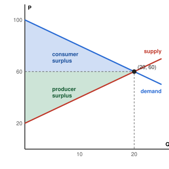

## How to use this track

This track teaches the calculus an MSc in economics uses from the first week: derivatives, optimisation, partial derivatives, constrained optimisation with Lagrange multipliers, and integrals. It assumes **Math Foundations** and **Algebra & Matrices**, especially functions, powers, quadratics, exponentials and logs.

### What calculus is for in economics

Economics is about choices at the margin: one more unit, one more hour, one more euro. Calculus is the maths of "one more, and a tiny bit more".

| Idea | Calculus tool | Example |
|---|---|---|
| Marginal cost, revenue, utility | Derivative | MC = C′(q) |
| Best output, price or bundle | Setting a derivative to zero | Profit is highest where MR = MC |
| Effect of one input, others fixed | Partial derivative | Marginal product of labour |
| Best choice under a budget | Lagrange multiplier | Utility maximisation |
| Totals from marginals, surplus | Integral | Consumer surplus |

### How to study

- Work every example on paper. Calculus is a set of rules you practise until they are automatic.
- Each skill ends with practice questions and answers. Cover the answers.
- Notation: f′(x) ("f prime of x") and dy/dx both mean the derivative. ∂f/∂x is a partial derivative.
- If something from algebra feels shaky (negative powers, fractions, logs), go back to that skill first. Most calculus mistakes are algebra mistakes.

### Two paths

After the derivative rules the tree splits: the left path covers the chain rule, exponentials and logs, partial derivatives and Lagrange; the right path covers marginal analysis, optimisation and integrals. Both meet at the boss review.


## 1. Limits and rates of change

This skill covers the idea that starts calculus: the rate of change of a curve at a single point. You will see how the slope of a straight line becomes the slope of a curve through a limit.

### Average rate of change

For a straight line the slope is the same everywhere. For a curve it changes. The **average rate of change** of f between x = a and x = b is the slope of the straight line (the **secant**) joining the two points:

```
average rate = (f(b) - f(a))/(b - a)
```

Example: cost C(q) = q² + 10. From q = 2 to q = 5:

```
C(2) = 14,  C(5) = 35
average rate = (35 - 14)/(5 - 2)
             = 21/3 = 7 euros per unit
```

This is the average extra cost per extra unit over that range.

### From average to instant

To get the rate **at** q = 2, shrink the gap. Use the points q = 2 and q = 2 + h for smaller and smaller h:

| h | C(2 + h) | average rate |
|---|---|---|
| 1 | 19 | 5 |
| 0.1 | 14.41 | 4.1 |
| 0.01 | 14.0401 | 4.01 |
| 0.001 | 14.004001 | 4.001 |

The average rate gets as close as we like to **4**. That value is the **instantaneous rate of change** at q = 2: the slope of the curve there, which is the slope of the **tangent line** that just touches it.

### Limits

"Gets as close as we like to" is written with a **limit**:

```
lim   f(x) = L
x→a
```

means f(x) can be made as close to L as we like by taking x close enough to a (but not equal to it).

Most limits of ordinary functions are found by substituting: lim (3x + 1) as x → 2 is 7. The interesting cases give 0/0 on direct substitution; then simplify first:

```
lim  (x² - 9)/(x - 3)
x→3
= lim (x + 3)(x - 3)/(x - 3)
= lim (x + 3) = 6
```

A function is **continuous** at a if you can draw it there without lifting the pen: the limit exists and equals f(a). Polynomials, eˣ and ln x (for x > 0) are continuous wherever they are defined.

### The derivative as a limit

The slope at x is the limit of the average rate over [x, x + h] as h shrinks to 0. That limit is the **derivative**:

```
f′(x) = lim  (f(x + h) - f(x))/h
        h→0
```

For f(x) = x²:

```
(x + h)² - x² = 2xh + h²
divide by h:    2x + h
let h → 0:      f′(x) = 2x
```

So the slope of x² at x = 2 is 4, matching the table. You will rarely use this definition directly: the next skill gives rules that produce derivatives in one line. But it is what every rule means.

### Practice

1. f(x) = x² + 3x. Find the average rate of change from x = 1 to x = 4.
2. A firm's revenue was 200 at q = 10 and 260 at q = 15. What is the average revenue gained per extra unit?
3. Find lim (2x² − 1) as x → 3.
4. Find lim (x² − 4)/(x − 2) as x → 2.
5. Find lim (x² + 5x)/x as x → 0.
6. Use the limit definition to find the derivative of f(x) = 3x + 2.
7. Use the limit definition to find the derivative of f(x) = x² + x.
8. Using f′(x) = 2x for x², find the slope of y = x² at x = −3. Is the curve rising or falling there?

**Answers.** 1: (28 − 4)/3 = 8. 2: 60/5 = 12. 3: 17. 4: x + 2 → 4. 5: x + 5 → 5. 6: (3(x + h) + 2 − 3x − 2)/h = 3. 7: (2xh + h² + h)/h = 2x + h + 1 → 2x + 1. 8: −6; falling.


## 2. Derivative rules

This skill gives the rules that find most derivatives in one line: the power rule, constants, and sums. With them you can differentiate any polynomial, and functions with negative and fractional powers.

### Notation

The derivative of y = f(x) can be written in several ways. They all mean the same thing.

| Written | Read as |
|---|---|
| f′(x) | f prime of x |
| dy/dx | dee y by dee x |
| d/dx (x³) | the derivative of x³ |

dy/dx is not a fraction, but it behaves like "small change in y over small change in x", which is a good way to think about it.

### The basic rules

| Rule | Function | Derivative |
|---|---|---|
| Constant | c | 0 |
| Power | xⁿ | n xⁿ⁻¹ |
| Constant multiple | c × f(x) | c × f′(x) |
| Sum and difference | f(x) ± g(x) | f′(x) ± g′(x) |

The **power rule**: bring the power down in front, then reduce the power by one.

```
d/dx (x⁵)  = 5x⁴
d/dx (x)   = 1        (x = x¹)
d/dx (7)   = 0        (a constant
                       doesn't change)
d/dx (4x³) = 12x²
```

### Polynomials

Differentiate term by term:

```
f(x)  = 3x⁴ - 5x² + 2x - 9
f′(x) = 12x³ - 10x + 2
```

To find the slope at a point, differentiate first, then substitute: f′(1) = 12 − 10 + 2 = 4.

Economics example: cost C(q) = 0.1q³ − 2q² + 30q + 500.

```
C′(q) = 0.3q² - 4q + 30
at q = 10:
C′(10) = 30 - 40 + 30 = 20
```

At 10 units, one more unit costs about 20 euros. The fixed cost 500 disappears: it does not change with output.

### Negative and fractional powers

Rewrite roots and fractions as powers first (skill 6 of Foundations), then use the power rule:

```
1/x = x⁻¹     ->  -x⁻² = -1/x²
5/x² = 5x⁻²   ->  -10x⁻³ = -10/x³
√x = x^(1/2)  ->  (1/2)x^(-1/2)
              =  1/(2√x)
```

Example: a production function Q = 20√L = 20L^(1/2). Its derivative is dQ/dL = 10L^(−1/2) = 10/√L. At L = 25 workers this is 10/5 = 2: one more worker adds about 2 units of output.

### Common mistakes

- Differentiating a product term by term: d/dx (x² × x³) is not 2x × 3x². Multiply out first (x⁵ → 5x⁴) or use the product rule (next skill).
- Forgetting to rewrite: 1/x³ is x⁻³, derivative −3x⁻⁴, not 1/(3x²).
- Keeping the constant: the derivative of x² + 10 is 2x, not 2x + 10.

### Practice

1. d/dx (x⁷)
2. d/dx (6x³ − 4x + 11)
3. f(x) = 2x⁴ + x³ − 5x. Find f′(x) and f′(2).
4. d/dx (3/x)
5. d/dx (4√x)
6. d/dx (x^(2/3))
7. y = (x + 2)². Expand, then find dy/dx.
8. Cost C(q) = q³ − 6q² + 20q + 100. Find the marginal cost at q = 5.
9. Revenue R(q) = 50q − 0.5q². Find R′(q) and the value of q where R′(q) = 0.

**Answers.** 1: 7x⁶. 2: 18x² − 4. 3: 8x³ + 3x² − 5; f′(2) = 64 + 12 − 5 = 71. 4: −3/x². 5: 2/√x. 6: (2/3)x^(−1/3). 7: x² + 4x + 4, so 2x + 4. 8: C′ = 3q² − 12q + 20 = 75 − 60 + 20 = 35. 9: R′ = 50 − q; q = 50.


## 3. Product, quotient and chain rules

This skill covers the three rules for combined functions: products, fractions, and functions inside functions. The chain rule is the most important of the three: it is used in almost every economics derivation.

### The product rule

For a product of two functions u × v:

```
(uv)′ = u′v + uv′
```

"Derivative of the first times the second, plus the first times the derivative of the second."

```
y = x² (3x + 1)
u = x²,  u′ = 2x
v = 3x + 1,  v′ = 3
y′ = 2x(3x + 1) + x²(3)
   = 6x² + 2x + 3x²
   = 9x² + 2x
```

Check by expanding first: y = 3x³ + x², y′ = 9x² + 2x ✓.

Economics: revenue is price × quantity. If the price depends on quantity, P(q), then R = P(q) × q and

```
R′(q) = P′(q) × q + P(q)
```

Marginal revenue is the price, plus the loss from lowering the price on all the units already sold (P′ is negative for a demand curve).

### The quotient rule

For a fraction u/v:

```
(u/v)′ = (u′v - uv′)/v²
```

"Bottom times derivative of top, minus top times derivative of bottom, over bottom squared." The minus sign makes the order matter.

```
y = (2x + 1)/(x + 3)
u′ = 2,  v′ = 1
y′ = (2(x + 3) - (2x + 1)(1))/(x + 3)²
   = (2x + 6 - 2x - 1)/(x + 3)²
   = 5/(x + 3)²
```

Economics: **average cost** AC(q) = C(q)/q is a quotient. Its derivative tells you whether average cost is rising or falling.

### The chain rule

For a function inside a function, y = f(g(x)):

```
dy/dx = f′(g(x)) × g′(x)
```

"Derivative of the outside (keeping the inside as it is), times the derivative of the inside." With u = g(x), it reads dy/dx = dy/du × du/dx, which looks like fractions cancelling.

```
y = (3x + 2)⁵
outside: u⁵ -> 5u⁴
inside:  u = 3x + 2 -> 3
y′ = 5(3x + 2)⁴ × 3
   = 15(3x + 2)⁴

y = √(x² + 1) = (x² + 1)^(1/2)
y′ = (1/2)(x² + 1)^(-1/2) × 2x
   = x/√(x² + 1)
```

Expanding (3x + 2)⁵ first would work too, but would take a page.

### Chains in economics

Chains appear whenever one variable depends on another that depends on a third. Output depends on workers, revenue depends on output:

```
R depends on Q,  Q depends on L
dR/dL = dR/dQ × dQ/dL
```

This is the **marginal revenue product of labour**: marginal revenue times the marginal product. A firm hires until it equals the wage.

Example: Q = 4√L and R = 10Q. At L = 16: dQ/dL = 2/√L = 0.5 and dR/dQ = 10, so dR/dL = 5 euros per extra worker-hour.

### Practice

1. Differentiate x³(2x − 5) with the product rule, then check by expanding.
2. Differentiate (x² + 1)(x − 4).
3. Differentiate x/(x + 1).
4. Differentiate (x² − 1)/x² (quotient rule, or simplify first).
5. Differentiate (2x − 7)⁴.
6. Differentiate √(5x + 1).
7. Differentiate 1/(x² + 3)  (write it as a power first).
8. Demand is P(q) = 40 − 2q. Write R(q) = P(q) × q and find marginal revenue with the product rule.
9. Q = 6L^(1/2), and each unit sells for 4 euros. Find the marginal revenue product of labour at L = 9.

**Answers.** 1: 3x²(2x − 5) + 2x³ = 8x³ − 15x²; check: 2x⁴ − 5x³ → 8x³ − 15x². 2: 2x(x − 4) + (x² + 1) = 3x² − 8x + 1. 3: 1/(x + 1)². 4: 1 − x⁻², derivative 2/x³. 5: 8(2x − 7)³. 6: 5/(2√(5x + 1)). 7: −2x/(x² + 3)². 8: R′ = (−2)q + (40 − 2q) = 40 − 4q. 9: dQ/dL = 3/√L = 1, so MRP = 4 × 1 = 4.


## 4. Marginal analysis

This skill applies derivatives to economics: marginal cost, marginal revenue, marginal profit and marginal product, and the link between marginal and average values.

### Marginal means derivative

In economics, "marginal" means the extra amount from one more unit. Calculus makes it exact: the marginal value is the derivative.

| Total | Marginal | Meaning |
|---|---|---|
| Cost C(q) | MC = C′(q) | extra cost of one more unit |
| Revenue R(q) | MR = R′(q) | extra revenue from one more unit |
| Profit π(q) | π′(q) = MR − MC | extra profit from one more unit |
| Output Q(L) | MPL = Q′(L) | extra output from one more worker |
| Utility U(x) | MU = U′(x) | extra satisfaction from one more unit |

The derivative is the rate at a point, so "one more unit" is an approximation, but a very good one when units are small compared with output:

```
C(q + 1) - C(q) ≈ C′(q)
```

### Cost and revenue

```
C(q) = 200 + 4q + 0.01q²
MC   = 4 + 0.02q
at q = 100:  MC = 6

P = 30 - 0.05q
R    = 30q - 0.05q²
MR   = 30 - 0.1q
at q = 100:  MR = 20
```

At 100 units, one more unit brings 20 euros of revenue and costs 6. Producing it raises profit by about 14, so the firm should produce more. Profit stops rising where **MR = MC**: 30 − 0.1q = 4 + 0.02q, so q ≈ 216.7. This is the most important rule in microeconomics, and the next skill on optimisation proves it.

### Marginal versus average

**Average cost** is AC = C(q)/q, the cost per unit. Marginal and average are linked by a simple fact:

- If MC < AC, the next unit is cheaper than the average, so the average **falls**.
- If MC > AC, the average **rises**.
- So MC crosses AC exactly at the **lowest point** of AC.

It is like a test score: if your next result is below your average, your average goes down.

```
C(q) = 100 + q²
AC = 100/q + q,   MC = 2q
AC = MC:  100/q + q = 2q
          100/q = q
          q = 10,  AC = MC = 20
```

Minimum average cost is 20, at q = 10.

### Diminishing returns

The second derivative (the derivative of the derivative, written f″) tells you how the marginal value itself changes.

```
Q(L) = 10√L
Q′(L) = 5/√L        (positive)
Q″(L) = -2.5/L^1.5  (negative)
```

Each extra worker adds output (Q′ > 0), but less than the one before (Q″ < 0): **diminishing marginal returns**. In the same way, U″ < 0 is **diminishing marginal utility**.

### Practice

1. C(q) = 500 + 8q + 0.02q². Find MC at q = 50.
2. R(q) = 60q − 0.2q². Find MR at q = 100. Is it positive?
3. With these C and R, write π′(q) and find where it is zero.
4. Use MC to estimate the cost of the 51st unit for question 1, then compute C(51) − C(50) exactly.
5. C(q) = 400 + 4q². Find AC and MC, and the output with the lowest AC.
6. Q(L) = 12L^(1/3). Find the marginal product at L = 8.
7. Show that Q(L) = 12L^(1/3) has diminishing marginal returns.
8. A firm finds MR = 25 and MC = 31 at its current output. Should it produce more or less?

**Answers.** 1: 8 + 0.04q = 10. 2: 60 − 0.4q = 20; yes. 3: π′ = (60 − 0.4q) − (8 + 0.04q) = 52 − 0.44q; q ≈ 118.2. 4: estimate 10 (MC at 50); exact: (500 + 408 + 52.02) − (500 + 400 + 50) = 10.02. 5: AC = 400/q + 4q, MC = 8q; 400/q = 4q gives q = 10 (AC = 80). 6: 4L^(−2/3) = 4/4 = 1. 7: Q″ = −(8/3)L^(−5/3) < 0. 8: Less: the last unit costs more than it brings in.


## 5. Exponentials, logs and elasticity

This skill covers the derivatives of eˣ and ln x, growth rates, and elasticity, the measure economists use for how strongly one variable responds to another in percentage terms.

### Derivatives of eˣ and ln x

| Function | Derivative |
|---|---|
| eˣ | eˣ |
| e^(kx) | k e^(kx) |
| ln x | 1/x |
| ln(g(x)) | g′(x)/g(x) |
| aˣ | aˣ ln a |

eˣ is the function that is its own slope. That is why e appears in continuous growth.

With the chain rule:

```
y = e^(3x² + 1)
y′ = 6x e^(3x² + 1)

y = ln(x² + 5)
y′ = 2x/(x² + 5)

y = x² ln x   (product rule)
y′ = 2x ln x + x² × (1/x)
   = 2x ln x + x
```

### Growth rates

If a quantity grows as Y(t) = Y₀ e^(gt), then

```
Y′(t) = g Y₀ e^(gt) = g Y(t)
so  Y′(t)/Y(t) = g
```

The **growth rate** Y′/Y is constant: g. And Y′/Y is exactly the derivative of ln Y:

```
d/dt ln Y(t) = Y′(t)/Y(t)
```

This gives a powerful trick. Take logs, then differentiate, and products turn into sums of growth rates. For GDP per person y = Y/N:

```
ln y = ln Y - ln N
growth of y = growth of Y - growth of N
```

If GDP grows 3% and population 1%, GDP per person grows about 2%.

### Elasticity

The derivative depends on units (euros, cents, kilos). **Elasticity** removes units by comparing percentage changes:

```
elasticity of y with respect to x
  = (% change in y)/(% change in x)
  = (dy/dx) × (x/y)
```

The **price elasticity of demand** is ε = (dQ/dP) × (P/Q). It is usually negative.

```
Q = 100 - 2P,  at P = 20:  Q = 60
dQ/dP = -2
ε = -2 × 20/60 = -0.67
```

A 1% rise in price cuts quantity by about 0.67%.

| Size of ε (ignoring the sign) | Name | Raising the price ... |
|---|---|---|
| greater than 1 | elastic | lowers revenue |
| equal to 1 | unit elastic | leaves revenue unchanged |
| less than 1 | inelastic | raises revenue |

### Elasticity with logs

Elasticity is the derivative of ln y with respect to ln x. So for a power function it is just the power:

```
Q = A P^(-1.5)
ln Q = ln A - 1.5 ln P
elasticity = -1.5   (at every price)
```

This is why econometricians run regressions in logs: in ln Q = a + b ln P, the coefficient b **is** the elasticity.

### Practice

1. d/dx (e^(5x))
2. d/dx (e^(x²))
3. d/dx (ln(3x + 2))
4. d/dx (x e^x)
5. d/dx (ln(x³))  (simplify first)
6. A population follows N(t) = 2000 e^(0.03t). What is its growth rate? Find N′(10).
7. Nominal GDP grows 5% a year and prices grow 2%. About how fast does real GDP grow?
8. Demand is Q = 120 − 3P. Find the price elasticity at P = 10 and at P = 30. Elastic or inelastic?
9. Demand is Q = 50 P^(−0.8). What is the price elasticity? Will a price rise increase revenue?

**Answers.** 1: 5e^(5x). 2: 2x e^(x²). 3: 3/(3x + 2). 4: e^x + x e^x. 5: ln(x³) = 3 ln x, so 3/x. 6: 3% a year; N′ = 60 e^(0.3) ≈ 81.0 people per year. 7: about 3%. 8: at P = 10, Q = 90, ε = −3 × 10/90 = −0.33 (inelastic); at P = 30, Q = 30, ε = −3 (elastic). 9: −0.8, inelastic, so yes.


## 6. Optimisation

This skill shows how to find maximum and minimum points with derivatives: stationary points, the second derivative test, and the economic results that follow, such as MR = MC.

### Stationary points

At the top of a hill or the bottom of a valley, the curve is momentarily flat: its slope is zero. So to find a maximum or minimum:

1. Find f′(x).
2. Solve **f′(x) = 0**. The solutions are **stationary points** (also called critical points).
3. Decide whether each is a maximum, a minimum, or neither.

This is the **first-order condition** (FOC). Economists say "take the FOC".

```
f(x) = x³ - 6x² + 9x + 1
f′(x) = 3x² - 12x + 9
      = 3(x - 1)(x - 3)
f′(x) = 0  at  x = 1 and x = 3
```

### The second derivative test

The second derivative f″ shows the curve's bend:

| At a stationary point | Shape | Point |
|---|---|---|
| f″ < 0 | bends down (a hill) | maximum |
| f″ > 0 | bends up (a valley) | minimum |
| f″ = 0 | test fails | look at signs of f′ either side |

This is the **second-order condition** (SOC).

```
f″(x) = 6x - 12
f″(1) = -6 < 0  ->  maximum at x = 1
f″(3) = 6 > 0   ->  minimum at x = 3
```

These are **local** maximum and minimum points. On a limited range (say output between 0 and 100), also check the end points: the overall best may be there.

### Profit maximisation: MR = MC

Profit is π(q) = R(q) − C(q). The first-order condition:

```
π′(q) = R′(q) - C′(q) = 0
so  MR = MC
```

The second-order condition π″ < 0 means MC must cut MR from below.

Example: P = 100 − 2q, C(q) = 20q + 300.

```
R = 100q - 2q²,  MR = 100 - 4q
MC = 20
100 - 4q = 20  ->  q = 20
π″ = -4 < 0, a maximum
P = 100 - 40 = 60
π = 1200 - 700 = 500
```

### More economics examples

**Minimum average cost.** C(q) = 2q² + 50, so AC = 2q + 50/q.

```
AC′ = 2 - 50/q² = 0
q² = 25,  q = 5
AC″ = 100/q³ > 0, a minimum
AC = 10 + 10 = 20
```

**Tax revenue.** A tax of t per unit cuts sales to Q = 100 − 5t. Revenue T = tQ = 100t − 5t².

```
T′ = 100 - 10t = 0  ->  t = 10
T = 1000 - 500 = 500
```

Raising the tax above 10 lowers revenue: a simple Laffer curve.

### Practice

1. Find and classify the stationary points of f(x) = x² − 8x + 3.
2. Find and classify the stationary points of f(x) = 2x³ − 3x² − 12x + 5.
3. Demand P = 80 − q and cost C = q² + 20q. Find the profit-maximising q, the price and the profit.
4. Show that the answer in question 3 satisfies MR = MC.
5. C(q) = q² + 4q + 100. Find the output that minimises average cost.
6. A monopolist faces P = 120 − 3q and constant MC = 30. Find q, P and profit (no fixed costs).
7. Find the maximum of f(x) = x e^(−x) for x ≥ 0.
8. Profit is π(q) = −q³ + 12q² + 60q − 100. Find the profit-maximising output.

**Answers.** 1: f′ = 2x − 8 = 0 at x = 4; f″ = 2 > 0: minimum (f = −13). 2: 6x² − 6x − 12 = 6(x − 2)(x + 1); f″ = 12x − 6: x = −1 maximum (f = 12), x = 2 minimum (f = −15). 3: π = 60q − 2q², q = 15, P = 65, π = 450. 4: MR = 80 − 2q = 50, MC = 2q + 20 = 50 ✓. 5: AC = q + 4 + 100/q, AC′ = 1 − 100/q² = 0, q = 10. 6: MR = 120 − 6q = 30, q = 15, P = 75, π = (75 − 30) × 15 = 675. 7: f′ = e^(−x)(1 − x) = 0 at x = 1; maximum 1/e ≈ 0.368. 8: π′ = −3q² + 24q + 60 = −3(q − 10)(q + 2) = 0, q = 10 (π″ = −6q + 24 = −36 < 0).


## 7. Partial derivatives

This skill covers functions of several variables and how to differentiate them one variable at a time. Production, utility and demand in economics all depend on more than one thing, so this is used constantly.

### Functions of several variables

Output depends on labour **and** capital. Utility depends on several goods. We write f(x, y), or Q(K, L):

```
Q(K, L) = 10 K^0.5 L^0.5
Q(16, 4) = 10 × 4 × 2 = 80
```

A function of two variables is a surface over a grid, like a landscape: (x, y) is the position on the map and f(x, y) is the height.

### Partial derivatives

A **partial derivative** measures how f changes when **one** variable moves and all the others stay fixed. Treat the other variables as constants, then differentiate as usual.

```
f(x, y) = x²y + 3y² + 5x

∂f/∂x = 2xy + 5       (y treated
                       as a constant)
∂f/∂y = x² + 6y       (x treated
                       as a constant)
```

∂ is a curly d, read "partial". Other notations: fₓ and f_y, or f₁ and f₂.

At a point: at (1, 2), ∂f/∂x = 4 + 5 = 9 and ∂f/∂y = 1 + 12 = 13.

### Marginal products and Cobb-Douglas

For a production function Q(K, L):

- ∂Q/∂L is the **marginal product of labour** (MPL): extra output from one more worker, capital fixed.
- ∂Q/∂K is the **marginal product of capital** (MPK).

The **Cobb-Douglas** function Q = A K^α L^β is the most used in economics:

```
Q   = 10 K^0.5 L^0.5
MPK = 5 K^(-0.5) L^0.5
    = 5 √(L/K)
MPL = 5 √(K/L)
at K = 16, L = 4:
MPK = 5 × 0.5 = 2.5
MPL = 5 × 2 = 10
```

Facts about Cobb-Douglas worth knowing:

| Fact | Condition |
|---|---|
| Constant returns to scale (double inputs, double output) | α + β = 1 |
| Increasing returns | α + β > 1 |
| Decreasing returns | α + β < 1 |
| Output elasticity of K | α |
| Share of income paid to capital (competitive markets) | α |

### Second partials and the MRS

Each first partial can be differentiated again: ∂²f/∂x², ∂²f/∂y², and the **cross partials** ∂²f/∂x∂y and ∂²f/∂y∂x. For the functions you will meet, the two cross partials are equal (Young's theorem).

```
f = x²y + 3y² + 5x
fxx = 2y,   fyy = 6,   fxy = fyx = 2x
```

The **marginal rate of substitution** (MRS) between two goods is the ratio of marginal utilities. For U(x, y) = x^0.5 y^0.5:

```
MUx = 0.5 x^(-0.5) y^0.5
MUy = 0.5 x^0.5 y^(-0.5)
MRS = MUx/MUy = y/x
```

At (4, 9) the consumer would give up 9/4 = 2.25 units of y for one more unit of x. The same ratio for a production function is the **marginal rate of technical substitution**, MPL/MPK.

### The total differential

If both variables change a little, the change in f is approximately the sum of the two effects:

```
df ≈ (∂f/∂x) dx + (∂f/∂y) dy
```

Example: Q = 10 K^0.5 L^0.5 at K = 16, L = 4 (Q = 80). Add 1 worker and remove 1 unit of capital: dQ ≈ 2.5(−1) + 10(1) = 7.5.

### Practice

1. f(x, y) = 3x²y³. Find ∂f/∂x and ∂f/∂y.
2. f(x, y) = x² + 4xy − y². Find both partials at (1, 2).
3. f(x, y) = e^(2x + y). Find ∂f/∂x and ∂f/∂y.
4. f(x, y) = ln(x) + 2 ln(y). Find both partials.
5. Q = 20 K^0.25 L^0.75. Find MPK and MPL. Returns to scale?
6. For question 5, at K = 16 and L = 1, find MPL.
7. U = x^0.3 y^0.7. Find the MRS (MUx/MUy).
8. For f = x³y + xy², find fxx, fyy and fxy.
9. Q = 10 K^0.5 L^0.5 at K = 25, L = 9. Estimate the change in Q if L rises by 0.5 and K stays fixed.

**Answers.** 1: 6xy³ and 9x²y². 2: fx = 2x + 4y = 10; fy = 4x − 2y = 0. 3: 2e^(2x + y) and e^(2x + y). 4: 1/x and 2/y. 5: MPK = 5K^(−0.75)L^0.75, MPL = 15K^0.25L^(−0.25); 0.25 + 0.75 = 1, constant. 6: 15 × 2 × 1 = 30. 7: (0.3/0.7)(y/x) = 3y/(7x). 8: 6xy, 2x, 3x² + 2y. 9: MPL = 5√(25/9) = 25/3 ≈ 8.33, so ΔQ ≈ 4.17.


## 8. Optimisation with several variables

This skill extends optimisation to functions of two variables: set every partial derivative to zero, then check the second-order conditions with the Hessian. A firm choosing two inputs, or a two-product firm choosing two outputs, is this problem.

### First-order conditions

At a maximum or minimum of f(x, y), the surface is flat in every direction, so **both** partials are zero:

```
∂f/∂x = 0   and   ∂f/∂y = 0
```

Solve the two equations together (the systems skill again).

```
f(x, y) = x² + y² - 4x - 6y + 20
fx = 2x - 4 = 0  ->  x = 2
fy = 2y - 6 = 0  ->  y = 3
stationary point (2, 3),  f = 7
```

### Second-order conditions: the Hessian

The **Hessian** is the matrix of second partials:

```
H = [ fxx  fxy ]
    [ fxy  fyy ]
```

At a stationary point, use its determinant D = fxx fyy − (fxy)²:

| Condition | Point |
|---|---|
| D > 0 and fxx > 0 | minimum |
| D > 0 and fxx < 0 | maximum |
| D < 0 | saddle point (neither) |
| D = 0 | test fails |

A **saddle point** goes up in one direction and down in another, like a horse's saddle or a mountain pass.

For the example: fxx = 2, fyy = 2, fxy = 0, so D = 4 > 0 and fxx > 0: a **minimum** of 7 at (2, 3).

```
g(x, y) = x² - y²
gx = 2x = 0,  gy = -2y = 0  ->  (0, 0)
D = (2)(-2) - 0 = -4 < 0: a saddle
```

### A two-product firm

A firm sells two goods at fixed prices 40 and 60. Its cost depends on both outputs (they share machines):

```
C = x² + xy + y²
π = 40x + 60y - x² - xy - y²

πx = 40 - 2x - y = 0
πy = 60 - x - 2y = 0
```

Solve: from the first, y = 40 − 2x; substitute: 60 − x − 80 + 4x = 0, so 3x = 20, x ≈ 6.67 and y ≈ 26.67.

```
πxx = -2,  πyy = -2,  πxy = -1
D = 4 - 1 = 3 > 0, πxx < 0: maximum
```

### Price discrimination

A monopolist sells in two separate markets: P₁ = 100 − q₁ and P₂ = 80 − 2q₂, with cost C = 20(q₁ + q₂).

```
π = (100 - q₁)q₁ + (80 - 2q₂)q₂
    - 20q₁ - 20q₂
π₁ = 100 - 2q₁ - 20 = 0  ->  q₁ = 40
π₂ = 80 - 4q₂ - 20 = 0   ->  q₂ = 15
P₁ = 60,  P₂ = 50
```

The firm charges more in the market where demand is less elastic. The first-order conditions say MR₁ = MR₂ = MC.

### Practice

1. Find and classify the stationary point of f = x² + 2y² − 6x + 8y.
2. Find and classify the stationary point of f = −x² − y² + xy + 3x.
3. Classify the stationary point of f = xy at (0, 0).
4. A firm sells two goods at prices 20 and 30 with cost C = x² + y². Find the profit-maximising outputs.
5. A firm sells at prices 50 and 40 with cost C = 2x² + xy + y². Find the outputs and check it is a maximum.
6. A monopolist has P₁ = 60 − 2q₁ and P₂ = 40 − q₂, with constant MC = 10. Find both quantities and prices.

**Answers.** 1: 2x − 6 = 0, 4y + 8 = 0: (3, −2); D = 8 > 0, fxx = 2 > 0: minimum, f = −17. 2: −2x + y + 3 = 0, x − 2y = 0: x = 2, y = 1; D = 4 − 1 = 3 > 0, fxx < 0: maximum. 3: fxx = fyy = 0, fxy = 1, D = −1: saddle. 4: 20 − 2x = 0, 30 − 2y = 0: x = 10, y = 15. 5: 50 − 4x − y = 0, 40 − x − 2y = 0: x = 60/7 ≈ 8.57, y = 110/7 ≈ 15.71; D = 8 − 1 = 7 > 0, πxx = −4: maximum. 6: 60 − 4q₁ = 10, q₁ = 12.5, P₁ = 35; 40 − 2q₂ = 10, q₂ = 15, P₂ = 25.


## 9. Integrals

This skill covers integration, the reverse of differentiation: antiderivatives, the rules for finding them, and definite integrals as areas under curves. In economics it turns marginal values back into totals.

### Antiderivatives

If F′(x) = f(x), then F is an **antiderivative** of f. Integration asks: "which function has this derivative?"

```
∫ 2x dx = x² + C
```

The **constant of integration** C is there because constants vanish when you differentiate: x² + 5 and x² − 3 both have derivative 2x. ∫ is a long S (for "sum"), and dx says x is the variable.

### Integration rules

Each rule is a derivative rule run backwards.

| Function | Integral |
|---|---|
| xⁿ (n ≠ −1) | xⁿ⁺¹/(n + 1) + C |
| 1/x | ln x + C (for x > 0) |
| eˣ | eˣ + C |
| e^(kx) | (1/k) e^(kx) + C |
| c f(x) | c ∫ f(x) dx |
| f(x) + g(x) | ∫ f dx + ∫ g dx |

The power rule backwards: **raise the power by one, then divide by the new power**.

```
∫ x³ dx = x⁴/4 + C
∫ (6x² - 4x + 5) dx
  = 2x³ - 2x² + 5x + C
∫ √x dx = ∫ x^(1/2) dx
        = (2/3) x^(3/2) + C
∫ 3/x² dx = ∫ 3x⁻² dx
          = -3x⁻¹ + C = -3/x + C
```

Check any integral by differentiating your answer.

### From marginal back to total

If you know marginal cost, integrate to get total cost. The constant C is then the **fixed cost**, found from extra information.

```
MC = 3q² - 10q + 40
C(q) = q³ - 5q² + 40q + F
fixed cost 200 -> F = 200
C(q) = q³ - 5q² + 40q + 200
```

The same works for revenue from marginal revenue (R(0) = 0, so the constant is 0) and for capital stock from investment.

### Definite integrals and areas

The **definite integral** from a to b gives a number:

```
  b
∫  f(x) dx = F(b) - F(a)
  a
```

This is the **fundamental theorem of calculus**. Find any antiderivative F, then subtract its value at the bottom limit from its value at the top. The constant C cancels, so leave it out.

```
∫ from 1 to 3 of 2x dx
= [x²] from 1 to 3
= 9 - 1 = 8
```

**Meaning:** when f is positive, the definite integral is the **area under the curve** between a and b. (Area below the x-axis counts as negative.)

And it adds up changes: the integral of a rate of change over a period is the total change. The integral of MC from q = 10 to q = 20 is the extra cost of raising output from 10 to 20.

```
MC = 4 + 0.2q
∫ from 10 to 20 of (4 + 0.2q) dq
= [4q + 0.1q²] from 10 to 20
= (80 + 40) - (40 + 10) = 70
```

### Practice

1. ∫ (5x⁴ + 2x) dx
2. ∫ (x² − 3x + 7) dx
3. ∫ (4/x) dx
4. ∫ e^(2x) dx
5. ∫ x^(−1/2) dx
6. Evaluate ∫ from 0 to 2 of (3x² + 1) dx.
7. Evaluate ∫ from 1 to e of (1/x) dx.
8. MC = 6q + 8 and fixed cost is 50. Find C(q) and C(10).
9. MR = 100 − 4q. Find total revenue R(q). (R(0) = 0.)
10. Investment flows in at I(t) = 3√t billion a year. How much capital is added from t = 0 to t = 4?

**Answers.** 1: x⁵ + x² + C. 2: x³/3 − 3x²/2 + 7x + C. 3: 4 ln x + C. 4: e^(2x)/2 + C. 5: 2√x + C. 6: [x³ + x] = 8 + 2 = 10. 7: ln e − ln 1 = 1. 8: C = 3q² + 8q + 50; C(10) = 430. 9: 100q − 2q². 10: [2t^(3/2)] from 0 to 4 = 16 billion.


## 10. Constrained optimisation: Lagrange

This skill covers optimisation with a constraint, using the Lagrange multiplier method. Maximising utility subject to a budget, or minimising cost for a given output, is the core problem of microeconomics.

### The problem

A consumer wants the most utility, but cannot spend more than their income:

```
maximise   U(x, y)
subject to px x + py y = m
```

Setting ∂U/∂x = 0 and ∂U/∂y = 0 no longer works: more is always better, so the unconstrained "best" is to buy infinitely much. The constraint must be built in.

**Method 1: substitution.** With one constraint you can often solve it for y, substitute into U, and optimise in one variable. This is fine for simple cases.

**Method 2: the Lagrangian**, which always works and gives extra information.

### The Lagrangian method

1. Write the constraint as g(x, y) = 0, here m − px x − py y = 0.
2. Form the **Lagrangian**: ℒ = U(x, y) + λ (m − px x − py y). λ (lambda) is the **Lagrange multiplier**.
3. Set all three partial derivatives to zero:

```
∂ℒ/∂x = Ux - λ px = 0
∂ℒ/∂y = Uy - λ py = 0
∂ℒ/∂λ = m - px x - py y = 0
```

4. Solve the three equations for x, y and λ. A good trick: divide the first two equations to eliminate λ.

### Worked example: Cobb-Douglas utility

U = x^0.5 y^0.5, prices px = 2, py = 4, income m = 80.

```
ℒ = x^0.5 y^0.5 + λ(80 - 2x - 4y)

0.5 x^(-0.5) y^0.5 = 2λ   (1)
0.5 x^0.5 y^(-0.5) = 4λ   (2)
2x + 4y = 80              (3)

(1) ÷ (2):  y/x = 2/4
so x = 2y
(3): 4y + 4y = 80
y = 10,  x = 20
```

Dividing (1) by (2) gave **MRS = price ratio** (MUx/MUy = px/py): the famous tangency condition. At the best bundle, the rate at which the consumer is willing to swap goods equals the rate at which the market lets them.

With Cobb-Douglas U = x^a y^(1−a), the consumer always spends the share a of income on x. Here a = 0.5: 2 × 20 = 40, half of 80.

### What λ means

λ is the **shadow price** of the constraint: how much the objective rises if the constraint is relaxed by one unit. In the consumer problem, λ is the **marginal utility of income**.

```
from (1):  λ = 0.5 x^(-0.5) y^0.5 / 2
             = 0.25 × √(10/20)
             ≈ 0.177
```

One more euro of income raises maximum utility by about 0.177. In a firm's cost problem, λ is the **marginal cost** of producing one more unit.

### Cost minimisation

A firm wants output Q = K^0.5 L^0.5 = 10 at the lowest cost, with wage w = 4 and rental rate r = 1.

```
minimise 4L + K
subject to K^0.5 L^0.5 = 10

MPL/MPK = w/r
(K/L) = 4,  so K = 4L
√(4L × L) = 10
2L = 10,  L = 5,  K = 20
cost = 20 + 20 = 40
```

The condition MPL/MPK = w/r (marginal rate of technical substitution = price ratio) is the producer's version of MRS = price ratio.

### Practice

1. Maximise U = xy subject to x + 2y = 40.
2. Maximise U = x^0.5 y^0.5 subject to 4x + y = 64.
3. Maximise U = x^0.25 y^0.75 subject to x + 3y = 120. What share of income goes on y?
4. Find λ in question 1 and say what it means.
5. Minimise the cost 2L + 8K of producing Q = K^0.5 L^0.5 = 20.
6. Use substitution to maximise f = x²y subject to x + y = 9 (x, y > 0).

**Answers.** 1: y = λ, x = 2λ, so x = 2y; 4y = 40: y = 10, x = 20, U = 200. 2: MRS y/x = 4, y = 4x; 8x = 64: x = 8, y = 32. 3: x = 30, y = 30; three quarters, 90 of 120. 4: λ = Ux/px = y/1 = 10: one more unit of income raises U by about 10. 5: MPL/MPK = K/L = 2/8, so L = 4K; 2K = 20: K = 10, L = 40, cost 160. 6: y = 9 − x, f = 9x² − x³, f′ = 18x − 3x² = 0, x = 6, y = 3, f = 108.


## 11. Integrals in economics

This skill uses definite integrals for the classic economics applications: consumer and producer surplus, totals from marginal functions, and the present value of a stream of income.

### Consumer surplus

The demand curve shows the most each buyer is willing to pay. Buyers who would have paid more than the market price gain the difference. Adding that gain over all buyers gives **consumer surplus** (CS): the area between the demand curve and the price line.



```
CS = ∫ from 0 to Q* of D(Q) dQ
     - P* Q*
```

where D(Q) is the inverse demand function and (Q*, P*) the market point.

With demand P = 100 − 2Q and price 60 (so Q* = 20):

```
∫ from 0 to 20 of (100 - 2Q) dQ
= [100Q - Q²] from 0 to 20
= 2000 - 400 = 1600
CS = 1600 - 60 × 20 = 400
```

For a straight demand line, the area is a triangle, so you can check: ½ × 20 × (100 − 60) = 400 ✓. The integral is needed when demand is curved.

### Producer surplus

Sellers would have accepted any price down to the supply curve. **Producer surplus** (PS) is the area between the price line and the supply curve S(Q):

```
PS = P* Q* - ∫ from 0 to Q* of S(Q) dQ
```

With supply P = 20 + 2Q:

```
∫ from 0 to 20 of (20 + 2Q) dQ
= [20Q + Q²] from 0 to 20 = 800
PS = 1200 - 800 = 400
```

**Total surplus** = CS + PS = 800. A tax or price ceiling shrinks it; the lost part is the **deadweight loss**, computed as another area.

### Curved demand

With demand P = 50/√Q (so P = 50Q^(−1/2)) at Q* = 25, the price is 50/5 = 10.

```
∫ from 0 to 25 of 50Q^(-1/2) dQ
= [100 Q^(1/2)] from 0 to 25
= 500
CS = 500 - 10 × 25 = 250
```

No triangle formula would give this.

### Present value of a stream

Money received later is worth less today. With continuous discounting at rate r, a payment received at time t is worth e^(−rt) times as much today. A stream paying f(t) per year from t = 0 to T has **present value**:

```
PV = ∫ from 0 to T of f(t) e^(-rt) dt
```

For a constant stream of A per year:

```
PV = ∫ from 0 to T of A e^(-rt) dt
   = (A/r)(1 - e^(-rT))
```

Example: 10,000 a year for 5 years at r = 5%:

```
PV = (10000/0.05)(1 - e^(-0.25))
   = 200000 × 0.2212
   ≈ 44,240
```

As T grows without limit, e^(−rT) → 0 and PV → A/r: a perpetuity of 10,000 at 5% is worth 200,000.

### Practice

1. Demand P = 80 − 4Q, market price 40. Find Q* and the consumer surplus (by integral, then check with the triangle).
2. Supply P = 10 + Q, market price 30. Find Q* and the producer surplus.
3. Demand P = 120 − 3Q and supply P = 20 + 2Q. Find the equilibrium, CS and PS.
4. Demand P = 40/√Q. Find the consumer surplus when Q = 16.
5. MC = 2q + 10. Find the extra cost of raising output from 10 to 30 units.
6. Find the present value of 5,000 a year for 10 years at r = 4% (continuous).
7. What is a perpetuity of 3,000 a year worth at r = 6%?

**Answers.** 1: Q* = 10; [80Q − 2Q²] = 600, CS = 600 − 400 = 200; triangle ½ × 10 × 40 = 200 ✓. 2: Q* = 20; PS = 600 − [10Q + Q²/2] = 600 − 400 = 200. 3: 120 − 3Q = 20 + 2Q, Q = 20, P = 60; CS = ½ × 20 × 60 = 600; PS = ½ × 20 × 40 = 400. 4: P = 10; [80√Q] from 0 to 16 = 320; CS = 320 − 160 = 160. 5: [q² + 10q] from 10 to 30 = 1200 − 200 = 1000. 6: (5000/0.04)(1 − e^(−0.4)) = 125000 × 0.3297 ≈ 41,210. 7: 3000/0.06 = 50,000.


## 12. Boss: calculus review

A mixed review of the whole track. Work on paper; a calculator is fine for e and ln. The skill number in brackets tells you what to revisit.

### Round 1: derivatives

1. Find lim (x² − 25)/(x − 5) as x → 5.  (1)
2. d/dx (4x³ − 2/x + 7)  (2)
3. d/dx (x² e^x)  (3, 5)
4. d/dx ((x + 1)/(x − 1))  (3)
5. d/dx ((4x² + 1)⁵)  (3)
6. d/dx (ln(x² + 4))  (5)

**Answers.** 1: 10. 2: 12x² + 2/x². 3: 2x eˣ + x² eˣ. 4: ((x − 1) − (x + 1))/(x − 1)² = −2/(x − 1)². 5: 40x(4x² + 1)⁴. 6: 2x/(x² + 4).

### Round 2: marginal analysis and optimisation

1. C(q) = 0.5q² + 6q + 200. Find MC at q = 20 and the output with the lowest average cost.  (4, 6)
2. Demand Q = 200 − 4P. Find the price elasticity at P = 30. Elastic or inelastic?  (5)
3. Find and classify the stationary points of f(x) = x³ − 12x + 4.  (6)
4. Demand P = 90 − 3q, cost C = q² + 10q + 50. Find the profit-maximising output, price and profit.  (6)

**Answers.** 1: MC = q + 6 = 26; AC = 0.5q + 6 + 200/q, AC′ = 0.5 − 200/q² = 0, q = 20. 2: Q = 80, ε = −4 × 30/80 = −1.5: elastic. 3: 3x² − 12 = 0, x = ±2; f″ = 6x: x = 2 minimum (f = −12), x = −2 maximum (f = 20). 4: π = 80q − 4q² − 50, q = 10, P = 60, π = 350.

### Round 3: several variables

1. f(x, y) = x³y² + 4xy. Find fx, fy and fxy.  (7)
2. Q = 8 K^0.25 L^0.5. Find MPL. What kind of returns to scale?  (7)
3. Find and classify the stationary point of f = 2x² + y² − 2xy − 4x.  (8)
4. Maximise U = x^0.4 y^0.6 subject to 2x + 3y = 100.  (10)
5. In question 4, how much is spent on each good?  (10)

**Answers.** 1: 3x²y² + 4y, 2x³y + 4x, 6x²y + 4. 2: 4K^0.25 L^(−0.5); 0.75 < 1, decreasing. 3: 4x − 2y − 4 = 0, 2y − 2x = 0: x = y = 2; D = 4 × 2 − 4 = 4 > 0, fxx > 0: minimum. 4: MRS = (0.4/0.6)(y/x) = 2/3, so y = x; 5x = 100, x = y = 20. 5: 40 on x and 60 on y (shares 0.4 and 0.6).

### Round 4: integrals

1. ∫ (3x² − 4x + 2) dx  (9)
2. Evaluate ∫ from 0 to 4 of √x dx.  (9)
3. MC = 0.3q² + 5 and fixed cost 100. Find C(q).  (9)
4. Demand P = 60 − Q, price 20. Find the consumer surplus.  (11)
5. Find the present value of 2,000 a year for 20 years at r = 5%, continuous.  (11)

**Answers.** 1: x³ − 2x² + 2x + C. 2: [(2/3)x^(3/2)] = 16/3. 3: 0.1q³ + 5q + 100. 4: Q* = 40; [60Q − Q²/2] = 1600, CS = 1600 − 800 = 800. 5: (2000/0.05)(1 − e^(−1)) = 40000 × 0.6321 ≈ 25,285.

### What next

20 questions. 17 or more means you have the calculus a first-term MSc course expects. The usual next topics are the implicit function theorem, comparative statics, and difference and differential equations for growth models. The **Probability & Statistics** branch covers the other half of the MSc toolkit.


