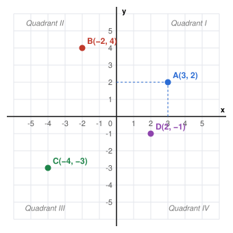
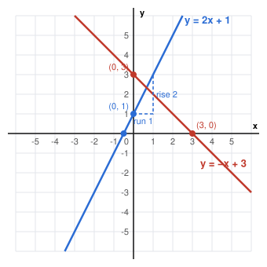

## How to use this track

This track rebuilds school maths from the ground up, for adults who missed parts of it. It assumes nothing beyond counting. By the end you can solve equations, rearrange formulas, read and draw graphs, and turn a word problem into maths. That is the toolkit an economics degree uses every week.

### Why the foundations matter for economics

Economics is written in algebra. A demand curve is an equation. "Find the equilibrium" means "solve two equations together". "What happens if the tax rises by 10%?" means percentages and rearranging. Elasticities are fractions of percentages. Almost every gap in later maths (calculus, statistics, matrices) turns out to be a gap here: a sign error with negatives, a fraction rule, or an equation step done in the wrong order.

### How to study each skill

- **Use paper.** Reading maths is not the same as doing it. Copy every worked example by hand before reading the solution.
- **Do the practice questions.** Each skill ends with practice questions and their answers. Cover the answers, work the questions out, then check.
- **Get it wrong on purpose first.** The "Common mistakes" sections show the errors most people make. If you recognise one, that is the gap to fix.
- **Little and often.** One part (about 5 minutes) a day beats two hours on Sunday.
- **No calculator** until the skill says so. The point is to make the rules automatic.

### The route

| Stage | Skills |
|---|---|
| Arithmetic | Negatives, multiplying and dividing, order of operations |
| Number forms | Fractions, decimals and percentages, powers and roots |
| Algebra | Expressions, solving equations, rearranging and inequalities |
| Using it | Word problems, the coordinate plane, straight-line graphs |
| Boss | A mixed review of everything |

After this track, go to **Algebra & Matrices** for functions, polynomials, quadratics and linear algebra.

### Symbols used in this track

| Symbol | Meaning |
|---|---|
| × and ÷ | Multiply and divide (in algebra, 3x means 3 × x) |
| − | Minus or negative |
| = | Is equal to |
| ≠ | Is not equal to |
| < and > | Less than, greater than (the open side faces the bigger number) |
| ≤ and ≥ | Less than or equal to, greater than or equal to |
| x² | x squared, x × x |
| √ | Square root |
| a/b | The fraction a over b, the same as a ÷ b |


## 1. Numbers and negatives

This skill fixes the most common source of wrong answers in all of maths: negative numbers. Get these rules automatic and half of your future errors disappear.

### The number line

Picture numbers on a line. Zero sits in the middle. Positive numbers go right, negative numbers go left.

```
-5 -4 -3 -2 -1  0  1  2  3  4  5
```

- Further right means bigger. So −1 is bigger than −5, even though 5 looks bigger. A debt of 1 euro is better than a debt of 5.
- **Adding** a positive number moves you right. **Subtracting** a positive number moves you left.
- The distance from zero, ignoring the sign, is called the **absolute value**. The absolute value of −7 is 7.

In economics, negatives are everywhere: losses, falling prices, negative growth, a trade deficit.

### Adding and subtracting with negatives

Two rules cover every case.

1. **Subtracting a negative is the same as adding.** Two minus signs next to each other become a plus: 5 − (−3) = 5 + 3 = 8. Think: taking away a debt of 3 makes you 3 richer.
2. **Adding a negative is the same as subtracting.** 5 + (−3) = 5 − 3 = 2.

When the signs are mixed, use this shortcut:

| Situation | What to do | Example |
|---|---|---|
| Both numbers negative | Add the sizes, keep the minus | −4 − 6 = −10 |
| Different signs | Subtract the smaller size from the bigger, keep the sign of the bigger | −9 + 4 = −5 |
| Different signs, positive bigger | Same rule | −3 + 10 = 7 |

### Worked examples

```
-7 + 12
  sizes 7 and 12, positive bigger
  12 - 7 = 5

-2 - 8
  both going left: -10

6 - 11
  6, then 11 to the left: -5

-4 - (-9)
  minus a negative = plus
  -4 + 9 = 5
```

A firm made a profit of 3 million last year and a loss of 5 million this year. The change is −5 − 3 = −8 million.

### Common mistakes

- Reading −3 − 4 as −3 + 4. Both steps go left: the answer is −7.
- Forgetting the brackets: 5 − −3 is unclear on paper. Always write 5 − (−3).
- Thinking −8 is bigger than −2. On the number line, −2 is to the right, so −2 > −8.

### Practice

1. −6 + 9
2. 4 − 10
3. −3 − 7
4. 8 − (−5)
5. −12 + (−3)
6. Which is bigger, −0.5 or −2?
7. The temperature was −4 °C and rose by 9 degrees. What is it now?
8. Growth went from 2% to −1%. By how many percentage points did it change?

**Answers.** 1: 3. 2: −6. 3: −10. 4: 13. 5: −15. 6: −0.5. 7: 5 °C. 8: −1 − 2 = −3, a fall of 3 percentage points.


## 2. Multiplying and dividing

This skill covers multiplication and division without a calculator, the sign rules for negatives, and why you can never divide by zero.

### What multiplication and division mean

- **Multiplication** is repeated addition: 4 × 3 means four lots of 3, or 3 + 3 + 3 + 3 = 12.
- **Division** is the reverse: 12 ÷ 3 asks "how many 3s fit into 12?" The answer is 4.
- So every multiplication fact gives two division facts: 4 × 3 = 12 means 12 ÷ 3 = 4 and 12 ÷ 4 = 3.

Order does not matter for multiplication (3 × 4 = 4 × 3) but it does for division (12 ÷ 3 is not 3 ÷ 12).

Words that mean multiply: times, product, of ("half of 40"), per (when scaling up). Words that mean divide: per (when sharing), quotient, ratio, average.

### Times tables without memorising all of them

You only need a handful of facts, then tricks for the rest.

| Trick | Example |
|---|---|
| × 10: shift one place | 37 × 10 = 370 |
| × 5: × 10, then halve | 48 × 5 = 480 ÷ 2 = 240 |
| × 9: × 10, minus one lot | 9 × 7 = 70 − 7 = 63 |
| × 11: × 10, plus one lot | 11 × 14 = 140 + 14 = 154 |
| Split a number | 7 × 13 = 7 × 10 + 7 × 3 = 70 + 21 = 91 |
| Double and halve | 16 × 25 = 8 × 50 = 4 × 100 = 400 |

The "split" trick is the important one. It is called the **distributive law**, and it comes back in algebra as expanding brackets.

### Long multiplication and division

For bigger numbers, split by place value:

```
 34 × 26
 = 34 × 20 + 34 × 6
 = 680 + 204
 = 884
```

For division, ask how many times the divisor fits, step by step:

```
852 ÷ 6
6 into 8  -> 1, rem. 2
             bring down 5: 25
6 into 25 -> 4, rem. 1
             bring down 2: 12
6 into 12 -> 2, rem. 0
answer 142
check: 142 × 6 = 852
```

Always check a division by multiplying back.

### Signs: negatives in multiplication and division

| Signs | Result | Example |
|---|---|---|
| positive × positive | positive | 3 × 4 = 12 |
| negative × positive | negative | −3 × 4 = −12 |
| negative × negative | positive | −3 × (−4) = 12 |
| negative ÷ positive | negative | −12 ÷ 4 = −3 |
| negative ÷ negative | positive | −12 ÷ (−4) = 3 |

Short version: **same signs give a positive, different signs give a negative.** With many factors, count the minus signs: an even number gives a positive, an odd number a negative. So (−1) × (−2) × (−3) = −6.

### Zero

- Anything times zero is zero.
- Zero divided by a number is zero: 0 ÷ 5 = 0.
- **Dividing by zero is undefined.** 5 ÷ 0 would ask "what times 0 gives 5?" and nothing does. When a formula would divide by zero, it simply does not apply there.

### Practice

1. 9 × 8
2. 25 × 12
3. 47 × 6
4. 23 × 15
5. 744 ÷ 8
6. −7 × 6
7. −48 ÷ (−6)
8. (−2) × 3 × (−5)
9. A café sells 135 coffees a day at 3 euros each. What is the daily revenue?
10. 96 euros are split equally between 4 people. How much each?

**Answers.** 1: 72. 2: 300 (25 × 4 = 100, times 3). 3: 282. 4: 345 (23 × 10 + 23 × 5 = 230 + 115). 5: 93. 6: −42. 7: 8. 8: 30. 9: 405 euros. 10: 24 euros.


## 3. Order of operations

This skill covers the rule for which part of a calculation to do first. Without it, 2 + 3 × 4 could be 20 or 14, and only one is right.

### The rule: BODMAS

Work in this order:

| Letter | Step | Notes |
|---|---|---|
| B | Brackets | Innermost first |
| O | Orders (powers and roots) | x², √ |
| D M | Division and Multiplication | Same rank: left to right |
| A S | Addition and Subtraction | Same rank: left to right |

The American name is PEMDAS (Parentheses, Exponents, Multiply/Divide, Add/Subtract). It is the same rule.

So 2 + 3 × 4: multiply first, 3 × 4 = 12, then 2 + 12 = **14**.

### Same rank: go left to right

Multiplication and division are equal partners. So are addition and subtraction. Neither one "wins"; you go from left to right.

```
12 ÷ 3 × 2 = 4 × 2 = 8
  (not 12 ÷ 6 = 2)
10 - 4 + 3 = 6 + 3 = 9
  (not 10 - 7 = 3)
```

This trips up most people, because the acronym lists D before M and A before S.

### Worked examples

```
(5 + 3) × 2
  = 8 × 2 = 16
5 + 3 × 2
  = 5 + 6 = 11
20 - 2 × 3²
  = 20 - 2 × 9
  = 20 - 18 = 2
(20 - 2) × 3²
  = 18 × 9 = 162
4 × (6 - (3 - 1))
  = 4 × (6 - 2)
  = 4 × 4 = 16
```

### Fraction bars and negatives

- A **fraction bar acts like brackets** around the top and around the bottom. (6 + 4)/2 = 10/2 = 5. If you type it into a calculator, you must add the brackets yourself: (6+4)/2, not 6+4/2.
- **−3² is −9**, not 9. The power applies to 3 first, then the minus. If you mean negative three squared, write (−3)² = 9. This matters in formulas such as the quadratic formula later.

### Why it matters in economics

A firm's profit is revenue minus cost. With price 10, quantity 50, fixed cost 100 and cost 4 per unit:

```
profit = 10 × 50 - (100 + 4 × 50)
       = 500 - (100 + 200)
       = 500 - 300
       = 200
```

Leave out the brackets and you subtract only the 100, then add the variable cost: a completely wrong profit of 600.

### Practice

1. 6 + 4 × 5
2. (6 + 4) × 5
3. 18 ÷ 3 × 2
4. 30 − 12 ÷ 4 + 1
5. 2 × 3² + 4
6. (2 × 3)² + 4
7. −4²
8. (15 − 3)/(2 + 4)
9. 5 × (8 − (2 + 3))
10. Revenue is 8 × 120 and cost is 300 + 2 × 120. What is the profit?

**Answers.** 1: 26. 2: 50. 3: 12. 4: 28 (30 − 3 + 1). 5: 22. 6: 40. 7: −16. 8: 2. 9: 15. 10: 960 − 540 = 420.


## 4. Fractions

This skill covers what a fraction is, how to simplify one, and the four operations on fractions. Fractions are the gap that causes the most trouble in algebra, so take your time here.

### What a fraction is

A fraction a/b means "a divided by b". The top is the **numerator**, the bottom the **denominator**. 3/4 means three of four equal parts, and also 3 ÷ 4 = 0.75.

- If the top is bigger than the bottom (7/4), the fraction is more than 1. As a mixed number, 7/4 = 1 3/4. In algebra, keep the "top-heavy" form; it is easier to work with.
- A whole number is a fraction over 1: 5 = 5/1.
- The bottom can never be 0.

### Equivalent fractions and simplifying

Multiplying or dividing the top **and** the bottom by the same number does not change the value: 1/2 = 2/4 = 50/100.

To **simplify**, divide top and bottom by a number that goes into both, until nothing else does:

```
18/24  -> both divide by 6 -> 3/4
45/60  -> both divide by 15 -> 3/4
```

If you cannot spot the biggest common factor at once, divide by small ones repeatedly: 18/24 → 9/12 → 3/4.

### Multiplying and dividing

**Multiply:** top × top, bottom × bottom.

```
2/3 × 4/5 = 8/15
3/4 × 2/9 = 6/36 = 1/6
```

Tip: cancel before you multiply. In 3/4 × 2/9, the 3 and the 9 share a 3, the 2 and the 4 share a 2, giving 1/2 × 1/3 = 1/6.

**Divide:** flip the second fraction and multiply. ("Keep, change, flip.")

```
2/3 ÷ 4/5 = 2/3 × 5/4 = 10/12 = 5/6
6 ÷ 1/2   = 6/1 × 2/1 = 12
  (12 halves fit in 6)
```

"Of" means multiply: 2/5 of 60 = 2/5 × 60 = 120/5 = 24.

### Adding and subtracting

You can only add fractions with the **same denominator**. Then add the tops and keep the bottom.

```
2/7 + 3/7 = 5/7
```

If the bottoms differ, rewrite both over a common denominator first (multiply the two bottoms if nothing smaller works):

```
1/3 + 1/4   = 4/12 + 3/12 = 7/12
5/6 - 1/4   = 10/12 - 3/12 = 7/12
2 + 3/5     = 10/5 + 3/5 = 13/5
```

### Common mistakes

| Wrong | Why | Right |
|---|---|---|
| 1/3 + 1/4 = 2/7 | Never add the bottoms | 7/12 |
| 2/3 ÷ 4/5 = 8/15 | That is multiplying | 5/6 |
| (3 + 5)/3 = 5 | You can only cancel a factor of the whole top, not part of a sum | 8/3 |

The last one becomes very important in algebra: (x + 6)/x is **not** 6.

### Practice

1. Simplify 20/35.
2. 3/5 × 10/21
3. 3/4 ÷ 9/8
4. 2/5 + 1/3
5. 7/8 − 1/6
6. 1 1/2 + 2 2/3 (give the answer as a top-heavy fraction)
7. 3/4 of 84
8. A household spends 1/4 of its income on rent and 1/6 on food. What fraction is left?
9. Is (4 + 8)/4 equal to 8 or to 3?

**Answers.** 1: 4/7. 2: 30/105 = 2/7. 3: 3/4 × 8/9 = 24/36 = 2/3. 4: 6/15 + 5/15 = 11/15. 5: 21/24 − 4/24 = 17/24. 6: 3/2 + 8/3 = 9/6 + 16/6 = 25/6. 7: 63. 8: 1 − 3/12 − 2/12 = 7/12. 9: 3 (12/4).


## 5. Decimals and percentages

This skill links fractions, decimals and percentages, and covers percentage change, the single most used calculation in economics.

### Decimals and place value

Digits after the point are tenths, hundredths, thousandths: 0.375 = 3/10 + 7/100 + 5/1000 = 375/1000 = 3/8.

- **× 10** moves the point one place right: 0.375 × 10 = 3.75. **÷ 10** moves it left: 3.75 ÷ 10 = 0.375.
- To **multiply decimals**, ignore the points, multiply, then put back as many decimal places as the two numbers had together: 0.3 × 0.04: 3 × 4 = 12, three places → 0.012.
- To **divide by a decimal**, shift both numbers until the divisor is whole: 4.5 ÷ 0.15 = 450 ÷ 15 = 30.

### Converting between the three forms

Per cent means "out of 100". So 35% = 35/100 = 0.35.

| From | To | How | Example |
|---|---|---|---|
| Percentage | Decimal | ÷ 100 | 7.5% = 0.075 |
| Decimal | Percentage | × 100 | 0.4 = 40% |
| Fraction | Decimal | Divide top by bottom | 3/8 = 0.375 |
| Decimal | Fraction | Over 10, 100 or 1000, then simplify | 0.45 = 45/100 = 9/20 |

Worth knowing by heart: 1/2 = 0.5 = 50%, 1/4 = 25%, 3/4 = 75%, 1/5 = 20%, 1/10 = 10%, 1/3 ≈ 33.3%, 1/8 = 12.5%.

### Percentages of an amount and the multiplier

To find a percentage of an amount, multiply by the decimal: 15% of 240 = 0.15 × 240 = 36.

To **increase or decrease** by a percentage, use one **multiplier**:

| Change | Multiplier | Example |
|---|---|---|
| Increase by 20% | 1.20 | 50 × 1.2 = 60 |
| Decrease by 20% | 0.80 | 50 × 0.8 = 40 |
| Increase by 3.5% | 1.035 | 200 × 1.035 = 207 |
| Add 19% VAT | 1.19 | 100 × 1.19 = 119 |

Repeated changes multiply: 5% growth two years running is 1.05 × 1.05 = 1.1025, a 10.25% rise, not 10%. This is **compounding**.

### Percentage change and reverse percentages

**Percentage change** = (new − old) / old × 100.

```
price 80 -> 92:
  (92 - 80)/80 × 100
  = 12/80 × 100 = 15% rise
GDP 500 -> 485:
  (485 - 500)/500 × 100
  = -3%  (a 3% fall)
```

Always divide by the **old** value.

**Reverse percentage:** a price after 25% off is 60. What was it before? The multiplier was 0.75, so the original = 60 ÷ 0.75 = 80. (Not 60 + 25% of 60 = 75.)

**Percent vs percentage points:** interest rates going from 2% to 3% rose by 1 **percentage point**, but by 50 **per cent** (1/2 × 100).

### Practice

1. Write 0.06 as a percentage and as a fraction.
2. Write 5/8 as a decimal.
3. 0.7 × 0.03
4. 6 ÷ 0.2
5. 12% of 350
6. Increase 640 by 15%.
7. A price goes from 25 to 20. What is the percentage change?
8. After a 20% pay rise, a salary is 42,000. What was it before?
9. Prices rise 10% one year and fall 10% the next. Are they back where they started?
10. Unemployment goes from 4% to 5%. Give the change in percentage points and in per cent.

**Answers.** 1: 6%, 6/100 = 3/50. 2: 0.625. 3: 0.021. 4: 30. 5: 42. 6: 640 × 1.15 = 736. 7: −5/25 = −20%. 8: 42,000 ÷ 1.2 = 35,000. 9: No: 1.1 × 0.9 = 0.99, so 1% lower. 10: 1 percentage point; 25 per cent.


## 6. Powers and roots

This skill covers powers (exponents), their rules, square roots and scientific notation. Powers appear in growth rates, interest, production functions and every quadratic.

### What a power means

aⁿ means multiply a by itself n times. a is the **base**, n the **exponent** (or index or power).

```
2⁵ = 2 × 2 × 2 × 2 × 2 = 32
3² = 9        (3 squared)
4³ = 64       (4 cubed)
(-2)³ = -8   (odd no. of minuses)
(-2)⁴ = 16
```

2⁵ is **not** 2 × 5. Learn the squares up to 15² = 225 and a few cubes: 2³ = 8, 3³ = 27, 4³ = 64, 5³ = 125, 10³ = 1000.

### The laws of exponents

These work for any base (numbers or letters).

| Law | Rule | Example |
|---|---|---|
| Multiply: add powers | aᵐ × aⁿ = aᵐ⁺ⁿ | x³ × x⁴ = x⁷ |
| Divide: subtract powers | aᵐ ÷ aⁿ = aᵐ⁻ⁿ | x⁷ ÷ x² = x⁵ |
| Power of a power: multiply | (aᵐ)ⁿ = aᵐⁿ | (x²)³ = x⁶ |
| Power of a product | (ab)ⁿ = aⁿbⁿ | (3x)² = 9x² |
| Zero power | a⁰ = 1 | 7⁰ = 1 |
| Negative power: one over | a⁻ⁿ = 1/aⁿ | 2⁻³ = 1/8 |
| Fraction power: root | a^(1/2) = √a | 9^(1/2) = 3 |

The laws only work when the **base is the same**: x³ × y⁴ cannot be combined. And there is no law for sums: (a + b)² is **not** a² + b². (You will see why in the polynomials skill.)

### Square roots and cube roots

√a is the number which, squared, gives a. √49 = 7, because 7² = 49. ∛27 = 3, because 3³ = 27.

- Every positive number has two square roots: 7 and −7 both square to 49. The symbol √ means the positive one. When you **solve** x² = 49, the answers are x = 7 or x = −7.
- You cannot take the square root of a negative number (in the real numbers).
- √(ab) = √a × √b, so √50 = √25 × √2 = 5√2. But √(a + b) is **not** √a + √b: √(9 + 16) = √25 = 5, not 3 + 4 = 7.

### Scientific notation and big numbers

Economics deals in billions. Scientific notation writes a number as (a number from 1 to 10) × (a power of 10):

```
4,200,000,000 = 4.2 × 10⁹
  (4.2 billion)
0.00035         = 3.5 × 10⁻⁴
```

To multiply, multiply the front numbers and add the powers: (2 × 10³) × (4 × 10⁵) = 8 × 10⁸.

A preview of growth: money growing at 5% a year for n years is multiplied by 1.05ⁿ. After 10 years that is about 1.63.

### Practice

1. 5³
2. (−3)²  and  −3²
3. x⁴ × x⁵
4. y⁹ ÷ y³
5. (a³)⁴
6. (2x³)²
7. 10⁻²
8. √144 and √(36 + 64)
9. Solve x² = 81.
10. Write 3,600,000 in scientific notation.
11. (3 × 10⁴) × (2 × 10⁶)
12. Simplify √18.

**Answers.** 1: 125. 2: 9 and −9. 3: x⁹. 4: y⁶. 5: a¹². 6: 4x⁶. 7: 1/100 = 0.01. 8: 12 and 10. 9: x = 9 or x = −9. 10: 3.6 × 10⁶. 11: 6 × 10¹⁰. 12: √9 × √2 = 3√2.


## 7. Algebra: letters and expressions

This skill covers what letters mean in maths, how to simplify expressions, and how to expand and factorise brackets. It is the language every later skill is written in.

### Letters stand for numbers

A letter (a **variable**) is a number we do not know yet, or one that can change. In economics, P is usually price, Q quantity, Y income, C consumption, r the interest rate.

How algebra is written:

| Written | Means |
|---|---|
| 3x | 3 × x |
| xy | x × y |
| x/4 | x ÷ 4 |
| x² | x × x |
| 2(x + 5) | 2 × (x + 5) |
| −x | −1 × x |

An **expression** is a combination like 3x + 2y − 7. It has no equals sign. Its parts separated by + and − are **terms**. The number in front of a letter is its **coefficient** (3 in 3x).

**Substituting** means putting numbers in for the letters. If x = 4 and y = −2:

```
3x + 2y - 7 = 3(4) + 2(-2) - 7
            = 12 - 4 - 7 = 1
x² - y²     = 16 - 4 = 12
```

Use brackets when you substitute a negative number. That prevents sign errors.

### Collecting like terms

**Like terms** have exactly the same letters and powers: 3x and −5x are like terms; 3x and 3x² are not; xy and yx are.

You can add or subtract only like terms, by adding their coefficients:

```
4x + 3y - x + 5y      = 3x + 8y
2a² + 3a - a² + 7a    = a² + 10a
5pq - 2qp + 3         = 3pq + 3
```

Think of x as "apples" and y as "pears": 4 apples + 3 pears − 1 apple + 5 pears = 3 apples + 8 pears.

### Expanding brackets

Multiply **every** term inside by the term outside (the distributive law from skill 2):

```
3(x + 4)      = 3x + 12
-2(a - 5)     = -2a + 10
  (minus times minus is plus)
x(x + 7)      = x² + 7x
5 - (x - 3)   = 5 - x + 3 = 8 - x
```

The last one is the classic trap: a minus in front of a bracket changes the sign of **every** term inside.

Two brackets: every term in the first times every term in the second.

```
(x + 3)(x + 5)
  = x² + 5x + 3x + 15
  = x² + 8x + 15
(x - 2)(x + 6)
  = x² + 6x - 2x - 12
  = x² + 4x - 12
```

### Factorising: brackets in reverse

Factorising takes out what the terms have in common:

```
6x + 15       = 3(2x + 5)
x² + 4x       = x(x + 4)
8a²b - 12ab   = 4ab(2a - 3)
```

Check by expanding again. Factorising quadratics like x² + 8x + 15 is covered in the Algebra & Matrices track.

### Common mistakes

- 2(x + 3) = 2x + 3. The 2 multiplies **both** terms: 2x + 6.
- 3x + 2y = 5xy. Unlike terms stay separate.
- x × x = 2x. It is x². (x + x is 2x.)

### Practice

1. Find 2a − 3b when a = 5 and b = −1.
2. Find x² + 3x when x = −4.
3. Simplify 7m − 2n + 3m + 5n.
4. Simplify 4x² − x + 2x² + 6x.
5. Expand 4(2y − 3).
6. Expand and simplify 3(x + 2) − 2(x − 1).
7. Expand (x + 4)(x − 3).
8. Factorise 12x − 18.
9. Factorise 5x² + 10x.
10. Revenue is R = P × Q. Find R when P = 12 and Q = 30.

**Answers.** 1: 13. 2: 16 − 12 = 4. 3: 10m + 3n. 4: 6x² + 5x. 5: 8y − 12. 6: 3x + 6 − 2x + 2 = x + 8. 7: x² + x − 12. 8: 6(2x − 3). 9: 5x(x + 2). 10: 360.


## 8. Solving linear equations

This skill teaches the one method that solves every linear equation: do the same thing to both sides until the letter is on its own. If you take one skill from this track, take this one.

### The balance idea

An **equation** says two things are equal: 3x + 5 = 20. **Solving** it means finding the value of x that makes it true.

Think of a balance scale. Whatever you do to one side, you must do to the other, or it tips. You may:

- add or subtract the same number on both sides;
- multiply or divide both sides by the same number (not zero).

The goal: get x alone on one side. Undo what was done to x, **in reverse order**. In 3x + 5, x was multiplied by 3, then 5 was added. So first subtract 5, then divide by 3.

```
3x + 5 = 20
3x     = 15   (-5 both sides)
 x     = 5    (÷3 both sides)
check: 3(5) + 5 = 20  ✓
```

Always check by putting the answer back into the original equation.

### More worked examples

```
x/4 - 2 = 3
x/4     = 5        (+2)
x       = 20       (×4)

7 - 2x = 15
-2x    = 8         (-7)
x      = -4        (÷ -2)

5(x - 3) = 35
x - 3    = 7   (÷5)
x        = 10      (+3)
```

### Letters on both sides

Collect the letter terms on one side and the numbers on the other. Move the smaller letter term to avoid negatives:

```
5x + 3 = 2x + 18
3x + 3 = 18        (-2x)
3x     = 15        (-3)
x      = 5         (÷3)

4(x + 1) = 2(x + 7)
4x + 4   = 2x + 14  (expand)
2x       = 10       (-2x, -4)
x        = 5
```

### Equations with fractions

Clear the fractions first by multiplying **every term** by the common denominator:

```
x/2 + x/3 = 10
3x + 2x   = 60      (× 6, every term)
5x        = 60
x         = 12

(x + 1)/4 = (x - 2)/3
3(x + 1)  = 4(x - 2)
  (× 12: "cross-multiply")
3x + 3    = 4x - 8
11        = x
```

### An economics example: break-even

A firm sells at 15 euros a unit, has fixed costs of 2,400 and a cost of 9 per unit. Break-even is where revenue equals cost:

```
15Q = 2400 + 9Q
6Q  = 2400
Q   = 400 units
```

### Common mistakes

- Doing something to one term but not the whole side: from 2x + 6 = 10, dividing only 2x by 2 gives x + 6 = 5. Wrong: divide **every** term, or subtract first.
- Sign slips when moving terms: "change side, change sign" is a shortcut for subtracting from both sides. If unsure, write the subtraction out.
- Skipping the check.

### Practice

1. 4x − 7 = 13
2. x/5 + 3 = 9
3. 10 − 3x = 1
4. 6(x + 2) = 48
5. 7x − 4 = 3x + 16
6. 3(2x − 1) = 2(x + 5) + 3
7. x/3 + x/6 = 5
8. (2x + 1)/3 = 5
9. A phone plan costs 12 euros a month plus 0.05 per minute. A bill is 19.50. How many minutes were used?
10. Demand is Q = 100 − 4P. At what price is Q = 60?

**Answers.** 1: x = 5. 2: x = 30. 3: x = 3. 4: x = 6. 5: x = 5. 6: 6x − 3 = 2x + 13, x = 4. 7: 2x + x = 30, x = 10. 8: 2x + 1 = 15, x = 7. 9: 0.05m = 7.5, m = 150 minutes. 10: 60 = 100 − 4P, 4P = 40, P = 10.


## 9. Rearranging formulas and inequalities

This skill uses the equation method on formulas full of letters, then on inequalities. Economics papers do this constantly: "solve for P", "express Y in terms of C".

### Changing the subject of a formula

The **subject** is the letter on its own: in A = l × w, A is the subject. To make another letter the subject, treat it as the unknown and every other letter as a number. Use exactly the same steps as in skill 8.

```
Make w the subject of A = lw:
A/l = w                         (÷ l)

Make x the subject of y = mx + c:
y - c = mx                      (- c)
(y - c)/m = x                   (÷ m)

Make r the subject of I = Prt:
r = I/(Pt)
```

### Harder rearrangements

When the letter appears inside a bracket, a fraction, a square or twice:

```
P as subject of Q = 200 - 5P
(a demand curve):
5P = 200 - Q
P  = (200 - Q)/5   = 40 - Q/5

Make r the subject of A = πr²:
r² = A/π
r  = √(A/π)

x as subject of ax + b = cx + d
(x on both sides):
ax - cx = d - b   (collect x)
x(a - c) = d - b  (factorise)
x = (d - b)/(a - c)
```

The last trick (collect, then factorise) is the key move whenever the subject appears twice.

### Inequalities

An inequality says one side is bigger: 2x + 1 > 7. You solve it like an equation, with one extra rule:

**When you multiply or divide both sides by a negative number, flip the inequality sign.**

```
2x + 1 > 7          -3x + 4 ≤ 10
2x > 6              -3x ≤ 6
x > 3               x ≥ -2
                    (÷ -3: flip)
```

Why flip? 2 < 5 is true, but multiply both by −1: −2 and −5, and now −2 > −5.

On a number line, x > 3 is everything to the right of 3, with an open circle at 3 (3 itself is not included); x ≥ −2 uses a filled circle.

### Double inequalities

Do the same thing to all three parts:

```
-1 < 2x + 3 ≤ 9
-4 < 2x ≤ 6   (-3 from all three)
-2 < x ≤ 3         (÷ 2)
```

Economics example: a budget of 120 euros buys pizza at 8 each, after a fixed delivery fee of 6. How many pizzas, n, can you buy? 8n + 6 ≤ 120, so 8n ≤ 114, n ≤ 14.25. At most **14** pizzas.

### Practice

1. Make t the subject of v = u + at.
2. Make h the subject of V = (1/3)bh.
3. Make P the subject of Q = 80 − 2P.
4. Make x the subject of y = (x − 4)/3.
5. Make a the subject of 3a + b = ab + 7 (a appears twice).
6. Solve 5x − 2 < 18.
7. Solve 4 − 2x ≥ 10.
8. Solve −3 ≤ 3x + 6 < 12.
9. Income Y is spent as C = 50 + 0.8Y. Make Y the subject.
10. A taxi charges 4 euros plus 2 per km. How far can you go for at most 30 euros?

**Answers.** 1: t = (v − u)/a. 2: h = 3V/b. 3: P = (80 − Q)/2 = 40 − Q/2. 4: x = 3y + 4. 5: 3a − ab = 7 − b, a(3 − b) = 7 − b, a = (7 − b)/(3 − b). 6: x < 4. 7: −2x ≥ 6, x ≤ −3. 8: −9 ≤ 3x < 6, −3 ≤ x < 2. 9: Y = (C − 50)/0.8. 10: 4 + 2d ≤ 30, d ≤ 13 km.


## 10. Word problems into equations

This skill is about the step most people find hardest: turning words into an equation. Once the equation is written, the earlier skills solve it.

### A four-step method

1. **Name the unknown.** Write "Let x = ..." with units: "Let x = the number of tickets sold".
2. **Translate** each sentence into maths, using the phrase table below.
3. **Solve** the equation.
4. **Answer the question in words** and check it makes sense (no negative people, no 3.7 buses).

### Translating phrases

| Words | Maths |
|---|---|
| 5 more than x, x increased by 5 | x + 5 |
| 5 less than x | x − 5 (not 5 − x) |
| twice x, double x | 2x |
| half of x | x/2 |
| x is 3 times y | x = 3y |
| the sum of x and y | x + y |
| the product of x and y | xy |
| x per unit, for q units | xq |
| 20% of x | 0.2x |
| x exceeds y by 4 | x = y + 4 |
| at least 10 | ≥ 10 |
| at most 10, no more than 10 | ≤ 10 |

### Worked example: ages and amounts

"Anna has 3 times as much money as Ben. Together they have 84 euros. How much does each have?"

```
Let b = Ben's money. Anna has 3b.
b + 3b = 84
4b = 84
b = 21
Ben has 21 euros, Anna 63.
Check: 21 + 63 = 84 ✓
```

"A shirt costs 15 euros more than a hat. Two hats and a shirt cost 60. Find the price of a hat."

```
Let h = price of a hat.
Shirt = h + 15.
2h + (h + 15) = 60
3h = 45
h = 15 euros
```

### Worked example: economics

"A firm's cost is 500 euros a month plus 3 euros per unit. It sells each unit for 8 euros. How many units must it sell for a profit of 1,000 euros?"

```
Let q = units sold.
profit = revenue - cost
       = 8q - (500 + 3q)
       = 5q - 500
5q - 500 = 1000
5q = 1500
q = 300 units
```

"After a 15% discount, a laptop costs 680. What was the original price?"

```
Let p = original price.
0.85p = 680
p = 800 euros
```

### Worked example: rates and mixtures

"Savings of 10,000 are split between an account paying 2% and one paying 5%. Total yearly interest is 380. How much is in each?"

```
Let x = amount at 5%.
Then 10000 - x is at 2%.
0.05x + 0.02(10000 - x) = 380
0.05x + 200 - 0.02x = 380
0.03x = 180
x = 6000
6,000 at 5% and 4,000 at 2%.
Check: 300 + 80 = 380 ✓
```

The trick: when two amounts add to a known total, call one x and the other (total − x).

### Practice

1. A number doubled, plus 7, is 31. Find the number.
2. Three consecutive whole numbers add to 72. What are they?
3. A gym charges a 40 euro joining fee plus 25 per month. After how many months has someone paid 340 in total?
4. A rectangle is 4 cm longer than it is wide. Its perimeter is 44 cm. Find its width and length.
5. A shop's price after 20% VAT is 54. What was the price before VAT?
6. A factory has fixed costs of 1,200 and costs 6 per unit; it sells units at 10 each. How many units to break even?
7. 30 litres of juice is a mix of orange (at 2 euros a litre) and apple (at 1.50). The mix cost 51 euros. How many litres of orange?
8. Maria earns 2,000 a month and saves 15% of it. How many months to save 4,500?

**Answers.** 1: 2n + 7 = 31, n = 12. 2: n + (n + 1) + (n + 2) = 72, n = 23: 23, 24, 25. 3: 40 + 25m = 340, m = 12 months. 4: 2w + 2(w + 4) = 44, w = 9: 9 cm by 13 cm. 5: 1.2p = 54, p = 45. 6: 10q = 1200 + 6q, q = 300. 7: 2x + 1.5(30 − x) = 51, 0.5x = 6, x = 12 litres. 8: 300 a month, 15 months.


## 11. The coordinate plane

This skill covers how points are placed on a grid with two numbers, how to read them, and how to find the distance and midpoint between two points. Every graph in economics (supply and demand, cost curves, growth over time) lives on this grid.

### Axes and coordinates

Two number lines cross at right angles at the **origin**, (0, 0). The horizontal one is the **x-axis**, the vertical one the **y-axis**. A point is written as an **ordered pair (x, y)**:

- x first: how far **across** (right is positive, left negative);
- y second: how far **up** (up is positive, down negative).

Memory aid: "along the corridor, then up the stairs".



To plot A(3, 2): start at the origin, go 3 right, then 2 up. To plot C(−4, −3): 4 left, then 3 down.

(3, 2) and (2, 3) are different points. Order matters.

### Quadrants and the axes

The axes split the plane into four **quadrants**, numbered anticlockwise from the top right:

| Quadrant | Signs | Example |
|---|---|---|
| I (top right) | x positive, y positive | (3, 2) |
| II (top left) | x negative, y positive | (−2, 4) |
| III (bottom left) | x negative, y negative | (−4, −3) |
| IV (bottom right) | x positive, y negative | (2, −1) |

Points **on** an axis belong to no quadrant. Every point on the x-axis has y = 0, like (5, 0). Every point on the y-axis has x = 0, like (0, −2).

Most economics graphs only use quadrant I, because price and quantity cannot be negative. By convention, economists put **quantity on the x-axis and price on the y-axis**, even though price is usually the cause. Expect that.

### Distance and midpoint

The **midpoint** of two points is the average of the x values and the average of the y values:

```
midpoint of (2, 3) and (8, 7)
  = ((2 + 8)/2, (3 + 7)/2)
  = (5, 5)
```

The **distance** between two points comes from Pythagoras (a² + b² = c² in a right-angled triangle). Go across, go up, and the straight line is the long side:

```
distance =
  √((x₂ - x₁)² + (y₂ - y₁)²)

from (1, 2) to (4, 6):
across = 4 - 1 = 3,  up = 6 - 2 = 4
distance = √(9 + 16) = √25 = 5
```

Horizontal or vertical distances are simpler: from (−3, 2) to (5, 2) is 5 − (−3) = 8.

### Plotting a relationship from a table

A rule like y = 2x + 1 gives a y for every x. Make a table, then plot the points:

| x | −1 | 0 | 1 | 2 | 3 |
|---|---|---|---|---|---|
| y = 2x + 1 | −1 | 1 | 3 | 5 | 7 |

The points (−1, −1), (0, 1), (1, 3), (2, 5), (3, 7) lie on a straight line. That line is the **graph** of the rule: every point on it satisfies the equation, and every point that satisfies the equation is on it. The next skill is all about such lines.

### Practice

1. Which quadrant is (−5, 2) in? And (4, −4)?
2. A point is 3 left of the origin and 6 down. Write its coordinates.
3. Where does every point with x = 0 lie?
4. Find the midpoint of (−2, 5) and (6, 1).
5. Find the distance from (2, 1) to (8, 9).
6. Find the distance from (−1, −4) to (−1, 3).
7. Complete the table for y = 3 − x at x = −2, 0, 2, 4.
8. Does the point (2, 7) lie on y = 2x + 3?
9. In an economics graph, a point is at (Q, P) = (40, 12). What are the quantity and price?

**Answers.** 1: II; IV. 2: (−3, −6). 3: On the y-axis. 4: (2, 3). 5: √(36 + 64) = √100 = 10. 6: 7. 7: 5, 3, 1, −1. 8: 2(2) + 3 = 7, yes. 9: Quantity 40, price 12.


## 12. Straight-line graphs

This skill covers the equation of a straight line, y = mx + c: what the slope and intercept mean, how to draw a line, how to find its equation, and where two lines meet. Linear supply, demand, cost and consumption functions are all of this form.

### y = mx + c: slope and intercept

Every straight line (except a vertical one) can be written as **y = mx + c**.

- **m is the slope** (gradient): how much y changes when x goes up by 1. Positive m slopes up to the right, negative m slopes down, m = 0 is flat.
- **c is the y-intercept**: where the line crosses the y-axis (the value of y when x = 0).



For y = 2x + 1: each step of 1 to the right goes 2 up, and it crosses the y-axis at (0, 1). For y = −x + 3: each step right goes 1 down, crossing at (0, 3).

Americans write y = mx + b; economists often write y = a + bx. Same thing, different letters. In C = 50 + 0.8Y (consumption), 50 is the intercept and 0.8 the slope: the **marginal propensity to consume**.

### Slope from two points

Slope = rise ÷ run = change in y ÷ change in x.

```
m = (y₂ - y₁) / (x₂ - x₁)

through (1, 3) and (4, 9):
  m = (9 - 3)/(4 - 1) = 6/3 = 2
through (-2, 5) and (2, -3):
  m = (-3 - 5)/(2 - (-2))
    = -8/4 = -2
```

Keep the same point first on top and bottom. Special cases: a horizontal line y = 4 has slope 0; a vertical line x = 3 has an undefined slope (division by zero) and cannot be written as y = mx + c.

Parallel lines have the **same slope**.

### Drawing a line and finding its equation

**To draw y = mx + c:** plot the intercept (0, c), then use the slope to step to a second point, and join them. Or find where it crosses both axes: for 2x + 3y = 12, x = 0 gives y = 4 and y = 0 gives x = 6, so join (0, 4) and (6, 0).

**To find the equation** through two points:

```
through (2, 5) and (4, 11):
m = (11 - 5)/(4 - 2) = 3
y = 3x + c; put in (2, 5):
  5 = 6 + c, so c = -1
y = 3x - 1
```

**To read a line in another form**, rearrange it to y = ...: 2x + 3y = 12 becomes 3y = −2x + 12, so y = −(2/3)x + 4. Slope −2/3, intercept 4.

### Where two lines meet

Two lines cross where their x and y are both equal. Set the two right-hand sides equal and solve.

Demand: P = 100 − 2Q. Supply: P = 20 + 2Q. The market **equilibrium** is where they meet:

```
100 - 2Q = 20 + 2Q
80 = 4Q
Q = 20
P = 100 - 2(20) = 60
check: 20 + 2(20) = 60 ✓
equilibrium: Q = 20, P = 60
```

Solving two equations together like this is called a **system of equations**. The Algebra & Matrices track goes much further with it.

### Practice

1. Give the slope and intercept of y = −4x + 7.
2. Give the slope and intercept of 3x + y = 10.
3. Find the slope through (0, 2) and (3, 14).
4. Find the slope through (−1, 4) and (3, −4).
5. Find the equation of the line with slope 5 through (1, 2).
6. Find the equation of the line through (2, 3) and (6, 11).
7. Where does 4x + 2y = 8 cross the x-axis and the y-axis?
8. Are y = 3x + 1 and 6x − 2y = 5 parallel?
9. Find where y = 2x + 1 and y = −x + 7 meet.
10. Demand is P = 50 − Q, supply is P = 10 + Q. Find the equilibrium.

**Answers.** 1: −4; 7. 2: y = −3x + 10: −3; 10. 3: 4. 4: −2. 5: y = 5x − 3. 6: m = 2, y = 2x − 1. 7: (2, 0) and (0, 4). 8: Yes: the second is y = 3x − 2.5, slope 3. 9: 3x = 6, x = 2, y = 5: (2, 5). 10: Q = 20, P = 30.


## 13. Boss: foundations review

This is a mixed review of the whole track. Work through it on paper without a calculator. If you get a question wrong, the skill number in brackets tells you which skill to revisit.

### Round 1: arithmetic

1. −8 + 3 − (−6)  (1)
2. 36 × 25  (2)
3. −72 ÷ (−8) × (−2)  (2, 3)
4. 40 − 3 × (2 + 4)² ÷ 12  (3)
5. −5² + (−5)²  (3, 6)
6. 2/3 + 3/4 − 1/6  (4)
7. 5/6 ÷ 10/9  (4)
8. 0.4 × 0.25  (5)

**Answers.** 1: 1. 2: 900. 3: −18 (9 × −2). 4: 40 − 3 × 36 ÷ 12 = 40 − 9 = 31. 5: −25 + 25 = 0. 6: 8/12 + 9/12 − 2/12 = 15/12 = 5/4. 7: 5/6 × 9/10 = 45/60 = 3/4. 8: 0.1.

### Round 2: percentages and powers

1. A price rises from 120 to 138. What is the percentage change?  (5)
2. After a 30% fall, a share is worth 49. What was it worth before?  (5)
3. A salary of 40,000 grows 3% a year. Write the salary after n years as a formula.  (5, 6)
4. Simplify (x³)² × x⁴ ÷ x⁵.  (6)
5. Evaluate 4⁻² and 16^(1/2).  (6)
6. Solve x² = 64.  (6)

**Answers.** 1: 18/120 = 15%. 2: 49 ÷ 0.7 = 70. 3: 40,000 × 1.03ⁿ. 4: x⁶ × x⁴ ÷ x⁵ = x⁵. 5: 1/16 and 4. 6: x = 8 or x = −8.

### Round 3: algebra and equations

1. Expand and simplify 4(x − 2) − 3(2x − 5).  (7)
2. Expand (2x + 3)(x − 4).  (7)
3. Factorise 9x² − 6x.  (7)
4. Solve 8 − 3x = 2x − 12.  (8)
5. Solve (x − 3)/2 = (x + 1)/4.  (8)
6. Make Q the subject of P = 30 − Q/4.  (9)
7. Solve 7 − 4x > 19.  (9)
8. Make k the subject of y = kx + 2k.  (9)

**Answers.** 1: 4x − 8 − 6x + 15 = −2x + 7. 2: 2x² − 8x + 3x − 12 = 2x² − 5x − 12. 3: 3x(3x − 2). 4: 20 = 5x, x = 4. 5: 2(x − 3) = x + 1, x = 7. 6: Q/4 = 30 − P, Q = 120 − 4P. 7: −4x > 12, x < −3. 8: y = k(x + 2), k = y/(x + 2).

### Round 4: problems and graphs

1. A concert hall sells adult tickets at 25 and child tickets at 10. It sold 400 tickets for 7,600 in total. How many adult tickets?  (10)
2. A firm has fixed costs of 3,000 and variable cost 12 per unit, and sells at 20. How many units for a profit of 1,000?  (10)
3. Find the distance and midpoint between (−3, 1) and (3, 9).  (11)
4. Find the equation of the line through (−1, 7) and (2, −2).  (12)
5. Rearrange 5x − 2y = 8 to y = mx + c. Give the slope and intercept.  (12)
6. Demand: Q = 120 − 3P. Supply: Q = 2P + 20. Find the equilibrium price and quantity.  (8, 12)

**Answers.** 1: 25a + 10(400 − a) = 7600, 15a = 3600, a = 240 adult tickets. 2: 20q − (3000 + 12q) = 1000, 8q = 4000, q = 500. 3: distance √(36 + 64) = 10, midpoint (0, 5). 4: m = −9/3 = −3, 7 = 3 + c, y = −3x + 4. 5: y = 2.5x − 4: slope 2.5, intercept −4. 6: 120 − 3P = 2P + 20, P = 20, Q = 60.

### What next

Score yourself: 26 or more out of 28 means the foundations are solid. Fewer, and the bracketed skill numbers show what to revisit. Then go to **Algebra & Matrices**, which starts with functions and works up to quadratics and matrices.


