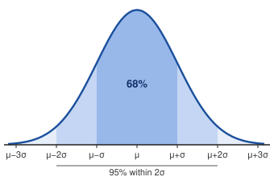

## How to use this track

This track covers the probability and statistics an MSc in economics builds on: describing data, probability, random variables, the binomial and normal distributions, sampling, confidence intervals, hypothesis tests and simple regression. It assumes **Math Foundations** (fractions, percentages, powers, square roots). Sums and a few formulas are all the algebra you need.

### Why it matters for economics

Almost all modern economics is empirical: you test a theory against data. Econometrics, which every MSc requires, is statistics applied to economic data. Its central tool, regression, rests on everything in this track.

| Topic | Where you will use it |
|---|---|
| Mean, variance, standard deviation | Summarising income, prices, returns, risk |
| Probability and expected value | Decisions under uncertainty, insurance, game theory |
| Normal distribution | Sampling, finance, test statistics |
| Confidence intervals and tests | "Is this effect real or noise?" |
| Correlation and regression | Estimating demand, returns to education, policy effects |

### Notation used

| Symbol | Meaning |
|---|---|
| Σ | sum of (Σx means x₁ + x₂ + ... + xₙ) |
| x̄ | sample mean ("x bar") |
| μ | population mean ("mu") |
| s, σ | sample and population standard deviation ("sigma") |
| P(A) | probability of event A |
| P(A given B) | probability of A when B is known to have happened |
| E(X), Var(X) | expected value and variance of a random variable |

### How to study

Work the examples on paper with a calculator. Each skill ends with practice and answers. The tree splits after the first skill: the left path is descriptive statistics, the right is probability. They join at random variables, and the rest builds in a line towards regression.


## 1. Describing data

This skill covers the first thing to do with any data set: describe its centre and its spread. Mean, median and mode tell you what is typical; range and quartiles tell you how spread out the values are.

### Types of data

| Type | Examples | Can you average it? |
|---|---|---|
| Categorical | country, sector, gender | No (count it instead) |
| Discrete numerical | children per household, cars sold | Yes |
| Continuous numerical | income, price, GDP growth | Yes |

A **population** is everyone you are interested in (all households in Germany). A **sample** is the part you actually observe (2,000 surveyed households). Statistics is mostly about learning about a population from a sample.

### Mean, median and mode

For the data 3, 7, 7, 2, 11:

- **Mean** (average): add them up, divide by how many. x̄ = Σx/n = 30/5 = **6**.
- **Median**: the middle value once sorted. Sorted: 2, 3, 7, 7, 11, so the median is **7**. With an even number of values, take the mean of the middle two.
- **Mode**: the most common value: **7**.

```
x̄ = (x₁ + x₂ + ... + xₙ)/n
  = Σx / n
```

From a frequency table, multiply each value by its count:

| Children | Households |
|---|---|
| 0 | 10 |
| 1 | 15 |
| 2 | 20 |
| 3 | 5 |

```
x̄ = (0×10 + 1×15 + 2×20 + 3×5)/50
  = 70/50 = 1.4 children
```

### Mean or median? Skewed data

The mean uses every value, so a few extreme values pull it. The median does not care how extreme the extremes are.

Five salaries: 30, 32, 35, 38, 400 (thousand). Mean = 107; median = 35. The median describes the typical person far better.

Income and wealth are **right-skewed** (a long tail of high values), so the mean is above the median. That is why economists usually report **median household income**. When the mean and median are close, the data is roughly symmetric.

### Spread: range and quartiles

Two cities with the same average temperature can have very different climates. Spread matters.

- **Range** = largest − smallest. Simple, but driven by the two most extreme values.
- **Quartiles** split sorted data into four quarters: Q1 (25% below), Q2 (the median), Q3 (75% below).
- **Interquartile range** IQR = Q3 − Q1: the spread of the middle half, unaffected by extremes.

```
data: 2 4 5 7 8 10 12 15 20
median Q2 = 8
lower half 2 4 5 7:  Q1 = 4.5
upper half 10 12 15 20:  Q3 = 13.5
IQR = 13.5 - 4.5 = 9
```

(Software uses slightly different quartile rules, so answers can differ a little.)

A **percentile** generalises this: the 90th percentile of income is the level that 90% of people are below. A **box plot** draws the minimum, Q1, median, Q3 and maximum.

### Practice

1. Find the mean, median and mode of 4, 8, 6, 8, 9, 1.
2. Find the median of 12, 5, 9, 20, 7, 15, 3.
3. A firm has 9 workers earning 2,000 a month and a manager earning 20,000. Find the mean and median pay. Which describes a typical worker?
4. Find the mean from the table: value 1 (count 4), 2 (count 6), 5 (count 10).
5. Find the range, Q1, Q3 and IQR of 1, 3, 4, 6, 9, 11, 14, 18.
6. Mean income in a country is above the median. What does that tell you about the distribution?
7. The mean of 4 numbers is 10. A fifth number is added and the mean becomes 12. What was the fifth number?

**Answers.** 1: mean 36/6 = 6; median (6 + 8)/2 = 7; mode 8. 2: sorted 3, 5, 7, 9, 12, 15, 20: median 9. 3: mean 38,000/10 = 3,800; median 2,000; the median. 4: (4 + 12 + 50)/20 = 3.3. 5: range 17; Q1 = (3 + 4)/2 = 3.5, Q3 = (11 + 14)/2 = 12.5, IQR 9. 6: It is right-skewed: a tail of high incomes. 7: total goes from 40 to 60, so 20.


## 2. Variance and standard deviation

This skill covers the standard measures of spread, variance and standard deviation, plus z-scores. In economics the standard deviation is the usual measure of risk and volatility.

### Deviations from the mean

How far is each value from the mean? For 2, 4, 6, 8, 10 (mean 6), the **deviations** are −4, −2, 0, 2, 4.

Averaging them gives zero (they always cancel). So square them first: squares are never negative.

### Variance

The **variance** is the average squared deviation.

```
population:  σ² = Σ(x - μ)² / N
sample:      s² = Σ(x - x̄)² / (n - 1)
```

The sample version divides by n − 1, not n. A sample tends to sit a little closer to its own mean than to the true population mean, and n − 1 corrects for that. Use n − 1 whenever you estimate from a sample (which is almost always).

```
data 2, 4, 6, 8, 10;  x̄ = 6
squared deviations: 16, 4, 0, 4, 16
sum = 40
s² = 40/4 = 10
```

### Standard deviation

Variance is in squared units (euros²), which is hard to interpret. The **standard deviation** is its square root, back in the original units:

```
s = √s² = √10 ≈ 3.16
```

Roughly: a typical value is about one standard deviation from the mean.

A useful shortcut for calculating by hand:

```
Σ(x - x̄)² = Σx² - n x̄²
here: (4+16+36+64+100) - 5×36
    = 220 - 180 = 40 ✓
```

### Rules for changing data

| If every value is ... | Mean | Standard deviation |
|---|---|---|
| increased by c | + c | unchanged |
| multiplied by k | × k | × k (size of k) |

Adding 100 euros to everyone's wage raises the mean by 100 but does not change the spread. Converting euros to cents multiplies both by 100. Variance is multiplied by k².

### Z-scores and the coefficient of variation

A **z-score** says how many standard deviations a value is above (or below) the mean:

```
z = (x - x̄)/s
```

An exam mark of 80 where the mean is 65 and s = 10 has z = 1.5. A z-score lets you compare values on different scales: a mark of 80 (z = 1.5) is more impressive than a mark of 90 in a test with mean 85 and s = 10 (z = 0.5).

The **coefficient of variation** CV = s/x̄ compares spread relative to size: a standard deviation of 10 is large for a mean of 20 (CV = 0.5) but small for a mean of 1,000 (CV = 0.01).

In finance, the standard deviation of returns is called **volatility**. Two funds with the same average return of 6% but standard deviations of 2% and 15% carry very different risk.

### Practice

1. Find the sample variance and standard deviation of 3, 5, 7, 9.
2. Find the sample standard deviation of 10, 10, 10, 10. Explain the answer.
3. Use the shortcut formula for 1, 2, 3, 4, 5.
4. Prices have mean 50 and s = 8. All prices rise by 5. New mean and s? Then all prices double. New mean and s?
5. A household's income is 52,000 where the mean is 40,000 and s = 8,000. Find its z-score.
6. Which is more unusual: a growth rate of 4% (mean 2%, s = 1%) or an inflation rate of 7% (mean 3%, s = 4%)?
7. Fund A: mean return 8%, s = 12%. Fund B: mean 5%, s = 4%. Find each coefficient of variation. Which is riskier per unit of return?

**Answers.** 1: x̄ = 6; squared deviations 9, 1, 1, 9, sum 20; s² = 20/3 ≈ 6.67, s ≈ 2.58. 2: 0: no spread at all. 3: Σx² = 55, n x̄² = 5 × 9 = 45, s² = 10/4 = 2.5, s ≈ 1.58. 4: 55 and 8; then 110 and 16. 5: 1.5. 6: growth z = 2, inflation z = 1: the growth rate. 7: A 1.5, B 0.8: A.


## 3. Probability basics

This skill covers what probability means, how to count outcomes, and the basic rules: complements, "or" (addition) and "and" (multiplication) for independent events.

### What a probability is

A **probability** is a number from 0 (impossible) to 1 (certain). It can be written as a fraction, decimal or percentage: 1/4 = 0.25 = 25%.

- An **experiment** has outcomes (rolling a die: 1 to 6).
- The **sample space** is the list of all outcomes.
- An **event** is a set of outcomes ("an even number" = 2, 4, 6).

When all outcomes are equally likely:

```
P(A) = (outcomes in A)/(all outcomes)
P(even on a die) = 3/6 = 1/2
```

Otherwise, probability is estimated from data as a long-run frequency: if 1,200 of 20,000 loans defaulted, P(default) ≈ 0.06.

### The complement

Either A happens or it doesn't, so

```
P(not A) = 1 - P(A)
```

This is often the easy way in. The probability of at least one six in four rolls is 1 − P(no six in four rolls) = 1 − (5/6)⁴ ≈ 1 − 0.482 = 0.518.

### "Or": the addition rule

```
P(A or B) = P(A) + P(B) - P(A and B)
```

You subtract the overlap so it isn't counted twice. Drawing a card: P(king or heart) = 4/52 + 13/52 − 1/52 = 16/52.

If A and B cannot happen together (**mutually exclusive**), P(A and B) = 0 and the rule is simply P(A) + P(B). P(rolling 1 or 2) = 1/6 + 1/6 = 1/3.

### "And": independent events

A and B are **independent** if one happening does not change the chance of the other. Then

```
P(A and B) = P(A) × P(B)
```

Two coin tosses: P(heads and heads) = 1/2 × 1/2 = 1/4. Three machines that each fail with probability 0.1, independently: P(all three fail) = 0.1³ = 0.001.

Careful: many economic events are **not** independent. Two firms in the same industry tend to fail together in a recession. Treating them as independent badly understated risk before the 2008 financial crisis.

### Tables and tree diagrams

A **two-way table** organises probabilities for two characteristics. Survey of 200 people:

| | Employed | Unemployed | Total |
|---|---|---|---|
| Degree | 70 | 10 | 80 |
| No degree | 90 | 30 | 120 |
| Total | 160 | 40 | 200 |

```
P(degree)              = 80/200  = 0.4
P(unemployed)          = 40/200  = 0.2
P(degree and unemp.)   = 10/200  = 0.05
P(degree or unemp.)    = 0.4 + 0.2
                         - 0.05 = 0.55
```

A **tree diagram** draws stages in order, with probabilities on each branch; multiply along a branch, add across branches.

### Practice

1. A bag holds 5 red, 3 blue and 2 green balls. Find P(blue) and P(not green).
2. Two dice are rolled. Find P(total is 7). (There are 36 equally likely outcomes.)
3. P(A) = 0.5, P(B) = 0.4, P(A and B) = 0.2. Find P(A or B).
4. A firm's two suppliers fail independently with probabilities 0.05 and 0.08. Find P(both fail) and P(at least one fails).
5. A coin is tossed 5 times. Find P(at least one head).
6. From the table above, find P(no degree and employed) and P(employed or no degree).
7. Are "degree" and "unemployed" independent in the table? (Compare P(degree and unemployed) with P(degree) × P(unemployed).)

**Answers.** 1: 3/10; 8/10. 2: 6/36 = 1/6. 3: 0.7. 4: 0.004; 1 − 0.95 × 0.92 = 0.126. 5: 1 − (1/2)⁵ = 31/32. 6: 90/200 = 0.45; 0.8 + 0.6 − 0.45 = 0.95. 7: 0.05 vs 0.4 × 0.2 = 0.08: not independent (graduates are less likely to be unemployed).


## 4. Conditional probability and Bayes

This skill covers conditional probability, the general multiplication rule, and Bayes' theorem: how to update a probability when new information arrives. It is the logic behind tests, screening and learning from evidence.

### Conditional probability

P(A | B), read "the probability of A given B", is the probability of A when we already know B happened. Knowing B shrinks the world to the cases where B is true:

```
P(A | B) = P(A and B)/P(B)
```

From the survey table in the last skill (200 people: 80 with a degree, 10 of them unemployed; 120 without, 30 unemployed):

```
P(unemployed | degree)
  = 10/80 = 0.125
P(unemployed | no degree)
  = 30/120 = 0.25
```

The unemployment rate is twice as high without a degree. Note that P(A | B) and P(B | A) are different: P(degree | unemployed) = 10/40 = 0.25.

### The general multiplication rule

Rearranging the definition:

```
P(A and B) = P(B) × P(A | B)
```

This works whether or not events are independent. Events are **independent** exactly when P(A | B) = P(A): knowing B tells you nothing about A.

Drawing two cards without replacement: P(both aces) = 4/52 × 3/51 = 1/221. The second probability is conditional: one ace is already gone.

### The law of total probability

If B can happen in several separate ways, add them:

```
P(B) = P(B | A) P(A)
     + P(B | not A) P(not A)
```

A bank's borrowers are 20% "risky" (default rate 15%) and 80% "safe" (default rate 2%):

```
P(default) = 0.15 × 0.2 + 0.02 × 0.8
           = 0.03 + 0.016 = 0.046
```

### Bayes' theorem

Bayes' theorem turns P(B | A) around into P(A | B):

```
P(A | B) = P(B | A) P(A) / P(B)
```

Continue the bank example: a borrower has defaulted. What is the chance they were "risky"?

```
P(risky | default)
  = 0.15 × 0.2 / 0.046
  = 0.03/0.046 ≈ 0.65
```

Before the default, the chance they were risky was 0.20 (the **prior**). After seeing the default, it is 0.65 (the **posterior**). That is learning from evidence.

### The base-rate trap

A disease affects 1 in 100 people. A test catches 95% of cases, but also gives a false positive for 5% of healthy people. You test positive. How likely are you to be ill?

```
P(+) = 0.95 × 0.01 + 0.05 × 0.99
     = 0.0095 + 0.0495 = 0.059
P(ill | +) = 0.0095/0.059 ≈ 0.16
```

Only about 16%. Most positives come from the large healthy group. Ignoring the base rate is one of the most common reasoning errors, in medicine, in court and in economic forecasting (most recession signals are false alarms when recessions are rare).

### Practice

1. P(A and B) = 0.12 and P(B) = 0.3. Find P(A | B).
2. In a class, 60% study economics; of those, 40% also study maths. What fraction of the class studies both?
3. Two cards are drawn without replacement. Find P(both hearts).
4. P(A) = 0.5, P(B) = 0.4, P(A and B) = 0.2. Are A and B independent?
5. 30% of firms export. Exporters innovate with probability 0.6, non-exporters with 0.2. Find P(innovates).
6. In question 5, a firm innovates. What is the probability it exports?
7. A recession indicator fires in 90% of recessions and in 10% of non-recession years. Recessions occur in 10% of years. The indicator fires. Find the probability of a recession.

**Answers.** 1: 0.4. 2: 0.6 × 0.4 = 0.24. 3: 13/52 × 12/51 = 1/17 ≈ 0.059. 4: P(A) × P(B) = 0.2 = P(A and B): yes. 5: 0.18 + 0.14 = 0.32. 6: 0.18/0.32 ≈ 0.56. 7: P(fires) = 0.09 + 0.09 = 0.18; 0.09/0.18 = 0.5.


## 5. Random variables and expected value

This skill covers random variables, their probability distributions, expected value and variance. Expected value is how economists value risky choices: investments, insurance and bets.

### Random variables

A **random variable** is a number whose value depends on chance: the profit of a project, the number of customers tomorrow, next year's return. It is written with a capital letter, X, and its possible values with small letters, x.

A **discrete** random variable has a list of possible values. Its **probability distribution** gives each value's probability, and the probabilities add to 1.

A project's profit (in thousands):

| x | −20 | 10 | 50 |
|---|---|---|---|
| P(X = x) | 0.3 | 0.5 | 0.2 |

### Expected value

The **expected value** (mean) of X is the probability-weighted average of its values:

```
E(X) = Σ x P(X = x)
```

```
E(X) = -20(0.3) + 10(0.5) + 50(0.2)
     = -6 + 5 + 10 = 9
```

The expected profit is 9 thousand. It is not a value X can actually take; it is the long-run average if the project were repeated many times.

**Fair bets and insurance.** A lottery ticket costs 2 and pays 1,000 with probability 0.001: E(winnings) = 1 − 2 = −1, so on average you lose 1 per ticket. Insurers price policies above the expected loss; customers buy anyway because they dislike risk. Economics models this with **expected utility**.

### Variance of a random variable

```
Var(X) = Σ (x - μ)² P(X = x)
       = E(X²) - μ²
SD(X)  = √Var(X)
```

For the project (μ = 9):

```
E(X²) = 400(0.3) + 100(0.5) + 2500(0.2)
      = 120 + 50 + 500 = 670
Var(X) = 670 - 81 = 589
SD(X) ≈ 24.3
```

Two projects with the same expected profit can have very different standard deviations: the higher one is riskier.

### Rules for expected value and variance

| Rule | Expected value | Variance |
|---|---|---|
| a + bX | a + b E(X) | b² Var(X) |
| X + Y | E(X) + E(Y) | Var(X) + Var(Y) + 2 Cov(X, Y) |
| X + Y, independent | E(X) + E(Y) | Var(X) + Var(Y) |

The **covariance** Cov(X, Y) measures whether X and Y move together. This is the maths of **diversification**: two assets with negative or low covariance give a portfolio less risky than either alone.

Example: a salesperson earns 1,000 plus 0.1 times sales S, where E(S) = 20,000 and SD(S) = 5,000. Pay = 1000 + 0.1S: E = 3,000, SD = 0.1 × 5,000 = 500.

### Practice

1. X takes values 0, 1, 2, 3 with probabilities 0.1, 0.3, 0.4, 0.2. Check it is a valid distribution and find E(X).
2. Find Var(X) and SD(X) for question 1.
3. A game costs 5 to play. You win 20 with probability 0.2, otherwise nothing. Find the expected net gain. Is it fair?
4. An investment returns +30% with probability 0.6 and −20% with probability 0.4. Find the expected return and its standard deviation.
5. E(X) = 10, Var(X) = 4. Find E(3X − 2) and Var(3X − 2).
6. X and Y are independent with SDs 3 and 4. Find SD(X + Y).
7. A house worth 200,000 has a 1% chance of burning down in a year. What is the expected loss? Why would someone pay 2,500 for insurance?

**Answers.** 1: sums to 1; E = 0.3 + 0.8 + 0.6 = 1.7. 2: E(X²) = 0.3 + 1.6 + 1.8 = 3.7; Var = 3.7 − 2.89 = 0.81; SD = 0.9. 3: 0.2 × 20 − 5 = −1: not fair. 4: E = 18 − 8 = 10%; E(X²) = 540 + 160 = 700, Var = 600, SD ≈ 24.5%. 5: 28 and 36. 6: √(9 + 16) = 5. 7: 2,000; risk aversion: they pay 500 more than the expected loss to avoid a large loss.


## 6. The binomial distribution

This skill covers the binomial distribution: the number of "successes" in a fixed number of independent yes/no trials. Defaults among loans, buyers among visitors and votes in a sample all follow it.

### When it applies

X counts successes and follows a **binomial distribution**, written X ~ B(n, p), when:

1. there is a fixed number of trials, n;
2. each trial is success or failure;
3. the probability of success, p, is the same each time;
4. the trials are independent.

Examples: the number of 10 loans that default (if defaults are independent with the same p); the number of 50 website visitors who buy.

### Counting arrangements

How many ways can 2 successes fall among 4 trials? SSFF, SFSF, SFFS, FSSF, FSFS, FFSS: six. This is "4 choose 2":

```
C(n, k) = n! / (k! (n - k)!)
```

where n! ("n factorial") = n × (n − 1) × ... × 1, and 0! = 1.

```
C(4, 2) = 24/(2 × 2) = 6
C(10, 3) = (10 × 9 × 8)/(3 × 2 × 1)
         = 120
```

### The binomial formula

```
P(X = k) = C(n, k) pᵏ (1 - p)ⁿ⁻ᵏ
```

Read it as: (number of arrangements) × (probability of each arrangement).

A salesperson closes 30% of calls. Out of 5 calls, the chance of exactly 2 sales:

```
P(X = 2) = C(5, 2) (0.3)² (0.7)³
         = 10 × 0.09 × 0.343
         ≈ 0.309
```

"At least" and "at most" questions add several terms, or use the complement:

```
P(X ≥ 1) = 1 - P(X = 0)
         = 1 - 0.7⁵ ≈ 0.832
```

### Mean and variance

For X ~ B(n, p):

```
E(X)   = np
Var(X) = np(1 - p)
SD(X)  = √(np(1 - p))
```

100 loans each defaulting with p = 0.05: expected defaults 5, variance 4.75, standard deviation ≈ 2.18.

The **proportion** of successes, X/n, has mean p and standard deviation √(p(1 − p)/n). That formula is the basis of opinion-poll margins of error later in the track.

### When n is large

For large n, the binomial is close to a normal distribution with the same mean and variance (a rule of thumb: when np and n(1 − p) are both at least 10). That is the first example of the central limit theorem, coming in skill 8.

The independence condition matters. If loan defaults are correlated (a recession hits many borrowers at once), the real distribution has far more extreme outcomes than the binomial predicts.

### Practice

1. Compute C(6, 2) and C(8, 3).
2. X ~ B(4, 0.5). Find P(X = 2).
3. X ~ B(6, 0.2). Find P(X = 0) and P(X ≥ 1).
4. A machine produces 2% defective items. In a box of 10, find P(exactly 1 defective).
5. 40% of voters back a party. In a random sample of 5, find P(exactly 3 back it).
6. X ~ B(200, 0.1). Find the mean and standard deviation.
7. A website converts 3% of visitors. Out of 1,000 visitors, what is the expected number of sales and its standard deviation?
8. Does the number of rainy days in a week follow a binomial distribution? Which condition is doubtful?

**Answers.** 1: 15 and 56. 2: 6 × 0.0625 = 0.375. 3: 0.8⁶ ≈ 0.262; 0.738. 4: 10 × 0.02 × 0.98⁹ ≈ 0.167. 5: 10 × 0.064 × 0.36 ≈ 0.230. 6: 20 and √18 ≈ 4.24. 7: 30 and √29.1 ≈ 5.39. 8: Independence (and constant p): a rainy day makes the next day more likely to be rainy.


## 7. The normal distribution

This skill covers the normal distribution: its bell shape, the 68-95-99.7 rule, standardising with z-scores and reading probabilities from the standard normal table. It is the most used distribution in statistics and econometrics.

### Continuous distributions

Income, height and returns can take any value in a range, so we cannot list the probability of each value. Instead a **density curve** describes them: the probability of a range is the **area under the curve** over that range, and the total area is 1.

### The normal curve

The **normal distribution** X ~ N(μ, σ²) is symmetric and bell-shaped, centred at its mean μ, with spread set by its standard deviation σ.



The **68-95-99.7 rule**:

| Range | Share of values |
|---|---|
| μ ± 1σ | about 68% |
| μ ± 2σ | about 95% |
| μ ± 3σ | about 99.7% |

IQ scores are roughly N(100, 15²): about 95% of people score between 70 and 130.

### Standardising

Every normal distribution becomes the **standard normal** Z ~ N(0, 1) by turning values into z-scores:

```
z = (x - μ)/σ
```

Then one table serves every normal distribution. The table gives Φ(z) = P(Z ≤ z), the area to the left of z:

| z | P(Z ≤ z) |
|---|---|
| 0 | 0.500 |
| 0.5 | 0.691 |
| 1 | 0.841 |
| 1.28 | 0.900 |
| 1.5 | 0.933 |
| 1.645 | 0.950 |
| 1.96 | 0.975 |
| 2 | 0.977 |
| 2.576 | 0.995 |

By symmetry, P(Z ≤ −z) = 1 − P(Z ≤ z).

### Finding probabilities

Monthly sales are N(500, 40²). Find P(sales > 560).

```
z = (560 - 500)/40 = 1.5
P(Z > 1.5) = 1 - 0.933 = 0.067
```

Find P(460 < sales < 580):

```
z₁ = (460 - 500)/40 = -1
z₂ = (580 - 500)/40 = 2
P = 0.977 - (1 - 0.841)
  = 0.977 - 0.159 = 0.818
```

Always sketch the curve and shade the area you want: it prevents most sign errors.

### Working backwards

Which value cuts off the top 10%? From the table, P(Z ≤ 1.28) = 0.90, so z = 1.28:

```
x = μ + zσ = 500 + 1.28 × 40
  ≈ 551
```

The z-values 1.645, 1.96 and 2.576 are worth remembering: they leave 5%, 2.5% and 0.5% in one tail. They are used for 90%, 95% and 99% confidence intervals.

### Is it really normal?

Many economic variables are not normal. Income is right-skewed (its logarithm is closer to normal, which is one reason economists use log income). Financial returns have "fat tails": crashes happen far more often than a normal model predicts. Use the normal where it fits, and check.

### Practice

Use the table above.

1. X ~ N(50, 10²). Find P(X < 60).
2. X ~ N(50, 10²). Find P(X > 30).
3. Heights are N(170, 8²) cm. What share of people are between 162 and 178 cm?
4. Exam marks are N(65, 12²). Find P(mark > 89).
5. Returns are N(8%, 5²). Find P(return < 0).
6. In question 4, which mark cuts off the top 5%?
7. Weekly demand is N(1,000, 150²). How much stock is needed so that demand exceeds stock only 2.5% of the time?

**Answers.** 1: z = 1, 0.841. 2: z = −2, 0.977. 3: z from −1 to 1: about 0.68 (0.841 − 0.159 = 0.682). 4: z = 2, 1 − 0.977 = 0.023. 5: z = −1.6; P(Z ≤ 1.6) ≈ 0.945, so about 0.055 (between the table's 0.067 at 1.5 and 0.050 at 1.645). 6: 65 + 1.645 × 12 ≈ 84.7. 7: 1000 + 1.96 × 150 = 1,294.


## 8. Sampling and the central limit theorem

This skill covers how sample statistics vary from sample to sample, the standard error, and the central limit theorem: the result that makes most of statistical inference possible.

### Samples vary

We want the population mean μ (say, average household income), but only see a sample. Its mean x̄ is an **estimate** of μ. Draw another sample and you get a different x̄. The sample mean is itself a random variable.

To be useful, a sample must be **random**: every member of the population has a known chance of being chosen. A sample of people who answer an online poll, or only of people with landlines, can be badly **biased**, however large it is.

### The sampling distribution of the mean

Imagine taking every possible sample of size n and computing x̄ each time. The distribution of those x̄ values is the **sampling distribution**. For a random sample from a population with mean μ and standard deviation σ:

```
E(x̄) = μ
SD(x̄) = σ/√n
```

- The sample mean is **unbiased**: on average it hits the true mean.
- Its spread, σ/√n, is called the **standard error** (SE). It shrinks as n grows.

When σ is unknown (the usual case), estimate it with the sample standard deviation s: SE = s/√n.

```
incomes: σ = 20,000
n = 100:   SE = 20000/10  = 2,000
n = 400:   SE = 20000/20  = 1,000
```

Note the square root: **to halve the error you need four times the sample.** That is why surveys rarely go above a few thousand people.

### The central limit theorem

The **central limit theorem** (CLT): for a large enough sample, the sample mean is approximately normally distributed, **whatever the shape of the population**:

```
x̄ ≈ N(μ, σ²/n)   for large n
```

Even a skewed population (like income) gives sample means whose distribution is close to a bell curve once n is around 30 or more (more if the population is very skewed). This is why the normal distribution appears everywhere in statistics.

The same holds for a sample **proportion** p̂ (the share of "yes" answers):

```
p̂ ≈ N(p, p(1 - p)/n)
SE(p̂) = √(p(1 - p)/n)
```

### Using it

Household spending has mean 2,400 and standard deviation 600 a month. For a sample of 36 households, what is P(x̄ > 2,550)?

```
SE = 600/√36 = 100
z = (2550 - 2400)/100 = 1.5
P(Z > 1.5) = 1 - 0.933 = 0.067
```

One household spending over 2,550 is common (z = 0.25). A sample **average** that high is rare. Averages are much less variable than individual values.

Poll example: if 50% of voters support a policy, a poll of 1,000 has SE = √(0.25/1000) ≈ 0.016, so about 95% of such polls land within 2 × 1.6 ≈ 3.2 percentage points of 50%.

### Practice

1. A population has σ = 12. Find the standard error of the mean for n = 16 and n = 144.
2. How large a sample is needed for the standard error to be one tenth of σ?
3. Wages have mean 18 and SD 6 euros an hour. For samples of 64 workers, find the mean and SE of x̄.
4. In question 3, find P(x̄ < 17).
5. Why can the CLT be used for a sample of 100 incomes, even though income is skewed?
6. True support for a party is 30%. For polls of 400 people, find the standard error of the sample proportion.
7. In question 6, find P(p̂ > 0.33).
8. A magazine polls 10,000 of its own readers. Does the large sample guarantee an accurate picture of all voters?

**Answers.** 1: 3 and 1. 2: √n = 10, n = 100. 3: 18 and 6/8 = 0.75. 4: z = −1/0.75 ≈ −1.33; P ≈ 0.09. 5: The CLT says x̄ is close to normal for large n whatever the population shape. 6: √(0.3 × 0.7/400) ≈ 0.0229. 7: z = 0.03/0.0229 ≈ 1.31; P ≈ 0.095. 8: No: readers are not a random sample of voters, so the result can be biased however large it is.


## 9. Confidence intervals

This skill covers confidence intervals: a range of plausible values for an unknown population number, built from a sample. Every published estimate (unemployment, inflation, a regression coefficient) should come with one.

### The idea

A sample mean alone gives no sense of precision. A **confidence interval** adds a margin of error:

```
estimate ± (critical value) × (standard error)
```

From the CLT, x̄ lies within 1.96 standard errors of μ in 95% of samples. Turn that around: the interval x̄ ± 1.96 SE captures μ in 95% of samples. That is a **95% confidence interval**.

### For a mean

```
x̄ ± z × s/√n
```

| Confidence | z |
|---|---|
| 90% | 1.645 |
| 95% | 1.96 |
| 99% | 2.576 |

A sample of 100 households has mean spending 2,400 and s = 600:

```
SE = 600/√100 = 60
95% CI: 2400 ± 1.96 × 60
      = 2400 ± 117.6
      = (2282.4, 2517.6)
```

### Small samples: the t distribution

With a small sample, s is a shaky estimate of σ, so the interval should be wider. Use the **t distribution** with n − 1 **degrees of freedom** instead of z. It looks like the normal but with fatter tails, and it approaches the normal as n grows.

| Degrees of freedom | t for 95% |
|---|---|
| 5 | 2.571 |
| 10 | 2.228 |
| 20 | 2.086 |
| 30 | 2.042 |
| large | 1.96 |

A sample of 11 firms has mean profit margin 8.0% and s = 3.0%:

```
SE = 3/√11 ≈ 0.905
t (10 df) = 2.228
CI: 8.0 ± 2.228 × 0.905
  = 8.0 ± 2.02
  = (5.98, 10.02)
```

### For a proportion

```
p̂ ± z × √(p̂(1 - p̂)/n)
```

A poll of 1,000 finds 52% support:

```
SE = √(0.52 × 0.48/1000) ≈ 0.0158
95% CI: 0.52 ± 1.96 × 0.0158
      = 0.52 ± 0.031
      = (0.489, 0.551)
```

The "margin of error ±3 points" in news reports is exactly this. Since the interval includes 50%, the poll cannot say who leads.

### What the confidence level means

The correct reading: "if we repeated the sampling many times, 95% of the intervals built this way would contain the true value." It is a statement about the method. It does **not** mean there is a 95% probability that μ is in this particular interval (μ is fixed; the interval is what varies).

Trade-offs:

- **More confidence** (99% instead of 95%) gives a **wider** interval.
- **A bigger sample** gives a **narrower** interval, shrinking with √n.
- The interval only covers sampling error. A biased sample gives a precise but wrong answer.

### Choosing a sample size

Rearrange the margin of error E = z σ/√n:

```
n = (z σ / E)²
```

To estimate mean spending within ±50 with 95% confidence when σ ≈ 600: n = (1.96 × 600/50)² ≈ 553.

### Practice

1. n = 64, x̄ = 50, s = 16. Find the 95% confidence interval for μ.
2. Find the 99% interval for question 1. Is it wider or narrower?
3. A sample of 400 workers has mean wage 22 euros, s = 8. Find a 90% interval.
4. n = 6 observations: mean 12, s = 2. Find the 95% interval (t with 5 df = 2.571).
5. 240 of 600 surveyed firms plan to hire. Find a 95% interval for the true proportion.
6. A 95% interval for average rent is (820, 880). What was x̄, and what was the margin of error?
7. How large a sample estimates a proportion near 0.5 to within ±2 points with 95% confidence? (σ for a proportion is √(p(1 − p)) = 0.5.)

**Answers.** 1: SE = 2; 50 ± 3.92 = (46.08, 53.92). 2: 50 ± 5.15 = (44.85, 55.15); wider. 3: SE = 0.4; 22 ± 0.658 = (21.34, 22.66). 4: SE = 2/√6 ≈ 0.816; 12 ± 2.10 = (9.90, 14.10). 5: p̂ = 0.4, SE = 0.02; 0.4 ± 0.039 = (0.361, 0.439). 6: 850 and 30. 7: n = (1.96 × 0.5/0.02)² ≈ 2,401.


## 10. Hypothesis tests

This skill covers hypothesis testing: null and alternative hypotheses, test statistics, p-values, significance levels, and the two kinds of error. It is how economists decide whether an effect in the data is real or could be chance.

### The logic

A test is like a trial: assume innocence, and convict only if the evidence makes innocence very hard to believe.

- **Null hypothesis H₀**: the "nothing going on" claim, e.g. "the policy has no effect", μ = 0.
- **Alternative H₁**: what we suspect, e.g. μ ≠ 0 (two-sided) or μ > 0 (one-sided).
- Assume H₀ is true and ask: how surprising is our sample?

### Test statistic and p-value

For a mean, the **test statistic** counts standard errors between the sample and the null value:

```
z (or t) = (x̄ - μ₀)/(s/√n)
```

The **p-value** is the probability, if H₀ were true, of getting a result at least as extreme as ours. A small p-value means the data would be surprising under H₀.

Before looking, choose a **significance level** α, usually 5%. Then:

| p-value | Decision |
|---|---|
| p < α | reject H₀: the result is "statistically significant" |
| p ≥ α | do not reject H₀ (not the same as proving it true) |

Equivalently, for a two-sided test at 5%, reject when the test statistic is beyond ±1.96.

### Worked example

A firm claims average delivery time is 30 minutes. A sample of 49 deliveries has mean 32.1 and s = 7. Is the claim wrong? Test at 5%, two-sided.

```
H₀: μ = 30    H₁: μ ≠ 30
SE = 7/√49 = 1
z = (32.1 - 30)/1 = 2.1
p = 2 × P(Z > 2.1)
  = 2 × 0.018 = 0.036
```

p = 0.036 < 0.05: reject H₀. The data are evidence that the true average is not 30 minutes. (Equivalently, 2.1 > 1.96. And the 95% confidence interval 32.1 ± 1.96 = (30.14, 34.06) does not contain 30: tests and intervals always agree.)

For small samples use t with n − 1 degrees of freedom, as in the last skill.

### Two kinds of error

| | H₀ actually true | H₀ actually false |
|---|---|---|
| Reject H₀ | Type I error (false alarm) | correct |
| Don't reject H₀ | correct | Type II error (missed effect) |

α is the chance of a Type I error. Lowering α (say to 1%) makes false alarms rarer but missed effects more common. The **power** of a test is the chance of detecting a real effect; it grows with sample size.

### Significance is not importance

- With a huge sample, a tiny, economically meaningless effect can be "highly significant". Always look at the **size** of the effect, not just the p-value.
- Not rejecting H₀ does not show there is no effect: the sample may have been too small to see it.
- Running 20 tests at 5% will produce about one "significant" result by pure chance. Be suspicious of studies that report one striking result from many tries.

### Comparing two groups

To test whether two group means differ (wages of trained vs untrained workers), test H₀: μ₁ − μ₂ = 0 using

```
z = (x̄₁ - x̄₂) / √(s₁²/n₁ + s₂²/n₂)
```

### Practice

1. Write H₀ and H₁ for: "Does a training programme raise average wages?"
2. n = 100, x̄ = 52, s = 10, H₀: μ = 50 (two-sided, 5%). Find z and decide.
3. In question 2, would you reject at the 1% level (critical value 2.576)?
4. A test gives p = 0.12. What do you conclude at 5%?
5. n = 36, x̄ = 98.5, s = 6, H₀: μ = 100. Find z and the two-sided p-value. (P(Z > 1.5) = 0.067.)
6. A drug trial wrongly concludes the drug works. Which type of error is that?
7. Trained workers (n = 100) earn on average 21.5 (s = 5); untrained (n = 100) earn 20.0 (s = 5). Test for a difference at 5%.
8. A study of 2 million people finds coffee drinkers earn 0.1% more, p = 0.001. Comment.

**Answers.** 1: H₀: μ(trained) = μ(untrained); H₁: μ(trained) > μ(untrained). 2: SE = 1, z = 2 > 1.96: reject. 3: No: 2 < 2.576. 4: Do not reject H₀: not enough evidence. 5: SE = 1, z = −1.5, p = 0.134: do not reject. 6: Type I. 7: SE = √(0.25 + 0.25) ≈ 0.707, z ≈ 2.12 > 1.96: reject; the difference is significant. 8: Statistically significant but economically tiny; also correlation, not necessarily causation.


## 11. Correlation and regression

This skill covers covariance, correlation and simple linear regression (ordinary least squares): fitting a line through data, reading its slope, R², and testing whether the slope is real. This is the starting point of econometrics.

### Covariance and correlation

Do two variables move together? The sample **covariance**:

```
cov(x, y) = Σ(x - x̄)(y - ȳ)/(n - 1)
```

It is positive when above-average x goes with above-average y. Its size depends on units, so we scale it to the **correlation**:

```
r = cov(x, y)/(sx sy)
```

r is always between −1 and 1:

| r | Meaning |
|---|---|
| close to 1 | strong positive straight-line link |
| close to 0 | no straight-line link |
| close to −1 | strong negative straight-line link |

r measures only **straight-line** association; a perfect U-shape can have r = 0.

### Correlation is not causation

Ice-cream sales and drownings are correlated: both rise in summer. Countries with more doctors have more deaths from old age: richer countries have both. A third variable (a **confounder**) can create a correlation with no causal link. Separating causation from correlation is the central problem of econometrics (experiments, instrumental variables, difference-in-differences).

### The regression line

**Simple linear regression** fits the line

```
ŷ = b₀ + b₁x
```

that makes the sum of squared vertical distances from the points to the line as small as possible: **ordinary least squares** (OLS). The formulas:

```
b₁ = Σ(x - x̄)(y - ȳ) / Σ(x - x̄)²
b₀ = ȳ - b₁ x̄
```

The line always passes through (x̄, ȳ).

**Example.** Years of education x and hourly wage y for five workers:

| x | 10 | 12 | 12 | 14 | 17 |
|---|---|---|---|---|---|
| y | 12 | 14 | 17 | 19 | 23 |

```
x̄ = 13,  ȳ = 17
x - x̄:  -3, -1, -1,  1,  4
y - ȳ:  -5, -3,  0,  2,  6
products: 15, 3, 0, 2, 24 -> 44
squares:   9, 1, 1, 1, 16 -> 28
b₁ = 44/28 ≈ 1.57
b₀ = 17 - 1.57 × 13 ≈ -3.43
ŷ = -3.43 + 1.57x
```

**Reading it:** each extra year of education goes with about 1.57 euros more per hour. The intercept (−3.43 at zero years) is outside the data and means nothing on its own. With logs, ln(wage) = b₀ + b₁ × education, b₁ is roughly the **percentage** return to a year of schooling: the famous Mincer equation.

### Fit and residuals

The **residual** is actual minus predicted: e = y − ŷ. For the worker with 12 years and wage 17: ŷ = −3.43 + 18.86 = 15.43, so e = 1.57.

**R²** is the share of the variation in y that the line explains, from 0 to 1. In simple regression R² = r². An R² of 0.3 is normal for wage data: education matters, but much else does too.

### Is the slope real?

The slope has a standard error SE(b₁), which every regression program reports. Test H₀: β₁ = 0 (no relationship) with

```
t = b₁/SE(b₁)
```

A rule of thumb: if the size of t is above about 2, the slope is significant at 5%. A 95% interval for the slope is b₁ ± 1.96 SE(b₁) (with t critical values in small samples).

Multiple regression adds more x variables (experience, gender, region) so that each slope measures an effect **holding the others fixed**. That is the partial-derivative idea from calculus, and its formulas are the matrix algebra from Algebra & Matrices: b = (XᵀX)⁻¹Xᵀy.

### Practice

1. Which r fits each: (a) height and weight, (b) price and quantity demanded, (c) shoe size and IQ? Choose from −0.7, 0.0, 0.6.
2. cov(x, y) = 12, sx = 4, sy = 5. Find r.
3. Data: x = 1, 2, 3, 4, 5 and y = 2, 4, 5, 4, 5. Find the regression line.
4. For question 3, predict y at x = 6 and find the residual at x = 3.
5. A regression of consumption C on income Y gives C = 200 + 0.75Y. Interpret 0.75.
6. A slope estimate is 0.8 with SE 0.25. Find t. Is it significant at 5%?
7. Towns with more police have more crime (r = 0.6). Does this show police cause crime?
8. ln(wage) = 1.2 + 0.08 × education. About how much does one more year of education raise wages?

**Answers.** 1: (a) 0.6, (b) −0.7, (c) 0.0. 2: 12/20 = 0.6. 3: x̄ = 3, ȳ = 4; products 4, 0, 0, 0, 2 → 6; squares 10; b₁ = 0.6, b₀ = 4 − 1.8 = 2.2; ŷ = 2.2 + 0.6x. 4: 5.8; ŷ(3) = 4, residual 5 − 4 = 1. 5: the marginal propensity to consume: each extra euro of income goes with 75 cents more consumption. 6: 3.2 > 2: significant. 7: No: reverse causation (more crime leads to more police) and confounders. 8: about 8%.


## 12. Boss: statistics review

A mixed review of the whole track. Use a calculator and the normal table from skill 7. The skill number in brackets tells you what to revisit.

### Round 1: describing data and probability

1. Find the mean, median and sample standard deviation of 4, 6, 6, 8, 11.  (1, 2)
2. House prices are strongly right-skewed. Which is larger, the mean or the median?  (1)
3. P(A) = 0.3, P(B) = 0.5, A and B independent. Find P(A and B) and P(A or B).  (3)
4. 5% of products are faulty. A test flags 90% of faulty ones and 4% of good ones. A product is flagged. Find P(faulty).  (4)
5. A bet pays 50 with probability 0.1 and costs 6. Find the expected net gain.  (5)

**Answers.** 1: mean 7, median 6; squared deviations 9, 1, 1, 1, 16 = 28, s² = 7, s ≈ 2.65. 2: the mean. 3: 0.15; 0.3 + 0.5 − 0.15 = 0.65. 4: P(flag) = 0.045 + 0.038 = 0.083; 0.045/0.083 ≈ 0.54. 5: 5 − 6 = −1.

### Round 2: distributions

1. X ~ B(8, 0.25). Find P(X = 2), E(X) and SD(X).  (6)
2. X ~ N(200, 25²). Find P(X > 250).  (7)
3. X ~ N(200, 25²). Find P(175 < X < 225).  (7)
4. Monthly costs are N(10,000, 800²). Which level is exceeded only 5% of the time?  (7)

**Answers.** 1: 28 × 0.0625 × 0.178 ≈ 0.311; 2; √1.5 ≈ 1.22. 2: z = 2, 0.023. 3: about 0.68. 4: 10,000 + 1.645 × 800 ≈ 11,316.

### Round 3: inference

1. A population has σ = 30. Find the standard error of the mean for n = 225.  (8)
2. A sample of 81 has mean 64 and s = 18. Find a 95% confidence interval for μ.  (9)
3. 180 of 400 people support a policy. Find a 95% interval for the true share.  (9)
4. In question 2, test H₀: μ = 60 at 5% (two-sided).  (10)
5. A result is "significant at 5%" with a sample of 5 million. Is it necessarily important?  (10)

**Answers.** 1: 30/15 = 2. 2: SE = 2; 64 ± 3.92 = (60.08, 67.92). 3: p̂ = 0.45, SE ≈ 0.0249; 0.45 ± 0.049 = (0.401, 0.499). 4: z = 4/2 = 2 > 1.96: reject (60 is just outside the interval). 5: No: with huge samples tiny effects are significant; judge the size.

### Round 4: regression

1. cov(x, y) = −6, sx = 2, sy = 5. Find r.  (11)
2. Data x = 2, 4, 6, 8 and y = 3, 7, 8, 10. Find the OLS line.  (11)
3. A regression of quantity on price gives Q = 500 − 4P, slope SE = 1.5. Interpret the slope and test it at 5%.  (11)
4. A regression finds that people who exercise more earn more. Give one reason this may not be causal.  (11)

**Answers.** 1: −0.6. 2: x̄ = 5, ȳ = 7; products (−3)(−4) + (−1)(0) + (1)(1) + (3)(3) = 22; squares 20; b₁ = 1.1, b₀ = 7 − 5.5 = 1.5; ŷ = 1.5 + 1.1x. 3: each 1 euro rise in price goes with 4 fewer units; t = −4/1.5 ≈ −2.67, size above 1.96: significant. 4: confounders (health, education or free time affect both), or reverse causation (higher earners can afford gyms).

### What next

18 questions. 15 or more means you are ready for a first econometrics course. The next steps there are multiple regression, the OLS assumptions, heteroskedasticity, and methods for causal effects (instrumental variables, difference-in-differences, panel data).


