## How to use this guide

This branch is the full text of *CI/CD for ML Engineers* (Edition November 2026), split into 20 skills. The companion code lives in `cicd-tutorial/code/credit-api` and `cicd-tutorial/code/rag-api`.

### How to use this book

This book takes you from "I have heard of CI/CD" to "I can build and
explain a production-grade ML pipeline". It is written for a data
scientist or ML engineer who knows Python and basic Git, and who wants
to be fluent in delivery engineering for job interviews and real work
in Germany.

**Work through it with a keyboard.** Every level contains hands-on tasks,
complete files and exercises. The listings come from two companion
projects, `credit-api` and `rag-api`, and were run before printing:
the unit tests pass, the linters are clean and the evaluation gates
were executed. The Git labs and most "what if" scenarios were run
too. Two things could not be executed while writing: GitHub Actions
runs and AWS calls. Those files were
checked against the current documentation (November 2026) and parsed
as valid YAML/JSON, but you will be the first to run them. That
makes it a good exercise: when something is off, Appendix F lists the
usual error messages and fixes.

The callout boxes

**Concept**

Explains an idea or term before you use it. Read these even
when you skim.

**Try it**

A hands-on step for your machine, usually 2 to 10 minutes.

**Watch out**

A common mistake, a security risk, or something that costs
money.

**Interview tip**

Sentences you can say in an interview, phrased the way an
experienced engineer would.

**What if… something goes wrong?**

A situation you will meet at work,
what happens, why, and what you do. Terminal output in these boxes
is real unless it involves GitHub or AWS. Appendix A indexes them
all.

**Checkpoint: You should now be able to…**

The end of
every level: a list of skills to tick off before you move on.

Conventions

- Grey boxes: **terminal** (what you type; `#` starts a comment), **expected output**, or a file listing with its path in the title bar (longer files have line numbers).
- German terms you will hear at work are added in italics, e.g. continuous delivery  (*kontinuierliche Bereitstellung*). The glossary in Appendix G collects them.
- Version numbers are the current ones as of November 2026. Where something is likely to change (prices, action versions), the text says so.

### Study plan: four weeks, about 45 hours

| Day | Work | Hours |
|---|---|---|
| Week 1 · Mon | Ch. 1 Introduction; create GitHub repo; install uv, Docker, AWS CLI | 1.5 |
| Tue | Ch. 2.1–2.3: workflow, merge vs. rebase (with `git lg`), interactive rebase, splitting commits | 2 |
| Wed | Ch. 2.4: conflict lab, the harder conflict, merge **and** rebase; field guide; exercises 1, 4, 5 | 2.5 |
| Thu | Ch. 2.5–2.8: stash, worktree, recovery table, revert trap, bisect; exercises 2–3 (force-push trap) | 2.5 |
| Fri | Ch. 3: project setup, pytest in depth, behavioural tests | 2 |
| Sat | Ch. 3: first workflow, red runs, badge; exercises 6–9 | 2 |
| Week 2 · Mon | Ch. 4.1: ruff, mypy, pre-commit; exercise 13 | 1.5 |
| Tue | Ch. 4.2–4.4: cache, matrix, coverage, ruleset with `ci-ok`, merge queue; exercises 10–12 | 2 |
| Wed | Ch. 4.5–4.6: secrets traps, Dependabot, speed; Ch. 5.1: AWS account, MFA, Identity Center, **budgets** | 2 |
| Thu | Ch. 5.2–5.3: Docker locally, debugging toolkit, exercise 17; OIDC setup and the `sub` table | 2.5 |
| Fri | Ch. 5.4–5.6: first deployment, approval, rollback what-ifs, exercises 14–16, **cleanup** | 2.5 |
| Week 3 · Mon | Ch. 6 Part A: data contract, drift, accuracy gate, `scripts/variance.py`, slices; exercises 18, 21 | 2.5 |
| Tue | Ch. 6: MLflow, paired promotion, weekly retrain; exercise 20 | 2 |
| Wed | Ch. 6 Part B: rag-api, golden set, thresholds as counts, retrieval gate; exercise 19 | 2 |
| Thu | Ch. 6: faithfulness, cost controls, cache key; exercise 22 | 2 |
| Fri | Ch. 8 Level 5: release strategies, supply chain, Terraform capstone (read) | 1.5 |
| Week 4 · Mon | Ch. 7: logs, alarms, SLO and error budget; exercises 23–24 | 2 |
| Tue | Ch. 7: game day, runbook, postmortem; exercise 25 | 2 |
| Wed | Ch. 7: cost and compliance; Ch. 9: senior signals, system design; exercise 27 (record yourself) | 2.5 |
| Thu | Ch. 9: fifteen questions aloud, your STAR stories; exercise 26 | 2 |
| Fri | Ch. 9: README, two more ADRs, demo video, CV bullets; exercise 28; skim the What-if index and explain five scenarios out loud | 2.5 |


## 1. What CI/CD is

*Chapter 1: Introduction.* Before we write a single YAML file, we need a clear picture of what CI/CD is, which problem it solves, and why machine learning makes it more interesting than in ordinary software.

**After this level you can:**

- Explain CI, continuous delivery and continuous deployment in your own words, and say how they differ.
- Describe what a pipeline is and why it fails fast.
- Name the three things that change in an ML system (code, data, configuration) and why evaluation becomes a quality gate.
- Know which tool in this book does what, and in which level you will meet it.

### A tale of two teams

Imagine two small ML teams in Berlin. Both have four engineers, both
serve a credit-risk model behind an HTTP API, and both deploy on a
Friday.

**Team A has no CI/CD.** Lena finishes a feature on Thursday: a new input
field `age`. Her tests pass on her laptop, so she copies the model file
to the server, restarts the service and goes home. On Friday morning
Jonas merges his own change, which was written against last week's
code. He never ran Lena's tests, and Lena never ran his. The service
starts, but every request with `age` crashes with a `KeyError`.
Nobody notices until a customer calls. Rolling back means finding the
"old" model file somewhere on a laptop. The team loses a day, and
next time everyone is afraid to deploy, so they deploy less often, so
each deployment contains more changes, so each one is riskier. This
vicious circle is the normal state of teams without automation.

**Team B has CI/CD.** Lena opens a pull request. Within four minutes a
robot (the CI server) installs the project from scratch on a clean
machine, runs the linters, the unit tests and a small training run, and
checks that the model's accuracy has not dropped. A red cross appears
next to Jonas's PR, because it conflicts with Lena's change. He
updates his branch and the cross turns green. After a review, the merge
to `main` automatically builds a Docker image, deploys it to a staging
environment, runs a smoke test, and waits for one click to go to
production. When something does go wrong, a "rollback" button
redeploys the previous image in two minutes.

Team B is not smarter than team A. It has simply moved the boring,
error-prone steps from human memory into code that runs the same way
every time. That code is what this book teaches you to write.

### The vocabulary

**Concept: Continuous Integration (CI)**

Every change is merged into the shared main branch often (at least
daily) and every merge is **automatically built and tested**. The goal is
to find integration problems minutes after they are created, while the
author still remembers the code. German: *kontinuierliche
Integration*.

**Concept: Continuous Delivery (CD)**

Every change that passes CI is automatically turned into a **release
candidate** (for us: a Docker image) and deployed to a test environment.
Going to production is a **business decision**, taken with one click.
German: *kontinuierliche Bereitstellung* (Bereitstellung = deployment).

**Concept: Continuous Deployment**

Like continuous delivery, but without the click: every green change
goes to production automatically. This needs very good tests and
monitoring. Many teams, and most ML teams, stop at continuous delivery
with a manual approval for production.

A **pipeline** is the automated sequence of stages that a change travels
through (Figure 1). Each stage only runs if the previous one succeeded;
that is called **failing fast**. A failing linter stops the pipeline after
20 seconds instead of after a 15-minute training run. A pipeline is
described as code (YAML files in the repository), so it is versioned,
reviewed and reproducible, exactly like the application itself.

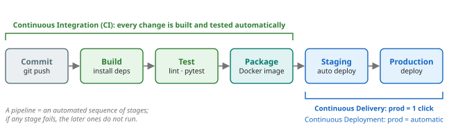

#### Worked example: one change, minute by minute

Abstract definitions only go so far, so here is a single change
travelling through the pipeline you will have built by the end of
Level 4. Lena adds a rule: applicants under 18 are rejected with HTTP
422. She opens a pull request at 10:00.

| Time | What runs | If it fails here, it means… |
|---|---|---|
| 10:00 | PR opened → GitHub starts the `CI` workflow on a fresh Ubuntu VM. | – |
| 10:00:40 | `lint`: ruff, format check, mypy (≈ 20 s after install). | Style or type error. Cheapest possible failure: nothing else ran, nothing was paid for. |
| 10:01:30 | `test (3.12)` and `test (3.13)` in parallel, with coverage. | Logic bug, or it only works on one Python version. |
| 10:02:30 | `model-gate`: validate data, train, compare metrics with the baseline. | The code is "correct" but the model got worse, or the data contract broke. |
| 10:03 | All green. A colleague reviews; Lena fixes one comment; CI runs again (the old run is **cancelled**). | – |
| 10:40 | Squash-merge into `main` → `Deploy` workflow starts. | – |
| 10:44 | Image built, tagged `:3f2a1c0…`, pushed to ECR. | Docker build broken (missing file, wrong base image). |
| 10:47 | Staging updated; smoke test calls `/health` and one `/predict`. | Config only production-like environments have: a missing env var, wrong port, too little memory. |
| 10:48 | Pipeline **pauses**: "Review deployments". | – |
| 11:15 | Lead approves → production deploy + smoke test. | Rare by now; if so, roll back to the previous SHA in two minutes. |

Notice the **shape**: the earliest checks are the cheapest and catch the
most common mistakes; each later stage catches a class of problem the
earlier ones cannot see. A pipeline is a funnel of increasingly
expensive, increasingly realistic tests. When you design one, ask of
every stage: **what kind of mistake does this catch that nothing before
it can?** If the answer is "nothing", delete the stage.

**What if… the tests pass on Lena's laptop but fail in CI?**

**What happens:**  The PR shows a red cross although "it works for me".

**Why:**  CI starts from a clean machine with only what is committed. The
usual culprits: a file that is in `.gitignore` (data, a model, a
`.env`), a package installed by hand but missing from `uv.lock`, an
absolute path like `/Users/lena/data.csv`, a different time zone,
or test order (one test relies on state another test left behind).

**What you do:**  Treat this as a **success** of CI: it found an assumption that
would also have broken production. Reproduce it with a fresh clone
(`git clone <url> /tmp/x`, then `uv sync --locked && uv run pytest`
inside it). Level 1 shows how to read the log.

**What if… two PRs are both green, but `main` is red after merging both?**

**What happens:**  Lena's PR renames a function; Jonas's PR adds a new call to
the **old** name. Each PR was tested against the `main` it started
from. Git merges both without a conflict, because they touched
different files. The combination is broken.

**Why:**  CI tested each change **alone**, not the **combination**. This is a
**semantic conflict**; Chapter 2 reproduces one.

**What you do:**  Require branches to be up to date before merging (Level 2), or
use a **merge queue**, which tests the exact combination before it
lands. And always run CI on `main` after every merge, so the
breakage is found within minutes, not by a customer.

A few more words that you will hear daily:

| Term | Meaning |
|---|---|
| Workflow | GitHub's name for a pipeline definition: one YAML file in `.github/workflows/`. |
| Job / step | A workflow contains jobs (each runs on its own fresh virtual machine); a job contains steps (single commands). |
| Runner | The machine that executes a job. GitHub provides hosted Linux, Windows and macOS runners. |
| Artefact | A file produced by a pipeline and kept afterwards: a coverage report, a trained model, a Docker image. |
| Environment | A place where the application runs: `dev`, `staging` (production-like, for testing), `production` (real users). |
| Quality gate | A check that must pass for the pipeline to continue: tests, coverage threshold, model accuracy. |
| Rollback | Returning production to the previous working version. |

### Why ML is different

In classic software, the behaviour of a system is determined by its
**code**. If the code does not change, the behaviour does not change. In
machine learning, behaviour is determined by **code, data and
configuration together** (Figure 2). Retraining with the same code on
new data gives you a different model. The same data with a different
random seed gives a slightly different model. This has consequences for
CI/CD:

1. **Version more than code.** You must be able to say which data snapshot and which hyper-parameters produced the model in production. Tools: Git for code, DVC or data snapshots for data, MLflow for runs and models.
2. **Evaluation is a test.** A model can be "correct code" and still be bad. So the pipeline trains (on a sample, to stay fast), measures metrics and **fails the build** if they drop. We call this an accuracy gate (Level 4).
3. **Tests are statistical, not exact.** You do not assert an exact prediction such as `0.7312`; you assert properties: probabilities between 0 and 1, determinism with a fixed seed, metric above a floor.
4. **Data can break things without any commit.** A new upstream column format breaks training. Data validation tests (a "data contract") catch this, and scheduled pipelines run them even when nobody pushes.
5. **LLM systems need evaluation with cost control.** A RAG service is evaluated against a golden set of questions. Calls to an LLM cost money, so CI must decide when to run the expensive checks.

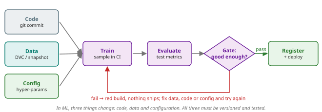

**What if… nobody changes the code, but the model gets worse?**

**What happens:**  Three months after deployment, the credit model approves
more bad loans. No commit was made; every pipeline run was green.

**Why:**  The world changed, not the code: inflation shifted
`credit_amount`, a new loan `purpose` appeared, a partner bank sends
different applicants. This is **data drift** (the inputs change) or
**concept drift** (the relation between inputs and outcome changes).
A push-triggered pipeline cannot see it, because nothing was pushed.

**What you do:**  Add **time-triggered** pipelines: nightly data validation against
the newest data, a weekly retraining that must beat the current
champion (Level 4), and monitoring of the live prediction
distribution. In ML, "nothing changed in Git" never means "nothing
changed".

**What if… the new model is better on average but worse for one group?**

**What happens:**  ROC-AUC goes up from 0.786 to 0.792, the gate passes, but
for applicants under 25 the model got clearly worse.

**Why:**  One average metric hides subgroups. In `credit-api` the gap is
real: on the test set, AUC is 0.80 for applicants aged 25 and over
but only 0.74 for the 48 applicants under 25 (Level 4 measures
this).

**What you do:**  Make the gate check **slices** that matter for your business and
for fairness, not only the overall number. For a credit model in the
EU this is not optional: the AI Act classes credit scoring as
high-risk.

**Interview tip**

"In ML, a green unit-test suite is necessary but not sufficient. I
treat model evaluation as a quality gate in CI: the build fails if the
new model is worse than the one in production, and data validation
runs before training so we fail on bad data, not on a bad model."

### The map of this book

Figure 3 shows where you are going. Each level builds on the previous
one and ends with a checkpoint. You use one running example, a
credit-risk API called **credit-api**, from Level 1 to the first half of
Level 4; then a second example, **rag-api**, for LLM evaluation. Two
chapters sit beside the levels: **Operate it** (Chapter 7: logs, SLOs,
incidents, cost and compliance after deployment) and **The senior
toolkit** (Chapter 9: system design, interview answers and turning the
projects into a portfolio).

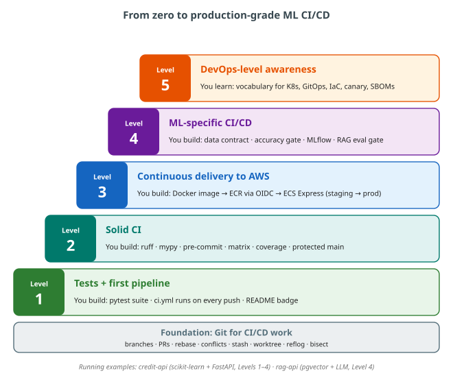

#### The tools at a glance

| Tool | What it does for us | Level |
|---|---|---|
| Git, GitHub | Version control  (*Versionsverwaltung*); pull requests, reviews, branch protection. | Git, 1–2 |
| GitHub Actions | Runs our workflows (CI and CD) on GitHub's runners. | 1–4 |
| uv | Fast Python package and project manager; creates the virtual environment and the lock file `uv.lock`. | 1 |
| pytest | The standard Python test framework. | 1 |
| ruff, mypy | Linter + formatter (ruff), static type checker (mypy). | 2 |
| pre-commit | Runs the same checks locally before each commit. | 2 |
| Docker | Packages the app and its dependencies into an image that runs the same everywhere. | 3 |
| Amazon ECR | AWS's private registry for Docker images. | 3 |
| Amazon ECS + Fargate | Runs containers without managing servers; we use **ECS Express Mode**, which also creates the load balancer. | 3 |
| AWS Lambda | Runs code per request; an optional target for our container. | 3 |
| MLflow | Tracks experiments; model registry with aliases such as `@champion`. | 4 |
| pandera, DVC | Data validation (pandera); data versioning (DVC, briefly). | 4 |
| pgvector, fastembed | Vector search in Postgres; local embedding model for the RAG example. | 4 |

**Watch out: AWS costs money**

Levels 1, 2 and 4 are free if your
repository is public (GitHub Actions minutes are free for public
repositories). Level 3 creates AWS resources that cost roughly 1 to 2
US dollars per day while they run. Chapter 5 sets up budget alarms
first and ends with a cleanup script. Run it at the end of each
session.


## 2. Merge & rebase

*Chapter 2: Git for CI/CD Work.* CI/CD lives on top of Git. Every pipeline starts with a push, every review is a pull request, every rollback is a commit you can point to. You know `commit`, `push`, `pull` and branches; this chapter adds the tools that make you comfortable in a busy team repository.

**After this level you can:**

- Work with feature branches, pull requests and a protected `main`.
- Choose between merge and rebase, and clean up a PR with interactive rebase.
- Resolve merge conflicts calmly, during a merge and during a rebase.
- Park work with `git stash`; review a PR in parallel with `git worktree`.
- Recover from mistakes with `reflog`, `reset`, `revert`, `cherry-pick`, and find a bad commit with `bisect`.

### The team workflow

In a professional repository, nobody pushes directly to `main`. The
branch is **protected**: changes arrive only through **pull requests**
(PRs; GitLab calls them merge requests), which must pass CI and get a
review before they can be merged. The basic loop (Figure 4):

1. Update `main` and create a short-lived branch:
`git switch -c feature/add-age-check`.
2. Make small, focused commits.
3. Push the branch and open a PR. CI runs on the PR.
4. Address review comments, keep the branch up to date with `main`.
5. Merge. Delete the branch. `main` is deployable at all times.

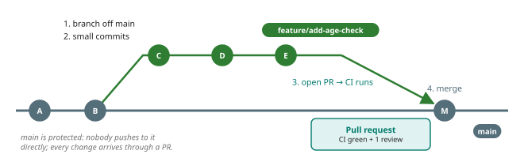

**Concept: Trunk-based development vs. GitFlow**

**Trunk-based development**: everyone integrates into one branch
(`main`, the "trunk") at least daily through small PRs; unfinished
features hide behind feature flags. This is what CI was invented for
and what most modern teams do. **GitFlow** uses long-lived `develop`,
`release/*` and `hotfix/*` branches. It fits products with scheduled
releases (e.g. installed software) but causes big, painful merges.
For services and ML APIs, prefer trunk-based with short branches.

### Merge vs. rebase

Your branch `feature` started from commit B. Meanwhile, teammates
merged C and F into `main`. Before your PR can be merged, your branch
must include their work. There are two ways to do that (Figure 5).


**`git merge main`** (while on `feature`) creates a new **merge commit** M
with two parents. Nothing existing is changed. History is truthful but
can get noisy: many "Merge branch main into feature" commits.

**`git rebase main`** takes your commits D and E, sets them aside, moves
your branch to the tip of `main`, and **replays** them one by one as new
commits D′ and E′. The result is a straight line, as if you had started
your work today. But D′ and E′ have new commit IDs: history was
**rewritten**.

#### Worked example: the same branch, merged and rebased

Diagrams are one thing; here is what Git itself prints. In a test
repository, `feature` has two commits and `main` gained two commits from
a teammate in the meantime. `git log --oneline --graph --all` draws the
history, newest first:

*expected output:*

```text
* 9529ffb F: teammate feature
* 4d36953 C: teammate fix
| * 817122a E: test age check
| * 174de9c D: add age check
|/
* d4a7642 B: add loader
* 42c8734 A: initial
```

After `git merge main` on a copy of the branch, the graph has a
**diamond**. D and E keep their IDs; a new merge commit `0e59e5a` joins
the two lines:

*expected output:*

```text
*   0e59e5a Merge branch 'main' into feature-merge
|\
| * 9529ffb F: teammate feature
| * 4d36953 C: teammate fix
* | 817122a E: test age check
* | 174de9c D: add age check
|/
* d4a7642 B: add loader
* 42c8734 A: initial
```

After `git rebase main` on the original branch, the history is a
straight line, and the IDs of D and E **changed** (`174de9c` →
`da2d582`, `817122a` → `89685ab`), because each commit's ID is a hash
of its content **and its parent**. New parent, new ID:

*expected output:*

```text
* 89685ab E: test age check
* da2d582 D: add age check
* 9529ffb F: teammate feature
* 4d36953 C: teammate fix
* d4a7642 B: add loader
* 42c8734 A: initial
```

That last sentence is the key to everything that can go wrong with
rebase: anybody who still has the **old** `174de9c` now has a commit that
no longer exists on your branch.

**Try it: Make it a habit**

Add an alias and look at the graph before and after every merge or
rebase: `git config --global alias.lg "log --oneline --graph --all
-20"`, then `git lg`. Most Git confusion disappears once you look at
the graph instead of guessing.

**Watch out: The golden rule of rebasing**

Never rebase commits that other people have already based work on.
Rebasing **your own** feature branch is fine, even after you pushed it
(you then need `git push --force-with-lease`). Rebasing `main` or a
branch a colleague also commits to will make their history diverge
from yours.

| Situation | Use | Why |
|---|---|---|
| Update **your** feature branch with new `main` | `git rebase main` (or merge, if the team prefers) | Clean, linear history; conflicts are solved commit by commit. |
| Branch is shared with a colleague | `git merge main` | Does not rewrite commits others have. |
| Integrating a finished PR into `main` | The PR button: "Squash and merge" or "Rebase and merge" | The team decides once, in the repository settings. |
| Pulling `main` when you have local commits | `git pull --rebase` | Avoids pointless merge commits. |

`git pull` is `git fetch` followed by `git merge`. With `--rebase` it
is `fetch` + `rebase` instead. Make it the default once:

*terminal:*

```bash
git config --global pull.rebase true
git config --global rebase.autoStash true   # stash/unstash dirty files
git config --global merge.conflictStyle zdiff3   # show the base, too
```

The usual way to update your branch before you ask for review:

*terminal:*

```bash
git switch feature/add-age-check
git fetch origin
git rebase origin/main          # replay my commits on the newest main
uv run pytest                   # still green?
git push --force-with-lease     # update the PR (safe force push)
```

**Concept: Why `--force-with-lease`, never `--force`**

After a rebase, your local branch and the remote branch have
different histories, so a normal push is rejected. `--force` would
overwrite the remote unconditionally, including commits a colleague
pushed in the meantime. `--force-with-lease` only overwrites if the
remote is still where you last saw it; otherwise it refuses.

This is what a normal push looks like after a rebase, and what the
lease does when a colleague pushed to the same branch meanwhile (real
output, remote URL shortened):

*expected output:*

```text
$ git push
 ! [rejected]        feature/x -> feature/x (fetch first)
hint: Updates were rejected because the remote contains work that you do
hint: not have locally. ...

$ git push --force-with-lease
 ! [rejected]        feature/x -> feature/x (stale info)
```

"Stale info" means: the remote branch is no longer where your last
fetch saw it, so somebody else pushed. Stop and look before you do
anything else.

**What if… I run `git fetch` and then `--force-with-lease` again?**

**What happens:**  The push succeeds, and your colleague's commit is **gone**
from the remote branch:

```text
$ git fetch
$ git push --force-with-lease
 + e00e90c...4081a71 feature/x -> feature/x (forced update)
```

It gets worse. When the colleague runs `git pull --rebase`, Git sees
that their commit used to be on `origin/feature/x` and assumes it was
intentionally removed upstream, so it silently drops it from **their**
branch too. We ran exactly this; the colleague's log afterwards no
longer contains "feat: colleague adds part 2".

**Why:**  The lease compares against your **remote-tracking branch**
(`origin/feature/x`). `git fetch` updates that to the colleague's
commit, so the lease now "expects" it and lets you overwrite it. You
never looked at what you fetched.

**What you do:**  Prevent it with `git push --force-with-lease --force-if-includes`
(Git 2.30+). It also checks that the remote tip is part of **your**
local history, and it rejected our push with
`(remote ref updated since checkout)`. Make it the default:
`git config --global push.useForceIfIncludes true`. Before any force
push, run `git log --oneline HEAD..origin/feature/x`: if it prints
anything, those commits exist only remotely; integrate them first
(`git rebase origin/feature/x`). To rescue a lost commit: the
colleague finds it in `git reflog` (it was `HEAD@{2}` in our run) and
runs `git cherry-pick <sha>`.

**What if… a colleague rebased a branch I also work on?**

**What happens:**  Your `git pull` stops with `fatal: Need to specify how to
reconcile divergent branches`, or a plain merge produces every commit
twice (old ID and new ID side by side).

**Why:**  Your local branch has the old commits, the remote has the
rewritten ones. Git sees two different histories.

**What you do:**  If you have no local work of your own: `git fetch` then
`git reset --hard origin/<branch>` (look at `git status` first: this
discards uncommitted changes). If you have local commits: `git pull
--rebase`, which skips commits that are already upstream in rewritten
form and replays only yours. Then agree with the team: shared
branches are **merged**, never rebased.

### Interactive rebase: clean up before review

Your PR has six commits: "add age check", "fix typo", "wip", "add test
for age", "oops forgot file", "fix lint". Reviewers want two meaningful
commits. Interactive rebase lets you edit the list of commits like a
text file:

*terminal:*

```bash
git rebase -i origin/main      # all commits not yet on main
# or: git rebase -i HEAD~6       # the last six commits
```

Git opens your editor with a **todo list**, oldest commit first:

*git-rebase-todo:*

```text
pick 3f2a1c0 add age check
pick 9b81d44 fix typo
pick 0c7e5aa wip
pick 51d2f9b add test for age
pick a77e0b3 oops forgot file
pick e41c2d8 fix lint

# Commands:
# p, pick = use commit           r, reword = use commit, edit message
# e, edit = stop to amend it     s, squash = meld into previous, keep msg
# f, fixup = meld into previous, discard this message
# d, drop = remove commit        (reorder lines to reorder commits)
```

Change the words and the order, save and close:

*git-rebase-todo (edited):*

```text
reword 3f2a1c0 add age check
fixup 9b81d44 fix typo
fixup 0c7e5aa wip
fixup e41c2d8 fix lint
pick 51d2f9b add test for age
fixup a77e0b3 oops forgot file
```

Git replays the commits; `reword` opens the editor once more so you
can write `feat: add age check`. The result is shown in Figure 6.

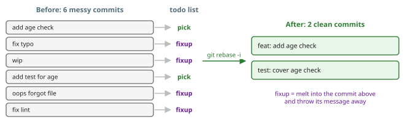

**Try it: Let Git prepare the todo list**

If you know while working that a commit fixes an earlier one, commit
it with `git commit --fixup 3f2a1c0`. Later, `git rebase -i
--autosquash origin/main` puts every fixup line in the right place
automatically.

#### Worked example: split one commit into two

Reviewers ask you to separate "refactor the loader" from "add age
validation", but both are in one commit `51d2f9b`. The `edit` command
stops the rebase **at** that commit so you can rebuild it:

*terminal:*

```bash
git rebase -i origin/main     # change 'pick 51d2f9b' to 'edit 51d2f9b'
# Git stops: 'Stopped at 51d2f9b... add age check and refactor loader'
git reset HEAD~1              # undo the commit, keep its changes unstaged
git add src/credit_api/data.py
git commit -m "refactor: simplify loader"
git add src/credit_api/validation.py tests/test_data.py
git commit -m "feat: reject applicants under 18"
git rebase --continue         # replay the remaining commits
```

`git add -p` (patch mode) goes one step further: it shows each changed
**hunk** and asks `Stage this hunk [y,n,q,a,d,s,e,?]?`, so you can split
changes **inside one file** into separate commits. It is the single most
useful command for making reviewable commits.

**What if… the interactive rebase went wrong and I already finished it?**

**What happens:**  You dropped the wrong line in the todo list, or squashed
into the wrong commit. The rebase finished; the branch looks wrong.

**What you do:**  Before the rebase started, Git saved the old tip in `ORIG_HEAD`.
Right after the rebase, `git reset --hard ORIG_HEAD` restores the
branch exactly. If you ran other commands since (which overwrite
`ORIG_HEAD`), use `git reflog` and look for the line **before**
`rebase (start)`, then `git reset --hard HEAD@{n}`. While a rebase is
still in progress, `git rebase --abort` is simpler.

**What if… my PR is based on a colleague's PR that was squash-merged?**

**What happens:**  You built `feat/b` on top of `feat/a` ("stacked PRs").
`feat/a` was squash-merged into `main` as one new commit S. Now
`git rebase main` on `feat/b` tries to replay `feat/a`'s original
commits again and conflicts with S everywhere.

**Why:**  A squash creates a **new** commit with new content; Git cannot
tell that `feat/a`'s commits are already in `main`.

**What you do:**  Transplant only **your** commits: `git rebase --onto main feat/a
feat/b` means "take the commits of `feat/b` that are not in `feat/a`
and replay them onto `main`". (If `feat/a` was already deleted, use
the SHA of its last commit instead of the name; `git log` on your
branch still shows it.)

### Commit messages that machines can read

**Conventional Commits** is a simple format for commit messages:
`type(scope): description`, e.g. `feat(api): add /version endpoint` or
`fix: handle unknown purpose category`.

| Type | Use for | Version bump |
|---|---|---|
| `feat` | A new feature for users of the API or model. | minor: 1.4.0 → 1.5.0 |
| `fix` | A bug fix. | patch: 1.4.0 → 1.4.1 |
| `feat!` or `BREAKING CHANGE:` footer | A change that breaks clients. | major: 1.4.0 → 2.0.0 |
| `docs`, `test`, `refactor`, `ci`, `chore`, `perf` | Everything else. | none |

Because the type is machine-readable, CI can generate changelogs and
release versions automatically (tools: *release-please*,
*semantic-release*; *commitlint* checks the format in CI). With squash
merges, the **PR title** becomes the commit message, so teams often lint
PR titles instead.

**Exercise: Rebase with conflicts**

In the conflict lab, add two more commits on `feature/stricter` that
each change `features:` to a different value, and one commit on `main`
that changes `features:` too. Rebase the feature branch onto `main`.
How many times do you have to resolve? Then use `git reflog` to get
back to the state before the rebase.

**Exercise: Clean history**

Create five small commits on a branch, including two "fix typo"
commits. Use `git commit --fixup` for one of them and
`git rebase -i --autosquash` to end up with two Conventional-Commit
messages.

**Exercise: The force-push trap**

Create a bare repository (`git init --bare remote.git`) and two
clones, `you` and `colleague`. Reproduce the what-if from Section
2.2: both push to `feature/x`, you rebase, fetch, and force-push with
the lease. Confirm the colleague's commit disappears, recover it from
the colleague's reflog, then repeat with `--force-if-includes` and
observe the rejection.

**Exercise: Lock file conflict**

In a fresh `uv init` project, add a different dependency on two
branches and merge them. Resolve it the right way, and prove it with
`uv sync --locked`.

**Exercise: Semantic conflict**

Reproduce the "no conflict, still broken" what-if with two branches
and a test. Which GitHub setting would have prevented the broken
`main`, and at what cost?

**Checkpoint: you should now be able to…**

- explain merge vs. rebase with a drawing, and state the golden rule;
- update a feature branch with `git rebase origin/main` and push with
`--force-with-lease`;
- squash, reword, reorder and drop commits with `git rebase -i`;
- read conflict markers, resolve them in VS Code or the terminal, and use `--abort` / `--continue`;
- read the base section of a `zdiff3` conflict and resolve by intention; handle modify/delete, lock-file and binary conflicts;
- explain why `--force-if-includes` exists, why a reverted merge must be reverted again before re-merging, and what a semantic conflict is;
- choose between `stash` and `worktree`;
- undo with `reset`, `revert` and `reflog`, and find a bad commit with `git bisect run`.


## 3. Merge conflicts

### Merge conflicts in depth

A conflict happens when two branches change **the same lines** of a file
(or one deletes a file the other changes). Git merges everything it
can; for the rest it stops and asks you (Figure 7). Conflicts are
normal. They are not errors, and you cannot break anything as long as
you know how to abort.


### Hands-on: create and resolve a conflict

**Try it: Conflict lab, about 10 minutes**

Run this in an empty folder. It creates a repository where `main` and
a feature branch disagree about one line.

*terminal:*

```bash
mkdir conflict-lab && cd conflict-lab && git init -b main
printf 'model: gbm\nthreshold: 0.5\nfeatures: 8\n' > config.yaml
git add . && git commit -m "chore: initial config"

git switch -c feature/stricter
printf 'model: gbm\nthreshold: 0.7\nfeatures: 8\n' > config.yaml
git commit -am "feat: stricter threshold"

git switch main            # meanwhile, a teammate changes main ...
printf 'model: gbm\nthreshold: 0.6\nfeatures: 8\n' > config.yaml
git commit -am "feat: tune threshold"

git switch feature/stricter
git merge main
```

*expected output:*

```text
Auto-merging config.yaml
CONFLICT (content): Merge conflict in config.yaml
Automatic merge failed; fix conflicts and then commit the result.
```

`git status` now lists `config.yaml` under "Unmerged paths". Open it:

*config.yaml (with merge.conflictStyle zdiff3):*

```text
model: gbm
<<<<<<< HEAD
threshold: 0.7
||||||| aecf8e0
threshold: 0.5
=======
threshold: 0.6
>>>>>>> main
features: 8
```

**Reading the markers:** between `<<<<<<< HEAD` and `|||||||` is **your**
version (the branch you are on, HEAD). Between `|||||||` and `=======`
is the **base**: the line as it was in the common ancestor `aecf8e0`.
Between `=======` and `>>>>>>> main` is the version being merged in.
Without `zdiff3`, the middle section is missing, and you only see two
different numbers without knowing who changed what.

**Resolving** means: edit the file into the final state you want, delete
all three marker lines, then tell Git you are done:

*terminal:*

```bash
# edit config.yaml so that it reads: threshold: 0.7
git add config.yaml          # "this file is resolved"
git commit                   # completes the merge (message prepared)
uv run pytest                # never skip this after a conflict
```

**In VS Code**, conflicted files show four small links above each
conflict: *Accept Current Change* (yours), *Accept Incoming Change*
(theirs), *Accept Both Changes*, *Compare Changes*. For larger conflicts
click **Resolve in Merge Editor**: a three-pane view with incoming,
current, and the result at the bottom. When the result is right, click
**Complete Merge**, which stages the file for you.

**Changed your mind?** `git merge --abort` restores the state before the
merge, as if nothing had happened.

### A harder conflict: why the base matters

Real conflicts rarely involve one line. Make the lab a little more
realistic: on the feature branch, commit **two** changes (threshold 0.7,
then features 10); on `main`, one commit changes threshold to 0.6 **and**
features to 9. Merging gives:

*config.yaml (real output):*

```text
model: gbm
<<<<<<< HEAD
threshold: 0.7
features: 10
||||||| aecf8e0
threshold: 0.5
features: 8
=======
threshold: 0.6
features: 9
>>>>>>> main
```

Neither "accept current" nor "accept incoming" is right here. Read it
as three questions:

1. **What did my side intend?** Base → HEAD: threshold 0.5 → 0.7 and features 8 → 10.
2. **What did their side intend?** Base → main: threshold 0.5 → 0.6 and features 8 → 9.
3. **Which intentions are compatible?** Talk to the teammate, or read their commit (`git log main -1 -p -- config.yaml`). Perhaps they added a ninth feature column to the data, and you added a tenth on your side. Then the right answer is 11, a number **neither** side wrote. This is why a conflict is a question for a human, not a choice between two buttons.

Three commands that help while you are in the middle of a merge:

| Command | Shows |
|---|---|
| `git diff --name-only --diff-filter=U` | Only the files that are still conflicted. |
| `git log --merge --oneline -- <file>` | The commits on **both** sides that touched this file: who to ask. |
| `git diff` | During a conflict: a **combined diff** of the remaining conflict regions against both sides. |

### Conflicts during a rebase

Undo the merge (`git merge --abort`) and run `git rebase main` instead.
Git replays your two commits one at a time. The first one already
conflicts. This is the real output:

*expected output:*

```text
Rebasing (1/2)Auto-merging config.yaml
CONFLICT (content): Merge conflict in config.yaml
error: could not apply aea4639... feat: stricter threshold
hint: Resolve all conflicts manually, mark them as resolved with
hint: "git add/rm <conflicted_files>", then run "git rebase --continue".
hint: You can instead skip this commit: run "git rebase --skip".
hint: To abort and get back to the state before "git rebase", run
hint: "git rebase --abort".
```

*config.yaml during the rebase, commit 1 of 2:*

```text
model: gbm
<<<<<<< HEAD
threshold: 0.6
features: 9
||||||| parent of aea4639 (feat: stricter threshold)
threshold: 0.5
features: 8
=======
threshold: 0.7
features: 8
>>>>>>> aea4639 (feat: stricter threshold)
```

Compare this with the merge and notice three differences:

1. **Ours and theirs are swapped.** During a rebase, HEAD is `main` plus the commits replayed so far; the "incoming" side is **your** commit being replayed. In VS Code, *Accept Incoming* therefore keeps **your** change, and `git checkout --theirs` means **your** version. This trips up everyone at least once.
2. **Only one commit's change is in play.** The incoming side shows features 8, because your first commit did not touch features. You resolve the **intention of this commit only**: threshold 0.7, keep main's features 9.
3. **Conflicts come per commit.** `git status` tells you where you are:

*expected output:*

```text
interactive rebase in progress; onto e8e8788
Last command done (1 command done):
   pick aea4639 # feat: stricter threshold
Next command to do (1 remaining command):
   pick 9be1d5a # feat: use 10 features
```

*terminal:*

```bash
# edit to: threshold 0.7 / features 9
git add config.yaml
git rebase --continue     # replay the next commit
# git rebase --skip       # drop this commit entirely
# git rebase --abort      # back to where you were before the rebase
```

Git now replays commit 2 and stops again, this time only on the
features line (base 8, main 9, your commit 10). You resolve it, `git
add`, `--continue`, and the rebase is done. Two small, focused
conflicts instead of one mixed one: this is the real advantage of
rebasing with small commits.

**Concept: `git rerere`: reuse recorded resolution**

If you rebase a long-lived branch several times, you meet the same
conflict again and again. `git config --global rerere.enabled true`
makes Git remember how you resolved a conflict and apply the same
resolution automatically next time. You still review and `git add`.

### A field guide to conflict types

Not every conflict has markers in a text file. `git status` shows a
two-letter code per file (`git status --short`); the type decides how
you resolve.

| Type | Status | How to resolve |
|---|---|---|
| Both modified | `UU` | Edit the markers away, `git add`. |
| Modify/delete | `UD` / `DU` | Decide whether the file should exist. Keep it: `git add <file>`. Delete it: `git rm <file>`. |
| Both added | `AA` | Two branches created the same path. Merge the contents by hand like `UU`. |
| Binary file | `UU` | No markers possible. Pick a side: `git checkout --ours∣--theirs <file>`, then `git add`. |
| Generated file | `UU` | Never hand-edit. Resolve the **source**, then regenerate (lock files, below). |

**What if… one branch deleted a file that the other changed?**

**What happens:**  Real output from the lab, where `main` removed `legacy.py`
and the feature branch fixed a bug in it:

```text
CONFLICT (modify/delete): legacy.py deleted in main and modified
in HEAD.  Version HEAD of legacy.py left in tree.
```

`git status --short` shows `UD legacy.py`. There are no markers: the
file is just there, in your version.

**Why:**  Git cannot know whether the deletion or the fix is more
important.

**What you do:**  Find out **why** it was deleted (`git log main -1 --
legacy.py`). Usually the code moved somewhere: then `git rm
legacy.py` and apply your bug fix in the new location, in the same
merge commit. Only if the deletion was a mistake: `git add
legacy.py`.

**What if… `uv.lock` (or `poetry.lock`, `package-lock.json`) conflicts?**

**What happens:**  You added `rich`, a teammate added `tabulate`. Both
`pyproject.toml` and `uv.lock` conflict. Lock files are huge
generated files; their conflict regions are meaningless to a human,
and uv cannot even read a lock file with markers in it.

**What you do:**  Resolve the **input** by hand, then regenerate the **output**. This
sequence was run in the lab:

```bash
# 1. pyproject.toml: keep BOTH dependencies, delete the markers
#    dependencies = ["rich>=15.0.0", "tabulate>=0.10.0"]
git checkout --theirs uv.lock   # any consistent version as a start
uv lock                         # re-resolve from pyproject.toml
git add pyproject.toml uv.lock
uv sync --locked                # proves lock and pyproject agree
git commit
```

If you forget `uv lock`, CI fails at `uv sync --locked` with the
error `The lockfile at uv.lock needs to be updated, but --locked was
provided.`, which is exactly what that flag is for.

**What if… a Jupyter notebook conflicts?**

**What happens:**  A `.ipynb` file is JSON with code, outputs, execution counts
and base64 images. Two people **running** the same notebook create
conflicts even without changing code, and the markers break the JSON
so the notebook will not open.

**What you do:**  Prevention beats cure: strip outputs before commit
(`nbstripout --install` adds a Git filter; there is also a
pre-commit hook), and move reusable code from notebooks into `.py`
modules that are tested. When it happens anyway, `nbdime` gives a
notebook-aware merge tool (`nbdime config-git --enable`, then
`git mergetool --tool nbdime`), or take one side with
`git checkout --ours` and re-apply the other change by hand.

**What if… a trained model file or other binary conflicts?**

**What happens:**  `CONFLICT (content): Merge conflict in models/model.joblib`;
Git cannot merge bytes.

**Why:**  Two branches each committed a retrained model.

**What you do:**  Pick a side (`git checkout --theirs models/model.joblib`) and,
better, retrain from the merged code and data. The real fix is
structural: model files do not belong in Git. In this book, CI
trains the model and the image or the MLflow registry stores it; Git
stores the **code and configuration** that produce it.

**What if… the merge has no conflicts, but the result is broken?**

**What happens:**  This was reproduced in a lab. Branch `rename` renames
`scale()` to `normalise()` and updates every caller. Branch `newcall`
adds `report.py`, which calls `scale()`. Both merge into `main`
with exit code 0. Then:

```text
report.py:1: in <module>
    from features import scale
E   ImportError: cannot import name 'scale' from 'features'
!!!!!!!!!!!!!!!!!!!! Interrupted: 1 error during collection !!!!!!!!!!
```

**Why:**  Git merges **text**, not **meaning**. The two changes touched
different files, so there was nothing to conflict about in Git's
eyes. This is a **semantic conflict**.

**What you do:**  This is the strongest argument for CI on the **merged** result:
run tests after every merge locally, require "branches up to date"
or a merge queue on GitHub (Level 2), and run CI on every push to
`main`. Git can never catch this; only tests can.

**What if… I resolved a conflict wrong and already committed the merge?**

**What you do:**  **Not pushed yet:** `git reset --hard ORIG_HEAD` (or `HEAD~1`)
returns to before the merge; merge again. **Already pushed to a
shared branch:** do not rewrite. Make a normal follow-up commit that
fixes the resolution ("fix forward"), or `git revert -m 1
<merge-sha>` if the whole merge must go (read the revert trap in
Section 2.7 first). To see what you actually decided during the
resolution, `git show <merge-sha>` displays only the lines where the
merge result differs from **both** parents.

### Avoiding conflicts

- Keep branches short-lived (one to three days) and PRs small.
- Rebase on `main` daily, so conflicts are small when they appear.
- Let a formatter (ruff) own the code style; then nobody creates diffs by re-indenting.
- Avoid "hot" files everybody edits, such as one giant `config.py`; split them.
- Talk: if you and a colleague both need to refactor the same module, agree on an order.


## 4. Stash & recovery

### `git stash`: park unfinished work

You are halfway through a change when your lead asks you to check
something on `main`. Your working directory is dirty and not ready to
commit. `git stash` takes your uncommitted changes, saves them on a
stack, and gives you a clean working directory.

*terminal:*

```bash
git stash push -m "half-done age validation"   # or just: git stash
git switch main                                  # do the urgent thing
git switch feature/age
git stash list
```

*expected output:*

```text
stash@{0}: On feature/age: half-done age validation
```

| Command | What it does |
|---|---|
| `git stash show -p stash@{0}` | Show the diff of a stash. |
| `git stash apply` | Re-apply the newest stash, **keep** it on the stack (safe: if it goes wrong, the stash is still there). |
| `git stash pop` | Re-apply and **delete** it from the stack (only if it applied without conflict). |
| `git stash push -- src/app.py` | Stash only specific files. |
| `git stash -u` | Include **untracked** (new) files. Without `-u`, new files stay in your working directory. |
| `git stash drop stash@{1}` | Delete one stash. |
| `git stash branch fix-age stash@{0}` | Create a branch from the commit where you stashed and apply the stash there: the cleanest way out of a stash that conflicts. |

**Watch out: Stash conflicts**

If the code changed since you stashed, `apply`/`pop` can conflict,
exactly like a merge. Resolve the markers and `git add` the files.
`pop` does not delete a stash that conflicted, so remove it yourself
with `git stash drop` once you are sure. Stashes are local and easy
to forget: treat them as hours-long parking, not storage.

This is what a conflicting `pop` really looks like. Note the last
line:

*expected output:*

```text
$ git stash pop
Auto-merging notes.txt
CONFLICT (content): Merge conflict in notes.txt
...
The stash entry is kept in case you need it again.
```

#### Stash recipes for real situations

| Situation | Recipe |
|---|---|
| Run the tests on **only** what you staged, to check the commit you are about to make | `git stash push --keep-index -u`, run `uv run pytest`, then `git stash pop`. The unstaged and untracked rest is parked meanwhile. |
| Park only the staged part | `git stash push --staged` |
| You started work on `main` by mistake | `git stash`, `git switch -c feat/x`, `git stash pop`. (Simpler: `git switch -c feat/x` **carries** uncommitted changes along, no stash needed.) |
| Pull, but you have local edits | `git pull --rebase --autostash` (or the `rebase.autoStash` setting from Section 2.2). |
| Take one file out of a stash | `git restore --source=stash@{0} -- path/to/file` |

**What if… I dropped a stash I still needed?**

**What happens:**  `git stash drop` printed `Dropped refs/stash@{0}
(a861edc…)`, and `git stash list` no longer shows it. Stashes have no
reflog entry after they are dropped.

**What you do:**  A stash is stored as a commit, and Git does not delete
unreachable commits immediately (garbage collection keeps them for
weeks). If the drop message is still on your screen, `git stash
apply a861edc` brings it back. Otherwise, search for dangling
commits. This worked in our lab:

```text
$ git fsck --no-reflogs --unreachable | grep commit
unreachable commit a861edc17c894ada149afd5003dd19e0ae61a699
$ git log --oneline --no-walk a861edc
a861edc On main: precious work
$ git stash apply a861edc
```

Stash commits are easy to spot: their message starts with `On
<branch>:` or `WIP on <branch>:`.

### `git worktree`: two branches checked out at once

Stashing is fine for five minutes. But suppose a colleague asks you to
review PR 42, which needs a 10-minute test run, while you are in the
middle of a big refactor. Switching branches would disturb your
editor, your virtual environment and your uncommitted files. A
**worktree** is a second working directory attached to the **same**
repository: same history and objects, different checked-out branch.

*terminal:*

```bash
git worktree add ../credit-api-pr42 feature/new-endpoint
cd ../credit-api-pr42 && uv sync && uv run pytest   # review here
cd ../credit-api                                    # your work: untouched
git worktree list
git worktree remove ../credit-api-pr42              # when done
```

*expected output:*

```text
/home/you/credit-api        3f2a1c0 [feature/refactor]
/home/you/credit-api-pr42   7c19e2b [feature/new-endpoint]
```

Use `git worktree add -b hotfix/crash ../hotfix origin/main` to create
a new branch for an urgent fix in its own folder. Two rules: a branch
can be checked out in only one worktree at a time, and if you delete a
worktree folder by hand, run `git worktree prune`.

**What if… I try to check out the same branch in two worktrees?**

**What happens:**  Real output:

```text
$ git worktree add ../credit-api-wt main
fatal: 'main' is already used by worktree at '/home/you/credit-api'
```

**Why:**  If two folders had the same branch checked out, a commit in one
would silently change the branch under the other's feet.

**What you do:**  Check out a **detached** copy for reading and testing
(`git worktree add --detach ../wt main`), or create a new branch
from it (`-b review/main ../wt main`).

**What if… my ML training run takes two hours and I want to keep coding?**

**What you do:**  This is where worktrees shine for ML work. `git worktree add
../credit-api-train exp/new-features`, then `cd` there, `uv sync`,
and start the training. It reads **that** folder's code, so you can
edit, switch branches and run tests in your main folder without
changing the code under a running job. Each worktree needs its own
virtual environment (`uv sync` creates `.venv` per folder; uv's
global cache makes this fast). Large data files are not shared
automatically: point both at one data directory through a config
value or environment variable instead of copying gigabytes.

**Interview tip**

"For quick context switches I use stash; when I need to run a PR's
test suite or a hotfix in parallel with my own work, I use git
worktree, so both have their own working directory and environment."

### Recovery: undo almost anything

Git rarely loses committed work. The trick is knowing where to look.
The tools below cover 95 % of "help, I broke it" situations.


**`git reset <commit>`** moves your branch pointer back to `<commit>`.
The mode decides what happens to the changes in between (Figure 8):
`--soft` keeps them staged (handy to redo the last commit:
`git reset --soft HEAD~1`), `--mixed` (the default) keeps them as
unstaged edits, `--hard` throws them away. Only use reset on commits
you have **not** pushed to a shared branch.

**`git revert <commit>`** creates a **new** commit that undoes an old one.
History is not rewritten, so this is the safe way to undo something on
`main` that is already pushed or deployed. To revert a merge commit, tell
Git which parent is the mainline: `git revert -m 1 <merge-sha>`.

**What if… I revert a merged feature, fix it, and merge it again?**

**What happens:**  Friday: `feature/age` was merged, broke production, and you
reverted the merge with `git revert -m 1`. Monday: you add a fix
commit to `feature/age` and merge again. In our lab, the merge
stopped with a strange conflict, and the file `age.py` from the
original feature was simply **missing**:

```text
CONFLICT (modify/delete): api.py deleted in HEAD and modified in
feature/age.  Version feature/age of api.py left in tree.
```

In other cases there is no conflict at all, and only the new fix
arrives, without the feature it fixes.

**Why:**  The revert undid the **changes**, but the original commits are
still in `main`'s history. Git considers them already merged, so it
only brings in commits made **after** the first merge.

**What you do:**  First **revert the revert**, then merge. Git calls the result
"Reapply":

```bash
git merge --abort
git revert <sha-of-the-revert-commit>   # 'Reapply "Merge branch ..."'
git merge feature/age                   # now brings only the fix
```

This worked cleanly in the lab. Remember the rule: a reverted merge
is not "unmerged" in Git's eyes.

**`git reflog`** is Git's diary of where HEAD has been, including commits
that no branch points to anymore. It is how you undo a bad `reset
--hard` or a rebase that went wrong:

*terminal:*

```bash
git reflog
```

*expected output:*

```text
e41c2d8 HEAD@{0}: rebase (finish): returning to refs/heads/feature
9a0d3b1 HEAD@{1}: rebase (pick): add test for age
a77e0b3 HEAD@{5}: commit: oops forgot file      <- before the rebase
```

*terminal:*

```bash
git branch rescue a77e0b3       # put a branch on the old state
# or move the current branch back: git reset --hard HEAD@{5}
```

**`git cherry-pick <sha>`** copies one commit onto your current branch.
Typical use: a bug fix landed on `main`, and you need exactly that fix
on a release branch. Add `-x` to record where it came from. A range
works too (`git cherry-pick A^..B` copies A through B). If it
conflicts, you resolve exactly as in a rebase, then `git cherry-pick
--continue` (or `--abort`).

**What if… Git says I am in "detached HEAD" state?**

**What happens:**  You checked out a commit or tag instead of a branch (`git
switch --detach v0.3.0`, or `git checkout 7c19e2b`; `git bisect`
does it too). Git prints `HEAD is now at 0bf8e3c …` and a long
warning.

**Why:**  Normally HEAD points to a **branch**, and the branch moves when
you commit. Detached, HEAD points straight at a **commit**. You can
look around and even commit, but no branch remembers those commits.

**What you do:**  Just looking? `git switch -` (or `git switch main`) and nothing
happened. Made commits you want to keep? `git switch -c rescue`
**before** switching away. Already switched away? The commits are in
`git reflog`. CI runners usually check out in detached HEAD too
(they check out an exact SHA), which is why some tools inside CI
cannot tell the branch name and read it from `$GITHUB_REF_NAME`
instead.

#### "Help, I…": the recovery table

| Situation | Recovery |
|---|---|
| …committed to `main` instead of a branch (not pushed) | `git branch feat/x` (keep the commits on a new branch), then `git reset --hard origin/main` (move `main` back), then `git switch feat/x`. |
| …want to change the last commit's message or add a forgotten file (not pushed) | `git add forgotten.py && git commit --amend` (`--no-edit` keeps the message). |
| …committed a file that should not be in the commit | `git reset --soft HEAD~1`, `git restore --staged file`, commit again. |
| …ran `git reset --hard` and lost commits | `git reflog`, find the line before the reset, `git reset --hard HEAD@{n}`. |
| …ran `git reset --hard` and lost **uncommitted** edits | Unstaged changes are gone: Git never saw them. **Staged** ones can be found with `git fsck --lost-found` (as blobs, without file names). Your editor's local history (VS Code: Timeline view) is the last hope. Commit early, even as "wip". |
| …deleted a branch | `git branch -D` prints the SHA: `git branch name <sha>`. Otherwise `git reflog` shows its last commit. |
| …pushed a broken commit to `main` | `git revert <sha>` and push. Never `reset` + force-push a shared branch. |
| …committed a secret | **Rotate the secret first**, then clean up (Level 2). Deleting the file in a new commit does not remove it from history. |

**Concept: How long does Git keep "lost" commits?**

Reflog entries are kept for 90 days by default (`gc.reflogExpire`),
but only 30 days for commits that no branch contains any more, such
as the ones a `reset --hard` left behind
(`gc.reflogExpireUnreachable`). Commits that are not even in the
reflog, such as dropped stashes, survive at least 14 days
(`gc.pruneExpire`) before `git gc` may delete them. So you have weeks, not minutes, but not
forever. And the reflog is **local**: a fresh clone has no reflog of
your work.

#### `git bisect`: which commit broke the test?

CI says `test_predict_returns_probability` fails on `main`, but it
passed at release `v0.3.0` fifty commits ago. Bisect does a binary
search over those commits: about six test runs instead of fifty.

*terminal:*

```bash
git bisect start
git bisect bad                    # current commit is broken
git bisect good v0.3.0            # this tag was fine
git bisect run uv run pytest tests/test_api.py -q
# ... Git checks out commits and runs the test for you ...
git bisect reset                  # back to where you started
```

*expected output:*

```text
7c19e2b5 is the first bad commit
    refactor: rename probability field
```

`git bisect run` treats exit code 0 as good and 1–127 (except 125) as
bad, which is exactly how pytest reports. This is one more reason why
every commit on `main` should pass CI: bisect only works if the
history is made of testable states.

#### Worked example: bisect a **metric** regression

Tests are not the only thing you can bisect. Suppose the nightly
evaluation shows ROC-AUC fell from 0.79 to 0.74 sometime since
`v0.3.0`, and every unit test is green. Write a small script whose
exit code answers "is this commit good?". Exit code **125** tells bisect
"this commit cannot be tested, skip it", for example a commit where
the code does not even build:

*bisect_auc.sh:*

```bash
#!/usr/bin/env bash
# exit 0 = good, 1 = bad, 125 = cannot test (skip)
uv sync --locked -q || exit 125
uv run python -m credit_api.train > /dev/null || exit 125
python3 -c "import json, sys
auc = json.load(open('metrics/metrics.json'))['roc_auc']
sys.exit(0 if auc >= 0.77 else 1)"
```

We ran a simulated version of this over nine commits, one of them a
broken build. Shortened output:

*expected output:*

```text
$ git bisect start HEAD v0.3.0
$ git bisect run ./bisect_auc.sh
[7392b8c] wip: broken build           <- exit 125: skipped
running './bisect_auc.sh'
Bisecting: 1 revision left to test after this (roughly 1 step)
[e09679c] fix: build
running './bisect_auc.sh'
589218d37b72df27e553f88a026aba7e07f9c6f7 is the first bad commit
    refactor: change encoding
bisect found first bad commit
$ git bisect reset
```

Three things make this work in practice: training must be
**deterministic** (fixed seed, fixed split), the threshold must sit
clearly between the good and bad values (0.77 between 0.79 and 0.74,
not 0.789), and the script must run from a **copy outside the
repository** (bisect checks out old commits, which might not contain
your script). Copy it to `/tmp` first.

**What if… the bug only appears with data that changed, not code?**

Then bisect over commits finds nothing, because every commit is good
with the old data and bad with the new. Bisect needs one variable.
Pin the data (a DVC version or a dated snapshot, Level 4) and
bisect the code, or keep the code fixed and compare the data
versions instead.


## 5. Tests with pytest

*Chapter 3 · Level 1: Tests and Your First Pipeline.* A pipeline can only be as good as the checks it runs. In this level you set up the running example, learn pytest from zero, and let GitHub Actions run your tests on every push.

**After this level you can:**

- Set up a Python project with `uv`, a `src/` layout and `pyproject.toml`.
- Write tests with assertions, fixtures, `parametrize` and `pytest.raises`, and decide what to test in an ML project.
- Write a GitHub Actions workflow and explain every line of it.
- Read a failing run, fix it, and show the status with a badge.

**What you build:** The `credit-api` repository on GitHub with 31 tests and a workflow that runs them on every push and pull request.

### The running example: credit-api

`credit-api` predicts whether a loan applicant is a good or bad credit
risk. It uses the public **German Credit** dataset (1,000 applicants,
from the University of Hamburg, via the UCI/OpenML repositories),
reduced to eight features, a scikit-learn gradient-boosting model, and
a FastAPI service. The model is deliberately small so that training
takes about one second, which is what makes training **inside CI**
realistic.

*project layout:*

```text
credit-api/
├── pyproject.toml          # project metadata, dependencies, tool config
├── uv.lock                 # exact versions of every package (commit it!)
├── data/german_credit.csv  # 1,000 rows, committed: small and public
├── src/credit_api/
│   ├── config.py           # paths and column names
│   ├── data.py             # load + stratified sample
│   ├── validation.py       # data contract (Level 4)
│   ├── model.py            # the sklearn pipeline
│   ├── train.py            # train, save model, write metrics
│   ├── gate.py             # quality gate (Level 4)
│   ├── schemas.py          # API request/response models
│   └── app.py              # FastAPI app
├── tests/                  # one test file per module
└── .github/workflows/      # CI/CD definitions
```

**Concept: Why the `src/` layout**

With code under `src/`, Python can only import your package after it
has been **installed** (which `uv sync` does). Tests therefore run
against the installed package, exactly like production, and you
cannot accidentally import a file that is missing from the package.

### uv, the virtual environment and the lock file

`uv` replaces `pip`, `venv` and `pip-tools` with one fast tool.
Install it once (`curl -LsSf https://astral.sh/uv/install.sh | sh`, or
`brew install uv`), then:

*terminal:*

```bash
git clone https://github.com/<you>/credit-api && cd credit-api
uv sync                     # creates .venv, installs exactly uv.lock
uv run pytest               # runs pytest inside .venv
uv add scikit-learn         # add a dependency (updates pyproject + lock)
uv add --group dev pytest   # add a development-only dependency
```

The **lock file** `uv.lock` records the exact version of every package,
including dependencies of dependencies. Your laptop, CI and the Docker
image all install from it, so "works on my machine" problems disappear.
`uv sync --locked` (used in CI) refuses to run if `pyproject.toml` and
`uv.lock` disagree. The project file:

*pyproject.toml:*

```toml
[project]
name = "credit-api"
version = "0.1.0"
description = "Credit-risk model served with FastAPI (CI/CD tutorial)"
requires-python = ">=3.12"
dependencies = [
    "fastapi>=0.115",
    "uvicorn>=0.30",
    "scikit-learn>=1.5",
    "pandas>=2.2",
    "joblib>=1.4",
]

[dependency-groups]
train = ["pandera>=0.20"]
tracking = ["mlflow>=3.0"]
dev = [
    { include-group = "train" },
    "pytest>=8.3",
    "pytest-cov>=5.0",
    "httpx2>=2.0",
    "ruff>=0.6",
    "mypy>=1.11",
    "pandas-stubs>=2.2",
    "pre-commit>=3.8",
]

[build-system]
requires = ["hatchling"]
build-backend = "hatchling.build"

[tool.pytest.ini_options]
testpaths = ["tests"]
```

Runtime dependencies go into `dependencies`; tools only needed during
development and training go into **dependency groups**. The Docker image
later installs only the runtime part, which keeps it small. The rest of
`pyproject.toml` configures pytest, coverage, ruff and mypy, so all
settings live in one file.

### pytest from zero

pytest finds files named `test_*.py`, runs every function whose name
starts with `test_`, and reports each as passed or failed. A test is
just a function with `assert` statements; when an assertion is false,
pytest shows you the values involved.

*tests/test_data.py:*

```python
def test_no_duplicate_rows(df: pd.DataFrame) -> None:
    assert df.duplicated().sum() == 0

def test_missing_column_is_reported(tmp_path) -> None:
    bad = tmp_path / "bad.csv"
    bad.write_text("duration,age\n12,30\n")
    with pytest.raises(ValueError, match="missing columns"):
        load_data(bad)
```

These two tests show the two basic patterns: **check a value**
(`assert ... == 0`) and **check that something fails correctly**
(`with pytest.raises(ValueError, match=...)`). `tmp_path` is a
built-in **fixture**: pytest gives the test a fresh temporary directory.

### Fixtures: shared setup

A **fixture** is a function that prepares something a test needs. Tests
request it by naming it as a parameter. Fixtures in
`tests/conftest.py` are available to all test files:

*tests/conftest.py:*

```python
"""Shared fixtures. pytest discovers this file automatically."""

from collections.abc import Iterator
from pathlib import Path

import joblib
import pandas as pd
import pytest
from fastapi.testclient import TestClient

from credit_api.data import load_data
from credit_api.lineage import write_meta

@pytest.fixture(scope="session")
def df() -> pd.DataFrame:
    return load_data()

@pytest.fixture
def applicant() -> dict[str, object]:
    return {
        "checking_status": "<0",
        "duration": 24,
        "credit_history": "existing paid",
        "purpose": "new car",
        "credit_amount": 4000,
        "savings_status": "<100",
        "employment": "1<=X<4",
        "age": 35,
    }

@pytest.fixture(scope="session")
def model_file(tmp_path_factory: pytest.TempPathFactory) -> Path:
    """Train a tiny model once per test session (fast: ~1 s)."""
    from credit_api.train import train

    model, _ = train(sample_frac=0.3, max_iter=20)
    path = tmp_path_factory.mktemp("models") / "model.joblib"
    joblib.dump(model, path)
    write_meta(path, {"model_version": "test-1", "data_sha256": "ab" * 32})
    return path

@pytest.fixture
def client(
    model_file: Path, monkeypatch: pytest.MonkeyPatch
) -> Iterator[TestClient]:
    monkeypatch.setenv("MODEL_PATH", str(model_file))
    from credit_api.app import app
```

Three things to notice. `scope="session"` (line 14) loads the CSV once
for the whole run instead of once per test. The `model_file` fixture
(line 34) trains a **tiny** model (30 % of the data, 20 trees) once per
session, so the API tests have a real model in about one second. And
`client` (line 45) uses `monkeypatch`, another built-in fixture, to set
an environment variable only for the duration of one test.

### Parametrize: one test, many cases

*tests/test_data.py:*

```python
@pytest.mark.parametrize(
    ("column", "value"),
    [("age", 12), ("duration", 0), ("credit_amount", -5), ("target", 2)],
)
def test_contract_rejects_bad_values(
    df: pd.DataFrame, column: str, value: int
) -> None:
    broken = df.copy()
    broken.loc[0, column] = value
    with pytest.raises(pandera.errors.SchemaErrors):
        validate(broken)
```

pytest runs this function four times and reports each case separately,
e.g. `test_contract_rejects_bad_values[age-12]`. Use `parametrize`
whenever you are tempted to copy-paste a test.

### Reading a failure, and comparing floats

pytest rewrites `assert` statements so that a failure shows the values
on both sides. Run this small file (it is not part of `credit-api`;
put it in a scratch folder):

*test_demo.py:*

```python
import pytest

def test_float_naive():
    assert 0.1 + 0.2 == 0.3

def test_float_approx():
    assert 0.1 + 0.2 == pytest.approx(0.3)
```

*expected output:*

```text
    def test_float_naive():
>       assert 0.1 + 0.2 == 0.3
E       assert (0.1 + 0.2) == 0.3

test_demo.py:6: AssertionError
FAILED test_demo.py::test_float_naive - assert (0.1 + 0.2) == 0.3
```

The `>` marks the failing line, `E` lines explain it. Here the values
**look** equal, but `0.1 + 0.2` is `0.30000000000000004` in binary
floating point. In ML code you compare floats all the time (metrics,
probabilities, scaled features), so learn the tool for it:
`pytest.approx(0.3)` accepts a relative difference of 1e-6 by
default; `pytest.approx(0.786, abs=0.01)` sets an absolute tolerance.
It also works on lists, dicts and NumPy arrays:
`assert probs == pytest.approx([0.2, 0.8])`. For DataFrames use
`pandas.testing.assert_frame_equal`, which shows **which** cells
differ.

### Fixtures in depth: scope, teardown, and a trap

A fixture can do cleanup after the test. Write `yield` instead of
`return`: everything after `yield` runs when the test is finished,
even if it failed.

*a fixture with teardown:*

```python
@pytest.fixture
def db_conn():
    conn = connect("postgresql://localhost/test")   # setup
    yield conn                                      # the test runs here
    conn.close()                                    # teardown, always
```

The `scope` decides how often the fixture runs: `function` (default,
once per test), `module` (once per file), `session` (once per run).
Wider scopes are faster but **shared**, which leads to the most
confusing kind of test failure.

**What if… a test passes alone but fails when the whole suite runs?**

**What happens:**  Real output from a two-test file that shares a
session-scoped DataFrame fixture:

```text
df =    age  income       ratio
0   30    3000  100.000000
1   45    5200  115.555556

    def test_b_expects_raw_columns(df):
>       assert list(df.columns) == ["age", "income"]
E       AssertionError: assert ['age', 'income', 'ratio'] == ['age',
E         'income']
E         Left contains one more item: 'ratio'
```

Run alone (`pytest test_demo.py::test_b_expects_raw_columns`), the
same test passes.

**Why:**  `test_a` added a column to the DataFrame. With
`scope="session"`, `test_b` received the **same object**, already
modified. The result depends on test order, which is why it can be
green on your laptop and red in CI (or after adding a test).

**What you do:**  Never mutate a shared fixture. Copy inside the test
(`df = df.copy()`), or give the fixture the default function scope.
Our `credit-api` fixture `df` is session-scoped for speed, so tests
that change data call `.copy()` first. To find order dependence on
purpose, the plugin `pytest-randomly` shuffles the test order on
every run.

### Isolating external calls: monkeypatch and mocks

Unit tests must not call the network: it is slow, costs money, and
fails when the other service is down. Replace the call during the test.
`monkeypatch` swaps an attribute and restores it afterwards:

*patterns (sketch):*

```python
from credit_api import app as app_module

def test_health_reports_version(client, monkeypatch):
    monkeypatch.setattr(app_module, "APP_VERSION", "abc123")
    assert client.get("/health").json()["version"] == "abc123"

def test_llm_failure_is_handled(monkeypatch):
    def boom(*args, **kwargs):
        raise TimeoutError("LLM did not answer")

    monkeypatch.setattr("rag_api.llm.ClaudeGenerator.generate", boom)
    ...  # assert that your code returns a clear 503, not a crash
```

For "was it called, and with what?" use `unittest.mock.Mock`, whose
`.assert_called_once_with(...)` checks the arguments. The cleaner
alternative, used in `rag-api` (Level 4), is **dependency injection**:
code receives a client object, and tests pass a fake class. No
patching needed.

### Testing the API

FastAPI's `TestClient` calls your endpoints in-process, without
starting a server:

*tests/test_api.py:*

```python
def test_predict_returns_probability(client: TestClient, applicant) -> None:
    r = client.post("/predict", json=applicant)
    assert r.status_code == 200
    body = r.json()
    assert body["risk"] in {"good", "bad"}
    assert 0.0 <= body["probability_bad"] <= 1.0

def test_predict_validates_input(client: TestClient, applicant) -> None:
    applicant["age"] = 7
    r = client.post("/predict", json=applicant)
    assert r.status_code == 422  # FastAPI's "unprocessable entity"
```

The 422 test is easy to forget but valuable: it proves that input
validation works, i.e. that a nonsense request is rejected with a clear
error instead of producing a nonsense prediction.

### What to test in an ML project

| Test type | Examples in credit-api |
|---|---|
| Data loading & contract | missing columns raise an error; values in valid ranges; no duplicate rows (`test_data.py`) |
| Pre-processing | stratified sampling keeps the class balance; unknown categories do not crash (`handle_unknown="ignore"`) |
| Model behaviour | output shape, probabilities in [0, 1], determinism with a fixed seed (`test_model.py`) |
| Quality gate logic | the gate fails below a floor and on a regression (`test_gate.py`) |
| API | health check, valid prediction, 422 on bad input, 503 when no model is loaded (`test_api.py`) |

### Behavioural tests: properties of a good model

You cannot assert that the model predicts exactly `0.6427`. You **can**
assert properties that any sensible credit model must have. These are
the tests in `tests/test_behaviour.py`:

*tests/test_behaviour.py:*

```python
def test_beats_random_guessing(model, df: pd.DataFrame) -> None:
    proba = model.predict_proba(df[FEATURES])[:, 1]
    assert roc_auc_score(df[TARGET], proba) > 0.6

def test_column_order_does_not_matter(model, df: pd.DataFrame) -> None:
    rows = df[FEATURES].head(20)
    shuffled = rows[list(reversed(FEATURES))]
    a = model.predict_proba(rows)[:, 1]
    b = model.predict_proba(shuffled)[:, 1]
    assert a == pytest.approx(b)

def test_input_is_not_modified(model, df: pd.DataFrame) -> None:
    rows = df[FEATURES].head(5).copy()
    before = rows.copy()
    model.predict_proba(rows)
    pd.testing.assert_frame_equal(rows, before)

def test_no_overlap_between_train_and_test(df: pd.DataFrame) -> None:
    train_idx, test_idx = train_test_split(
        df.index, test_size=0.25, stratify=df[TARGET], random_state=SEED
    )
    assert set(train_idx).isdisjoint(test_idx)

@pytest.mark.parametrize("delta", [1, -1])
def test_small_age_change_small_effect(
    model, applicant: dict[str, object], delta: int
) -> None:
    row = pd.DataFrame([applicant])[FEATURES]
    moved = row.copy()
    moved["age"] = moved["age"] + delta
    p0 = model.predict_proba(row)[0, 1]
    p1 = model.predict_proba(moved)[0, 1]
    assert abs(p1 - p0) < 0.10
```

Each test guards against a specific, real failure:

| Test | Catches |
|---|---|
| `beats_random_guessing` | A pipeline that trains on shuffled labels or the wrong target column: everything runs, AUC ≈ 0.5. We measured: a "predict the average" dummy model scores exactly 0.50 here. |
| `column_order_does_not_matter` | **Training–serving skew**: the API builds the row with columns in a different order than training. Our pipeline selects columns by name, so this passes; a model fed with a NumPy array by position would silently mix up `age` and `duration`. |
| `input_is_not_modified` | Pre-processing that changes the caller's DataFrame in place, a classic source of order-dependent bugs. |
| `no_overlap_between_train_and_test` | **Data leakage**: if test rows are also in training, every metric is too optimistic and the gate is meaningless. |
| `small_age_change_small_effect` | An unstable model, or a feature accidentally used on the wrong scale: one year of age should not swing the probability by 10 points. |

**Watch out: Behavioural tests need honest tolerances**

The 0.6 and 0.10 limits were chosen to be clearly true for any
reasonable model, not tuned to today's numbers. Avoid tests that
break whenever you retrain ("probability for applicant X is between
0.63 and 0.65"): they fail for good changes, and people learn to
update the numbers without thinking. Directional expectations
("a longer loan should not **lower** the risk") are tempting but often
false for tree models on small data; check them on many rows and
test a **share** ("holds for ≥ 90 % of applicants") rather than every
row.

**Watch out: Keep tests fast and deterministic**

A test suite that takes ten minutes will be skipped by humans. Train
on small samples, use fixed seeds (`random_state=42`), and mark slow
tests with `@pytest.mark.slow` so that `pytest -m "not slow"` gives
quick feedback. Never call external APIs or real databases in unit
tests; use fakes (you will see this with the RAG service in Level 4).

*terminal:*

```bash
uv run pytest
```

*expected output:*

```text
collected 31 items

tests/test_api.py ....                                          [ 12%]
tests/test_behaviour.py ......                                  [ 32%]
tests/test_data.py .........                                    [ 61%]
tests/test_gate.py ....                                         [ 74%]
tests/test_model.py ...                                         [ 83%]
tests/test_operations.py .....                                  [100%]

======================== 31 passed in 1.71s ========================
```

(`test_operations.py` belongs to Chapter 7; ignore it for now.) The flags
you will use every day:

| Command | Use it when |
|---|---|
| `pytest -x` | Stop at the first failure. |
| `pytest --lf` | Re-run only the tests that failed last time. |
| `pytest -k gate` | Run tests whose name contains "gate". |
| `pytest -m "not slow"` | Skip tests marked slow. |
| `pytest -vv` | Full names and complete diffs of long values. |
| `pytest -s` | Show `print()` output (normally captured). |
| `pytest --pdb` | Open the debugger at the failing line. |
| `pytest --durations=5` | List the five slowest tests: start here when the suite gets slow. |


## 6. First CI pipeline

### Your first GitHub Actions workflow

GitHub Actions runs **workflows**: YAML files in `.github/workflows/`.
When an event happens (a push, a pull request, a schedule), GitHub
starts a fresh virtual machine, a **runner**, and executes the jobs you
defined. Figure 9 shows the structure; here is the smallest useful
workflow:

*.github/workflows/ci.yml (Level 1 version):*

```yaml
name: CI

on:
  push:
    branches: [main]
  pull_request:

jobs:
  test:
    runs-on: ubuntu-latest
    steps:
      - uses: actions/checkout@v7
      - uses: astral-sh/setup-uv@v10.3.3
      - run: uv sync --locked
      - run: uv run pytest
```

| Line | Meaning |
|---|---|
| `name` (1) | Shown in the Actions tab and in PR checks. |
| `on` (3–6) | The **triggers**: pushes to `main`, and every pull request (any branch). Other triggers: `schedule` (cron), `workflow_dispatch` (a manual button), `release`, `workflow_call` (reusable). |
| `jobs` (8) | A map of jobs. Jobs run **in parallel** unless one says `needs: other-job`. |
| `runs-on` (10) | The runner image. `ubuntu-latest` is the standard choice: fast to start and free for public repositories. |
| `steps` (11) | Executed in order, in the same machine and directory. If a step fails (non-zero exit code), the job stops. |
| `uses` (12–13) | Runs a ready-made **action**: `owner/repo@version`. `checkout` clones your repository into the runner; `setup-uv` installs uv and, if needed, Python. |
| `run` (14–15) | Runs a shell command. Its exit code decides success: pytest returns 1 when a test fails, so the job turns red. |

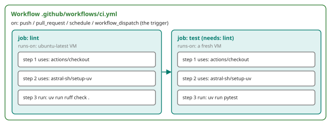

**Concept: `uses` vs. `run`, and pinning versions**

`run` executes your own command. `uses` executes someone else's code
(an action), so pin it to a version. `@v7` is a **moving** major tag
that receives fixes; `@v10.3.3` is an exact release. Some projects,
like `setup-uv`, no longer publish major tags, so you must name an
exact version. The most secure option is to pin the full commit SHA
(Level 5). The versions in this book were current in November 2026;
check each action's README for newer ones.

**Interview tip: `actions/setup-python`**

Most projects you will meet use `actions/setup-python@v7` with
`python-version: "3.12"` and then `pip install -r requirements.txt`.
It works the same way; `setup-uv` simply does both jobs (Python and
packages) and is faster.

### Five more things you need in almost every workflow

*common step options:*

```yaml
    steps:
      - uses: actions/checkout@v7
      - name: Show where we are            # 1. a readable name in the UI
        run: |                             # 2. several commands
          python --version
          echo "Triggered by $GITHUB_EVENT_NAME on $GITHUB_REF_NAME"
      - name: Train
        working-directory: ./training      # 3. run in a subfolder
        env:                               # 4. env vars for this step
          SAMPLE_FRAC: "0.1"
        run: uv run python train.py
      - name: Upload logs only if something failed
        if: failure()                      # 5. conditional step
        uses: actions/upload-artifact@v7
        with:
          name: training-logs
          path: training/logs/
```

`run: |` is YAML for a multi-line string; each line is one shell
command. GitHub sets many variables automatically (`GITHUB_SHA`,
`GITHUB_REF_NAME`, `GITHUB_EVENT_NAME`, `RUNNER_OS`, …); the same
values are available as expressions (`${{ github.sha }}`). A step
with `if: failure()` runs only when an earlier step failed: ideal for
collecting logs and reports that explain the failure. `always()` runs
regardless; `success()` is the default.

**What if… my workflow does not start at all?**

**What happens:**  You pushed, but the Actions tab shows nothing.

**Why:**  Go through this checklist; it covers nearly every case:
- The file is not in `.github/workflows/` exactly (a typo such as
`.github/workflow/` is silently ignored) or does not end in
`.yml`/`.yaml`.
- The YAML is invalid. The Actions tab then shows a failed run with an error like `Invalid workflow file: … (Line: 12, Col: 9)`, but only if GitHub could find the file. Indentation with tabs is a common cause.
- The trigger does not match: `branches: [main]` but you pushed to
`feature/x`; or `paths-ignore` matched every changed file.
- The workflow file exists only on your branch: `schedule` and
`workflow_dispatch` use the file on the **default branch**, and the manual button only appears after the file is on `main`.
- Actions are disabled in **Settings → Actions → General**, or the commit message contains `[skip ci]`.

**What you do:**  Validate locally before pushing: `actionlint` (a linter for
workflow files, also available as a pre-commit hook) catches
syntax errors, unknown keys and many expression mistakes.

**What if… my workflow runs twice for every push?**

**What happens:**  Each commit on a PR shows two identical runs.

**Why:**  `on: [push, pull_request]` without filters triggers once for the
push to the branch and once for the pull request.

**What you do:**  Use the pattern from this chapter: `push` only for `main`,
`pull_request` for everything else.

**What if… a command fails, but the step is green?**

**What happens:**  You write `run: uv run pytest | tee pytest.log` to keep a
log file. Tests fail, but the step and the job are green.

**Why:**  A shell pipeline's exit code is that of the **last** command
(`tee`, which succeeded). When you do not set `shell:`, GitHub runs
steps with `bash -e {0}`: it stops on errors, but without
`pipefail`. With an explicit `shell: bash` it uses
`bash --noprofile --norc -eo pipefail {0}`, and the step fails as
it should.

**What you do:**  Set it once for the whole workflow:

```yaml
defaults:
  run:
    shell: bash
```

The same trap exists in any script with pipes: start your shell
scripts with `set -euo pipefail`.

### Push it and watch it run

*terminal:*

```bash
git add .github/workflows/ci.yml
git commit -m "ci: run tests on every push"
git push
```

Open your repository on GitHub, click the **Actions** tab and then the
run. You see the job `test` and, inside, each step with its log. Steps
are collapsible; the first one, **Set up job**, shows the runner image
version, which is useful when something worked yesterday and fails
today.

### A red run, and how to read it

**Try it: Break it on purpose**

In `src/credit_api/gate.py`, change `if new[name] < floor:` to
`if new[name] > floor:`. Commit on a branch, push, and open a pull
request. Within a minute the PR shows a red cross: **CI / test
(pull_request) Failing**.

Click **Details** next to the failing check and expand the red step.
Always read a CI log **from the bottom up**: the summary is at the end.

*expected output:*

```text
FAILED tests/test_gate.py::test_gate_passes_for_good_model
FAILED tests/test_gate.py::test_main_returns_exit_code
==================== 2 failed, 29 passed in 1.9s ====================
Error: Process completed with exit code 1.
```

Then scroll up to the first failure:

*expected output:*

```text
tests/test_gate.py:11: in test_gate_passes_for_good_model
    assert gate.check(new, BASE, FLOORS, max_drop=0.03) == []
E   AssertionError: assert ['roc_auc=0.7...ow floor 0.4'] == []
E     Left contains 2 more items, first extra item:
E     'roc_auc=0.7900 below floor 0.7'
```

The message says a good model (AUC 0.79) was reported as "below floor
0.7", so the comparison is inverted. Reproduce locally with
`uv run pytest tests/test_gate.py`, fix it, push again: the same PR
re-runs automatically and turns green.

**Watch out: Typical first-run failures**

`uv sync --locked` fails with "The lockfile needs to be updated":
you changed `pyproject.toml` but did not commit the new `uv.lock`.
Run `uv lock` and commit. Tests that pass locally but fail in CI
usually depend on something only your laptop has: a file that is
not committed (check `.gitignore`), an environment variable, a
timezone or an absolute path.

### A field guide to red runs

The last lines of a failed log usually identify the category at once.
These are the ones you will meet most:

| Last lines of the log | Cause and fix |
|---|---|
| `ModuleNotFoundError: No module named 'credit_api'` | The package is not installed in the environment pytest runs in. With the `src/` layout, run tests through `uv run` after `uv sync`; with plain pip, `pip install -e .`. |
| `FileNotFoundError: … data/german_credit.csv` | The file is in `.gitignore` or was never committed. `git ls-files data/` shows what Git actually has. |
| `ERROR: … no tests ran` / exit code 5 | pytest found no tests: wrong folder, or files not named `test_*.py`. Exit code 5 fails the job, which is good. |
| `Error: Process completed with exit code 137.` | The runner killed the process: out of memory. Train on a smaller sample in CI, or use a larger runner. |
| `The job running on runner … has exceeded the maximum execution time of 10 minutes.` | Your `timeout-minutes` hit. Often a test waiting forever for a network service, or a prompt waiting for input (`apt-get install` without `-y`). |
| Passes on re-run without changes | A **flaky** test: randomness without a seed, timing (`sleep`), test order, or an external service. Fix it at once; a team that gets used to "just re-run" stops trusting red builds. |

**Try it: Read logs faster from the terminal**

With the GitHub CLI: `gh run list` shows recent runs, `gh run view
--log-failed` prints **only the failed steps' logs**, and `gh run
rerun --failed` re-runs only the failed jobs. For more detail,
re-run in the UI with **Enable debug logging**, which prints every
internal step of the runner and of the actions.

### The CI badge

A badge in the README shows the status of the last run on `main`. In
the Actions tab, open the workflow, click **…** → **Create status badge**,
or write it yourself:

*README.md:*

```markdown
# credit-api


```

The badge is small, but recruiters and interviewers notice it: it
shows at a glance that your portfolio project is tested automatically
and currently green.

**Exercise: A test for the schema**

Add a parametrized test to `tests/test_api.py` that sends three
invalid requests (negative `credit_amount`, `duration` of 200, a
missing `purpose`) and asserts status 422 for each.

**Exercise: Trigger on a schedule**

Make the Level 1 workflow also run every night at 04:00 UTC and add a
manual "Run workflow" button. (Hint: `schedule` and
`workflow_dispatch`.)

**Exercise: Find the order dependence**

Add a test at the end of `tests/test_api.py` that sets
`df["age"] = 0` on the session fixture **without** copying it. Run the whole suite and then
only `tests/test_data.py`. Which tests fail, and why only in one
case? Fix the test.

**Exercise: The pipe trap**

Add a step `run: uv run pytest | tee pytest.log` and break a test.
Confirm that the job stays green. Then add `defaults: run: shell:
bash` and confirm that it turns red.

**Checkpoint: you should now be able to…**

- create a project with `uv`, commit `uv.lock`, run `uv run pytest`;
- write tests with fixtures, `parametrize` and `pytest.raises`;
- compare floats with `pytest.approx`, write fixtures with teardown, and explain why a test can fail only in the full suite;
- write behavioural tests for a model (baseline, skew, leakage, stability);
- debug a workflow that does not start, runs twice, or stays green although a command failed;
- explain `on`, `jobs`, `runs-on`, `steps`, `uses` and `run`;
- find the cause of a red run by reading the log bottom-up;
- show the CI status with a README badge.


## 7. Lint, cache & matrix

*Chapter 4 · Level 2: Solid CI.* A pipeline that only runs tests is a start. A **solid** CI pipeline also enforces style and types, tests several Python versions, measures coverage, protects `main`, handles secrets safely, and does all of that quickly and cheaply.

**After this level you can:**

- Lint and format with ruff, type-check with mypy, and run both locally with pre-commit hooks.
- Cache dependencies, use a matrix build and enforce a coverage threshold.
- Configure branch protection with required checks, and walk a PR end to end.
- Use secrets and variables correctly, and know what never to commit.
- Make pipelines faster and cheaper with concurrency, path filters and timeouts.

**What you build:** A three-job CI workflow (lint → test matrix → model gate) that is required for every merge into a protected `main`.

### Linting, formatting and type checking

**Linting** finds likely bugs and bad patterns without running the code:
unused imports, undefined names, mutable default arguments. **Formatting**
rewrites code into one consistent style, so diffs show logic changes,
not whitespace. **Type checking** verifies that functions are called with
the types they declare.

**ruff** does linting and formatting, and is fast enough to run on every
keystroke. **mypy** is the reference type checker (**pyright** is a popular
alternative, used by VS Code's Pylance). Both are configured in
`pyproject.toml`:

*pyproject.toml:*

```toml
[tool.ruff]
line-length = 79
target-version = "py312"

[tool.ruff.lint]
select = ["E", "F", "I", "B", "UP", "SIM"]

[tool.mypy]
python_version = "3.12"
strict = true
ignore_missing_imports = true
```

`select` enables rule families: `E`/`F` (pycodestyle and pyflakes
basics), `I` (sorted imports), `B` (bugbear: likely bugs), `UP`
(modern syntax) and `SIM` (simplifications). `strict = true` makes mypy
require type hints everywhere in `src/`; `ignore_missing_imports`
silences libraries such as scikit-learn that ship without type
information.

*terminal:*

```bash
uv run ruff check .          # report problems
uv run ruff check --fix .    # fix what can be fixed automatically
uv run ruff format .         # reformat all files
uv run mypy src              # type-check the package
```

#### Worked example: what ruff and mypy actually find

Here is a small, plausible piece of feature-engineering code with four
bugs and bad habits hidden in it:

*features.py:*

```python
import os
import pandas as pd

def add_ratio(df: pd.DataFrame, cols=[]) -> pd.DataFrame:
    for c in cols:
        df[c + "_ratio"] = df[c] / df["credit_amount"]
    return df

def threshold(name: str) -> float:
    if name == "strict":
        return 0.7
    elif name == "default":
        return 0.5

def load(path):
    try:
        return pd.read_csv(path)
    except Exception:
        raise ValueError("cannot read")
```

With `credit-api`'s configuration, the two tools report (real output):

*expected output:*

```text
$ uv run ruff check --output-format concise features.py
features.py:1:1: I001 [*] Import block is un-sorted or un-formatted
features.py:1:8: F401 [*] `os` imported but unused
features.py:5:38: B006 Do not use mutable data structures for argument
  defaults
features.py:22:9: B904 Within an `except` clause, raise exceptions with
  `raise ... from err` or `raise ... from None` ...
Found 4 errors.
[*] 2 fixable with `--fix` (1 unsafe fix available with `--fix
  --unsafe-fixes`).

$ uv run mypy --strict features.py
features.py:5: error: Function is missing a type annotation for one or
  more parameters  [no-untyped-def]
features.py:11: error: Missing return statement  [return]
features.py:18: error: Function is missing a type annotation
  [no-untyped-def]
Found 3 errors in 1 file (checked 1 source file)
```

Two of these are real bugs, not style:

- **B006, mutable default.** `cols=[]` creates **one** list when the function is defined, shared by every call. Append to it once and every later call sees the change. Use `cols: list[str] | None = None`.
- **mypy `[return]`.** `threshold("lenient")` falls off the end and returns `None`. Somewhere later, `proba >= None` raises a
`TypeError` in production. Note that **ruff** did not catch this one and **mypy** did not catch the mutable default: the tools complement each other.
- **B904** is about debugging: without `from err` the original exception (which file? which line of the CSV?) is hidden from the traceback.

`[*]` marks automatic fixes; "unsafe" fixes might change behaviour, so
ruff only applies them with `--unsafe-fixes`. To silence one finding
on purpose, add `# noqa: B006` on the line, with a comment why. To
switch a rule off for a folder, use `[tool.ruff.lint.per-file-ignores]`
(for example, allow `assert` in `tests/`).

**What if… I turn on ruff in an old project and get 2,000 errors?**

**What happens:**  Nobody can merge anything until all are fixed, and a PR that
fixes 2,000 lines cannot be reviewed.

**What you do:**  Introduce tools in steps, each in its own PR:
1. **Format first**, in one commit that changes nothing else (`ruff format .`). Add its SHA to a file `.git-blame-ignore-revs`; GitHub and `git blame --ignore-revs-file` then skip it, so `blame` still shows who wrote each line.
1. Enable only rules that catch **bugs** (`F`, `B`), fix them, then add more rule families later.
1. For the rest, `ruff check --add-noqa` writes a `# noqa` comment on every current violation. New code must be clean; the old violations are visible and can be removed over time.
1. For mypy, start without `strict` and enable it per module:
`[[tool.mypy.overrides]]` with `module = "credit_api.gate"` and
`strict = true`.

**Concept: Why types matter in ML code**

Most production bugs in ML services are not in the model but in the
glue: a function that returns `None` on one path, a `str` where a
`float` was expected. mypy finds these before a user does. In
`credit_api.promote` it found exactly that: `run_id` may be `None`,
which would have crashed the weekly retraining job at 03:00.

#### pre-commit: the same checks before every commit

CI tells you about a problem after you pushed. **pre-commit** runs the
checks before the commit is even created, so they are cheap to fix:

*.pre-commit-config.yaml:*

```yaml
# Install once with:  uv run pre-commit install
repos:
  - repo: https://github.com/pre-commit/pre-commit-hooks
    rev: v6.0.0
    hooks:
      - id: trailing-whitespace
      - id: end-of-file-fixer
      - id: check-yaml
      - id: check-added-large-files
        args: ["--maxkb=1000"]
      - id: detect-private-key
  - repo: https://github.com/astral-sh/ruff-pre-commit
    rev: v0.17.4
    hooks:
      - id: ruff-check
        args: [--fix]
      - id: ruff-format
  - repo: https://github.com/pre-commit/mirrors-mypy
    rev: v2.4.1
    hooks:
      - id: mypy
        files: ^src/
        additional_dependencies: [pydantic, pandas-stubs]
```

*terminal:*

```bash
uv run pre-commit install         # once per clone: adds a git hook
uv run pre-commit run --all-files # run every hook on every file
```

From now on, `git commit` runs the hooks on the staged files. If a hook
fails or changes a file (e.g. the formatter), the commit is stopped;
you `git add` the fixed files and commit again. `detect-private-key`
(line 10) blocks the classic accident of committing an SSH or TLS key.

**What if… a hook changes my files and the commit is refused?**

**What happens:**  `git commit` prints something like
`ruff format.......Failed`, `- hook id: ruff-format`,
`- files were modified by this hook`, and no commit is created.

**Why:**  The formatter fixed your files **after** you staged them, so the
staged version is still unformatted. pre-commit refuses to commit
something different from what is now on disk.

**What you do:**  This is the intended workflow, not an error: look at the
changes (`git diff`), `git add` them, and commit again. If a hook
fails without changing anything (mypy, `detect-private-key`), read
its message and fix the code. `SKIP=mypy git commit …` skips one
hook in an emergency; CI still runs it.

**Watch out: pre-commit does not replace CI**

Hooks can be skipped (`git commit --no-verify`) and only run on
machines where someone installed them. CI is the **enforcement**;
pre-commit is the **convenience**. Run the same tools with the same
versions in both places, or you will see "passes locally, fails in
CI" confusion.

### Faster, broader, measured: cache, matrix, coverage

**Caching.** Every job starts on a fresh VM, so dependencies would be
downloaded every time. `setup-uv` with `enable-cache: true` stores uv's
package cache keyed on `uv.lock` and restores it in later runs. When
the lock file changes, the key changes and the cache is rebuilt. For
other things there is the general `actions/cache@v6`, which you will
use in Level 4 to cache an embedding model.

**Matrix builds.** A library or service should be tested on every Python
version it claims to support. A matrix runs the same job once per
combination of values:

*matrix (excerpt from ci.yml):*

```yaml
  test:
    needs: lint
    runs-on: ubuntu-latest
    strategy:
      fail-fast: false           # let all versions finish
      matrix:
        python-version: ["3.12", "3.13"]
    steps:
      - uses: actions/checkout@v7
      - uses: astral-sh/setup-uv@v10.3.3
        with:
          enable-cache: true
          python-version: ${{ matrix.python-version }}
```

**Concept: How the cache really works**

A cache entry has a **key** (`setup-uv` builds it from the OS, the
Python version and a hash of `uv.lock`). On restore, an exact key
match is a **hit**; otherwise a **restore key** prefix may give a
**partial** hit (an older cache, still useful). Caches are
**immutable**: an existing key is never overwritten, so a new cache is
only saved when the key changes. And caches are **scoped by branch**:
a PR can read caches created on `main`, but `main` never reads a
PR's cache, and two PRs cannot see each other's. That is why the
first run of every new branch is fast only if `main` has a warm
cache. Each repository gets 10 GB; the least recently used entries
are evicted.

**What if… CI keeps using an old, broken dependency from the cache?**

**What happens:**  You fixed a dependency, but CI behaves as if the old one is
installed.

**Why:**  Usually it isn't the cache. With `uv sync --locked`, the
environment is built from `uv.lock`, and the cache only stores
downloaded files. If the lock file did not change, you did not
change the dependency. A **hand-written** `actions/cache` step with a
key that does not include the right file hash (say, a key of just
`deps-${{ runner.os }}`) really can restore a stale folder forever.

**What you do:**  Put the hash of every input into the key
(`hashFiles('uv.lock')`). To throw caches away: **Actions → Caches**
in the UI, or `gh cache delete --all`.

`${{ … }}` is an **expression**: GitHub replaces it before the step runs.
The matrix can have several dimensions (`os: [ubuntu-latest,
windows-latest]` × versions = four jobs). `fail-fast: false` is useful
because you want to know **which** versions fail, not only that one did.

**Coverage** measures which lines your tests executed. `pytest-cov` adds
it to pytest; `fail_under = 80` in `pyproject.toml` makes the run fail
when coverage drops below 80 %:

*terminal:*

```bash
uv run pytest --cov --cov-report=term --cov-report=xml
```

*expected output:*

```text
Name                           Stmts   Miss  Cover   Missing
src/credit_api/app.py             33      1    97%   43
src/credit_api/train.py           47     22    53%   54-60, 71-86, 90
...
TOTAL                            166     25    85%
Required test coverage of 80.0% reached. Total coverage: 84.94%
```

The `Missing` column tells you exactly which lines no test touches.
The XML report is uploaded as an **artefact** (`actions/upload-artifact`)
so you can download it from the run page, or feed it to a service such
as Codecov that comments coverage changes on each PR.

**What if… my PR is well tested, but total coverage fails?**

**What happens:**  You add a 60-line training utility with three tests, and
the build fails with `FAIL Required test coverage of 80.0% not reached.
Total coverage: 79.40%`.

**Why:**  The floor applies to the **whole** project. Your new file is,
say, 70 % covered and pulls the average below the line, although
your PR is **better** tested than parts of the old code.

**What you do:**  Look at `Missing` for your file and test the important
branches, not every line. Exclude code that cannot run in unit tests
explicitly (`omit` in `pyproject.toml`, as we do for the MLflow
scripts, or `# pragma: no cover` on a single block) and say why in
the PR. In larger teams, **diff coverage** (tools: `diff-cover`,
Codecov's patch coverage) asks "are the lines **this PR changed**
covered?", which is the fairer question.

**Interview tip**

"Coverage is a smoke detector, not a goal. I enforce a floor so it
cannot silently drop, but I care more about whether the risky code,
data handling, the API contract and the gate logic, is tested."

### The complete CI workflow

Here is the workflow the repository uses from now on. The `model-gate`
job is explained in Level 4; until then you can delete lines 53–73
and remove `model-gate` from the `needs:` list in line 78.

*.github/workflows/ci.yml:*

```yaml
name: CI

on:
  push:
    branches: [main]
  pull_request:
    paths-ignore: ["**.md", "docs/**"]

# Cancel an older run of the same PR when a new commit arrives
concurrency:
  group: ci-${{ github.workflow }}-${{ github.ref }}
  cancel-in-progress: ${{ github.event_name == 'pull_request' }}

permissions:
  contents: read

jobs:
  lint:
    runs-on: ubuntu-latest
    timeout-minutes: 10
    steps:
      - uses: actions/checkout@v7
      - uses: astral-sh/setup-uv@v10.3.3
        with:
          enable-cache: true
      - run: uv sync --locked
      - run: uv run ruff check .
      - run: uv run ruff format --check .
      - run: uv run mypy src

  test:
    needs: lint
    runs-on: ubuntu-latest
    timeout-minutes: 15
    strategy:
      fail-fast: false
      matrix:
        python-version: ["3.12", "3.13"]
    steps:
      - uses: actions/checkout@v7
      - uses: astral-sh/setup-uv@v10.3.3
        with:
          enable-cache: true
          python-version: ${{ matrix.python-version }}
      - run: uv sync --locked
      - name: Run tests with coverage
        run: uv run pytest --cov --cov-report=xml --cov-report=term
      - uses: actions/upload-artifact@v7
        with:
          name: coverage-${{ matrix.python-version }}
          path: coverage.xml

  model-gate:
    needs: test
    runs-on: ubuntu-latest
    timeout-minutes: 15
    steps:
      - uses: actions/checkout@v7
      - uses: astral-sh/setup-uv@v10.3.3
        with:
          enable-cache: true
      - run: uv sync --locked
      - name: Train on the full data set
        run: uv run python -m credit_api.train
      - name: Quality gate (fails the build if metrics drop)
        run: uv run python -m credit_api.gate metrics/metrics.json
      - name: Show metrics in the run summary
        if: always()
        run: |
          echo "### Model metrics" >> "$GITHUB_STEP_SUMMARY"
          echo '```json' >> "$GITHUB_STEP_SUMMARY"
          cat metrics/metrics.json >> "$GITHUB_STEP_SUMMARY"
          echo '```' >> "$GITHUB_STEP_SUMMARY"

  # The one check to require in the branch ruleset (see Level 2)
  ci-ok:
    if: always()
    needs: [lint, test, model-gate]
    runs-on: ubuntu-latest
    steps:
      - name: Fail if any dependency failed or was cancelled
        if: >-
          contains(needs.*.result, 'failure') ||
          contains(needs.*.result, 'cancelled')
        run: exit 1
```

Lines 3–7: run on pushes to `main` and on PRs, but skip PRs that only
change Markdown. Lines 10–12: **concurrency** (next section). Lines
14–15: the default `GITHUB_TOKEN` of this workflow may only read the
repository (least privilege). Line 20: `timeout-minutes` kills a hung
job after ten minutes instead of the default six hours. Line 32:
`needs: lint` means the test matrix only starts if lint passed: fail
fast, save minutes. Lines 75–85: the `ci-ok` job, which summarises
all others into one check; the what-if in the next section explains
why it exists.


## 8. Protected PRs & secrets

### Branch protection and the PR workflow

Now make CI **mandatory**. In your repository: **Settings → Rules →
Rulesets → New branch ruleset**. Target the default branch and enable:

- **Restrict deletions** and **Block force pushes**.
- **Require a pull request before merging**, with 1 required approval (for a solo portfolio project you can set 0 approvals but still require the PR).
- **Require status checks to pass**: add `ci-ok`. (You could list
`lint`, `test (3.12)`, `test (3.13)` and `model-gate` one by one; the first what-if below shows why one aggregator is better.) A check name only appears in the list after it has run at least once.
- **Require branches to be up to date before merging**: the PR must contain the latest `main`, so CI tested the real combination.

(The older **Settings → Branches → Branch protection rules** page does
the same; rulesets are the newer, more flexible version.)

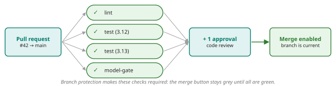

The full PR workflow, end to end:

*terminal:*

```bash
git switch main && git pull
git switch -c feat/validate-age
# ... edit code and tests ...
uv run pytest && git commit -am "feat: reject applicants under 18"
git push -u origin feat/validate-age
gh pr create --fill               # or open the PR in the browser
gh pr checks --watch              # watch CI from the terminal
# after approval and green checks:
gh pr merge --squash --delete-branch
```

**What if… a required check shows "Expected — Waiting for status to be reported" forever?**

**What happens:**  The PR cannot be merged. All runs are green, but one
required check stays yellow, and nothing is running.

**Why:**  Required checks are matched **by name**. The matrix creates names
such as `test (3.12)`. If you change the matrix to 3.13 and 3.14,
the job `test (3.12)` never runs again, but the ruleset still waits
for it. The same happens when a path filter skips the whole workflow
or an `if:` skips a required job (a skipped job counts as passed,
but a workflow that never **started** reports nothing).

**What you do:**  Do not make every matrix job required. Add one small
**aggregator** job that depends on everything and require only that:

```yaml
  ci-ok:
    if: always()                 # run even if a dependency failed
    needs: [lint, test, model-gate]
    runs-on: ubuntu-latest
    steps:
      - name: Fail if any dependency failed or was cancelled
        if: >-
          contains(needs.*.result, 'failure') ||
          contains(needs.*.result, 'cancelled')
        run: exit 1
```

Now you can change the matrix freely; the ruleset only knows
`ci-ok`. The `if: always()` is essential: without it, `ci-ok` would
be **skipped** when a dependency fails, and skipped counts as success.

**What if… the team is busy and "require up to date" becomes a race?**

**What happens:**  Five PRs are approved. You update yours with `main`, wait
six minutes for CI, and just before you click merge somebody else
merges. Your PR is out of date again. Repeat.

**Why:**  "Up to date" guarantees that CI tested the exact combination,
but it serialises the team on **your** attention.

**What you do:**  A **merge queue** (**Rulesets → Require merge queue**). You click
"Merge when ready"; GitHub builds a temporary branch with `main` +
the PRs ahead of yours + yours, runs CI on it, and merges if it is
green. Workflows must listen to the queue's event, or the queue
waits forever:

```yaml
on:
  pull_request:
  merge_group:        # run CI on the merge queue's temporary branch
```

### Secrets and variables

Sooner or later CI needs credentials: an API key for an LLM, a token for
a tracking server. **Never put them in the code or the workflow file.**
GitHub stores them encrypted: **Settings → Secrets and variables →
Actions**.

| Kind | Use for | In a workflow |
|---|---|---|
| Secret | Passwords, API keys, tokens. Write-only in the UI and masked as `***` in logs. | `${{ secrets.ANTHROPIC_API_KEY }}` |
| Variable | Non-secret configuration: region, role ARN, URLs. Visible in the UI. | `${{ vars.AWS_ROLE_ARN }}` |
| Environment secret/variable | Values that differ per environment (staging vs. production) and can be protected by approvals (Level 3). | same syntax, inside a job with `environment:` |
| `GITHUB_TOKEN` | Automatic, short-lived token for the GitHub API in this repository; scope it with `permissions:`. | `${{ secrets.GITHUB_TOKEN }}` |

Pass secrets to the step that needs them, as environment variables:

*using a secret:*

```yaml
      - name: Faithfulness eval
        env:
          ANTHROPIC_API_KEY: ${{ secrets.ANTHROPIC_API_KEY }}
        run: uv run python eval/run_eval.py --faithfulness
```

**Watch out: What never to commit, and what to do if you did**

Never commit `.env` files, cloud access keys, private keys, notebook
outputs containing credentials, or data with personal information
(GDPR!  (*DSGVO*)). Add them to `.gitignore` before the first commit.
If a secret was pushed, **deleting the file is not enough**: it stays in
Git history and bots scan public GitHub within minutes. Revoke and
rotate the key immediately, then clean history if needed. GitHub's
**secret scanning** and **push protection** (free for public repos) block
many known key formats on push; turn them on in **Settings → Code
security**.

Secrets are not passed to workflows triggered by pull requests from
**forks**, because anybody could open such a PR and print them. Keep this
in mind for open-source projects: expensive or credentialed jobs run
on `push` to `main` or behind a label set by a maintainer, a pattern
you will use for the LLM evaluation in Level 4.

**What if… a secret appears in the log in plain text after all?**

**What happens:**  Masking replaces the **exact** secret string with `***`. Your
step prints it base64-encoded, URL-encoded, or split across two
lines, and the transformed value is visible to anyone who can read
the logs.

**What you do:**  Never print secrets, not even "to debug". If a step **derives** a
sensitive value (a token fetched at runtime), register it for
masking before it is used: `echo "::add-mask::$TOKEN"`. If one
leaked: rotate it, then delete the run's logs (run page → **…** →
**Delete all logs**).

**What if… I switch to `pull_request_target` so fork PRs get secrets?**

**What happens:**  It works, and it is one of the most exploited GitHub
Actions mistakes ("pwn request").

**Why:**  `pull_request_target` runs in the context of the **base**
repository, with secrets and a write token. If the workflow then
checks out and runs the PR's code (`ref: ${{
github.event.pull_request.head.sha }}` followed by `pip install` or
`pytest`), the stranger's code runs with your secrets. A `conftest.py`
in the PR is enough to send them to the attacker.

**What you do:**  Use `pull_request` for anything that runs PR code. Use
`pull_request_target` only for tasks that never execute the PR's
code (labelling, commenting). For paid evaluations of fork PRs, let
a maintainer run them after reading the code.

**What if… my Dependabot PRs fail because secrets are empty?**

**What happens:**  PRs opened by Dependabot run CI, but every step that uses a
secret fails as if the secret did not exist.

**Why:**  For safety, workflows triggered by Dependabot do not receive
Actions secrets. They get **Dependabot secrets**, a separate store
(**Settings → Secrets and variables → Dependabot**).

**What you do:**  Make unit tests independent of secrets (fakes, as in Level 4),
and add a Dependabot secret only where a dependency PR truly needs
one.

#### Keeping dependencies fresh: Dependabot

A lock file freezes versions, which is good for reproducibility and
bad for security: vulnerabilities in old versions stay. **Dependabot**
opens PRs that update dependencies; CI then tells you whether the
update is safe to merge. It understands `uv.lock` and your workflow
files:

*.github/dependabot.yml:*

```yaml
version: 2
updates:
  - package-ecosystem: "uv"
    directory: "/"
    schedule: {interval: "weekly"}
    groups:                       # one PR for all minor/patch updates
      minor-and-patch:
        update-types: ["minor", "patch"]
  - package-ecosystem: "github-actions"   # bumps actions/checkout@v7 ...
    directory: "/"
    schedule: {interval: "monthly"}
```

This is where your test suite pays off a second time: a good suite
lets you merge a "bump scikit-learn" PR in one minute. Without one,
nobody dares, and the project ages until an upgrade becomes a
project of its own.

### Speed and cost

GitHub Actions is free for public repositories. For private ones,
GitHub Free includes 2,000 Linux minutes per month (check the current
plan details), and wasted minutes add up quickly in a team. The levers:

- **Concurrency groups.** `concurrency: group: ci-${{ github.ref }}` with
`cancel-in-progress: true` cancels the still-running pipeline of a PR when you push a new commit: nobody needs the result for an outdated commit. Our file only cancels on PRs; runs on `main` always finish.
- **Path filters.** `paths:` / `paths-ignore:` skip workflows when irrelevant files change (docs, README). Careful: a **required** check that is skipped by a path filter can block merging. Either keep required workflows unfiltered or filter at the job level.
- **Job dependencies.** Cheap jobs first (`lint` takes 15 seconds), expensive ones only if those pass (`needs:`).
- **Caching** and **timeouts**, as above.
- **Right-size the matrix.** Test all versions on PRs to `main`, but not necessarily all operating systems; nightly runs can cover the rest.

### Testing strategy at scale

Everything so far fits one repository and one person. In a team of
thirty with a dozen models, the questions change from "how do I write
a test?" to "which tests run where, how long may they take, and who
owns them?". A senior engineer can draw this on a whiteboard:

| Layer | Examples in this book | Budget | Runs on |
|---|---|---|---|
| Static checks | ruff, mypy, actionlint, secret scan | < 1 min | every push |
| Unit tests | `test_gate.py`, behavioural tests with a tiny model | < 3 min | every push |
| Data and model | data contract, train on a sample, metric gate | < 10 min | every PR |
| Integration | pgvector test, API against a real database | < 10 min | PR (paths) and `main` |
| Full evaluation | full-data training, LLM faithfulness, slices | < 60 min | `main`, nightly |
| Post-deploy | smoke test, distribution check, load test | < 10 min | after each deploy |

The budgets are the point: a layer that exceeds its budget moves down a
row (runs less often) or gets faster. Four practices keep this working
in a team:

- **Contract tests between services.** When another team calls
`/predict`, write down what they rely on (fields, types, status codes) as a test that runs in **your** CI. Tools such as Pact automate this between repositories; a JSON schema checked in both repos is the lightweight version. It turns "expand, then contract" (Chapter 5) from a promise into a check.
- **A load test with a gate.** A short k6 or Locust run against staging that fails if p95 latency exceeds the SLO (Chapter 7). Ten minutes of load after deploy catches the memory leak and the missing index that unit tests never will.
- **A flaky-test policy.** A test that fails without a code change gets a
`flaky` label, an owner and a deadline; it is **quarantined** (skipped in the required check, still run and reported elsewhere) until fixed. Without a policy, "re-run until green" becomes the culture and the required check means nothing.
- **Ownership.** `CODEOWNERS` makes the right people review changes to thresholds, evaluation sets, infrastructure and workflows. In
`credit-api`, `.github/CODEOWNERS` assigns `metrics/`, `gate.py`,
`infra/` and the workflows; combined with the ruleset option **Require review from Code Owners**, nobody lowers a quality gate without the owner's approval.

**Interview tip**

"I'd draw the test pyramid with a time budget per layer, and
enforce the budgets: if the unit tests take longer than three
minutes, that is a bug. Contract tests protect our consumers, a
short load test protects the SLO, and flaky tests get quarantined
with an owner, never re-run until green."

**Exercise: Add an OS dimension**

Extend the matrix to run the tests on `ubuntu-latest` and
`macos-latest` for Python 3.12 only, using `include:`. How many jobs
run now? Why might macOS minutes be more expensive on private
repositories?

**Exercise: Protect yourself**

Create the ruleset described above on your `credit-api` repository.
Then open a PR that breaks `ruff format --check` and confirm that
GitHub refuses to merge it.

**Exercise: Prove the aggregator**

With `ci-ok` as the only required check, (a) change the matrix to
`["3.13", "3.14"]` and confirm the PR can still be merged, and
(b) remove `if: always()` from `ci-ok`, break a test, and look at
what `ci-ok` reports. Why is (b) dangerous?

**Exercise: Read the linters**

Copy `features.py` from this chapter into `credit-api/src/credit_api/`,
run ruff and mypy, and fix every finding by hand (no `--fix`). Which
fix changes the behaviour of the code?

**Checkpoint: you should now be able to…**

- run ruff, mypy and pytest locally and via pre-commit;
- explain the bugs behind B006 and mypy's `[return]` error, and introduce linters into a legacy codebase step by step;
- require one aggregator check instead of matrix job names, and explain merge queues and `merge_group`;
- recognise the `pull_request_target` trap and unmasked transformed secrets;
- explain caching, matrix builds and the coverage threshold;
- make checks required with a branch ruleset and merge a PR end to end;
- store and use secrets and variables, and react to a leaked key;
- reduce CI time and cost with concurrency, path filters, `needs` and timeouts.


## 9. AWS setup & Docker

*Chapter 5 · Level 3: Continuous Delivery to AWS.* Now the pipeline stops being only a judge and becomes a delivery truck. Every merge to `main` builds a Docker image, pushes it to AWS without any stored password, deploys it to staging, tests it, and waits for your approval to go to production.

**After this level you can:**

- Set up an AWS account safely: root MFA, an admin user via IAM Identity Center, budget alarms, region `eu-central-1`.
- Write a production-quality Dockerfile for a Python service.
- Authenticate GitHub Actions to AWS with OIDC and explain the trust policy line by line.
- Deploy to ECS Express Mode (Fargate) with staging → production, manual approval, smoke tests and rollback.
- Delete everything again so you are not billed.

**What you build:** `deploy.yml`: merge → image in ECR tagged with the git SHA → staging → smoke test → approval → production → smoke test; plus a one-click rollback workflow.

### AWS account setup: security and cost first

**Watch out: Do this section before anything else**

A new AWS account is a credit card connected to the internet.
Leaked keys are found by bots within minutes and used for crypto
mining. The four steps below take 30 minutes and prevent almost all
horror stories.

**1. Create the account** at `aws.amazon.com` (you need a credit card and
a phone). AWS changed its free tier in 2025: new accounts receive
credits and choose between a free and a paid account plan. Read the
current terms during sign-up; credits do not replace budget alarms.

**2. Protect the root user.** The e-mail address you signed up with is
the **root user**: it can do everything, including closing the account.
In the console: account menu → **Security credentials** → **Assign MFA
device**. Use a passkey/security key or an authenticator app. Then stop
using root for daily work, and never create access keys for it.

**3. Create your everyday admin user with IAM Identity Center.** Open
**IAM Identity Center** (choose region `eu-central-1`, Frankfurt), click
**Enable**. Then: **Users → Add user** (your name and e-mail) → **Permission
sets → Create** → predefined **AdministratorAccess** → **AWS accounts** →
select your account → **Assign users** → your user + the permission set.
You get an e-mail with an **AWS access portal** URL. Log in there from now
on, with MFA. On your laptop, install the AWS CLI v2 and connect it:

*terminal:*

```bash
aws configure sso          # asks for the portal URL and region
#   SSO start URL:  https://d-xxxxxxxxxx.awsapps.com/start
#   SSO region:     eu-central-1
#   profile name:   admin
export AWS_PROFILE=admin   # put this in your ~/.zshrc
aws sso login              # opens the browser; valid for some hours
aws sts get-caller-identity
```

The CLI now uses **short-lived** credentials that expire after a few
hours. There is no long-lived access key on your laptop that could
leak.

**4. Budget alarms.** **Billing and Cost Management → Budgets → Create
budget → Use a template → Monthly cost budget**. Create one budget of
**10 USD** and a second of **25 USD**, each sending e-mails at 80 % of the
actual cost and at 100 % of the **forecasted** cost. Also enable **Cost
Anomaly Detection** (same console, free), which mails you when spending
jumps unexpectedly.

**What if… the 10-dollar budget e-mail arrives?**

**What happens:**  "AWS Budgets: Monthly 10 USD has exceeded your alert
threshold". Budgets are an **alarm**, not a **brake**: AWS does not stop
anything, and the cost data behind them is updated only a few times
per day, so the real spend is already higher than the e-mail says.

**What you do:**  Find the cause in this order. (1) **Billing → Bills**, expand by
service and region: which service, where? (2) **Cost Explorer**,
grouped by **Usage type**: for example `EUC1-LoadBalancerUsage` is an
ALB in Frankfurt running by the hour, `PublicIPv4:InUseAddress` are
public IPs. (3) Delete the resource; for this book, `bash
infra/cleanup.sh`. (4) Check **other regions**: a service created by
mistake in `us-east-1` is invisible while the console shows
Frankfurt.

**What if… I lose the phone with my root MFA?**

**What you do:**  Register **two** MFA devices for root from the start (AWS allows
several), for example a hardware key plus an authenticator app, and
keep one in a drawer. Without any device, AWS has a recovery process
that verifies the root e-mail address and the account's phone
number: it works, but takes time. Keep both up to date.

**Concept: Why `eu-central-1` (Frankfurt)**

A **region** is a set of AWS data centres in one place. Choose the one
closest to your users and your legal requirements. For a German
company, Frankfurt means low latency and data that stays in the EU,
which simplifies GDPR discussions. Many AWS resources are regional:
if you cannot find something in the console, check the region
selector at the top right first.

### Docker for the app

A **container image** is a packaged file system with your code, the
Python interpreter and every library, plus the command to start it.
A **container** is a running instance of an image. Because the image
contains everything, it runs the same on your laptop, in CI and on AWS.
An image is built from a `Dockerfile` in **layers**; each instruction
creates one, and unchanged layers are reused from cache.

*Dockerfile:*

```dockerfile
# syntax=docker/dockerfile:1

# ---------- stage 1: build the virtual environment ----------
FROM python:3.12-slim AS builder
COPY --from=ghcr.io/astral-sh/uv:0.13 /uv /bin/uv
ENV UV_COMPILE_BYTECODE=1 UV_LINK_MODE=copy UV_PYTHON_DOWNLOADS=never
WORKDIR /app
# Dependencies first: this layer is cached until uv.lock changes
COPY pyproject.toml uv.lock ./
RUN uv sync --locked --no-dev --no-install-project
# Then our own code (changes often, so it comes last)
COPY src ./src
RUN uv sync --locked --no-dev --no-editable

# ---------- stage 2: small runtime image ----------
FROM python:3.12-slim
RUN useradd --create-home --uid 10001 app
WORKDIR /app
COPY --from=builder /app/.venv /app/.venv
COPY models/ /app/models/
ENV PATH="/app/.venv/bin:$PATH" \
    PYTHONUNBUFFERED=1 \
    MODEL_PATH=/app/models/model.joblib
USER app
EXPOSE 8080
HEALTHCHECK --interval=30s --timeout=3s CMD python -c \
  "import urllib.request as u; u.urlopen('http://localhost:8080/health')"
CMD ["uvicorn", "credit_api.app:app", "--host", "0.0.0.0", "--port", "8080"]
```

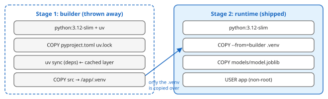

What makes this Dockerfile production-quality:

- **Slim base image** (lines 4, 16): `python:3.12-slim` is Debian with Python and little else. Smaller images download faster, start faster and contain fewer packages with security vulnerabilities.
- **Multi-stage build** (Figure 11): stage 1 has uv and build tools; stage 2 receives only `/app/.venv`. Build tools never reach production.
- **Layer order for caching** (lines 9–13): dependency files are copied and installed **before** the source code. Changing `app.py` reuses the expensive dependency layer; only `uv.lock` changes invalidate it.
- **`--locked`**: the image contains exactly the versions in `uv.lock`, the same ones CI tested.
- **Non-root user** (lines 17, 24): if an attacker breaks into the process, they are not root inside the container.
- **Model baked in** (line 20): the image is a complete, versioned unit. "Image `:3f2a1c0`" means exactly one code version **and** one model.
- **`HEALTHCHECK` and `EXPOSE`** (lines 25–27): document the port and let Docker know if the app is healthy.

The `.dockerignore` file keeps the **build context** small and secret-free:

*.dockerignore:*

```
# Keep the build context small and free of secrets
.git
.github
.venv
**/__pycache__
.pytest_cache
.mypy_cache
.ruff_cache
.coverage
coverage.xml
mlruns
mlflow.db
tests
data
*.md
.env
```

**Try it: Build and run locally**

Install Docker Desktop (or Colima/OrbStack on macOS), then:

*terminal:*

```bash
uv run python -m credit_api.train          # creates models/model.joblib
docker build -t credit-api:dev .
docker run --rm -p 8080:8080 -e APP_VERSION=dev credit-api:dev
# in a second terminal:
curl localhost:8080/health
curl -X POST localhost:8080/predict -H 'Content-Type: application/json' \
  -d '{"checking_status":"<0","duration":24,"credit_history":
  "existing paid","purpose":"new car","credit_amount":4000,
  "savings_status":"<100","employment":"1<=X<4","age":35}'
```

*expected output:*

```text
{"status":"ok","version":"dev","model_version":"local-a7ad9a21934f",
 "data_sha256":"a7ad9a21934f"}
{"risk":"bad","probability_bad":0.6427,
 "model_version":"local-a7ad9a21934f"}
```

(Your probability and hashes will differ if you trained on other data.
The container also prints one JSON log line per request; Chapter 7
explains them.)

**Watch out: Apple Silicon and image architecture**

On an M-series Mac, `docker build` produces an `arm64` image.
Fargate runs `x86_64` by default, where such an image fails to start
with `exec format error`. In our pipeline the image is built on
GitHub's `ubuntu-latest` (x86_64), so this does not happen. If you
push from your laptop, build with `--platform linux/amd64`.

### When the container does not work: a debugging toolkit

| Command | Answers the question |
|---|---|
| `docker logs <container>` (`-f` to follow) | What did the app print before it died? |
| `docker run --rm -it --entrypoint sh credit-api:dev` | What is **actually** in the image? (`ls /app/models`, `whoami`, `env`) |
| `docker exec -it <container> sh` | Look inside a **running** container. |
| `docker inspect <container> --format '{{.State.ExitCode}} {{.State.OOMKilled}}'` | Why did it stop? Exit code, killed for memory? |
| `docker history credit-api:dev` | Which layer makes the image big? |
| `docker run --memory 512m …` | Does it survive with the memory Fargate will give it? |

**What if… the container runs locally but the deployment never becomes healthy?**

**What happens:**  The deploy step waits, then fails; ECS shows tasks starting
and stopping in a loop, with `Task failed ELB health checks`.

**Why:**  Work through the usual suspects:
- The app listens on `127.0.0.1` (uvicorn's default!) instead of
`0.0.0.0`. Inside a container, `127.0.0.1` is reachable only from inside the container itself, so the load balancer can never connect (and neither can `docker run -p` on your laptop: `curl` gets `Connection reset by peer`). The bug hides when you only ever run `uvicorn` directly on your laptop, where `127.0.0.1` is fine. Our `CMD` passes `--host 0.0.0.0` for exactly this reason.
- Port mismatch: the app listens on 8000, the service expects 8080.
- `/health` returns 503 because the model did not load (wrong
`MODEL_PATH`), which is exactly what our health check is designed to report.
- Exit code 137 / `OutOfMemoryError: Container killed due to memory usage`: 512 MB is too little for the model plus pandas. Measure locally with `docker run --memory 512m` and raise `memory`.
- `exec format error`: an `arm64` image on `x86_64` (box above).

**What you do:**  Read the **task's** logs, not only the workflow's: CloudWatch Logs
(**ECS → service → Logs**) or `aws logs tail <log-group> --follow`.
The workflow only knows "unhealthy"; the container's own output says
why.

**What if… the Docker build fails with `"/models/model.joblib": not found`?**

**What happens:**  `COPY models/model.joblib …` fails with `failed to compute
cache key: … "/models/model.joblib": not found`.

**Why:**  `models/` is in `.gitignore`, so a fresh checkout has no model.
Our `deploy.yml` trains the model **before** `docker build` (line 33);
if someone removes or reorders that step, the file is missing.
(The same error appears if `.dockerignore` excludes the path.)

**What you do:**  Keep the train step before the build, and treat the error as
useful: it proves the image can never ship without a model. In a
registry-based setup, this step downloads `@champion` instead of
training (Level 4).

**What if… I need a secret during `docker build` (a private package index)?**

**What happens:**  The tempting `ARG PIP_TOKEN` + `--build-arg PIP_TOKEN=…` works
but stores the token in the image metadata and layers: anyone who can
pull the image can read it with `docker history`.

**What you do:**  Use a **build secret**, which is mounted only for one `RUN` and
never stored: `RUN --mount=type=secret,id=pip_token
PIP_TOKEN=$(cat /run/secrets/pip_token) uv sync …`, built with
`docker build --secret id=pip_token,env=PIP_TOKEN .`. Multi-stage
builds help too: secrets used only in the builder stage never reach
the runtime image.


## 10. Keyless OIDC to AWS

### Keyless authentication: GitHub OIDC → AWS

The pipeline must push images and deploy services, so it needs AWS
permissions. The old way was to create an IAM user, generate an
access key, and store it as a GitHub secret. That key never expires,
and if it leaks, someone else can use your account until you notice.

The modern way is **OpenID Connect (OIDC)**. GitHub can issue each job a
short-lived, signed **ID token** (a JWT) that says "I am a workflow run
of repository X, on branch Y, in environment Z". You tell AWS to trust
tokens from GitHub **under specific conditions**. The job exchanges the
token for temporary AWS credentials that expire after about an hour
(Figure 12).

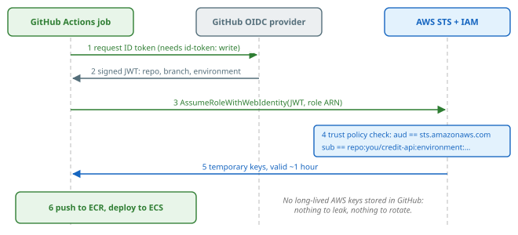

### The trust policy, line by line

Every IAM role has two policies. The **trust policy** answers "who may
assume this role?". We use one template for all our GitHub roles;
`setup.sh` fills in `ACCOUNT_ID`, `GH_OWNER` and `SUBJECT`:

*infra/github-trust-policy.json:*

```json
{
  "Version": "2012-10-17",
  "Statement": [
    {
      "Sid": "GitHubActionsOIDC",
      "Effect": "Allow",
      "Principal": {
        "Federated": "arn:aws:iam::ACCOUNT_ID:oidc-provider/token.actions.githubusercontent.com"
      },
      "Action": "sts:AssumeRoleWithWebIdentity",
      "Condition": {
        "StringEquals": {
          "token.actions.githubusercontent.com:aud": "sts.amazonaws.com",
          "token.actions.githubusercontent.com:sub": "repo:GH_OWNER/credit-api:SUBJECT"
        }
      }
    }
  ]
}
```

| Line | Meaning |
|---|---|
| 7–9 | **Principal**: the identity provider you registered in IAM for `token.actions.githubusercontent.com`. Only tokens signed by GitHub are considered. |
| 10 | **Action**: `sts:AssumeRoleWithWebIdentity` is the STS call that exchanges an OIDC token for credentials. |
| 13 | **Audience** (`aud`): the token must be meant for AWS STS. `configure-aws-credentials` requests exactly this audience. |
| 14 | **Subject** (`sub`): who exactly is calling. A push to `main` gives `repo:you/credit-api:ref:refs/heads/main`; a job that declares `environment: production` gives `repo:you/credit-api:environment:production`. Each role accepts exactly **one** subject; any other repository, fork, branch or environment is rejected. |

**Watch out: The classic OIDC security hole**

Never use a wildcard such as `repo:*` or leave out the `sub`
condition. Then **every** GitHub repository in the world could assume
your role. Keep `sub` as narrow as possible; `StringLike` with
`repo:you/credit-api:*` is the loosest acceptable form.

### The `sub` claim decides everything

Most OIDC problems are a mismatch between the `sub` that GitHub puts
into the token and the list in the trust policy. The format depends on
**how** the job was started, and one rule surprises everybody: **if the
job declares an `environment`, the environment wins** over the branch.

| The job… | gets `sub` = |
|---|---|
| runs on a push to `main`, no environment | `repo:you/credit-api:ref:refs/heads/main` |
| runs on a push to `feature/x` | `repo:you/credit-api:ref:refs/heads/feature/x` |
| runs for a pull request | `repo:you/credit-api:pull_request` |
| runs for a tag push | `repo:you/credit-api:ref:refs/tags/v1.4.0` |
| declares `environment: production`, any trigger | `repo:you/credit-api:environment:production` |

### Three roles, three blast radii

A first version of this pipeline (in the previous edition of this
book) used **one** role that trusted three subjects: `main`, the
`staging` environment and the `production` environment, with
permission to update **any** ECS service. A senior reviewer found the
hole in five minutes:

**What if… a feature branch declares `environment: staging`?**

**What happens:**  Someone pushes a branch with a new workflow whose job says
`environment: staging`. GitHub issues a token with `sub =
…:environment:staging`, which the single role trusted. The job gets
AWS credentials and, because the role could update **every** ECS
service, it can deploy unreviewed code to **production**.

**Why:**  Two weaknesses combined: an environment without rules (anyone
on any branch may use `staging`) and a role broader than any single
job needs.

**What you do:**  Close both, as the repository now does. (1) In **Settings →
Environments**, give **every** environment, staging included, a
deployment-branch rule: only `main`. GitHub then refuses to start a
job for that environment from any other branch, so no token is
ever issued. (2) Split the role: one per stage, each trusting one
subject and allowed to touch only its own resources.

| Role | Trusts only `sub` = | May do |
|---|---|---|
| `github-credit-api-build` | `…:ref:refs/heads/main` | Push images to the `credit-api` repository. Nothing in ECS. |
| `github-credit-api-staging` | `…:environment:staging` | Update the service `credit-api-staging`; read images; pass the two ECS roles. |
| `github-credit-api-production` | `…:environment:production` | Same, for `credit-api-production`; tag images `prod-…`. |

Now the trust policies read like sentences: only code on `main` can
build; only a job that passed the staging rules can touch staging;
only a job a reviewer approved can touch production. A pull request
gets `sub = …:pull_request` and matches no role at all. This is
**defence in depth**: if one control is misconfigured, another still
holds. The permissions live in `infra/permissions-build.json` and
`infra/permissions-deploy.json`; the deploy file is a template in
which `setup.sh` replaces `ENV`:

*infra/permissions-deploy.json (excerpt):*

```json
    {
      "Sid": "EcsUpdateOnlyThisEnvironment",
      "Effect": "Allow",
      "Action": [
        "ecs:UpdateExpressGatewayService",
        "ecs:DescribeExpressGatewayService",
        "ecs:DescribeServices",
        "ecs:ListServiceDeployments",
        "ecs:DescribeServiceDeployments",
        "ecs:UntagResource"
      ],
      "Resource": "arn:aws:ecs:eu-central-1:ACCOUNT_ID:service/*/credit-api-ENV"
    },
```

**Watch out: Verify the service ARN pattern**

The statement above restricts updates to resources matching
`service/*/credit-api-staging` (or `-production`), the format ECS
uses for service ARNs. This edition could not run it against AWS. If
the first deployment fails with `AccessDenied` on
`UpdateExpressGatewayService`, the error names the resource it
tried; compare it with the output of `aws ecs list-services
--cluster default` and adjust the pattern. In a company, the
stronger version of this idea is **one AWS account per environment**
(Chapter 9).

**What if… the AWS login step fails with "Not authorized to perform sts:AssumeRoleWithWebIdentity"?**

**What happens:**  `configure-aws-credentials` fails with `Could not assume role
with OIDC: Not authorized to perform sts:AssumeRoleWithWebIdentity`.

**Why:**  AWS rejected the token. AWS does not tell you which condition
failed (that would help attackers), so check in this order:
1. **Which `sub` did this job get?** Use the table above. Typical: you added `environment: staging` to a job, and its `sub` changed from `ref:refs/heads/main` to `environment:staging`, which is not in the policy. Or the workflow runs on a PR.
1. **Typos.** The owner in `repo:You/credit-api` must match GitHub's spelling; the repository name too. `StringEquals` compares exactly.
1. **Audience.** `aud` must be `sts.amazonaws.com`.
1. **Provider.** The OIDC provider exists in **this** account, and the role's `Principal` contains **this** account ID.
1. **Role ARN.** `vars.AWS_ROLE_ARN` is an **environment** variable: in a job without that environment it is empty or points elsewhere.

**What you do:**  Fix the workflow, or the subject in `setup.sh` and run it
again: it updates existing trust policies
(`aws iam update-assume-role-policy`). AWS
CloudTrail records each failed `AssumeRoleWithWebIdentity` call,
which can confirm **that** it was tried and by which role.

**What if… the error is "Credentials could not be loaded" instead?**

**What happens:**  `Credentials could not be loaded, please check your action
inputs: Could not load credentials from any providers`.

**Why:**  The job never got an OIDC token at all, so AWS was not even
asked: `permissions: id-token: write` is missing. A common way to
lose it: you add a `permissions:` block to a **job** (for example
`contents: write` to create a release). Job-level permissions
**replace** the workflow-level ones; they are not merged.

**What you do:**  List everything the job needs in its own block:
`permissions: {id-token: write, contents: read}`. In a reusable
workflow, the **caller** must grant it as well.

**What if… the login works, but `docker push` says "not authorized"?**

**What happens:**  `denied: User: arn:aws:sts::…:assumed-role/github-actions-…
is not authorized to perform: ecr:InitiateLayerUpload`.

**Why:**  Authentication succeeded (you **are** the role); **authorisation**
failed: the permissions policy does not allow this action on this
resource. Different ECR repository name, different region in the
ARN, or a missing action.

**What you do:**  The message names the exact action and role. Add the action for
the exact resource ARN to the permissions policy; resist the
temptation of `ecr:*` on `*`. Least privilege means you will see
this error a few times while building a pipeline, and each time the
message tells you precisely what is missing.

### One-time setup

`infra/setup.sh` creates the ECR repository, the OIDC provider, the
three GitHub roles and the two roles ECS Express Mode needs. Every
step first checks whether its resource exists, so you can run it again
after changing a policy (an **idempotent** script, the property that
infrastructure-as-code tools give you for free, Chapter 8). Read it
before running it, then:

*terminal:*

```bash
aws sso login
GH_OWNER=<your-github-user> bash infra/setup.sh
```

Afterwards add the variables below in GitHub. None of them is secret:
an ARN is an address, not a password. Most are **repository variables**
(**Settings → Secrets and variables → Actions → Variables**);
`AWS_ROLE_ARN` is an **environment variable**, set once in each
environment (**Settings → Environments → staging → Add variable**), so
the same workflow line resolves to a different role per environment.

| Variable | Value |
|---|---|
| `AWS_BUILD_ROLE_ARN` | `arn:aws:iam::<account>:role/github-credit-api-build` |
| `AWS_ROLE_ARN` (staging) | `…:role/github-credit-api-staging` |
| `AWS_ROLE_ARN` (production) | `…:role/github-credit-api-production` |
| `ECS_EXECUTION_ROLE_ARN` | `arn:aws:iam::<account>:role/ecsTaskExecutionRole` |
| `ECS_INFRA_ROLE_ARN` | `…:role/ecsInfrastructureRoleForExpressServices` |
| `ECR_REGISTRY` | `<account>.dkr.ecr.eu-central-1.amazonaws.com` |

### Choosing a deployment target

| Option | Good at | Why not here |
|---|---|---|
| **ECS Express Mode** (Fargate) | One API call creates service, load balancer, HTTPS URL, autoscaling and canary deployments. You still see and own every resource. | **Our choice.** |
| ECS on Fargate, hand-built | Full control over VPC, load balancer, task definitions. | Twenty resources to wire up before the first request; that belongs in an IaC lesson (Level 5). |
| AWS Lambda | Pay per request, scales to zero. | Cold starts with a 500 MB ML image; 15-minute limit. Shown as an optional variant. |
| Amazon EKS (Kubernetes) | Large platforms with many services. | Costs about 70 USD/month for the control plane alone; Level 5. |
| AWS App Runner | Was the simplest "container → URL" service. | Closed to new customers since April 2026 (box below). |

**Concept: AWS App Runner: what you should know**

App Runner (2021) took a container image or a source repository and
gave you an HTTPS URL with automatic scaling, without load balancers
or clusters. You paid per vCPU and GB while instances were active.
On **30 April 2026** AWS closed App Runner to **new** customers (per AWS's
availability notice when this edition was written; verify). Existing
customers can still use it and create services, and AWS keeps
patching it, but no new features are planned. AWS recommends **ECS
Express Mode** as the replacement, and publishes a migration guide
that shifts traffic with weighted DNS (a blue-green technique, Level
5). In interviews: you may meet App Runner in existing stacks; for
new work you would choose ECS Express Mode or ECS on Fargate.

### What ECS Express Mode creates

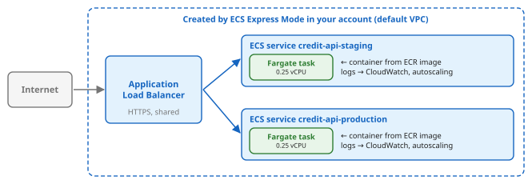

**Amazon ECS** (Elastic Container Service) runs containers. A **task** is a
running container (or a group of them). A **service** keeps N copies of a
task running and replaces failed ones. **Fargate** runs tasks without you
managing servers. An **Application Load Balancer** (ALB) receives HTTPS
traffic and forwards it to healthy tasks; it uses our `/health`
endpoint to decide which tasks are healthy. Express Mode creates all of
this in your account's **default VPC** (network) and gives each service
a URL like `https://<name>.ecs.eu-central-1.on.aws`.

**Watch out: What it costs**

Approximate Frankfurt prices (November 2026; check the AWS Pricing
Calculator): one ALB ≈ 0.03 USD/hour; each Fargate task with 0.25 vCPU
and 0.5 GB ≈ 0.015 USD/hour; public IPv4 addresses 0.005 USD/hour
each. Staging plus production together: **roughly 2 USD per day**,
about 60 USD per month if forgotten. Your budget alarms will warn
you, but the habit to build is: **clean up after each session**
(Section 5.6).


## 11. Deploy & roll back

### The deployment workflow

The deployment is split into two files. `deploy.yml` builds once and
then calls a **reusable workflow** twice, once per environment:

*.github/workflows/deploy.yml:*

```yaml
name: Deploy

on:
  push:
    branches: [main]
  workflow_dispatch:

concurrency:
  group: deploy            # never run two deployments at the same time
  cancel-in-progress: false

permissions:
  id-token: write          # needed to request the OIDC token
  contents: read

env:
  AWS_REGION: eu-central-1
  ECR_REPOSITORY: credit-api

jobs:
  build:
    runs-on: ubuntu-latest
    timeout-minutes: 20
    outputs:
      image: ${{ steps.push.outputs.image }}
    steps:
      - uses: actions/checkout@v7
      - uses: astral-sh/setup-uv@v10.3.3
        with:
          enable-cache: true
      - run: uv sync --locked
      - run: uv run pytest -q
      # With a shared MLflow server, ship the registry's @champion;
      # without one (the tutorial default), train and gate here.
      - if: vars.MLFLOW_TRACKING_URI == ''
        run: uv run python -m credit_api.train
      - if: vars.MLFLOW_TRACKING_URI == ''
        run: uv run python -m credit_api.gate metrics/metrics.json
      - if: vars.MLFLOW_TRACKING_URI != ''
        env:
          MLFLOW_TRACKING_URI: ${{ vars.MLFLOW_TRACKING_URI }}
          MLFLOW_TRACKING_TOKEN: ${{ secrets.MLFLOW_TRACKING_TOKEN }}
        run: uv run --group tracking python -m credit_api.export_champion

      - name: Log in to AWS with OIDC (no stored keys)
        uses: aws-actions/configure-aws-credentials@v6
        with:
          role-to-assume: ${{ vars.AWS_BUILD_ROLE_ARN }}
          aws-region: ${{ env.AWS_REGION }}

      - name: Log in to Amazon ECR
        id: ecr
        uses: aws-actions/amazon-ecr-login@v2

      - name: Build and push image tagged with the git SHA
        id: push
        env:
          IMAGE: ${{ steps.ecr.outputs.registry }}/${{ env.ECR_REPOSITORY }}
        run: |
          docker build -t "$IMAGE:$GITHUB_SHA" .
          docker push "$IMAGE:$GITHUB_SHA"
          # deploy by digest: the exact bytes we built and tested
          DIGEST=$(docker inspect --format '{{index .RepoDigests 0}}' \
            "$IMAGE:$GITHUB_SHA")
          echo "image=$DIGEST" >> "$GITHUB_OUTPUT"

  deploy-staging:
    needs: build
    if: vars.DEPLOY_FREEZE != 'true'   # set the variable to pause deploys
    uses: ./.github/workflows/_deploy-env.yml
    with:
      environment: staging
      image: ${{ needs.build.outputs.image }}
      version: ${{ github.sha }}

  deploy-production:
    needs: deploy-staging
    uses: ./.github/workflows/_deploy-env.yml
    with:
      environment: production
      image: ${{ needs.build.outputs.image }}
      version: ${{ github.sha }}
```

- Lines 8–10: `concurrency: deploy` with `cancel-in-progress: false` queues deployments instead of running two at once or killing one halfway.
- Line 13: `id-token: write` allows the jobs to request the OIDC token. Without it, `configure-aws-credentials` fails with "Credentials could not be loaded".
- Lines 31–43: the build job re-runs the tests and then gets a model: without a shared MLflow server (the tutorial default) it trains and runs the quality gate; with one, it exports the registry's
`@champion` instead (Chapter 6 explains why that matters). An image is only built from code and a model that passed.
- Line 48: the build job uses the **build** role, which can push images and nothing else.
- Lines 55–65: the image is tagged with `$GITHUB_SHA`, the full commit ID, for humans. The job **outputs** the image **digest** (`…/credit-api@sha256:4f1c…`), a hash of the image's content, so later jobs deploy exactly the bytes that were built and tested: **build once, deploy many**. A tag is a name that could, in a mutable repository, point to different images over time; a digest cannot.
- Line 69: if the repository variable `DEPLOY_FREEZE` is `true`, both deployments are skipped (a **deploy freeze**, e.g. during an incident or over the holidays). Rollbacks are not affected.

*.github/workflows/_deploy-env.yml:*

```yaml
# Reusable workflow: deploy one image to one environment, then smoke-test.
name: deploy-env

on:
  workflow_call:
    inputs:
      environment:
        type: string
        required: true
      image:
        type: string
        required: true
      version:
        type: string
        required: true

permissions:
  id-token: write
  contents: read

jobs:
  deploy:
    runs-on: ubuntu-latest
    timeout-minutes: 30
    # One deployment per environment at a time, shared by deploy.yml
    # and rollback.yml, so a rollback never races a deployment
    concurrency:
      group: deploy-${{ inputs.environment }}
      cancel-in-progress: false
    environment:
      name: ${{ inputs.environment }}
      url: ${{ steps.deploy.outputs.endpoint }}
    steps:
      - uses: actions/checkout@v7

      - uses: aws-actions/configure-aws-credentials@v6
        with:
          # an *environment* variable: a different role per environment
          role-to-assume: ${{ vars.AWS_ROLE_ARN }}
          aws-region: eu-central-1

      - name: Deploy to ECS Express Mode (Fargate + load balancer)
        id: deploy
        uses: aws-actions/amazon-ecs-deploy-express-service@v1
        with:
          service-name: credit-api-${{ inputs.environment }}
          image: ${{ inputs.image }}
          execution-role-arn: ${{ vars.ECS_EXECUTION_ROLE_ARN }}
          infrastructure-role-arn: ${{ vars.ECS_INFRA_ROLE_ARN }}
          container-port: 8080
          health-check-path: /health
          cpu: "256"
          memory: "512"
          min-task-count: 1
          max-task-count: 2
          environment-variables: |
            [{"name": "APP_VERSION", "value": "${{ inputs.version }}"}]

      - name: Smoke test
        run: >
          python3 scripts/smoke_test.py
          "${{ steps.deploy.outputs.endpoint }}" "${{ inputs.version }}"

      - name: Distribution check (are the predictions plausible?)
        run: >
          python3 scripts/distribution_check.py
          "${{ steps.deploy.outputs.endpoint }}" 200

      - name: Protect the image from expiry once it ran in production
        if: inputs.environment == 'production'
        env:
          TAG: ${{ inputs.version }}
        run: |
          aws ecr describe-images --repository-name credit-api \
            --image-ids imageTag="prod-$TAG" > /dev/null 2>&1 && exit 0
          MANIFEST_TYPE=$(aws ecr batch-get-image \
            --repository-name credit-api --image-ids imageTag="$TAG" \
            --query 'images[0].imageManifestMediaType' --output text)
          aws ecr batch-get-image --repository-name credit-api \
            --image-ids imageTag="$TAG" \
            --query 'images[0].imageManifest' --output text > manifest.json
          aws ecr put-image --repository-name credit-api \
            --image-tag "prod-$TAG" --image-manifest file://manifest.json \
            --image-manifest-media-type "$MANIFEST_TYPE" > /dev/null
```

- Lines 27–29: one deployment per environment at a time. `rollback.yml` uses the same reusable workflow and therefore the same group, so a rollback waits for a running deployment instead of racing it.
- Lines 30–32: `environment:` links the job to a GitHub **environment** (next section). Its `url` appears as a link on the run page.
- Line 39: `vars.AWS_ROLE_ARN` is an environment variable, so staging and production assume different roles.
- Lines 42–57: the Express action creates the service on the first run and updates it afterwards, then **waits** until the new tasks are healthy. `APP_VERSION` is passed into the container so `/health` reports which commit is running.
- Lines 59–67: the smoke test ("is it alive and the right version?") and the distribution check ("are its decisions plausible?", Chapter 7) run against the real URL.
- Lines 69–84: after a successful production deployment, the image gets a second tag `prod-<sha>`, which the ECR lifecycle policy protects (box below).

### Environments, approval and versioning

In GitHub, **Settings → Environments → New environment**:

- `staging`: **Deployment branches and tags** = `main` only. No reviewers: it deploys automatically. The branch rule is not optional; the what-if in Section 5.3 shows what happens without it.
- `production`: **Required reviewers** = you (or your team); **Deployment branches and tags** = `main` only. Optionally a **wait timer** and **Prevent self-review**.

When the pipeline reaches `deploy-production`, it pauses and GitHub
shows **Review deployments**. Nothing happens until a reviewer approves:
this is continuous **delivery**. Remove the reviewer rule and you have
continuous **deployment**.

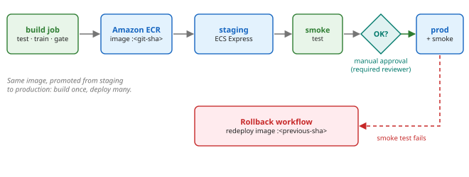

**Image tags.** Our ECR repository is **immutable**: a tag can never be
overwritten. The git SHA identifies every build uniquely and links the
running container to the exact code. For human-friendly releases, add
a **semantic version** tag when you create a GitHub release, e.g. trigger
on `push: tags: ["v*"]` and push the same image also as `:v1.4.0`.
Avoid `:latest` in production: it tells you nothing about what is
running, and with immutable tags you cannot even push it twice.

### Smoke tests and rollback

A **smoke test** is a short check right after deployment: "does the new
version answer, and is it the version we just deployed?" It is not a
full test suite; it catches broken configuration, missing files, wrong
ports. Ours checks `/health` (with retries while tasks start), the
reported version, and one real prediction:

*scripts/smoke_test.py:*

```python
def main(base: str, expected_version: str) -> int:
    if not base.startswith("http"):
        base = "https://" + base
    for attempt in range(1, 11):  # new tasks may need a minute
        try:
            health = call(f"{base}/health")
            break
        except OSError as exc:
            print(f"attempt {attempt}: {exc}; retrying in 15 s")
            time.sleep(15)
    else:
        print("service never became healthy")
        return 1
    if health.get("version") != expected_version:
        print(f"wrong version: {health} (expected {expected_version})")
        return 1
    pred = call(f"{base}/predict", APPLICANT)
    if not 0 <= pred["probability_bad"] <= 1:
        print(f"nonsense prediction: {pred}")
        return 1
    print(f"smoke test passed: {health} {pred}")
    return 0
```

If the smoke test fails, the job fails, and production is never
reached (or, for production, you know within seconds). Express Mode
also uses **canary deployments** with alarm-based automatic rollback (as
documented when this edition was written; verify the current options) on
HTTP errors. For a **manual** rollback, `rollback.yml` redeploys an older
image by SHA through the same reusable workflow. In the Actions tab:
**Rollback → Run workflow** → environment + SHA. Because the image
already exists in ECR, a rollback takes about as long as a deployment,
with no build. (Do not confuse it with `git revert`, which fixes the
code. A rollback is the fast emergency step; the revert follows.)

### What can go wrong during a deployment

**What if… I merge three PRs within two minutes?**

**What happens:**  Merge A starts `Deploy`. B and C start `Deploy` too, but the
concurrency group `deploy` allows only one **running** and one
**pending** run. When C arrives, GitHub **cancels the pending B**. The
Actions tab shows B as cancelled.

**Why:**  With `cancel-in-progress: false`, the running deployment is
protected, but there is room for only one waiting run per group.

**What you do:**  Nothing: this is what you want. C's image contains A, B and C
(it was built from the newest `main`), so deploying B in between
would be wasted time. Be aware of it when someone asks "why was my
deployment cancelled?". If every commit must be deployed
individually (rare), use one concurrency group per commit and let
ECS serialise them, or deploy through a queue.

**What if… the new version starts but crashes on real traffic?**

**What happens:**  Staging and the smoke test were green. Ten minutes after
production went live, error rates rise.

**Why:**  A smoke test checks that the service is **alive**, not that it
handles every real request. Production has inputs, volumes and
clients that staging does not.

**What you do:**  Two safety nets, in this order. First, Express Mode's **canary**:
a small share of traffic goes to the new tasks first, and if the
CloudWatch alarm on HTTP 5xx fires, ECS rolls back by itself. Second,
your rollback workflow, by SHA. Then reproduce the failing request
in a test and fix forward. Over time, every production incident
should leave behind a test that would have caught it.

**What if… nobody approves the production deployment?**

**What happens:**  The run waits in "Waiting for review". After 30 days the
pending deployment fails on its own.

**What you do:**  That is harmless: staging has the new version, production the
old one, both healthy. Configure **Environments → production → Wait
timer** or reminders as your team prefers. What you should **not** do
is approve old runs out of order: always approve the newest one,
and reject (or let expire) the rest.

**What if… ECR deletes the image that production is running?**

**What happens:**  A quiet week in production, a busy week in staging: twelve
merges. Then production scales out to a second task, or AWS replaces
an unhealthy one, and it fails with `CannotPullContainerError`. The
image production runs no longer exists. The same error appears when
you try to roll back to a SHA from two months ago.

**Why:**  The first edition's lifecycle policy kept "the 10 newest images,
any tag". It counted **builds**, not **what is running**: after ten
staging builds, the production image was expired. A rule written to
save storage became an outage.

**What you do:**  Make "has run in production" visible to the policy. The
production deploy job adds a second tag `prod-<sha>` (lines 69–84 of
`_deploy-env.yml`), and the lifecycle policy treats those images
separately:

*infra/ecr-lifecycle.json:*

```json
{
  "rules": [
    {
      "rulePriority": 1,
      "description": "Images that ran in production: keep the newest 20",
      "selection": {
        "tagStatus": "tagged",
        "tagPrefixList": ["prod-"],
        "countType": "imageCountMoreThan",
        "countNumber": 20
      },
      "action": { "type": "expire" }
    },
    {
      "rulePriority": 2,
      "description": "All other images: keep the newest 30",
      "selection": {
        "tagStatus": "any",
        "countType": "imageCountMoreThan",
        "countNumber": 30
      },
      "action": { "type": "expire" }
    }
  ]
}
```

An image matched by a higher-priority rule is not expired by a
lower-priority one, so the 20 newest production images survive any
number of staging builds, and your rollback window is "the last 20
production releases". Before starting a rollback, check the image:
`aws ecr describe-images --repository-name credit-api --image-ids
imageTag=<sha>`.

**What if… the old image is fine, but rolling back would break clients?**

**What happens:**  Version 2 added a response field `explanation` (the top
three reasons for the decision), and the bank's web app now shows
it. Version 2 has a memory leak, so you roll back to version 1. The
web app now receives responses without `explanation` and its page
crashes.

**Why:**  A rollback restores the **code**, not the world around it:
clients, database schemas, message formats.

**What you do:**  Change interfaces in steps that are each safe to roll back
(**expand, then contract**): release the new field, let it run
stably for a while, and only then let clients **depend** on it;
clients should treat new fields as optional at first. Remove old
fields last. (In the other direction our API is forgiving already:
Pydantic **ignores** unknown request fields by default, so clients
may send a new field before the server knows it. A schema with
`extra="forbid"` would turn that into a 422.) For databases, the
same rule: add columns in one release, use them in the next, drop
old ones in a third. And for ML specifically: because our image
contains the model, rolling back the image rolls back the model
too. If the model is loaded from a registry at runtime instead,
you must roll back **both** (image **and** alias) to restore the old
behaviour.

**What if… I need to roll back **now**, and the approval rule slows me down?**

**What happens:**  `rollback.yml` reuses the production environment, so it
waits for a reviewer, at 2 a.m., during an incident.

**What you do:**  Decide this calmly, before the incident. Options: allow
administrators to bypass the review (environment setting), add a
second reviewer so one is always reachable, or create a separate
`production-rollback` environment that only accepts images that
have already been deployed to production. The worst option is the
common one: someone with console access changes the service by
hand, and Git no longer tells the truth about what is running.
Two more things to check during the incident: set `DEPLOY_FREEZE`
so that the next merge does not redeploy the broken version on top
of your rollback, and reject any production deployment that is
still **waiting for approval**, so nobody approves it by reflex later.
Rollback and deployment share the concurrency group
`deploy-production`, so they can never run at the same time.

**Concept: Optional: the same image on AWS Lambda**

Lambda can run container images. With the **AWS Lambda Web Adapter**,
a normal HTTP app like ours runs on Lambda without code changes:
`Dockerfile.lambda` adds the adapter as a Lambda **extension**, which
translates Lambda invocations into HTTP requests to uvicorn. Push it
to ECR as `credit-api:lambda-<sha>`, then create the function with
`aws lambda create-function --package-type Image --code
ImageUri=<image> --role <lambda-role-arn> --memory-size 1024
--timeout 30` and expose it with `aws lambda
create-function-url-config --auth-type NONE` (the console adds the
required invoke permission; with the CLI add it with `aws lambda
add-permission`). Expect a cold start of several seconds for an image
with scikit-learn; this variant was not executed for this book.

### Cleanup: stop paying

**Watch out: Run this at the end of every AWS session**

Everything in this chapter is reproducible: the next push recreates
the services. There is no reason to leave them running overnight.

To pause cheaply but keep the setup, delete only the two Express
services (step 1 below). To remove everything, run the script:

*infra/cleanup.sh:*

```bash
#!/usr/bin/env bash
# Delete everything the tutorial created, so nothing keeps billing.
#   bash infra/cleanup.sh
set -uo pipefail          # no -e: keep going if something is gone already
export AWS_REGION=eu-central-1
P=arn:aws:iam::aws:policy/service-role   # AWS-managed policies

echo "1) ECS Express services (also removes ALB, target groups, SGs)"
for arn in $(aws ecs list-services --cluster default \
               --query 'serviceArns[]' --output text); do
  echo "   deleting $arn"
  aws ecs delete-express-gateway-service --service-arn "$arn" \
    --monitor-resources
done

echo "2) ECR repository and all images"
aws ecr delete-repository --repository-name credit-api --force
```

The rest of the script (in the repository) deletes the log groups,
the IAM roles and the OIDC provider, and finally lists anything that
is still there. Check by hand, too: in the console, open **Billing →
Bills** the next day and confirm there are no running charges, and look
at **Resource Explorer** (all regions) for leftovers. Keep the budgets:
they are free.

**What if… the cleanup script prints errors?**

**What happens:**  Lines like `An error occurred (NoSuchEntity) … The role with
name ecsTaskExecutionRole cannot be found` or
`RepositoryNotFoundException`.

**Why:**  The script uses `set -uo pipefail` **without** `-e` on purpose: it
keeps going if something is already gone, so it can be run twice.
"Not found" means "already deleted": good. A real problem looks
different: `DeleteConflict` (a role is still attached to something),
`DependencyViolation` (a security group is still used), or
`AccessDenied` (your SSO session expired: run `aws sso login`).

**What you do:**  Read the last section of the output: it lists services, load
balancers and tagged resources that still exist. Run the script
again after a few minutes (deleting an Express service takes time
to remove the load balancer behind it), and delete stragglers in
the console.

**What if… I forgot to clean up for a month?**

**What happens:**  The bill shows around 60 USD for the load balancer, tasks
and public IPs.

**What you do:**  Clean up immediately, then open a case in the **AWS Support
Center** (account and billing support is free): explain it was an
unintended charge on a learning account, and what you have changed
(cleanup script, budgets). AWS sometimes grants a one-time credit
for such cases, but there is no guarantee. The budget alarms you set
up in Section 5.1 exist so this conversation never becomes
necessary.

**Exercise: Prove the approval gate**

Change the response of `/health` to include `"python": "3.12"`,
merge, and follow the run. Approve production only after you have
called the staging URL yourself. Then use the rollback workflow to
return production to the previous SHA, and confirm with `curl`.

**Exercise: Prove the environment rule**

On a feature branch, add a workflow with one job that declares
`environment: staging` and runs `aws sts get-caller-identity` after
`configure-aws-credentials`. Push it. What does GitHub do, and at
which point? Then temporarily allow all branches for `staging` and
push again: what does AWS answer now, and why is that still not a
production risk with three roles? Restore the rule.

**Exercise: Break OIDC on purpose**

Add `environment: staging` to the `build` job in `deploy.yml` without
changing anything else. Does the AWS login still work? Then add
`permissions: {contents: read}` to the `build` job. What error do you
get now, and why? Restore both.

**Exercise: Simulate the listen-address bug**

Change the `CMD` in the Dockerfile to drop `--host 0.0.0.0`, build,
run with `-p 8080:8080`, and `curl` the health endpoint. What do you
see? Then use `docker exec` to call the endpoint from **inside** the
container (`python -c "import urllib.request as u;
print(u.urlopen('http://localhost:8080/health').read())"`).

**Checkpoint: you should now be able to…**

- set up an AWS account with root MFA, Identity Center, budgets and the right region;
- write a multi-stage, non-root Dockerfile and explain layer caching;
- explain OIDC and every line of the trust policy, and why the pipeline uses one role per stage plus branch rules on **every** environment;
- deploy by digest, protect production images from lifecycle expiry, and freeze deployments during an incident;
- predict a job's `sub` claim and debug the three typical AWS login and permission errors;
- debug a container that is healthy locally but not on Fargate;
- explain what rollback can and cannot restore (lifecycle policy, client contracts, model in image vs. registry);
- deploy with environments, manual approval, SHA tags and smoke tests, and roll back;
- explain why App Runner is no longer an option and what ECS Express Mode creates;
- delete everything you created.


## 12. Data & model gates

*Chapter 6 · Level 4: ML-Specific CI/CD.* Levels 1–3 would work for any web service. This level adds what makes ML delivery different: data contracts, training inside CI, a gate that blocks worse models, a model registry, and an evaluation gate for an LLM-based RAG service, with costs under control.

**After this level you can:**

- Validate training data with a pandera contract before training.
- Train in CI and fail the build when metrics drop (accuracy gate).
- Track runs in MLflow and promote models with registry aliases.
- Evaluate a RAG service with a golden set: hit rate, MRR and LLM-judged faithfulness, as a gate.
- Control LLM costs in CI; schedule nightly evals and weekly retraining.
- Explain the whole pipeline in an interview in two minutes.

**What you build:** `credit-api` with data contract, accuracy gate and MLflow champion/challenger promotion; `rag-api` with a retrieval and faithfulness gate that runs cheaply on PRs and fully every night.

### Part A · Classic ML: data contract

Most ML incidents start with data: an upstream system changes a unit,
a column is renamed, a category appears that never existed. A **data
contract** states what valid training data looks like, and the pipeline
checks it **before** training, so it fails on bad data with a clear
message instead of producing a silently bad model.

*src/credit_api/validation.py:*

```python
"""Data contract for the training data, written with pandera."""

import pandas as pd
import pandera.pandas as pa

SCHEMA = pa.DataFrameSchema(
    {
        "duration": pa.Column(int, pa.Check.in_range(1, 120)),
        "credit_amount": pa.Column(int, pa.Check.gt(0)),
        "age": pa.Column(int, pa.Check.in_range(18, 100)),
        "checking_status": pa.Column(str, nullable=False),
        "credit_history": pa.Column(str, nullable=False),
        "purpose": pa.Column(str, nullable=False),
        "savings_status": pa.Column(str, nullable=False),
        "employment": pa.Column(str, nullable=False),
        "target": pa.Column(int, pa.Check.isin([0, 1])),
    },
    checks=[
        # at least 15 % of rows must be "bad" so the model can learn it
        pa.Check(
            lambda df: df["target"].mean() >= 0.15,
            error="label share of class 1 below 15 %",
        ),
    ],
    strict=True,
)

def validate(df: pd.DataFrame) -> pd.DataFrame:
    """Raise pandera.errors.SchemaErrors listing every problem found."""
    return SCHEMA.validate(df, lazy=True)
```

`pandera` checks types, ranges and allowed values per column (lines
8–16), and whole-table rules such as a minimum share of the minority
class (lines 18–24). `strict=True` rejects unexpected extra columns.
`lazy=True` (line 31) collects **all** problems instead of stopping at
the first, so one CI run shows everything that is wrong. The tests in
`test_data.py` prove that the contract rejects bad values: a contract
that never fails is useless.

**What if… the upstream system sends a category we have never seen?**

**What happens:**  A new product launches, and `purpose` now contains
`"crypto"`. Our contract only says `purpose` is a non-empty string,
so validation **passes**. Training works. At serving time, the
`OneHotEncoder(handle_unknown="ignore")` turns `"crypto"` into all
zeros: the model predicts as if the purpose were unknown, without
any error (the test `test_unknown_category_does_not_crash` proves
it does not crash, which is not the same as "behaves well").

**Why:**  There is a deliberate trade-off. A strict contract
(`pa.Check.isin([...])` with the known values) stops training on the
first new category, which is safe but blocks the weekly retraining
for something harmless. A loose one never blocks, and silently
degrades.

**What you do:**  Be strict where an unknown value is **dangerous** and loose where
it is merely **new**, and make "new" visible: log the share of unknown
categories at serving time and in the nightly validation, and alert
above a few percent. A good middle ground in pandera is a check with
a tolerance: "at most 1 % of rows outside the known values".

### Contracts check **validity**, not **drift**

A contract answers "is every value plausible?". It cannot answer "is
this data **like** the data the model learned from?". We tested this:
multiplying every `credit_amount` by 1.3 (30 % inflation) produces data
that passes the contract completely. A two-sample **Kolmogorov–Smirnov
test** compares two distributions and notices at once. Real output,
comparing two halves of the data set, then one half against the
inflated other half:

*drift check (results from a real run):*

```python
from scipy.stats import ks_2samp

ks_2samp(ref.credit_amount, new.credit_amount)
# statistic=0.042  pvalue=0.77        same source: no evidence of drift
ks_2samp(ref.credit_amount, inflated.credit_amount)
# statistic=0.184  pvalue=8.2e-08     clear drift
```

In CI, such a check compares the newest training data with a stored
**reference** sample, typically in the nightly data-validation job.
Two warnings from practice. With large samples, a p-value flags even
tiny, irrelevant differences, so teams threshold the **statistic**
(e.g. KS > 0.1) or use the **Population Stability Index** (PSI; rule of
thumb: < 0.1 stable, 0.1–0.25 watch, > 0.25 act). And drift is a
reason to **look**, not automatically a reason to fail: inflation is
real, and the model may need retraining, not the data rejecting.
Libraries such as Evidently produce these reports for every column.

### Training in CI and the accuracy gate

`train()` validates, splits with a fixed seed, fits and measures:

*src/credit_api/train.py:*

```python
def train(
    sample_frac: float = 1.0, max_iter: int = 200
) -> tuple[Pipeline, dict[str, float]]:
    df = validate(sample(load_data(), sample_frac))
    x_train, x_test, y_train, y_test = train_test_split(
        df[FEATURES],
        df[TARGET],
        test_size=0.25,
        stratify=df[TARGET],
        random_state=SEED,
    )
    model = build_pipeline(max_iter=max_iter)
    model.fit(x_train, y_train)
    proba = model.predict_proba(x_test)[:, 1]
    pred = (proba >= 0.5).astype(int)
    metrics = {
        "roc_auc": round(float(roc_auc_score(y_test, proba)), 4),
        "accuracy": round(float(accuracy_score(y_test, pred)), 4),
        "f1": round(float(f1_score(y_test, pred)), 4),
        "n_train": float(len(x_train)),
    }
    return model, metrics
```

With 1,000 rows this takes about a second, so CI can train on the
**full** data. With real data sets you would train on a stratified
sample in PR pipelines (`--sample-frac 0.1`) and on everything only on
`main` or nightly. The point is not to produce the production model in
every PR; it is to prove that **the pipeline still produces a good
model**.

The gate compares the new metrics with two kinds of limits (Figure 15):

- **Floors**: absolute minimums (`roc_auc ≥ 0.70`, `f1 ≥ 0.40`). Below them, the model is not fit for purpose, whatever the baseline says.
- **Maximum drop**: compared with the **baseline** (the metrics of the model in production, committed as `metrics/baseline.json`), no metric may fall by more than 0.03. This catches regressions that are still above the floor.

*src/credit_api/gate.py:*

```python
def check(
    new: dict[str, float],
    baseline: dict[str, float],
    floors: dict[str, float],
    max_drop: float,
) -> list[str]:
    """Return a list of human-readable failures (empty = pass)."""
    failures = []
    for name, floor in floors.items():
        if new[name] < floor:
            failures.append(f"{name}={new[name]:.4f} below floor {floor}")
        drop = baseline.get(name, 0.0) - new[name]
        if drop > max_drop:
            failures.append(
                f"{name} dropped {drop:.4f} vs baseline (allowed {max_drop})"
            )
    return failures
```


In CI the gate is a job of its own (`model-gate` in `ci.yml`), which
also writes the metrics into the **job summary** (`$GITHUB_STEP_SUMMARY`),
so reviewers see them on the run page without opening logs:

*terminal:*

```bash
uv run python -m credit_api.train
uv run python -m credit_api.gate metrics/metrics.json
```

*expected output:*

```text
roc_auc    new=0.7865 baseline=0.7865
f1         new=0.5231 baseline=0.5231
QUALITY GATE PASSED
```

**Watch out: Gates on noisy metrics**

Metrics on small test sets fluctuate. A tolerance that is too tight
makes the gate flaky (red without a real problem), and people learn
to ignore red builds. Fix the seed, use a large enough test set,
choose the tolerance from the run-to-run variance you observe, and
update the baseline **deliberately**, through a PR that changes
`baseline.json`, when a better model ships.

### Worked example: choosing the tolerance from data

Is `max_drop = 0.03` a good value? Do not guess: **measure** how much the
metric moves when nothing meaningful changes. We trained the
`credit-api` model 20 times while varying one source of randomness at
a time (`uv run python scripts/variance.py`; real output):

| What varied | ROC-AUC over 20 runs |
|---|---|
| Model seed only (same split) | 0.7865 every time, std 0.0000 |
| Train/test split seed | mean 0.7814, **std 0.025**, min 0.741, max 0.832 |
| Bootstrap of the fixed test set (1,000 resamples) | 95 % interval **0.728 – 0.851** |

Three lessons, each with consequences for the gate:

1. **This model has no training randomness.** Gradient boosting without subsampling is deterministic here (early stopping, which would add randomness, only switches on automatically above 10,000 rows). So on an unchanged split, **any** metric change is caused by the code or the data. The 0.03 tolerance is generous for code changes.
2. **The split is worth ±0.05.** A PR that "only" changes `test_size`, the seed, or the order of rows in the CSV moves AUC by as much as a real model regression, in either direction. Rule: the evaluation split is part of the **contract**. Change it only in a PR that also updates the baseline, and say so.
3. **250 test rows give an uncertainty of ±0.06.** Our baseline 0.7865 is one draw from a wide interval. You cannot claim "the new model is better" from a 0.005 improvement on this test set. With real data, use a larger test set; the interval shrinks roughly with 1/√n (four times the rows, half the width).

**What if… the gate fails, but I am sure the model is not worse?**

**What happens:**  A refactoring PR fails with `roc_auc dropped 0.0410 vs
baseline (allowed 0.03)`, although you did not touch the model.

**Why:**  Look for something that changed **what is evaluated**: the split
(seed, `test_size`, row order after a data cleanup), the set of rows
(a filter that now drops duplicates), the features (a column now
parsed differently). Lesson 2 above says these alone can move AUC by
0.05.

**What you do:**  Find which. Run the old and the new code on the **same** rows and
compare predictions row by row (`np.abs(p_old - p_new).max()`): if
predictions are identical, the evaluation changed, not the model. Fix
the accidental change, or, if it was intentional, update
`baseline.json` in the same PR with an explanation. Do **not** raise
`max_drop` to make the build green.

### Gating on slices, not only the average

The overall AUC hides a gap we measured on the test set:

| Slice | Rows | ROC-AUC |
|---|---|---|
| age ≥ 25 | 202 | 0.796 |
| age < 25 | 48 | 0.736 |

Young applicants get noticeably worse predictions. A change that
improves the average while making this gap worse would pass our gate.
A **slice gate** adds per-segment floors (for example "AUC for age < 25
≥ 0.70" and "gap ≤ 0.08"), computed in `train.py` and checked by the
same `check()` function. Be careful with small slices: with 48 rows,
the slice AUC itself is very noisy, so set slice floors loosely, or
require a minimum slice size before the check applies. In a credit
model, which slices to watch is not only a technical choice: anti-
discrimination law and the EU AI Act make it a legal one, and the
slices belong in the model card.

**What if… we decide to accept a slightly worse model on purpose?**

**What happens:**  Removing the feature `age` makes the model fairer and
simpler to defend, but AUC drops by 0.035. The gate blocks it.

**What you do:**  That is the gate working: it forces the trade-off to be a
**visible decision**. Change `metrics/baseline.json` in the same PR,
explain the trade-off in the PR description, and get an explicit
approval (CODEOWNERS can make a specific person's review mandatory
for changes to `metrics/`). The Git history then records who
accepted which metric change, and why: exactly what an auditor will
ask for.


## 13. MLflow & registry

### Experiment tracking and the model registry with MLflow

A gate answers "is this model good enough?". A **registry** answers
"which model is in production, where did it come from, and what was
there before?". **MLflow** records each training **run** (parameters,
metrics, artefacts such as the model file) and keeps **registered
models** with numbered versions.

*src/credit_api/train.py:*

```python
def log_to_mlflow(
    model: Pipeline, metrics: dict[str, float], params: dict[str, Any]
) -> None:
    import mlflow  # imported lazily: only needed with --track

    mlflow.set_experiment("credit-risk")
    with mlflow.start_run():
        mlflow.log_params(params)
        mlflow.set_tag("data_sha256", file_sha256(DATA_PATH))
        mlflow.log_metrics(metrics)
        mlflow.sklearn.log_model(
            model,
            name="model",
            registered_model_name="credit-risk",
            # MLflow 3 saves sklearn models with skops (safer than
            # pickle) and asks us to vouch for non-standard types
            skops_trusted_types=[TREE_PREDICTOR],
        )
```

Every `--track` run creates a new version of the registered model
`credit-risk`. Versions are labelled with **aliases**: `@champion` for
the model in production and `@challenger` for the newest candidate.
Code loads `models:/credit-risk@champion`, so promotion and rollback
are just moving an alias.

**Concept: Aliases replace the old "stages"**

Older tutorials move models between the **stages** `Staging` and
`Production`. MLflow deprecated stages in version 2.9 in favour of
aliases and tags, because one fixed set of stages did not fit real
workflows. If you meet stages in an existing project, the concept
maps directly: `Production` ≈ `@champion`.

`promote.py` implements champion/challenger: the newest version
becomes `@challenger`; if it passes the same gate against the current
champion's metrics, it becomes `@champion`:

*src/credit_api/promote.py:*

```python
def main() -> int:
    client = MlflowClient()
    versions = client.search_model_versions(f"name='{NAME}'")
    newest = max(versions, key=lambda v: int(v.version))
    client.set_registered_model_alias(NAME, "challenger", newest.version)
    new = client.get_run(str(newest.run_id)).data.metrics

    try:
        champ = client.get_model_version_by_alias(NAME, "champion")
        baseline = client.get_run(str(champ.run_id)).data.metrics
    except MlflowException:
        print("no champion yet: the first model becomes champion")
        baseline = {}

    cfg = json.loads(THRESHOLDS.read_text())
    failures = check(new, baseline, cfg["floors"], cfg["max_drop"])
    if failures:
        print("challenger rejected:", *failures, sep="\n  - ")
        return 1
    client.set_registered_model_alias(NAME, "champion", newest.version)
    print(f"version {newest.version} is now @champion")
    return 0

if __name__ == "__main__":
    sys.exit(main())
```

The **weekly retraining** workflow ties it together. A `schedule`
trigger runs it every Monday; `workflow_dispatch` adds a manual button:

*.github/workflows/retrain.yml:*

```yaml
name: Weekly retrain

on:
  schedule:
    - cron: "0 3 * * 1"     # Mondays 03:00 UTC
  workflow_dispatch:         # plus a "Run workflow" button

# Only one run may write to the model registry at a time
concurrency:
  group: model-registry
  cancel-in-progress: false

permissions:
  contents: read

jobs:
  retrain:
    runs-on: ubuntu-latest
    timeout-minutes: 30
    env:
      # Real teams point this at a shared MLflow server; the fallback
      # keeps the tutorial runnable without one.
      MLFLOW_TRACKING_URI: >-
        ${{ vars.MLFLOW_TRACKING_URI || 'sqlite:///mlflow.db' }}
      MLFLOW_TRACKING_TOKEN: ${{ secrets.MLFLOW_TRACKING_TOKEN }}
    steps:
      - uses: actions/checkout@v7
      - uses: astral-sh/setup-uv@v10.3.3
        with:
          enable-cache: true
      - run: uv sync --locked --group tracking
      - name: Train and register a new model version
        run: uv run python -m credit_api.train --track
      - name: Promote to @champion if it beats the current one
        run: uv run python -m credit_api.promote
      - uses: actions/upload-artifact@v7
        if: always()
        with:
          name: mlflow-db
          path: mlflow.db
          if-no-files-found: ignore
```

**Try it: See it locally**

`export MLFLOW_TRACKING_URI=sqlite:///mlflow.db`, then run
`uv run --group tracking python -m credit_api.train --track` twice
(once with `--max-iter 3` for a deliberately bad model), then
`uv run --group tracking python -m credit_api.promote` after each.
The bad model is rejected. Browse the runs with
`uv run --group tracking mlflow ui --backend-store-uri
sqlite:///mlflow.db` at `http://localhost:5000`.

**Watch out: Where MLflow lives in a team**

A SQLite file on a CI runner disappears after the job; our workflow
uploads it as an artefact only so the tutorial works without a
server. In a team, `MLFLOW_TRACKING_URI` points to a shared tracking
server (self-hosted on ECS with a database and S3, or a managed
offering such as Amazon SageMaker's MLflow), and the deploy pipeline
exports `models:/credit-risk@champion` (`export_champion.py`) instead
of training a fresh model.

### Closing the loop: which model is actually running?

Be precise about what the tutorial setup does, because an interviewer
will be. Without a shared tracking server, `retrain.yml` registers and
promotes models in a SQLite file that disappears after the job. Its
`@champion` **never reaches production**; `deploy.yml` trains its own
model from the merged code. Both are legitimate designs, and you must
be able to say which one you run:

|  | Train-in-deploy (tutorial default) | Registry-driven (`MLFLOW_TRACKING_URI` set) |
|---|---|---|
| Model in the image | Trained from the commit being deployed | `@champion`, exported by `export_champion.py` |
| Quality gate | `gate.py` against `baseline.json` | `promote.py`, before the alias moves |
| A new model ships when… | code or data changes are merged | retraining promotes a challenger **and** a deploy runs |
| Reproducible from Git alone? | Yes | No: needs the registry |
| Good for | Small models, few retrains | Expensive training, frequent retrains, several consumers of one model |

`deploy.yml` (lines 33–43) supports both: if the repository variable
`MLFLOW_TRACKING_URI` is set, the build exports the champion instead
of training. In registry mode, `baseline.json` should not be edited by
hand any more: the champion's own metrics are the baseline, otherwise
there are two sources of truth that will disagree.

**Lineage** is the chain that lets you answer "what exactly is running?"
in one minute during an incident:

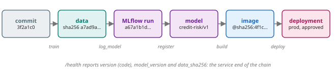

Every link is recorded somewhere: Git, the `data_sha256` tag on the
MLflow run, the registry version, the image digest in the deploy job,
the GitHub deployment history. `train.py` and `export_champion.py`
write the part the **service** needs into `models/model_meta.json`, and
`/health` reports it. This is real output with the exported champion:

*expected output:*

```text
{'status': 'ok', 'version': '3f2a1c0', 'model_version': 'credit-risk/v1',
 'data_sha256': 'a7ad9a21934f'}
```

`version` is the code (git SHA), `model_version` the model, and
`data_sha256` the training data. Before this edition, the API reported
the git SHA as `model_version`, which stops being true the moment
models come from a registry.

### When to retrain: a decision table

"We retrain weekly" is a junior answer; a senior answer names the
**trigger** and who decides:

| Trigger | Use when | Watch out |
|---|---|---|
| Schedule (our weekly job) | Data arrives steadily; cheap training | Retrains even when nothing changed; promotes noise unless the gate is paired (box above). |
| New labelled data | Labels arrive in batches (e.g. loan outcomes after 12 months) | Label delay: the newest data has no labels yet. |
| Drift alarm (Chapter 7) | Inputs shift, labels are slow | Drift is a reason to **look**; retraining on drifted data can bake in a data bug. |
| Performance alarm | Labels arrive quickly (fraud chargebacks) | The best trigger when you have it; most credit models do not. |
| Code or feature change | Always, through the normal PR | Already covered by CI. |

Whichever trigger fires, **promotion** stays a gated decision, and for a
credit model in the EU a human approval of the production deploy is a
sensible default (Chapter 7 explains the regulatory side).

**What if… the challenger was evaluated on newer data than the champion?**

**What happens:**  `promote.py` compares the challenger's metrics from **its**
training run with the champion's metrics from **its** run. If the data
grew between the two runs (new applicants arrived, so the split
contains different rows), the two numbers come from different test
sets. The challenger may "lose" against a champion that would score
lower on today's data, or "win" for the same reason.

**Why:**  Lesson 3 above: on 250 rows, the test set alone is worth
±0.06.

**What you do:**  For promotion decisions, evaluate **both** models on the **same**,
current test set, inside the promotion job: load
`models:/credit-risk@champion`, score it on today's test split,
score the challenger on the same rows, then apply the gate. This is
called a **paired** comparison, and it is much more sensitive than
comparing two numbers from different runs. Our `promote.py` keeps
the simple version for readability; an exercise at the end of
this chapter asks you to improve it.

**What if… the new champion turns out bad in production?**

**What you do:**  Because code loads `@champion`, rollback is moving the alias
back, one API call:

```python
from mlflow import MlflowClient

MlflowClient().set_registered_model_alias(
    "credit-risk", "champion", "7"    # the previous good version
)
```

Note **where** the model is loaded. In our image-based setup, the
model is baked in at build time, so moving the alias changes nothing
until the next build and deploy: rollback = redeploy the previous
image (Level 3). In a setup that loads `@champion` at startup,
moving the alias and restarting the tasks is the rollback. Know
which one your system is, before the incident.

**What if… two retraining runs promote at the same time?**

**What happens:**  The schedule fires while someone clicks **Run workflow**.
Both runs register a version, both set `@challenger`, and the
"newest version" one of them promotes is not the one it trained.

**What you do:**  One concurrency group for everything that writes to the
registry. Our `retrain.yml` has it (lines 8–11):
`concurrency: {group: model-registry, cancel-in-progress: false}`. And promote the version **this run**
registered (MLflow returns it from `log_model`), not "the newest
version in the registry".


## 14. Evaluating RAG

### Part B · LLM systems: the RAG service

`rag-api` answers employee questions from a (fictional) company
handbook: vacation, sick leave, expenses, on-call. It embeds the
question, retrieves the three most similar text chunks from
Postgres with **pgvector**, and asks an LLM to answer **only from those
chunks**. The design choice that makes CI possible is that every
component sits behind a small interface with a free, deterministic
fake for unit tests (Figure 17).

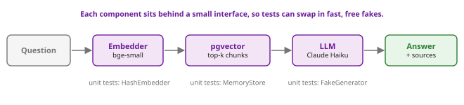

*src/rag_api/embeddings.py (excerpt):*

```python
class Embedder(Protocol):
    dim: int

    def embed(self, texts: list[str]) -> Vectors: ...

class HashEmbedder:
    """Bag-of-words hashed into a fixed-size vector (a test double)."""

    def __init__(self, dim: int = 256) -> None:
        self.dim = dim

    def embed(self, texts: list[str]) -> Vectors:
        out = np.zeros((len(texts), self.dim), dtype=np.float32)
        for row, text in enumerate(texts):
            for word in re.findall(r"[a-zäöüß0-9]+", text.lower()):
                h = int(hashlib.md5(word.encode()).hexdigest(), 16)
                out[row, h % self.dim] += 1.0
        norms = np.linalg.norm(out, axis=1, keepdims=True)
        return (out / np.maximum(norms, 1e-9)).astype(np.float32)
```

`Embedder` is a `Protocol`: any class with a `dim` and an `embed()`
method fits. In unit tests, `HashEmbedder` turns words into hashed
counts: meaningless as semantics, but deterministic, instant and free.
In the evaluation, `FastEmbedder` runs the real model
`BAAI/bge-small-en-v1.5` locally on the CPU (ONNX, about 70 MB, no API
key). The same pattern gives `MemoryStore` vs. `PgVectorStore` and
`FakeGenerator` vs. `ClaudeGenerator`. Result: 15 unit tests run in
under a second without network access, and one integration test runs
against a real Postgres with pgvector.

#### The golden set

A **golden set** is a small, hand-curated list of questions with the
expected source and a reference answer. It is the test data of an LLM
system. Twenty good questions beat two hundred generated ones;
include easy cases, paraphrases, questions that need the right
paragraph, and some that mention German terms.

*eval/golden.jsonl (two of 20 lines, wrapped for print):*

```text
{"id": "q04", "question": "When do I need a doctor's certificate when
  I am sick?", "expected_doc": "sick-leave", "reference": "From the
  fourth calendar day of illness."}
{"id": "q17", "question": "What documents do I need for the
  Anmeldung?", "expected_doc": "onboarding", "reference": "Passport
  and the Wohnungsgeberbestätigung."}
```

**What if… the team tunes the system until the golden set is perfect?**

**What happens:**  After a month of prompt tweaks, hit rate is 1.00 and
faithfulness 1.00, but users report the same problems as before.

**Why:**  The golden set became **training data**: every change was judged
by it, so the system was fitted to these 20 questions. Same problem
as tuning a model on its test set.

**What you do:**  Keep a second, **held-out** set that only the nightly job uses and
nobody looks at while tuning. Grow the golden set from **production**:
every bad answer a user reports becomes a new golden question (after
removing personal data), so the set follows real usage. And version
the golden set in Git: a metric change caused by a golden-set change
must be visible in the same PR.

#### The evaluation gate

| Metric | Meaning | Threshold |
|---|---|---|
| Hit rate@3 | Share of questions where the expected document is among the 3 retrieved chunks. Measures **retrieval**. | ≥ 0.90 |
| MRR | Mean reciprocal rank: 1 if the right document is first, 1/2 if second, 1/3 if third, else 0, averaged. | ≥ 0.75 |
| Faithfulness | Share of answers whose every claim is supported by the retrieved context, judged by an LLM. Measures **hallucination**. | ≥ 0.85 |

*eval/run_eval.py (core loop):*

```python
    hits, rr, faithful = 0, 0.0, 0
    for item in golden:
        results = rag.retrieve(item["question"], args.k)
        docs = [chunk.doc for chunk, _ in results]
        hits += item["expected_doc"] in docs
        rr += reciprocal_rank(docs, item["expected_doc"])
        status = "HIT " if item["expected_doc"] in docs else "MISS"
        print(f"{status} {item['id']} {item['question'][:50]:<50} {docs}")
        if judge:
            answer = rag.answer(item["question"], args.k)
            context = [chunk.text for chunk, _ in results]
            faithful += judge.judge(context, answer.text).faithful

    n = len(golden)
    scores = {f"hit_rate_at_{args.k}": hits / n, "mrr": rr / n}
    if judge:
        scores["faithfulness"] = faithful / n
        print(f"judge cost this run: ${judge.spent_usd:.4f}")
    (HERE / "scores.json").write_text(json.dumps(scores, indent=2))

    limits = json.loads((HERE / "thresholds.json").read_text())
    failed = False
    for name, value in scores.items():
        ok = value >= limits[name]
        failed |= not ok
        print(
            f"{name:<14} {value:.3f}  (min {limits[name]})  "
            f"{'ok' if ok else 'FAIL'}"
        )
    return 1 if failed else 0
```

Retrieval metrics need no LLM at all, so they are free and fast. The
real run with the local embedding model:

*terminal:*

```bash
uv run python eval/run_eval.py
```

*expected output:*

```text
HIT  q01 How many vacation days do full-time employees  ['vacation', …]
HIT  q07 Which days do I have to be in the Berlin office?  ['onboarding',
     'remote-work', 'expenses']
…
hit_rate_at_3  1.000  (min 0.9)  ok
mrr            0.975  (min 0.75)  ok
```

Look at q07: the right document is only in second place. That is
exactly the kind of case a changed chunking strategy can push out of
the top 3; the gate would catch it.

**Faithfulness** uses an **LLM as a judge**. The judge sees the retrieved
context and the answer, and returns a structured verdict. The SDK's
`messages.parse()` validates the response against a Pydantic model,
so the code never parses free text:

*src/rag_api/judge.py (excerpt):*

```python
    def judge(self, context: list[str], answer: str) -> Verdict:
        prompt = JUDGE_PROMPT.format(
            context="\n\n".join(context), answer=answer
        )
        key = hashlib.sha256((self.model + prompt).encode()).hexdigest()
        cached = self.cache_dir / f"{key}.json"
        if cached.exists():  # same input as last time: free
            return Verdict.model_validate_json(cached.read_text())
        if self.spent_usd >= self.max_usd:
            raise RuntimeError(f"eval budget of ${self.max_usd} used up")

        response = self.client.messages.parse(
            model=self.model,
            max_tokens=300,
            messages=[{"role": "user", "content": prompt}],
            output_format=Verdict,
        )
        price_in, price_out = PRICES.get(self.model, (5.0, 25.0))
        usage = response.usage
        self.spent_usd += (
            usage.input_tokens * price_in + usage.output_tokens * price_out
        ) / 1e6
        verdict = response.parsed_output
        if verdict is None:  # e.g. a refusal: count it as a failure
            verdict = Verdict(faithful=False, reason="no verdict")
        cached.write_text(json.dumps(verdict.model_dump()))
        return verdict
```

**Watch out: LLM judges have limits**

A judge is a model too: it can be wrong, and it may favour answers
that sound like its own. Spot-check its verdicts by hand, keep the
judge prompt under version control (a prompt change changes the
metric), and prefer a different or stronger model as judge when the
stakes are high. Our companion code makes the cheap choice: by
default the generator and the judge are the **same** small model
(`claude-haiku-5-5`), which keeps CI cheap but means the judge grades
its own family's answers. Set `JUDGE_MODEL` to a larger model for the
nightly run (and add its price to `PRICES` in `judge.py`, or the
budget check cannot count it); say this trade-off out loud in an
interview. The judge path was tested with a mocked client; running
it needs an `ANTHROPIC_API_KEY`.

#### Thresholds on small evaluation sets

With 20 golden questions, each question is worth **5 percentage points**.
That turns the thresholds into simple counting rules:

| Metric · threshold | Questions | Means in practice |
|---|---|---|
| hit rate ≥ 0.90 | 20 | at most 2 retrieval misses |
| faithfulness ≥ 0.85 | 20 | at most 3 unfaithful answers |
| faithfulness ≥ 0.85 | 5 (PR subset) | **no** mistake allowed: 4 of 5 = 0.80 fails |

**What if… the faithfulness gate is red on a PR, green on the re-run?**

**What happens:**  On the 5-question PR subset, one answer was judged
unfaithful. Re-run: green.

**Why:**  Two sources of noise meet: the generator and the judge are both
LLMs, and their output can vary between calls for the same input.
On 5 questions, a single changed verdict moves the metric by 0.20,
across the threshold.

**What you do:**  Do not make a 5-question LLM metric a **hard** gate. Options: use
the subset as a **warning** (post the score as a PR comment) and gate
hard only on the full set on `main`; or set a lower threshold for
the subset; or run each question several times and use the majority
verdict. Treat the retrieval metrics, which are deterministic, as
the hard gate on PRs. And look at the failing **question**, not only
the number: the judge's `reason` field says what it objected to.

**What if… we switch to a better embedding model?**

**What happens:**  You change `BAAI/bge-small-en-v1.5` (384 dimensions) to a
model with 768 dimensions. Unit tests pass (they use the fake
embedder). The service starts and every query fails with
pgvector's `expected 384 dimensions, not 768`. With a model of the
**same** size the failure is worse: no error, just bad results,
because question vectors and stored chunk vectors now come from
different models and are not comparable.

**Why:**  Vectors from different embedding models live in different
spaces. Changing the model means **re-embedding the whole corpus**.

**What you do:**  Treat the embedding model as part of the **index version**: store
the model name with the index (a table per model, or a column), have
the service refuse to start when they differ, and build the new
index **before** switching (blue-green for data: build `chunks_v2`,
evaluate it with the golden set in CI, then switch reads). The
integration test against real pgvector catches the dimension case;
the evaluation gate catches the silent case.

### Controlling LLM costs in CI

Every faithfulness run calls the LLM twice per question (answer +
verdict). With Claude Haiku 5.5 at 0.10 USD per million input tokens
and 0.50 USD per million output tokens (November 2026 list prices;
check before relying on them), a full run of 20 questions with about
700 input tokens per call costs well under one cent. That is cheap,
but a team with 50 PRs a day, a bigger golden set and a larger model
pays real money, and an accidental loop can burn a budget. The
pipeline therefore uses five levers (Figure 18):

1. **Free checks first.** Retrieval metrics run on every PR; the paid job
`needs:` the free one.
2. **Run expensive checks deliberately.** Faithfulness runs on `main`, nightly, and on PRs only when a maintainer adds the label
`llm-eval`, and then only on 5 questions.
3. **Cache.** Answers and verdicts are cached on disk, keyed by a hash of model + prompt, and the cache is restored with `actions/cache`. An unchanged question with unchanged context costs nothing.
4. **Judge budget cap.** `--max-usd 0.50` makes the judge raise an error once its estimated spend reaches the cap. Two honest limits: it counts only the **judge's** calls, not the generator's, and it checks **before** each call, so the last call can overshoot slightly. A production version tracks both clients in one budget object.
5. **Small, cheap models** for judge and generator in CI, and token limits (`max_tokens`) on every call.

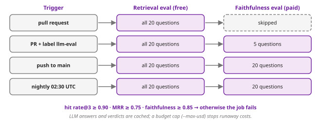

*.github/workflows/rag-eval.yml (faithfulness job):*

```yaml
  faithfulness:                 # costs money: run it deliberately
    needs: retrieval
    if: >-
      github.event_name != 'pull_request' ||
      contains(github.event.pull_request.labels.*.name, 'llm-eval')
    runs-on: ubuntu-latest
    timeout-minutes: 20
    services:
      postgres:
        image: pgvector/pgvector:pg17
        env:
          POSTGRES_PASSWORD: postgres
        ports: ["5432:5432"]
        options: >-
          --health-cmd "pg_isready -U postgres"
          --health-interval 5s --health-retries 10
    env:
      LLM: claude
      LLM_CACHE_DIR: eval/.cache/llm
      ANTHROPIC_API_KEY: ${{ secrets.ANTHROPIC_API_KEY }}
      # 5 questions on labelled PRs, the full set on main and nightly
      LIMIT: ${{ github.event_name == 'pull_request' && '5' || '20' }}
    steps:
      - uses: actions/checkout@v7
      - uses: astral-sh/setup-uv@v10.3.3
        with:
          enable-cache: true
      - run: uv sync --locked
      - uses: actions/cache@v6
        with:
          path: .cache/fastembed
          key: fastembed-bge-small-en-v1.5
      - name: Reuse earlier LLM answers and verdicts
        uses: actions/cache@v6
        with:
          path: eval/.cache
          key: llm-${{ hashFiles('eval/**', 'docs/**', 'src/**') }}
          restore-keys: llm-
      - name: Faithfulness gate (LLM-as-judge, max 0.50 USD)
        run: >
          uv run python eval/run_eval.py --faithfulness
          --limit "$LIMIT" --max-usd 0.50
      - uses: actions/upload-artifact@v7
        if: always()
        with:
          name: rag-scores
          path: eval/scores.json
```

**What if… I raise `max_tokens` and the eval results do not change?**

**What happens:**  Some answers were cut off, so you raise `max_tokens` in
`rag_api/llm.py` from 400 to 800 and run the evaluation in CI. You
get exactly the same, still truncated answers, at zero cost.

**Why:**  Read the cache key in `rag_api/llm.py`: `sha256(model + prompt)`.
The prompt includes the question and the retrieved context, so
changed documents or a changed prompt template invalidate the cache
automatically. But `max_tokens` (and any other request parameter,
such as a system prompt passed separately) is not part of the key,
so the old answers are served from the cache. This gap is in our own
code, and it is typical: a cache key must contain **everything that
influences the result**.

**What you do:**  Build the key from every request parameter, for example
`json.dumps({"model": …, "prompt": …, "max_tokens": …}, sort_keys=True)`.
When in doubt, delete the CI cache (**Actions → Caches**).

**What if… the LLM provider has an outage during CI?**

**What happens:**  The faithfulness job fails with `529 overloaded` or a
timeout. Nobody on `main` can merge, although nothing in the code is
wrong.

**What you do:**  Separate "the model is bad" from "the API was unavailable".
The SDK already retries transient errors (`max_retries`); on top of
that, catch API errors in the eval script and exit with a distinct
status, and let the workflow mark that run as **skipped** with a
warning instead of failed. Do not make a paid, external check a
**required** PR check; the free retrieval gate is. The nightly run
will catch up.

The `services:` block (lines 59–67) starts a real Postgres with the
pgvector extension next to the job, the standard way to give CI a
database. The `if:` (lines 54–56) implements lever 2, the expression
on line 73 picks the subset size, and lines 84–89 restore the cache.

### Operating ML pipelines over time

**Scheduled workflows.** `on: schedule: - cron: "30 2 * * *"` runs a
workflow every night at 02:30 UTC (cron fields: minute, hour, day of
month, month, day of week). Use schedules for things that can break
without a commit: nightly full evaluation, data validation against the
latest upstream data, weekly retraining. Schedules run on the default
branch only, may start a few minutes late, and GitHub disables them
in public repositories after 60 days without activity.

**Data versioning with DVC.** Our CSV is small enough for Git. Real
training data is not. **DVC** (Data Version Control) stores large files
in S3 or similar and commits only a small pointer file (`data.csv.dvc`
with a hash) to Git. `dvc pull` in CI fetches exactly the data version
of that commit, so code, data and model stay linked. Alternatives:
dated, immutable snapshots in S3, or table formats with time travel
(Delta Lake, Apache Iceberg).

**Model cards and changelogs.** A **model card** is a short document
shipped with each model: intended use, training data, metrics per
segment, known limitations, fairness considerations. (We dropped the
`personal_status` column of the German Credit data because it encodes
sex; a model card is where you say so.) Generate the metrics part in
CI from `metrics.json` and attach it to the release, next to a
changelog generated from Conventional Commits.


## 15. Operate in production

*Chapter 7 · Operations: Operate It.* A pipeline ends at "deployed". A senior engineer's responsibility ends at "working for users". This chapter covers the part after the green check mark: logs you can query, alarms, service level objectives, ML-specific signals, incidents and postmortems, cost, and what changes when your employer is a regulated German company.

**After this level you can:**

- Emit structured logs and turn them into queries, metrics and alarms.
- Define an SLO, compute an error budget, and use it to make decisions.
- Monitor a model without labels: proxy signals and a post-deploy distribution check.
- Run a game day, follow a runbook, and write a blameless postmortem.
- Estimate cost per prediction, and map your pipeline to GDPR, the EU AI Act and financial-sector rules.

**What you build:** `credit-api` with JSON request and prediction logs, model lineage in `/health`, a distribution check after every deploy, a runbook, a postmortem template, and a game-day story you can tell in an interview.

### Why operating belongs to CI/CD

Every check in Levels 1–4 runs **before** users see a change. None of
them can answer three questions that only production can: **Is it up
for users right now? Are its decisions still sensible? Did the last
change make anything worse?** Teams that cannot answer these quickly
deploy less often, because each deployment feels risky, which is the
vicious circle from Chapter 1. Observability is what makes frequent
deployment safe, and DORA's stability measures (change failure rate,
recovery time) are measured here, not in CI.

**Interview tip**

"I don't consider a pipeline finished at 'deployed'. For my
credit API, every deploy is followed by a smoke test and a check that
the share of rejected applicants is plausible, and I can say from
`/health` exactly which code, model and data are running."

### Logs you can query

`print("prediction done")` is useless at 2 a.m. A **structured** log line
is a JSON object with named fields, so tools can filter and aggregate
without parsing text. `credit-api` now writes one line per request and
one per prediction (`src/credit_api/app.py`). Real output:

*two log lines (wrapped for print):*

```json
{"event": "request", "request_id": "7c1e", "method": "POST",
 "path": "/predict", "status": 200, "latency_ms": 39.7,
 "app_version": "3f2a1c0"}
{"event": "prediction", "risk": "bad", "probability_bad": 0.5893,
 "unknown_categories": ["purpose"], "unknown_count": 1,
 "model_version": "credit-risk/v1"}
```

Three design choices matter more than the library:

- **A request ID.** The middleware takes `X-Request-ID` from the caller or creates one, returns it in the response, and puts it on every log line. A customer complaint with that ID leads straight to the right lines, across services.
- **Versions on every line.** `app_version` and `model_version` let you split any metric by deployment: "did errors start with `3f2a1c0`?"
- **No personal data.** The prediction line contains the decision, not the applicant. Age, amount and employment are personal data under GDPR; logging them needs a purpose, a retention period and access control. Log what you need to operate, nothing more.

ECS sends stdout to CloudWatch Logs. **CloudWatch Logs Insights**
discovers JSON fields automatically, so you can query them directly:

*Logs Insights queries:*

```text
# p95 latency and request count, per 5 minutes
fields latency_ms
| filter event = "request" and path = "/predict"
| stats pct(latency_ms, 95) as p95, count(*) as n by bin(5m)

# decisions per hour: is the share of 'bad' stable?
filter event = "prediction"
| stats count(*) as n by risk, bin(1h)

# how often do we see categories the model never learned?
filter event = "prediction" and unknown_count > 0
| stats count(*) by bin(1d)
```

#### From logs to alarms

A query answers a question you ask; an **alarm** asks it for you. A
**metric filter** turns matching log lines into a CloudWatch metric, and
an alarm watches the metric:

*terminal:*

```bash
aws logs put-metric-filter --log-group-name <group> \
  --filter-name http-5xx \
  --filter-pattern '{ $.event = "request" && $.status >= 500 }' \
  --metric-transformations \
  metricName=Http5xx,metricNamespace=credit-api,metricValue=1,defaultValue=0
aws cloudwatch put-metric-alarm --alarm-name credit-api-5xx \
  --namespace credit-api --metric-name Http5xx --statistic Sum \
  --period 300 --evaluation-periods 1 --threshold 5 \
  --comparison-operator GreaterThanThreshold \
  --alarm-actions <sns-topic-arn>        # e-mail or chat via SNS
```

(These commands were checked against the AWS CLI reference but not run
for this book; the group name comes from **ECS → service → Logs**.) Two
more alarms complete a minimal setup: p95 latency above your SLO
threshold, and **no** traffic at all when traffic is expected (a broken
client looks exactly like a quiet day). Also set a retention period on
the log group (`aws logs put-retention-policy --retention-in-days 30`):
cheaper, and GDPR asks you to keep data no longer than needed.

**What if… an alarm fires every night and everyone ignores it?**

**What happens:**  The p95 alarm fires daily at 02:00 during the batch import;
after a week, nobody looks. Then a real incident fires the same
alarm.

**What you do:**  An alarm nobody acts on is worse than no alarm: it trains people
to ignore alarms. Every alarm needs a **runbook entry** (what to do) and
must be **actionable**. Fix the cause, change the threshold or window
with a written reason, or delete it. Review alarm history monthly.

### SLOs and error budgets

"The service should be reliable" cannot be measured. A **service level
indicator** (SLI) is a measurement; a **service level objective** (SLO) is
a target for it over a window:

**Concept: An SLO for credit-api**

**SLI:** the share of `/predict` requests that return a non-5xx answer
in under 300 ms, measured at the load balancer or from our logs.
**SLO:** 99.5 % over a rolling 28 days.
**Error budget:** the 0.5 % that may fail. At steady traffic that is
0.005 × 28 days × 24 h = **3.36 hours** of "bad" per 28 days.

The budget turns arguments into arithmetic. While budget remains, the
team ships features at full speed; deployments are **allowed** to
consume some of it. When the budget is spent, an agreed **error budget
policy** applies, for example: only reliability work and fixes are
deployed until the window recovers. Product and engineering agree on
the policy **before** it is needed, which removes the "can we ship this
Friday?" debate.

Alert on how fast the budget burns, not on single errors. If the
service burns budget 14 times faster than sustainable for an hour, a
person must look now (**page**); a slow burn over days becomes a ticket.
Pick SLOs from what users need and what you can measure today; 99.5 %
for an internal scoring API is a defensible start, "five nines" for a
one-person project is not.

**Interview tip**

"I define the SLO before the dashboards: 99.5 % of predictions
under 300 ms over 28 days gives an error budget of about 3.4 hours.
Burn-rate alerts page on fast burn; slow burn becomes a ticket. If the
budget is gone, we freeze features, not people."

### Watching the model, not only the service

HTTP metrics stay green while a model makes bad decisions. The hard
part for credit models is **label delay**: whether a loan defaults is
known months later. Until then you watch **proxies**:

| Signal | Catches | Where |
|---|---|---|
| Share of `risk = bad` per hour | Threshold or model bugs, broken inputs, sudden population change | Logs Insights, alarm |
| Mean `probability_bad` | Slow shifts the share hides | Logs |
| Share of unknown categories | Upstream changes (new products, renamed values) | Logs, alarm |
| Input drift (KS, PSI) vs. training data | Population change before it hurts | Nightly job (Chapter 6) |
| Real performance (AUC on matured loans) | The truth, months late | Monthly job |

#### The distribution check after every deploy

The cheapest proxy runs inside the pipeline. `scripts/distribution_check.py`
sends 200 reference applicants from the committed data set to the
freshly deployed service and checks that the share predicted "bad"
lies between the bounds in `metrics/thresholds.json` (10–50 %; the
true rate in the data is 30 %, and the current model predicts 28 % on
these applicants):

*scripts/distribution_check.py (excerpt):*

```python
def bad_share(post: Post, rows: list[dict[str, object]]) -> float:
    risks = [post(row)["risk"] for row in rows]
    return sum(r == "bad" for r in risks) / len(risks)

def check(share: float, lo: float, hi: float) -> list[str]:
    if share < lo:
        return [f"share of 'bad' {share:.2f} below {lo} (approving too many?)"]
    if share > hi:
        return [f"share of 'bad' {share:.2f} above {hi} (rejecting too many?)"]
    return []
```

It runs right after the smoke test in staging **and** production
(`_deploy-env.yml`, lines 64–67). It is the minimal version of an
**ML-aware canary**: not "does it answer?" but "are its answers
plausible?".

### Game day: the release that passed every check

A **game day** is a planned exercise in which you break something on
purpose to test detection, runbook and people. Run this one; it
becomes your answer to "tell me about an incident".

**The scenario.** A colleague wants fewer false rejections and opens a
PR that changes the default `DECISION_THRESHOLD` in `app.py` from 0.5
to 0.99. We ran exactly this change locally:

*expected output:*

```text
$ uv run pytest -q
31 passed in 1.90s
$ uv run python -m credit_api.gate metrics/metrics.json
QUALITY GATE PASSED
$ python3 scripts/smoke_test.py http://localhost:8099 dev
smoke test passed: {'status': 'ok', ...} {'risk': 'good', ...}
$ python3 scripts/distribution_check.py http://localhost:8099 200
predicted 'bad' share on 200 reference applicants: 0.00
DISTRIBUTION CHECK FAILED: share of 'bad' 0.00 below 0.1
  (approving too many?)
```

Every traditional check is green: the tests, the model gate (which
evaluates the **model**, not the serving threshold), the smoke test. The
service now approves every applicant. Only the distribution check sees
it. With the threshold restored, the same check reports 0.28 and
passes.

**The exercise in AWS.** Merge the change. Watch staging deploy, the
distribution check fail, and production never be reached. Then, as if
the check had not existed, practise the runbook
(`docs/runbook.md`): freeze deploys, find the bad change from
`/health` and the deploy history, revert it, and time each step.
Finally write the postmortem with `docs/postmortem-template.md`.

**What if… the postmortem concludes "the developer should have been more careful"?**

Then it has failed. People will always make changes like this one;
the question is why the **system** let it through. Here: the threshold
is a business decision, but it lived in code without a test or an
owner; no check looked at decisions, only at the model. Good action
items are **prevent** (move the threshold into `thresholds.json`, owned
via CODEOWNERS), **detect** (the distribution check), and **mitigate**
(rollback in two minutes). Blameless does not mean nobody is
responsible; it means you fix the system, so the next person cannot
make the same mistake.

**Interview tip: The incident story, in STAR form**

"**Situation:** in my credit-risk project I ran a game day: a PR moved
the decision threshold from 0.5 to 0.99. **Task:** find out whether my
pipeline would catch a release that is technically fine but approves
everyone. **Action:** all 31 tests, the model gate and the smoke test
passed, so I added a post-deploy check that sends 200 reference
applicants and fails if the rejection share leaves 10–50 %. **Result:**
the bad release stops in staging; I also wrote a runbook and moved
the threshold under code ownership. The lesson: test the **decisions**,
not only the model."

### Runbooks and postmortems

A **runbook** is the page you open when an alarm fires: what the alarm
means, the first three commands, how to roll back, who to call. It is
written calmly, in advance, by the person who knows the system, for
the person who does not. `docs/runbook.md` is a one-page example; keep
it next to the code so it changes with the code.

A **postmortem** (German teams often say *Post-Mortem* or *Nachbetrachtung*)
is written after every incident that used error budget or surprised
someone. The template in `docs/postmortem-template.md` has the usual
parts: summary, impact, timeline, root cause and **contributing
factors**, what went well, and action items with an owner and a date.
Action items without owners are wishes.

### Cost governance

Cloud cost is an engineering metric. Three habits are enough at this
scale:

- **Tag everything** (`project=credit-api`, `env=staging`) and activate the tags as **cost allocation tags** in Billing, so Cost Explorer can split the bill by project and environment.
- **One budget per environment or team**, as in Section 5.1, with alerts to the people who can act.
- **Know your unit cost.** Our production environment costs roughly 1 USD per day (estimate from Section 5.4: load balancer, one small task, public IPs), about 30 USD per month, almost all of it **fixed**.

| Monthly predictions (assumed) | Cost per 1,000 predictions |
|---|---|
| 100,000 | ≈ 0.30 USD |
| 1,000,000 | ≈ 0.03 USD |
| 10,000,000 | ≈ 0.003 USD (more tasks needed; still small) |

At low volume, fixed costs dominate, so the lever is **fewer always-on
resources** (shared load balancer, scale to zero for dev, deleting idle
staging at night), not faster code. CI costs follow the same logic:
free for public repositories; for private ones, the minutes of the
slowest jobs times the number of PR pushes. The LLM evaluation from
Chapter 6 costs under one cent per full run, so 30 nightly runs stay
below 0.30 USD per month; print the estimate in the job summary so a
regression in cost is as visible as a regression in quality.

### Compliance in a regulated German company

Banks, insurers and health companies will ask how your pipeline fits
their rules. You do not need to be a lawyer; you need to show that
your pipeline already **produces the evidence** those rules ask for. The
legal details below are a starting point, not legal advice; dates and
articles change, so verify them with your employer's compliance team.

| Requirement | Evidence your pipeline produces |
|---|---|
| Change management, four-eyes principle (*Vier-Augen-Prinzip*) | Protected `main`, required reviews, CODEOWNERS, production approvals by a second person, the GitHub deployment history. |
| Traceability: what ran when? | Lineage chain (Chapter 6): commit, data hash, model version, image digest, deployment. |
| Technical documentation | Model card, ADRs, README, all versioned with the code. |
| Accuracy and robustness | Metric gates, slice gates, behavioural tests, the variance measurement. |
| Record-keeping / logging | Structured logs with versions and request IDs, with a defined retention period. |
| Human oversight | Manual production approval; the runbook; the ability to stop and roll back. |

The regulations behind the table, briefly:

- **GDPR** (*DSGVO*). No real personal data in test fixtures, golden sets or logs without a legal basis; data minimisation and retention limits. Automated decisions with legal or similarly significant effects on people (a loan rejection) are regulated (Art. 22), and high-risk processing needs a **data protection impact assessment** (*Datenschutz-Folgenabschätzung*, Art. 35). If an LLM provider processes personal data, where it is processed matters; check your provider's data-residency options.
- **EU AI Act.** Credit scoring of natural persons is listed as a **high-risk** use (*Hochrisiko-KI-System*). Obligations for high-risk systems include risk management, data governance, technical documentation, automatic logging, transparency, human oversight, and accuracy and robustness. The application dates for high-risk systems have been the subject of political change; verify the current timeline.
- **DORA, the regulation.** In the financial sector, "DORA" usually means the EU **Digital Operational Resilience Act**, which applies since January 2025: ICT risk management, incident classification and reporting, resilience testing, third-party (cloud) risk. Do not confuse it with the DevOps metrics in Chapter 8 in an interview at a bank; mentioning both, correctly, is a strong signal. German supervisory expectations (BaFin) add to this; ask what your employer follows.
- **Works council** (*Betriebsrat*). Systems that can monitor employees' behaviour or performance are subject to co-determination in Germany. A RAG assistant that logs employees' questions (our `rag-api`) is a typical case: expect the works council to have a say in what is logged and who can read it.

**Interview tip**

"I'd map the pipeline to the controls the auditors already
have: PR reviews and production approvals are our four-eyes
evidence, the lineage chain answers 'what ran when', and the logs
carry versions but no applicant data. For a credit model I'd also
ask early whether the AI Act's high-risk obligations and DORA
apply."

**Exercise: Your first alarm**

Deploy `credit-api` to staging, create the `http-5xx` metric filter
and alarm, and make it fire on purpose (hint: what does `/predict`
return when the model file is missing? Which status code does that
produce, and does it count?). Then write the runbook entry for it.

**Exercise: Budget arithmetic**

Your SLO is 99.9 % over 30 days. How many minutes of full outage does
the error budget allow? A deployment causes 4 minutes of 50 % errors.
How much budget did it consume?

**Exercise: Run the game day**

Run the threshold game day locally (change the default, start
`uvicorn`, run `scripts/distribution_check.py`). Then fill in the
postmortem template as if it had reached production at 10:47 and
been rolled back at 11:20.

**Checkpoint: you should now be able to…**

- emit structured logs with request ID and versions, without personal data, and query them with Logs Insights;
- turn a log pattern into a metric and an alarm, and keep alarms actionable;
- define an SLI and SLO, compute the error budget, and explain burn-rate alerting and an error budget policy;
- monitor a model under label delay with proxy signals and a post-deploy distribution check;
- run a game day, use a runbook, and write a blameless postmortem;
- estimate cost per 1,000 predictions, and map the pipeline to GDPR, the EU AI Act, DORA and the works council.


## 16. DevOps overview

*Chapter 8 · Level 5: DevOps-Level Overview.* You will not build these in this book, but you will hear about them in every platform team and in many interviews. For each topic: the problem it solves, when an ML engineer meets it, and one sentence you can say about it with confidence.

**After this level you can:**

- Recognise Kubernetes, Helm, GitOps, IaC pipelines and deployment strategies, and place them next to what you built.
- Explain supply-chain security, DORA metrics and platform engineering in plain words.

### Running and shipping at scale

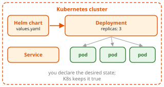

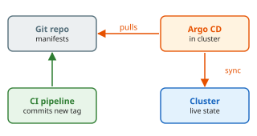

#### Kubernetes and Helm

**Problem:** Running many containers on many machines: placement, restarts, scaling, networking, rolling updates. **Kubernetes** (K8s) does this from **declarative** YAML ("I want 3 replicas of this image"); a **Helm chart** is a parameterised package of that YAML, installed with different `values.yaml` per environment.

**You meet it when:** your company runs a shared cluster (Amazon EKS, GKE, AKS), or you serve models with KServe, Ray Serve or a GPU node pool.

**Say it:** *"ECS Express is the managed version of what a Kubernetes Deployment plus Service plus Ingress give you; with Helm I'd template the same service for staging and production."*

**What if… the pods keep restarting with `CrashLoopBackOff`?**

The Kubernetes version of "unhealthy on Fargate": the container
exits, Kubernetes restarts it with increasing delays. `kubectl
describe pod <name>` shows the events (OOMKilled? image pull
failed?), `kubectl logs <name> --previous` the output of the crashed
run. The causes are the ones from Level 3: listen address, port,
memory, missing model file.

#### GitOps (Argo CD, Flux)

**Problem:** CI pipelines that push to clusters need cluster credentials, and the real state drifts from what Git says. In **GitOps**, Git is the single source of truth: an agent **inside** the cluster pulls the desired state from a repository and continuously reconciles it. CI only commits a new image tag; it never touches the cluster.

**You meet it when:** a platform team owns the clusters and you "deploy" by merging a PR into a config repository.

**Say it:** *"With GitOps, a deployment is a Git commit and a rollback is a revert: auditable, reviewable, and the cluster heals drift by itself."*

**What if… someone fixes production by hand with `kubectl edit`?**

Argo CD marks the application **OutOfSync**, and with auto-sync it
reverts the change within minutes, so the "fix" disappears in the
middle of an incident. That is the point: the fix must go through
Git. Emergency changes are a PR to the config repository with fast
review, not a terminal session.

#### Infrastructure as Code pipelines (Terraform, AWS CDK)

**Problem:** We created AWS resources with a shell script; in a team that is not reviewable or repeatable. **IaC** describes infrastructure in code (Terraform HCL, or Python/TypeScript with CDK). The pipeline runs `terraform plan` on each PR and posts the diff as a comment; `apply` runs only after merge, often with approval. State is stored remotely (S3 with locking) so two runs never collide.

**You meet it when:** you need a new S3 bucket, queue or GPU instance: you open a PR in the infra repository instead of clicking in the console.

**Say it:** *"I treat infrastructure like application code: plan on the PR, review the diff, apply on merge, no console changes in production."*

**What if… the `plan` on the PR said "1 to change", but `apply` wants to destroy a database?**

Something changed between plan and apply: another PR merged first,
or someone changed the resource in the console (**drift**). Good IaC
pipelines save the plan file from the PR and apply **exactly that
plan**, or re-plan and require approval again if it differs. Protect
stateful resources with `prevent_destroy` (Terraform) or deletion
protection, so that no plan can delete them by accident.

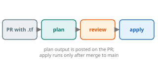

### Releasing safely

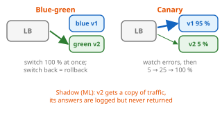

#### Blue-green, canary, feature flags

**Problem:** A deployment that goes to 100 % of users at once makes every bug a full outage. **Blue-green** runs the new version (green) next to the old (blue) and switches traffic at once, so rollback is switching back. **Canary** sends a small share of traffic (5 %) to the new version, watches error rates and metrics, then increases. **Feature flags** ship code switched off and enable it per user group at runtime. For ML, **shadow deployment** sends a copy of real traffic to the new model and only logs its answers, so you compare models on production data with zero risk.

**You meet it when:** you replace a model that drives business decisions, or ECS Express runs its built-in canary for you.

**Say it:** *"For a new model I'd start with shadow traffic to compare predictions offline, then a canary with automatic rollback on error and latency alarms."*

**What if… the canary has no errors, but its predictions are different?**

HTTP-level canary checks (5xx rate, latency) are blind to ML quality:
a model that approves everyone answers fast and without errors. For
model changes, also compare **prediction distributions** between the
canary and the stable version (share of "bad", mean probability)
and roll back on a large difference. Ground truth (did the loan
default?) arrives months later, which is why shadow deployments and
distribution checks matter so much in ML.

#### Choosing a release strategy

Knowing the names is junior; choosing is senior. The choice depends
on what you can afford and what you can **measure** quickly:

| Strategy | Extra cost | Rollback | Catches | Needs |
|---|---|---|---|---|
| Rolling (ECS default) | none | minutes (redeploy) | crashes, failed health checks | health checks |
| Blue-green | 2× capacity during switch | seconds (switch back) | config and startup errors before traffic | stateless service or compatible schema |
| Canary | small | seconds–minutes, can be automatic | errors and latency under real traffic | enough traffic for metrics to mean something; alarms |
| Shadow | 2× compute for shadowed traffic | nothing to roll back | prediction differences on real inputs, zero user risk | request duplication; offline comparison |
| Feature flag | code complexity | instant (flip) | business impact per user group | flag service, cleanup discipline |

For ML, the decisive column is often missing from such tables: **how
long until you know the model is wrong?** With fast labels (fraud
chargebacks within days), a canary on business metrics works. With
slow labels (loan defaults after months), a canary can only prove the
service is healthy; model quality needs shadow comparison before the
release and distribution checks after it, which is exactly what
`credit-api` does with its post-deploy distribution check (Chapter 7).

#### Monorepos and reusable workflows

**Problem:** Ten services with ten nearly identical workflow files drift apart. **Reusable workflows** (`workflow_call`, as our `_deploy-env.yml`) and **composite actions** put the shared logic in one place; in a **monorepo** (all services in one repository), path filters and tools such as Bazel, Nx or Pants build and test only what changed.

**You meet it when:** your team's ML services and libraries live in one big repository.

**Say it:** *"In my project one reusable deploy workflow serves both environments; across services I'd publish it as a tagged, shared workflow, so a security fix to the pipeline is one PR."*

**What if… a change to the shared reusable workflow breaks ten services?**

Version reusable workflows like actions: callers reference a tag
(`uses: org/pipelines/.github/workflows/deploy.yml@v3`), not `@main`.
The platform team releases `v4`, and services upgrade one by one,
ideally through Dependabot PRs that run each service's CI.

#### Self-hosted runners

**Problem:** GitHub's hosted runners have no GPU, no access to your private network, and limited CPU/RAM. **Self-hosted runners** are your own machines (often autoscaled on Kubernetes with Actions Runner Controller) that pick up jobs. Larger hosted runners, including GPU runners, are a paid alternative.

**You meet it when:** training or GPU tests must run in CI, or the pipeline needs data inside a private VPC.

**Say it:** *"Self-hosted runners must be ephemeral and never used for public repositories, because a PR from a fork could run code on them."*

**What if… a self-hosted runner is reused between jobs?**

A job can leave files, credentials or a modified Python installation
behind, and the next job (perhaps from another repository) inherits
them. Use **ephemeral** runners (`--ephemeral`, one job per runner)
that are destroyed after each job, as Actions Runner Controller does
by default.

### Security, measurement, organisation

#### Software supply-chain security

**Problem:** Your image contains hundreds of packages you did not write; any of them, or a compromised GitHub Action, can be an attack path. Defences: **dependency scanning** (Dependabot, `pip-audit`) and **image scanning** (Trivy, ECR scan on push, which we enabled); **SBOMs** (software bill of materials: a machine-readable list of everything in the image, e.g. with Syft); **image signing** with Sigstore **cosign** and verification before deploy; **pinning actions to commit SHAs**; and **SLSA** provenance, a signed record of how and from which commit an artefact was built.

**You meet it when:** a security review asks "how do you know what is in your container?" or a CVE appears in a library you use.

**Say it:** *"I'd give every image an SBOM and a vulnerability scan in CI, fail on critical CVEs with time-limited exceptions, sign by digest, and pin third-party actions by SHA."*

**What if… the image scan fails on a critical CVE with no fix available?**

Blocking every deployment until upstream ships a fix can be worse
than the risk. Teams keep an **exception file** (Trivy's `.trivyignore`
with an expiry date and a reason), reviewed like code, and check
whether the vulnerable code is reachable at all. What matters is
that the decision is explicit, recorded and time-limited.

#### Supply-chain checks in practice

The four commands below are the core of a supply-chain stage after
`docker build` in `deploy.yml`. They were not run for this book;
install each tool with its vendor's official GitHub Action and check
the current version and flags in its documentation.

*supply-chain stage (sketch):*

```bash
# 1. fail the build on critical, fixable vulnerabilities
trivy image --exit-code 1 --severity CRITICAL --ignore-unfixed "$IMAGE"
# 2. software bill of materials, kept as a build artefact
syft "$IMAGE" -o spdx-json > sbom.spdx.json
# 3. sign the image by digest, keyless (uses the job's OIDC token)
cosign sign --yes "$DIGEST"
# 4. before deploying: verify who signed it
cosign verify "$DIGEST" \
  --certificate-identity-regexp 'github.com/<you>/credit-api' \
  --certificate-oidc-issuer https://token.actions.githubusercontent.com
```

Signing **by digest** is why the deploy job now passes a digest instead
of a tag (Chapter 5): a signature on a tag would say nothing about
which bytes it covers. For organisation-wide reusable workflows, AWS
trust policies can also check the OIDC claim `job_workflow_ref`, which
names the **workflow file** that runs, so only the platform team's
reviewed deploy workflow can assume the production role.

#### DORA metrics

**Problem:** How do you know whether delivery is getting better? The DORA research programme found four (now five) measures that predict performance: **deployment frequency**, **lead time for changes** (commit to production), **change failure rate**, **failed deployment recovery time** (called "time to restore service" in older reports), and more recently **rework rate** (unplanned deployments to fix problems). Elite teams deploy on demand, with lead times under a day and fast recovery.

**You meet it when:** management asks for "engineering metrics", or you justify investment in CI/CD.

**Say it:** *"I'd measure lead time and change failure rate together: if small PRs and automated gates make us faster but the failure rate rises, we have only moved the work to incident handling."*

**What if… management wants to compare teams by DORA metrics?**

The research designed them to help a team improve itself, not to
rank teams. Used as targets, they get gamed: deployment frequency
rises with empty deployments. Answer with trends of **one** team over
time, and always show speed (frequency, lead time) together with
stability (failure rate, recovery time).

#### Platform engineering

**Problem:** When every team builds its own pipelines, clusters and monitoring, everyone solves the same problems badly. A **platform team** builds an internal developer platform: golden-path templates ("new ML service" creates repo, CI, deploy, dashboards), self-service infrastructure and a portal such as Backstage. Product and ML teams consume it like a product.

**You meet it when:** your company has a "platform" or "MLOps platform" team, and you are either its customer or you join it.

**Say it:** *"I'd treat the pipeline I built as a golden-path template: the next model service should get CI, gates and deployment by answering a few questions."*

### Capstone: from shell script to Terraform

`infra/setup.sh` works, and it is the first thing a senior reviewer
will question: it is imperative ("create this, then that"), has no
plan step and no review of infrastructure changes. Rebuilding it in
Terraform is the most valuable next project after this book; plan
about one weekend. The shape of the solution (a sketch, not run for
this book; check the current AWS provider documentation):

*infra/main.tf (excerpt, sketch):*

```text
terraform {
  backend "s3" {                      # remote state, shared and locked
    bucket       = "<you>-tfstate"
    key          = "credit-api/terraform.tfstate"
    region       = "eu-central-1"
    use_lockfile = true               # S3-native locking (newer versions)
  }
}

resource "aws_ecr_repository" "api" {
  name                 = "credit-api"
  image_tag_mutability = "IMMUTABLE"
  image_scanning_configuration { scan_on_push = true }
}

resource "aws_iam_role" "deploy" {
  for_each = toset(["staging", "production"])
  name     = "github-credit-api-${each.key}"
  assume_role_policy = templatefile("trust.json.tftpl", {
    subject = "repo:<you>/credit-api:environment:${each.key}"
  })
}
```

And the pipeline around it:

1. **On every PR** touching `infra/`: `terraform fmt -check`, `terraform validate`, `terraform plan -out=tfplan`, and post the plan as a PR comment. Reviewers read the plan, not only the code: "1 to add, 0 to destroy" is the sentence that matters.
1. **On merge**: `terraform apply` in a job with `environment: infrastructure` (required reviewers), using a dedicated OIDC role.
1. **Nightly**: `terraform plan -detailed-exitcode`; exit code 2 means the real infrastructure differs from the code (**drift**), and opens an issue.
1. Protect stateful resources (`lifecycle { prevent_destroy = true }`) and keep **one state per environment**, so a mistake in staging cannot plan changes to production.

The bootstrap problem has a standard answer: the state bucket and the
first OIDC role are created once by hand (or by a tiny separate
configuration), everything else by the pipeline.

**Interview tip: Where to go next**

After Terraform, the two strongest additions to `credit-api` are the
supply-chain stage above (scan, SBOM, sign, verify) and deploying the
same image to a local Kubernetes cluster (kind) with a Helm chart.
Each makes a strong second portfolio story; Chapter 9 shows how to
present them.


## 17. Cheat sheets & fixes

*Chapter 10: Appendices.* An index of every "what if" scenario in the book, cheat sheets to keep next to your keyboard, a troubleshooting table for the errors you will meet, a glossary with the German terms used at work, solutions to all exercises, and a study plan.

### Cheat sheet: Git

#### Everyday

| Command | What it does |
|---|---|
| `git switch -c feat/x` | new branch from current HEAD |
| `git pull --rebase` | update, replaying local commits on top |
| `git push -u origin feat/x` | first push of a branch |
| `git log --oneline --graph --all` | history as a graph |
| `git diff --staged` | what the next commit will contain |

#### Rebase

| Command | What it does |
|---|---|
| `git fetch && git rebase origin/main` | update feature branch |
| `git rebase -i origin/main` | squash / reword / reorder / drop |
| `git commit --fixup <sha>` | mark a fix for an earlier commit |
| `git rebase -i --autosquash origin/main` | apply fixups |
| `git push --force-with-lease` | push rewritten history safely |

#### Conflicts

| Command | What it does |
|---|---|
| `git status` | list conflicted files ("both modified") |
| `git add <file>` then `git commit` | finish a merge |
| `git add <file>` then `git rebase --continue` | next commit |
| `git merge --abort` / `git rebase --abort` | back to before |
| `git checkout --ours∣--theirs <file>` | take one side entirely |
| `git config --global rerere.enabled true` | reuse resolutions |

#### Stash and worktree

| Command | What it does |
|---|---|
| `git stash push -m "msg"` / `-u` | park changes (+ untracked) |
| `git stash list` / `show -p stash@{0}` | inspect |
| `git stash apply` / `pop` / `drop` | restore / restore+delete |
| `git worktree add ../dir <branch>` | second working directory |
| `git worktree list` / `remove ../dir` | manage worktrees |

#### Recovery

| Command | What it does |
|---|---|
| `git reset --soft HEAD~1` | undo last commit, keep it staged |
| `git reset --hard <sha>` | discard everything after `<sha>` |
| `git revert <sha>` / `-m 1 <merge>` | undo with a new commit |
| `git reflog` | where HEAD has been: find "lost" commits |
| `git cherry-pick -x <sha>` | copy one commit here |
| `git bisect start` / `bad` / `good <tag>` | binary search |
| `git bisect run uv run pytest -q` | automatic bisect |

### Cheat sheet: GitHub Actions

*syntax overview:*

```yaml
on:
  push: {branches: [main], tags: ["v*"], paths-ignore: ["**.md"]}
  pull_request:
  schedule: [{cron: "30 2 * * *"}]     # min hour dom month dow (UTC)
  workflow_dispatch:                   # manual button (+ inputs:)
  workflow_call:                       # reusable workflow (+ inputs:)

permissions: {contents: read, id-token: write}   # least privilege
concurrency: {group: ci-${{ github.ref }}, cancel-in-progress: true}
env: {AWS_REGION: eu-central-1}                  # workflow-wide

jobs:
  build:
    runs-on: ubuntu-latest
    timeout-minutes: 15
    needs: [lint]                       # run after lint succeeded
    if: github.ref == 'refs/heads/main' # condition for the job
    environment: production             # approvals, env secrets
    strategy:
      fail-fast: false
      matrix: {python: ["3.12", "3.13"], os: [ubuntu-latest]}
    services:                           # side containers, e.g. a DB
      db: {image: "pgvector/pgvector:pg17", ports: ["5432:5432"]}
    outputs: {image: "${{ steps.push.outputs.image }}"}
    steps:
      - uses: actions/checkout@v7
      - id: push
        run: echo "image=repo:$GITHUB_SHA" >> "$GITHUB_OUTPUT"
      - if: failure()                   # also: always(), success()
        run: echo "### failed" >> "$GITHUB_STEP_SUMMARY"
```

#### Expressions and contexts

| Command | What it does |
|---|---|
| `${{ secrets.NAME }}` / `${{ vars.NAME }}` | secret / variable |
| `${{ github.sha }}` · `github.ref` · `github.event_name` | commit, ref, trigger |
| `${{ matrix.python }}` · `needs.build.outputs.image` | matrix value, job output |
| `${{ hashFiles('uv.lock') }}` | hash for cache keys |
| `contains(github.event.pull_request.labels.*.name, 'x')` | PR has label x |

#### Useful CLI (gh)

| Command | What it does |
|---|---|
| `gh run list` / `gh run watch` / `gh run view --log-failed` | follow runs, show only failing logs |
| `gh workflow run deploy.yml -f sha=...` | trigger manually |
| `gh pr checks --watch` | PR status in the terminal |

### Cheat sheet: Docker

#### Images

| Command | What it does |
|---|---|
| `docker build -t app:dev .` | build from `./Dockerfile` |
| `docker build --platform linux/amd64 -t app .` | x86 image on a Mac |
| `docker images` / `docker image rm app:dev` | list / delete |
| `docker history app:dev` | layers and their sizes |
| `docker tag app:dev <registry>/app:<sha>` | add a name |
| `docker push <registry>/app:<sha>` | upload to a registry |

#### Containers

| Command | What it does |
|---|---|
| `docker run --rm -p 8080:8080 -e K=V app:dev` | run, map port, set env, delete on exit |
| `docker run --rm -it app:dev bash` | shell inside the image |
| `docker ps` / `docker logs -f <id>` | running containers, logs |
| `docker exec -it <id> sh` | shell in a running container |
| `docker stop <id>` | stop |

#### Cleanup and compose

| Command | What it does |
|---|---|
| `docker system df` / `docker system prune` | disk use / clean |
| `docker compose up -d` / `down` | start / stop `docker-compose.yml` |

#### Dockerfile checklist

| Command | What it does |
|---|---|
| slim base, multi-stage, `--locked` deps | small, reproducible |
| deps before source | layer cache works |
| `USER` non-root, `.dockerignore` | security, small context |
| `EXPOSE`, `HEALTHCHECK`, exec-form `CMD [...]` | operability |

### Cheat sheet: AWS CLI used in this book

#### Identity

| Command | What it does |
|---|---|
| `aws configure sso` / `aws sso login` | log in via Identity Center |
| `aws sts get-caller-identity` | who am I, which account |

#### ECR

| Command | What it does |
|---|---|
| `aws ecr create-repository --repository-name app` | registry (add `--image-tag-mutability IMMUTABLE`) |
| `aws ecr get-login-password ∣ docker login ...` | manual login: `--username AWS --password-stdin <registry>` |
| `aws ecr describe-images --repository-name app` | list images |
| `aws ecr delete-repository --repository-name app --force` | delete with images |

#### IAM / OIDC

| Command | What it does |
|---|---|
| `aws iam create-open-id-connect-provider ...` | trust GitHub's OIDC tokens, once per account (see `infra/setup.sh`) |
| `aws iam create-role --role-name R ...` | role + trust policy (`--assume-role-policy-document file://trust.json`) |
| `aws iam put-role-policy` / `attach-role-policy` | permissions |

#### ECS Express Mode

| Command | What it does |
|---|---|
| `aws ecs create-express-gateway-service ...` | create service |
| `aws ecs describe-express-gateway-service --service-arn A` | status, URL |
| `aws ecs monitor-express-gateway-service --service-arn A` | watch resources |
| `aws ecs delete-express-gateway-service --service-arn A` | delete service + its ALB |
| `aws ecs list-services --cluster default` | what is running |

#### Cost and cleanup

| Command | What it does |
|---|---|
| `aws elbv2 describe-load-balancers` | leftover load balancers? |
| `aws resourcegroupstaggingapi get-resources` | tagged leftovers |
| `aws logs delete-log-group --log-group-name G` | delete logs |

### Troubleshooting

| Error or symptom | Cause and fix |
|---|---|
| `The lockfile at uv.lock needs to be updated` | `pyproject.toml` changed without a new lock: run `uv lock`, commit `uv.lock`. |
| Tests pass locally, fail in CI | File not committed (check `.gitignore`), missing env var, absolute path, timezone, or a dependency only in your global Python. |
| `ModuleNotFoundError: credit_api` | Package not installed: run via `uv run`, keep the `src/` layout and the build-system table. |
| Required check "Expected — Waiting for status" | The workflow was skipped (path filter) or the check name changed (matrix); require one aggregator job such as `ci-ok` instead. |
| `! [rejected] … (stale info)` on push | Someone pushed to your branch since your last fetch. Look with `git log HEAD..origin/<branch>` before forcing anything. |
| `fatal: Need to specify how to reconcile divergent branches` | Local and remote branch both have new commits. Usually `git pull --rebase`; set `pull.rebase true` once. |
| `Connection reset by peer` from a container | App listens on `127.0.0.1`; start it with `--host 0.0.0.0`. |
| Exit code 137 / `OutOfMemoryError` | Process killed for memory: raise task memory, or train on a smaller sample in CI. |
| `CannotPullContainerError` on rollback | The image was expired by the ECR lifecycle policy; keep release images longer. |
| `expected 384 dimensions, not 768` (pgvector) | Embedding model changed without re-indexing; rebuild the index for the new model. |
| Job refused: branch not allowed to deploy to the environment | The environment's deployment-branch rule (only `main`). Working as intended; deploy from `main`. |
| `AccessDenied … UpdateExpressGatewayService` | The deploy role's service ARN pattern does not match; compare with `aws ecs list-services` and fix `permissions-deploy.json`. |
| `DISTRIBUTION CHECK FAILED` | Decisions implausible: check `DECISION_THRESHOLD`, `/health` model version and input changes before anything else; do not approve production. |
| `Could not load credentials from any providers` | Missing `permissions: id-token: write` in the workflow or job. |
| `Not authorized to perform sts:AssumeRoleWithWebIdentity` | Trust policy `sub` does not match: check repo name, branch, environment name (case-sensitive) and the OIDC provider ARN. |
| `AccessDenied ... ecr:InitiateLayerUpload` | Permissions policy names the wrong repository ARN or region. |
| `tag invalid: ... already exists` (ECR) | Immutable tags: you pushed the same tag twice. Use the SHA; never `latest`. |
| `exec format error` in the task | Image built for arm64 on a Mac; build with `--platform linux/amd64` or in CI. |
| `Unable to assume the service linked role` | IAM roles are eventually consistent; wait a minute after `setup.sh` and retry. |
| Service never becomes healthy | Wrong `container-port` or `health-check-path`; `/health` returns 503 when the model file is missing; read the task logs in CloudWatch. |
| Smoke test: `wrong version` | Old tasks still serve traffic during a deployment; the script retries, increase attempts if needed. |
| `UntrustedTypesFoundException` (MLflow) | MLflow 3 uses skops; pass `skops_trusted_types` for types you trust. |
| Quality gate red, nothing changed | Usually the **evaluation** changed (split, rows, parsing), not the model: compare predictions on the same rows. Widen `max_drop` only from measured variance (`scripts/variance.py`). |
| Schedule did not run | Schedules run on the default branch only, can be delayed, and stop after 60 days of inactivity (public repos). |
| Secret is empty in a PR run | Secrets are not passed to PRs from forks; run that job on `push` or behind a label. |
| `eval budget of $0.5 used up` | The cost cap triggered: check for a loop, a cache miss storm or a changed prompt. |

### Glossary (English · Deutsch)

| English | Deutsch | Meaning |
|---|---|---|
| Artefact | *Artefakt* | file produced and kept by a pipeline |
| Branch | *Zweig, Branch* | independent line of development |
| Build | *Build, Erstellung* | turning source into a runnable artefact |
| Code review | *Code-Review, Begutachtung* | colleagues check a PR |
| Container image | *Container-Image* | packaged app + dependencies |
| Continuous delivery | *kontinuierliche Bereitstellung* | always releasable; prod on click |
| Continuous integration | *kontinuierliche Integration* | merge often, test automatically |
| Deployment | *Bereitstellung, Deployment* | putting a version live |
| Environment | *Umgebung* | dev / staging / production |
| Merge conflict | *Merge-Konflikt* | competing changes to same lines |
| Pipeline | *Pipeline* | automated sequence of stages |
| Production | *Produktion(sumgebung)* | where real users are served |
| Pull request | *Pull-Request, Änderungsanfrage* | proposed change |
| Quality gate | *Qualitätsschranke* | check that must pass |
| Release | *Release, Veröffentlichung* | a published version |
| Rollback | *Zurücksetzen, Rollback* | back to previous version |
| Secret | *Geheimnis, Zugangsdaten* | credential, never in code |
| Smoke test | *Rauchtest, Smoke-Test* | quick post-deploy check |
| Test coverage | *Testabdeckung* | share of code run by tests |
| Unit test | *Unit-Test, Modultest* | tests one small unit |
| Version control | *Versionsverwaltung* | Git and friends |
| Data protection (GDPR) | *Datenschutz (DSGVO)* | EU privacy law |
| On-call | *Rufbereitschaft* | being reachable for incidents |
| Service level objective | *Service-Level-Ziel (SLO)* | target for a measured reliability indicator |
| Error budget | *Fehlerbudget* | allowed unreliability per window |
| Change management | *Änderungsmanagement* | controlled, documented changes |
| Four-eyes principle | *Vier-Augen-Prinzip* | a second person approves |
| Works council | *Betriebsrat* | employee representation; co-decides on monitoring |
| Data protection impact assessment | *Datenschutz-Folgenabschätzung* | GDPR Art. 35 risk assessment |
| High-risk AI system | *Hochrisiko-KI-System* | AI Act category, e.g. credit scoring |
| Incident / post-mortem | *Störung / Nachbetrachtung* | outage and its blameless review |
| English | *Deutsch* | Meaning |


## 18. System design

*Chapter 9 · Career: The Senior Toolkit.* You can now build and operate the pipeline. This chapter is about the other half of a senior role: designing delivery for more than one team, answering interview questions with trade-offs instead of features, and turning two repositories into evidence that a hiring manager believes.

**After this level you can:**

- Recognise what makes an answer sound senior, and rewrite junior answers.
- Work through a system-design question: a delivery platform for ten ML teams.
- Answer fifteen senior CI/CD questions, and tell honest "tell me about a time" stories from your own project.
- Turn `credit-api` and `rag-api` into a portfolio: README, ADRs, measurements, demo, CV bullets.

**What you build:** An interview kit you have rehearsed aloud, a portfolio README with measured numbers, three or more ADRs, and four CV bullets you can defend in any follow-up question.

### What "senior" sounds like

Interviewers for senior roles rarely ask "what is a pipeline?". They
ask open questions and listen for **signals**. The same knowledge can
sound junior or senior:

| Signal | Junior answer | Senior answer |
|---|---|---|
| Trade-offs | "We used canary deployments." | "Canary needs enough traffic for the metrics to mean something; at 50 requests a minute I used a smoke test plus a distribution check instead." |
| Numbers | "The gate prevents bad models." | "The split alone moves AUC by ±0.025, so I set the tolerance to 0.03 and fixed the split." |
| Failure | "It worked well." | "My first role design let any branch reach production through staging; a review found it, and I split the role." |
| Scope | "I built the pipeline." | "I'd turn it into a template so the next team gets it in a day; here is what they may change." |
| Uncertainty | Guesses a fact. | "I haven't run that at scale; I'd check X and measure Y first." |
| Users | Talks about tools. | Talks about who is affected: the applicant, the reviewer at 2 a.m., the auditor. |

A useful habit: answer in the order **context → options → decision →
cost → what I'd watch**. "It depends" is a senior phrase only if you
then say **on what**.

### System design: a delivery platform for ten ML teams

**Concept: The question**

"You join as a senior ML engineer. Ten teams each build models and
deploy them their own way: copied workflows, long-lived AWS keys,
manual deploys on Fridays. Design how they should build, test and
deliver models. You have 45 minutes."

#### Step 1: clarify (5 minutes)

Ask before you draw. Each answer changes the design:

- **Online or batch?** APIs with latency targets, or nightly scoring jobs, or both. (Both, usually.)
- **How regulated?** A bank (four-eyes principle, audit trail, DORA) or a startup?
- **Where do they run today?** One AWS account or many; Kubernetes or ECS; how mature is the platform team?
- **What hurts most?** Incidents, slow delivery, cost, audit findings? The answer sets your first milestone.
- **How many people for the platform?** Two engineers design differently from twenty.

Assume for this answer: a German bank, online and batch models, AWS,
ECS today, two platform engineers, and an audit finding about manual
production changes.

#### Step 2: the design (25 minutes)

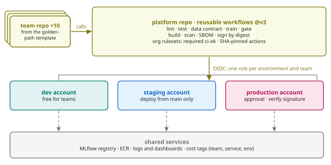

Walk through it in layers, and give each decision its reason:

1. **Golden-path template.** A template repository ("new model service") creates repo, CI, deploy, runbook skeleton, dashboards and a model card in one step (a cookiecutter template, or Backstage software templates if the company runs Backstage). Teams start on the paved road instead of copying last year's workflow.
1. **Reusable workflows, versioned.** The steps live once, in a platform repository, released by tag (`@v3`). Teams call them with a few inputs. Dependabot opens upgrade PRs; each team's CI proves the upgrade. A security fix becomes one release, not ten PRs.
1. **Accounts and identity.** Separate AWS accounts for dev, staging and production (AWS Organizations). No long-lived keys: OIDC roles per environment and team; production roles trust only the `production` environment and, via `job_workflow_ref`, only the platform's deploy workflow. This removes the audit finding at the root.
1. **Guardrails, not gatekeepers.** Organisation rulesets require the platform's check (`ci-ok`) and reviews on every repo; actions are pinned by SHA; images are scanned, get an SBOM, are signed by digest and **verified** before production deploys. Teams cannot skip these; everything else is theirs to change.
1. **ML specifics.** A shared MLflow registry and artefact store; promotion through gated aliases; a model card and lineage record are required artefacts of every production deploy. Data contracts and metric gates are **in** the template, thresholds owned by each team.
1. **Release and operations.** Continuous delivery with approval for models making credit decisions; canary or blue-green for services with enough traffic; standard JSON logs, an SLO per service, runbook and postmortem templates.
1. **Cost.** Mandatory cost tags (`team`, `service`, `env`) enforced in IaC; a monthly cost report per team; budgets per account.

#### Step 3: rollout and measurement (10 minutes)

A platform nobody adopts has failed. Say how you would roll out:

- **Phase 1 (month 1–2):** OIDC and the reusable CI workflow with two pilot teams, picked because they have the most pain. Remove their long-lived keys.
- **Phase 2 (month 3–4):** deploy workflow, environments, signing; the production account accepts only platform-built images.
- **Phase 3:** template for new services; migrate the rest team by team, with office hours, not a deadline email.
- **Measure:** DORA measures per team (lead time, deployment frequency, change failure rate, recovery time), share of repos on the current workflow version, number of long-lived keys (target: zero), audit findings closed.

#### Step 4: name the risks (5 minutes)

- **Too rigid:** teams fork the workflow and drift. Mitigation: inputs for the common variations, an "escape hatch" process, and a platform roadmap teams can influence.
- **Platform team becomes a bottleneck:** self-service over tickets; documented contribution path for teams.
- **Big-bang migration:** never. Pilot, measure, then expand.

**Interview tip**

"I'd treat the platform as a product with internal customers:
start with the two teams that hurt most, remove long-lived keys first
because that's also the audit finding, and measure adoption and lead
time, not the number of features we ship."

#### Two shorter design prompts

**Concept: Prompt A: "Design CI/CD for an LLM feature where prompts change weekly."**

**Key insight:** a prompt is code **and** configuration; it changes model
behaviour without a model change. **Answer outline:** prompts versioned
in Git (not in a database UI) and reviewed like code; a golden set
with deterministic checks (retrieval hit rate, format, refusal on
out-of-scope) as the hard PR gate; LLM-judged quality on a sample as
an advisory PR comment and a hard gate nightly; cost caps and a cache
keyed on **every** request parameter; prompt version in every log line;
rollout behind a feature flag to a share of users, with user feedback
and judge scores compared per prompt version; held-out set to avoid
tuning to the golden set. Mention the model provider as a dependency:
pin the model version, and treat a model upgrade like a dependency
upgrade with the full evaluation.

**Concept: Prompt B: "Nightly batch scoring of 50 million rows."**

**Key insight:** no latency SLO, but a **deadline** and a **correctness**
SLO (results complete and plausible by 06:00). **Answer outline:** the
scoring job is a versioned container image from the same pipeline,
run by a scheduler (Airflow, Step Functions, or a managed batch
service) with partitioned input; CI runs the job on a small fixed
sample and compares the output distribution with the previous
version; before publishing, checks on row counts, null shares and
the score distribution against yesterday, with publication blocked if
they fail (the batch equivalent of our distribution check); outputs
written to a dated location and switched atomically, so rollback is
pointing consumers back to yesterday's run; cost by using spot
capacity for a retryable job.

### Explaining your pipeline in an interview

A feature list ("ruff, mypy, pytest, Docker, ECR, ECS, MLflow…")
sounds like a tutorial. Interviewers for senior roles listen for
**decisions**: what problem, which options, why this one, what it cost,
what broke. Structure the two minutes that way:

**Interview tip: A two-minute script: problem, three decisions, what broke**

"I built a credit-risk API as a portfolio project, and treated the
delivery pipeline as the actual product. **The problem:** a model can
be correct code and still be worse than the one in production, so
ordinary CI is not enough.

**Decision one:** the pipeline validates data and trains on every PR,
and a gate fails the build if ROC-AUC falls below a floor or drops
more than 0.03 against the baseline. I chose that tolerance from
measurement, not by feel: I retrained twenty times and found that
the train/test split alone moves AUC by about ±0.025, so I fixed the
split as part of the contract.

**Decision two:** continuous delivery, not deployment. Every merge
goes to staging automatically, with a smoke test and a check that
the share of rejected applicants is plausible; production needs an
approval. For a credit model, a wrong release is expensive and
outcomes arrive months later, so the human gate is worth the delay.

**Decision three:** no stored cloud credentials. GitHub Actions gets
short-lived AWS credentials through OIDC, with one role per stage.
My first version had a single broad role, and a review showed that
any branch could have reached production through the staging
environment, so I split it and restricted every environment to
`main`.

**What I would do next at scale:** a shared model registry so that
promotion, not retraining, decides what ships; Terraform instead of
my shell script; and separate AWS accounts per environment."

Why this works: every paragraph contains a **trade-off** and a
**number**, it admits a mistake and shows how it was found, and it ends
with what you would change, which invites the follow-up questions you
have prepared. Never say "we" for a solo project, and do not claim
production traffic you did not have; "in my project I measured…" is
stronger than an invented team result. Chapter 9 has the full interview
kit: fifteen senior questions with model answers, and how to turn the
what-ifs in this book into honest "tell me about a time" stories.

Likely follow-up questions, and short answers:

| Question | Answer in one breath |
|---|---|
| Why not deploy automatically to production? | It depends on reversibility and how fast you learn about mistakes. Credit decisions are costly to reverse and labels arrive months later, so I keep a human approval; with fast labels, canaries and good monitoring I would move to continuous deployment. |
| How do you avoid flaky metric gates? | Measure the variance first, fix seeds and the split, set the tolerance from the measurement, and change the baseline only through a reviewed PR. |
| How does the champion reach production? | In my default setup it does not: deploy trains from the merged commit. With a shared registry, the build exports `@champion` instead; `/health` reports code SHA, model version and data hash either way. |
| How would this scale to big data? | Train on samples in PRs, full training as a separate pipeline (SageMaker, Kubeflow or Airflow), data versioned with DVC; CI only orchestrates and gates. |
| What if the new model is bad in production? | Smoke test and canary catch crashes; the distribution check catches implausible decisions; for quality, monitoring compares prediction distributions; rollback is redeploying the previous image by SHA, which also restores the old model. |

**Exercise: Break the data**

Change one `age` value in `data/german_credit.csv` to `150` and push
a branch. Which job fails first, with which message? Revert.

**Exercise: Make retrieval worse**

In `rag-api`, change `chunk_markdown` to put the whole document into
one chunk, run `eval/run_eval.py`, and explain the change in MRR.
Then run with `--k 1` (add a `hit_rate_at_1` threshold to
`eval/thresholds.json` first) and compare.

**Exercise: Paired promotion**

Rewrite `promote.py` so that it loads both `@champion` and the new
version, scores both on the **same** current test split, and promotes
only if the challenger passes the gate against the champion's score
on those rows. Test it locally with the SQLite tracking URI.

**Exercise: A slice gate**

Extend `train.py` to also report `roc_auc_age_lt_25`, add a floor of
0.65 for it in `thresholds.json`, and make sure `gate.check()` handles
it without code changes. What happens if a sample contains fewer than
two classes in the slice?

**Exercise: Fix the cache key**

Change the cache key in `rag_api/llm.py` so that it includes every
request parameter, make `max_tokens` a constructor argument, and add
a unit test that proves two different `max_tokens` values produce
two different cache files.

**Checkpoint: you should now be able to…**

- write a data contract and explain why it runs before training;
- explain why a contract does not detect drift, and run a KS test;
- derive a gate tolerance from measured variance, and explain why the evaluation split is part of the contract;
- add slice gates, and handle an intentional metric trade-off through a reviewed baseline change;
- explain paired comparisons and how alias rollback relates to image rollback;
- read RAG thresholds as question counts, and handle embedding-model changes, cache keys and provider outages;
- implement and justify floors and maximum-drop limits in a gate;
- track runs and promote models with MLflow aliases;
- build a golden set and compute hit rate, MRR and faithfulness;
- keep LLM evaluation costs predictable with five levers;
- present the whole pipeline in two minutes and answer follow-ups.


## 19. Senior interview

### Fifteen senior questions, with model answers

Practise these aloud; reading is not enough. Each answer is a
skeleton, so fill it with **your** project's details.

**1 · How do you decide between continuous delivery and continuous deployment for a model?**

It depends on reversibility, blast radius,
how fast I learn that a change is wrong, and regulatory oversight.
Fast labels, canary analysis and automatic rollback make continuous
deployment safe; slow labels and credit decisions argue for a human
approval. I'd also split by change type: code-only fixes can flow
automatically while new models need approval.

**2 · Your metric gate is flaky, and the team wants to remove it. What do you do?**

First measure: retrain several times and see how
much the metric moves without a real change. If the tolerance is
inside the noise, the gate is wrong, not the idea. Meanwhile make it
a warning, not a blocker, with an owner and a date. Then fix the
seeds and the split, set the tolerance from the measured variance,
and consider a paired comparison on the same rows. Never widen it
silently.

**3 · How do you roll back a model when the feature schema changed?**

Avoid needing to: expand/contract. The new service version accepts
both schemas; clients move over; only then is the old field removed.
If the model is baked into the image, rolling back the image restores
code and model together. With a registry, roll back alias **and**
image. Feature pipelines need the same discipline, or yesterday's
model meets today's features.

**4 · CI takes 40 minutes. How do you get it under 10?**

Measure
first: which jobs are on the critical path (`--durations`, job
timings). Then, in order of value: parallelise independent jobs,
cache dependencies, cancel outdated runs, run only affected tests in
a monorepo, move slow integration and full-data training to merge or
nightly, and use larger runners for the critical path when cheaper
than engineers waiting. Track the p50 and p90 as a team metric.

**5 · How do you stop a compromised GitHub Action from reaching production?**

Pin third-party actions by full commit SHA, with
Dependabot to update them; least-privilege `permissions` per job; no
long-lived cloud keys (OIDC, roles that trust specific environments
and workflows); production deploys only images built by the trusted
workflow, signed and verified by digest; environments with required
reviewers; and never run untrusted PR code with secrets
(`pull_request_target`).

**6 · What is your testing strategy for an LLM feature?**

Layers:
deterministic unit tests with fakes for chunking, prompts and parsing;
integration tests against a real vector store; a golden set for
retrieval metrics as the hard gate; LLM-judged faithfulness on a
sample, advisory on PRs and hard nightly; cost caps and caching;
production feedback flows back into the golden set; a held-out set
to detect overfitting to the golden set.

**7 · How do you know a deployed model is still good when labels take months?**

Proxies: prediction distribution, share of unknown
categories, input drift against training data, and business signals
like manual override rates. A post-deploy distribution check catches
gross errors immediately. Real performance is computed when labels
mature, and that job's result can trigger retraining or an
investigation.

**8 · Walk me through an incident you handled.**

Use the game day from
Chapter 7, in STAR form, and say clearly that it was a planned
exercise in a personal project. Detection, timeline, root cause,
contributing factors, the action items, and what you changed in the
system afterwards.

**9 · How would you introduce CI/CD in a team that has none?**

Start
with the highest-value, lowest-friction step: tests and lint on PRs,
required but fast. Then protect `main`, then automate deploys to
staging, then production with approval. Show one metric improving
(fewer hotfixes, faster reviews). Pair with the team; don't impose a
framework in a big-bang PR.

**10 · Monorepo or one repo per model?**

Monorepo: shared code and
atomic changes across services, but needs tooling to build and test
only what changed, and ownership via CODEOWNERS. Polyrepo: simple
pipelines and clear ownership, but shared code needs versioned
packages. With ten teams and a shared feature library I'd lean to a
monorepo for libraries and per-service repos for deployables, and say
that this is a judgment call.

**11 · How do you secure secrets in CI?**

Prefer no secrets: OIDC to
the cloud. Otherwise environment secrets with reviewers, least scope,
rotation, never in logs (masking has limits), no secrets in
Dependabot or fork PR runs, push protection and secret scanning on,
and a rehearsed process for leaks: rotate first, then clean up.

**12 · What would you measure to show the platform works?**

DORA
measures per team, with stability next to speed; adoption of the
golden path; time to first deploy for a new service; number of
long-lived credentials; CI p90 duration; cost per team. Trends over
time, never a league table of teams.

**13 · How do you handle a model that is better on average but worse for a group?**

Make slices part of the gate, with minimum slice sizes
because small slices are noisy. If the trade-off is intentional, it
goes through a reviewed baseline change with the reason documented,
owned by someone accountable. In a regulated context the slices also
belong in the model card.

**14 · How do you choose the decision threshold?**

Not 0.5 by default.
From the costs of errors: in the German Credit data, approving a bad
applicant is considered about five times as costly as rejecting a
good one, so the threshold that minimises expected cost is far below
0.5. It is a business decision with an owner, versioned, tested, and
monitored, because changing it changes every decision.

**15 · What would you do differently if you rebuilt your project?**

Terraform from day one; separate AWS accounts per environment; the
distribution check before I needed it; a shared registry so promotion
decides what ships. Have a real answer: interviewers ask this to see
whether you learn from your own work.

**Watch out: Honesty rules for a portfolio project**

Say "in my project" or "I", never "we" for something you built alone.
Distinguish **measured** ("rollback took 2 minutes in my game day")
from **designed** ("I would add canaries at higher traffic"). Never
claim production traffic, users or team results you did not have.
Interviewers probe exactly these claims, and one invented number
undoes everything else.

### Your stories: what-ifs you actually lived

"Tell me about a time…" questions need stories, and this book gave you
real ones **if you did the exercises**. Map them before the interview:

| Question | Story from this book (if you ran it) |
|---|---|
| …you found a serious bug in your own design | The single deploy role that let any branch reach production via staging; split into three roles and branch rules (Chapter 5). |
| …a test passed but the system was wrong | The threshold game day: 31 tests, gate and smoke test green, decisions wrong (Chapter 7). |
| …you chose a number based on data | Measuring split variance before setting the gate tolerance (Chapter 6). |
| …something worked locally but not in production | The `127.0.0.1` listen address, or the arm64 image on Fargate (Chapter 5). |
| …you prevented data loss | The force-push trap and `--force-if-includes` (Chapter 2). |
| …you kept costs under control | LLM evaluation with caching, budget caps and running the paid gate only on `main` and nightly (Chapter 6). |

Each story: one sentence of situation, one of task, three or four of
action (with the trade-off), one of result **with a number**, one of
what you learned. Two minutes, not ten.

### Turn the repositories into evidence

A recruiter spends under a minute on your GitHub, a hiring manager
maybe five. The repository must answer "what, why, how well" before
they scroll.

#### The README

`credit-api/README.md` now follows this structure; copy it for
`rag-api`:

1. **One paragraph pitch:** what it is and what the project is really about ("how a model gets to production safely").
1. **Architecture:** one diagram of the pipeline.
1. **Key decisions:** a table, each row linking to an ADR.
1. **Measured:** real numbers, each with how it was measured. Leave
`<measure>` until you have measured; never fill in a guess.
1. **Run it:** five commands.
1. **Limitations:** honest ones. This section builds more trust than any other.

#### Architecture decision records

An **ADR** is a one-page note: context, options, decision, consequences,
and when to revisit. `docs/adr/` contains three (runtime, model in
image, continuous delivery with approval). Write at least two more
yourself: LLM evaluation as advisory on PRs, and the ECR retention and
rollback window. ADRs show the skill interviews test most: deciding
under constraints and writing it down.

#### Demo, blog, CV

- **A three-minute screen recording:** break the gate in a PR, show the red check, merge a fix, approve production, roll back by SHA, show
`/health` change. Link it at the top of the README.
- **One blog post** (LinkedIn or dev.to), for example "What retraining a model 20 times taught me about CI metric gates": the variance table, the decision, the code. Specific beats general.
- **CV bullets** (*Lebenslauf*): one line each, verb first, number where you measured one. Examples to adapt honestly:

*CV bullets (replace ~values with your own):*

```text
• Built CI/CD for an ML credit-risk API (GitHub Actions, Docker,
  AWS ECS): OIDC auth with per-environment roles, staged deploys with
  approval, rollback by image SHA in ~2 min (measured in a game day)
• Designed ML quality gates (data contract, AUC floor and regression
  limit); set tolerances from measured variance across 20 retrains
• Added post-deploy decision monitoring that caught a threshold bug
  passing all 31 unit tests, the model gate and the smoke test
• Built a RAG evaluation gate (hit rate, MRR, LLM-judged faithfulness)
  with caching and a budget cap; full nightly run < 0.01 USD
```

For German applications, a link to GitHub in the CV header is common
for engineering roles, and English READMEs are normal in
international teams; check each job ad for the language it expects.

**Exercise: Rewrite a junior answer**

Take the old two-minute script from the previous edition: "Every pull
request runs ruff, mypy and pytest on two Python versions, with an 80
% coverage floor…". Rewrite its first half using the signals table:
one trade-off, one number, one failure.

**Exercise: Mock system design**

Set a timer for 45 minutes and answer Prompt A (LLM feature with
weekly prompt changes) aloud, drawing on paper. Record yourself.
Compare with the outline: which clarifying questions did you skip?

**Exercise: Fill the Measured table**

After deploying `credit-api`, measure the CI duration (p50 over five
runs), merge-to-production time excluding the approval wait, and the
rollback time. Put the numbers in the README with how you measured
them.

**Checkpoint: you should now be able to…**

- explain the difference between a junior and a senior answer, with examples;
- run a 45-minute system design for a multi-team ML delivery platform: clarify, design, roll out, name risks;
- answer the fifteen questions aloud from your own project;
- tell three STAR stories with numbers, without saying "we";
- publish a README with decisions, measurements and limitations, plus ADRs, a demo and CV bullets you can defend.


## 20. Boss: Exercise review

### Solutions to the exercises

**1 · Rebase with conflicts.**  You resolve once per replayed commit that
touches the conflicting line: if both feature commits change
`features:`, twice. `git reflog` shows an entry like
`rebase (start)`; the line before it is your old tip:
`git reset --hard HEAD@{n}` with that `n` (right after the rebase,
`git reset --hard ORIG_HEAD` does the same).

**2 · Clean history.**  `git commit --fixup <sha>` creates
`fixup! <message>`; `git rebase -i --autosquash origin/main` pre-sorts
it under its target with the `fixup` command; then `reword` the
remaining commits to `feat: …` / `test: …`.

**3 · The force-push trap.**  After `git fetch` the lease matches the
remote, so `--force-with-lease` overwrites the colleague's commit;
their `git pull --rebase` then drops it locally as well. They recover
it with `git reflog` (the `commit:` line) and `git cherry-pick <sha>`.
With `--force-if-includes` the push is rejected with
`(remote ref updated since checkout)`, because the remote tip was never
part of your local history.

**4 · Lock file conflict.**  Edit `pyproject.toml` to keep both
dependencies, then `git checkout --theirs uv.lock`, `uv lock`, `git add
pyproject.toml uv.lock`, `uv sync --locked` (must succeed), `git commit`.
Hand-editing `uv.lock` is never the answer.

**5 · Semantic conflict.**  Both merges succeed; `pytest` on `main`
fails with an `ImportError`. "Require branches to be up to date before
merging" would have forced the second PR to include the first and
re-run CI, which fails. The cost: every merge invalidates the other
open PRs' checks, so busy teams spend time re-running CI, which is the
problem a merge queue solves.

**6 · Schema test.**

```python
@pytest.mark.parametrize("field, value", [
    ("credit_amount", -1), ("duration", 200), ("purpose", None)])
def test_invalid_requests(client, applicant, field, value):
    if value is None:
        del applicant[field]
    else:
        applicant[field] = value
    assert client.post("/predict", json=applicant).status_code == 422
```

**7 · Schedule.**  Add under `on:`: `schedule: [{cron: "0 4 * * *"}]`
and `workflow_dispatch:`.

**8 · Find the order dependence.**  We ran it: the full suite gives
`1 failed, 26 passed`; the failure is `test_real_data_passes_contract`
with pandera's `in_range(18, 100)` check on `age`. `uv run pytest
tests/test_data.py` alone gives `9 passed`. pytest runs files in
alphabetical order, so `test_api.py` mutates the session-scoped `df`
before `test_data.py` uses it. Fix: `df = df.copy()` in the new test.

**9 · The pipe trap.**  Without `shell:`, the step runs with `bash -e`,
and the pipeline's exit code is `tee`'s (0): green. With `defaults: run:
shell: bash` it runs with `-o pipefail`, so pytest's exit code 1 fails
the step.

**10 · OS dimension.**  `matrix: {python-version: ["3.12", "3.13"], os:
[ubuntu-latest]}` plus `include: [{python-version: "3.12", os:
macos-latest}]` gives three jobs; use `runs-on: ${{ matrix.os }}`.
On private repositories macOS minutes are billed at a higher rate than
Linux minutes.

**11 · Protect yourself.**  The PR shows "Merging is blocked" and the
failing required check (`ci-ok`, because `lint` failed).

**12 · Prove the aggregator.**  (a) The matrix jobs get new names, but
`ci-ok` still runs and reports, so the PR can be merged. (b) Without
`if: always()`, `ci-ok` is **skipped** when `test` fails, and GitHub
treats a skipped required check as passing: a PR with failing tests
becomes mergeable. That is why the condition is essential.

**13 · Read the linters.**  Sort the imports and delete `import os`;
`cols: list[str] | None = None` with `for c in cols or []:`;
`except Exception as err: raise ValueError(...) from err`; type hints
for `load(path: Path) -> pd.DataFrame`. The fix that **changes
behaviour** is `threshold`: it needs a final branch, e.g. `raise
ValueError(f"unknown threshold {name!r}")`, so an unknown name now
fails loudly instead of returning `None`.

**14 · Approval gate.**  Approve via **Review deployments**; roll back with
**Rollback → Run workflow** and the previous SHA (find it in the run
history or with `aws ecr describe-images`); `curl <url>/health` shows
the old `version`.

**15 · Prove the environment rule.**  GitHub refuses to start the job
before any step runs, with a message that the branch is not allowed to
deploy to `staging` because of the environment's protection rules; no
OIDC token is issued, so AWS is never asked. With all branches
allowed, the staging role accepts the token (`sub =
…:environment:staging`) and `get-caller-identity` prints the staging
role. That is still not a production risk: the staging role can only
update `credit-api-staging`. Defence in depth: either control alone
blocks the attack on production.

**16 · Break OIDC on purpose.**  With `environment: staging` the login
**fails** with `Not authorized to perform
sts:AssumeRoleWithWebIdentity`: the `sub` becomes
`…:environment:staging`, but the build role trusts only
`…:ref:refs/heads/main`. (With the single role of the previous edition
it would have worked, which was part of the problem.) With
a job-level `permissions: {contents: read}` the job loses `id-token:
write`, because job permissions replace the workflow's, and the step
fails with `Credentials could not be loaded`.

**17 · Listen-address bug.**  From the host, `curl` fails (typically
`Connection reset by peer` or `Empty reply from server`); from inside
the container, the same request succeeds. That proves the app is
running but only reachable on the container's own loopback interface.

**18 · Break the data.**  The `test` job fails first, in
`test_real_data_passes_contract`, with a pandera `SchemaErrors` report
naming column `age`, check `in_range(18, 100)` and the row index; the
model gate never runs because it `needs: test`.

**19 · Worse retrieval.**  One chunk per document makes chunks long and
diluted, so several documents look similar and ranks get worse: MRR
drops. With `k=1` (after adding a `hit_rate_at_1` threshold), the hit
rate equals the share of first-place hits: in our run 19 of 20
questions had the right document first, so 0.95.

**20 · Paired promotion.**  The core of the new `promote.py`:

```python
champ = mlflow.sklearn.load_model(f"models:/{NAME}@champion")
chall = mlflow.sklearn.load_model(f"models:/{NAME}/{newest.version}")
_, x_test, _, y_test = current_split()      # same rows for both
base = {"roc_auc": auc(champ, x_test, y_test)}
new = {"roc_auc": auc(chall, x_test, y_test)}
failures = check(new, base, cfg["floors"], cfg["max_drop"])
```

`current_split()` reuses the exact `train_test_split` call from
`train.py` (move it into a function so both use one definition).

**21 · A slice gate.**  In `train()`, after computing `proba`:
`young = x_test["age"] < 25` and
`metrics["roc_auc_age_lt_25"] = roc_auc_score(y_test[young],
proba[young])`. `check()` loops over `floors`, so adding the floor is
enough; `baseline.get()` returns 0 for a missing baseline value, so
the first run passes the drop check. If the slice contains only one
class, `roc_auc_score` raises `ValueError`; guard it (skip the metric
and print a warning when `y_test[young].nunique() < 2` or the slice
has fewer than, say, 30 rows) and make the gate treat a missing slice
metric as "not checked" rather than as 0.

**22 · Fix the cache key.**

```python
payload = {"model": self.model, "prompt": prompt,
           "max_tokens": self.max_tokens}
key = hashlib.sha256(
    json.dumps(payload, sort_keys=True).encode()).hexdigest()
```

The test creates two generators with different `max_tokens`, a fake
client that returns a fixed text, and a `tmp_path` cache directory;
after one call each, `len(list(tmp_path.iterdir())) == 2`.

**23 · Your first alarm.**  Without a model file, `/predict` and
`/health` return 503, which the filter `$.status >= 500` counts. The
quickest way in staging: deploy an image with a wrong `MODEL_PATH`
environment variable (the deployment will fail its health checks,
which is also a valid test of the alarm on the **old** tasks being
replaced; watch both). The runbook entry names the alarm, its meaning,
the first three commands and the rollback.

**24 · Budget arithmetic.**  30 days × 24 h × 60 min × 0.001 = **43.2
minutes** of full outage. Four minutes at 50 % errors equal two minutes
of full outage, so the deployment used about 2 / 43.2 ≈ **4.6 %** of the
month's budget.

**25 · Run the game day.**  The local run reproduces the output in
Section 7.5. A good postmortem lists the timeline (10:40 merge, 10:47
staging check failed or, in the hypothetical, production impact until
11:20), impact (33 minutes of approving every applicant), root cause
(threshold default changed in code), contributing factors (business
parameter without owner or test; no decision-level check before this
chapter), and action items: move the threshold to `thresholds.json`
under CODEOWNERS (prevent), distribution check in every deploy
(detect), rollback rehearsal (mitigate).

**26 · Rewrite a junior answer.**  For example: "Every PR runs lint,
types and tests on two Python versions. The interesting part is the
model gate: I measured that the train/test split alone moves AUC by
±0.025, so a fixed 0.03 tolerance only works with a fixed split; I made
the split part of the data contract. My first version also had a
security hole in the deploy role, which a review found…"

**27 · Mock system design.**  Check your recording for: the
clarifying questions (how often prompts change, who edits them, cost
budget, regulated data?), prompts in Git, deterministic hard gates vs.
advisory LLM judging on PRs, cost controls with a complete cache key,
prompt version in logs, a feature-flag rollout, a held-out set, and
the model version pinned.

**28 · Fill the Measured table.**  `gh run list --workflow ci.yml
--limit 5 --json createdAt,updatedAt` gives start and end times; take
the median. For merge-to-production, subtract the approval wait shown
on the run page. For rollback, time from clicking **Run workflow** to
`/health` reporting the old SHA.


